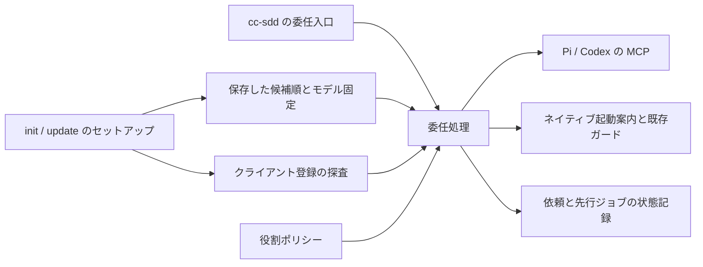
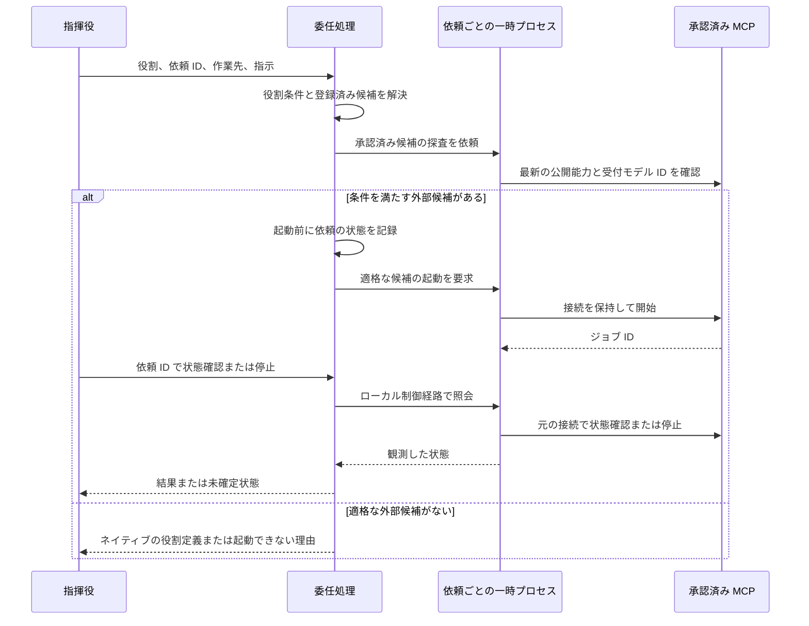

# Design Document: codex-delegation

## Overview

cc-sdd-bootstrap の導入・更新で登録済みのエージェント型 MCP を探査し、利用する候補と段内の優先順を保存する。cc-sdd の委任時には管理された委任処理が役割条件を解決し、公開されているモデルと機能を照合してから起動する。外部の起動や状態確認は接続先固有の処理に任せ、候補選択と失敗時の規則を共通化する。

### Goals

- 設定済みの候補に対し、ローカル MCP、異系統のクラウド MCP、ネイティブの順を機械的に適用する。
- 登録の変更とモデル一覧の変更を区別し、明示設定を保存したまま自動選択を更新する。
- 書き込みを伴う依頼では、開始結果が不明なときに別の委任先を起動しない。

### Non-Goals

- エージェント本体、モデル、認証の導入や管理。
- cc-sdd 本体のスキルの改変、MCP のモデル提供先への直接照会。
- 未検証のハーネスに対する設定ファイル形式やネイティブ機能の推測。

## Boundary Commitments

### This Spec Owns

- 登録済み MCP の探査、選択した登録の識別と段内の順序、モデルの明示固定。
- Claude Code 向けの管理対象 Codex MCP の登録内容と所有判定。
- 委任ごとの候補確認と選択、cc-sdd 作業中のエージェント MCP 直接起動の拒否、開始・状態・停止の接続契約、切り替えの判断。
- 確認済みの Pi MCP と Codex MCP の変換、Codex MCP が公開する受付モデルと権限の契約。

### Out of Boundary

- 役割 ID、権限・推論量の既定値、ネイティブ定義・起動拒否は subagent-model-policy が扱う。
- インストーラの実行入口、所有する生成物の配置記録と変更適用は installer-core が扱う。
- 利用者の MCP 登録や、ホスト側の信頼・承認・認証の変更。

### Allowed Dependencies

- installer-core の導入・更新時の設定解決と既存の配置処理。
- subagent-model-policy の `RoleId`、`RolePolicy`、`resolveRole`、`resolveNative`、cc-sdd 作業範囲とネイティブ起動の事前確認契約。
- Node.js 22 以上の標準機能、対象クライアントの登録情報、MCP の初期化・ツール一覧・呼び出し、Codex CLI のモデルカタログと実行。配置物からインストーラ本体を読み込まない。

### Revalidation Triggers

- 役割 ID や推論量・権限の契約を変更したときは全候補の適格判定を再検証する。
- MCP が公開する名前・プロトコル・スキーマ・接続寿命を変更したときは探査、起動前後の分類、停止を再検証する。
- ホストの登録の優先順位・信頼判定・ネイティブ起動の入口を変更したときは再設定、委任直前の確認、同系統除外を再検証する。

## Architecture

### Existing Architecture Analysis

installer-core は `init` / `update` で設定を解決してから変更計画を適用する。委任設定は同じ適用に含める。既存の `codex.enabled` は Claude Code 向けの Codex MCP の利用選択として残す。クライアントの導入対象と段内の候補順位は個別に設定する。現在の Pi MCP は必要な操作を公開するが、現行の skyshare 版 Codex MCP は `codex_exec` の一括実行が中心である。Codex 側は実行・権限検査の既存処理を再利用し、モデルと状態の契約を追加する。

### Architecture Pattern & Boundary Map



設定の検証と候補選択は外部 I/O から分ける。依存は設定・役割の契約 → 選択 → 登録の解決と MCP・状態への入出力 → 呼び出し入口とする。MCP の接続は、ホストが公開する登録・承認情報に基づく。最初の接続経路は、ホストが承認済みとして解決した stdio 登録。ローカル Pi とクラウド型 Codex MCP はこの経路で接続できる。ホストが取得済みの認証を必要とする登録は、その認証を保持した正規の呼び出しを行える接続が用意されている場合に使う。

### Technology Stack

| 領域 | 採用する形式 |
|---|---|
| 設定・選択・起動状態 | Node.js 22、ESM、JSDoc、既存の設定形式 1 |
| 登録と能力探査 | クライアントの有効な登録情報と MCP JSON-RPC |
| 確認済みの実行経路 | Pi MCP の stdio と、Codex CLI を呼ぶ登録済み Codex MCP |
| ネイティブ | 上流仕様で承認したクライアント別定義と起動ガード |

## File Structure Plan

| 道筋 | 責任 |
|---|---|
| `lib/delegation-setup.mjs`、`lib/cli.mjs` | 導入・更新の設定解決に候補の探査、選択、並べ替えを接続する |
| `lib/delegation-registration.mjs` | 管理対象の Codex MCP 登録を生成し、既存のプロジェクト設定に対する変更を計算する |
| `lib/plan.mjs`、`lib/target.mjs`、`lib/ledger.mjs` | 管理対象の登録を既存の変更計画と配置記録に組み込む |
| `.agent-hooks/cc-sdd-bootstrap/delegation-config.mjs` | 委任設定を検証し、旧利用設定との優先関係を定義する |
| `.agent-hooks/cc-sdd-bootstrap/delegation-registry.mjs` | クライアントから有効な登録・承認・接続情報を取得し、保存した識別子を解決する |
| `.agent-hooks/cc-sdd-bootstrap/delegation-select.mjs` | 段の順、役割条件、候補内のモデル選択を適用する |
| `.agent-hooks/cc-sdd-bootstrap/delegation-mcp.mjs` | MCP の接続、Pi・Codex の公開契約の変換を扱う |
| `.agent-hooks/cc-sdd-bootstrap/delegate.mjs` | 委任要求の管理入口、ネイティブの事前確認記録の発行、状態確認・停止要求の配送 |
| `.agent-hooks/cc-sdd-bootstrap/delegation-job-worker.mjs` | 依頼ごとに元の MCP 接続を保持し、起動・状態取得・停止を直列化する一時プロセス |
| `.agent-hooks/cc-sdd-bootstrap/delegation-job-store.mjs` | 依頼 ID・作業の識別子・所有プロセス・未確定状態の記録 |
| `.agent-hooks/cc-sdd-bootstrap/delegation-mcp-gate.mjs` | cc-sdd 作業中のエージェント MCP の直接起動を拒否するホストフック |
| `.agent-hooks/cc-sdd-bootstrap/codex-agent-mcp.mjs` | 選択時に利用する Codex MCP のモデル・起動・状態・停止と CLI 実行 |
| `lib/catalog.mjs`、`package.json` | 配置物、管理区画の委任手順、配布の登録 |
| `test/delegation-registration.test.mjs`、`test/delegation-job-worker.test.mjs`、`test/delegation-mcp-gate.test.mjs` | 登録統合、プロセスをまたぐジョブ制御、直接起動拒否 |
| `test/delegation-setup.test.mjs`、`test/delegation-select.test.mjs`、`test/delegation-mcp.test.mjs`、`test/delegate.test.mjs` | 設定・優先順・能力判定と異常時の試験 |
| `test/codex-agent-mcp.test.mjs`、`test/cli.e2e.test.mjs` | Codex MCP の公開契約と実行制限、導入から委任までの通し試験 |

## System Flows



管理区画は、cc-sdd の作業を登録し、サブエージェント段階では管理入口に依頼 ID と役割を渡す手順を記載する。管理作業中、ホスト上の既知のエージェント MCP の起動ツールは `PreToolUse` で直接呼び出しを拒否する。対象は確認済みのアダプターが公開するエージェント起動操作で、登録名・スコープと操作名を照合する。モデル一覧・状態確認や通常の非エージェント MCP 操作は対象にしない。対象ホストで直接起動を検出・拒否できる経路を検証してから管理委任を有効化する。内部のツール呼び出しがフックに現れない合成ツールや実行モードは、そのまま管理された委任経路に接続しない。通常作業には適用しない。

管理入口は上流の呼び出し参照を消費して確定したホスト・セッション・ターンを使う。MCP 起動は、登録・役割・優先順を検査した一時プロセスが行う。入口がネイティブを選んだ場合だけ、上流の契約で一回限りの事前確認記録を発行する。指揮役は返された役割名と検証済みの引数で起動する。上流フックが記録を原子的に消費し、起動条件を再検査する。入口を通らない組み込みの起動も作業中は拒否する。

## Requirements Traceability

| ID | 設計要素 |
|---|---|
| 1.1 | 導入・更新に組み込む設定手順 |
| 1.2 | Registry のクライアント別探査 |
| 1.3 | 登録の表示と能力契約 |
| 1.4 | 検証不能・単純応答型の除外 |
| 1.5 | 段別の順序を設定に保存 |
| 1.6 | 利用者が設定した候補だけを起動 |
| 1.7 | 現行設定との統合と未変更時の保持 |
| 2.1 | Runner の委任直前の再照会 |
| 2.2 | MCP の公開モデル一覧 |
| 2.3 | Selection の候補内自動選択 |
| 2.4 | 明示モデル指定の保持と候補除外 |
| 2.5 | 役割のローカルモデル条件との照合 |
| 3.1 | 固定の段順とネイティブへの移行 |
| 3.2 | 段内の保存順 |
| 3.3 | クライアントと同系統のクラウド除外 |
| 3.4 | Codex MCP の共通能力への変換 |
| 3.5 | 理由つきの利用不可 |
| 4.1 | ローカル MCP の公開能力とモデル一覧 |
| 4.2 | 開始要求とジョブ ID |
| 4.3 | 読み取り専用の権限の確認 |
| 4.4 | 作業先を書き込める権限の指定 |
| 4.5 | 非対応の組み合わせを起動前に拒否 |
| 4.6 | ジョブ状態と停止 |
| 5.1 | 起動前の不成立の処理 |
| 5.2 | 起動結果が不明な場合の照会 |
| 5.3 | 未確定の書き込み依頼の再起動禁止 |

## Components and Interfaces

### Setup と Registry

- Claude Code の登録状態は `claude mcp list` / `mcp get` と有効な登録から取得し、承認待ち、無効化、設定元を照合する。Codex は `codex mcp list --json` を使い、対象のプロジェクト設定が信頼済みかを確認する。Pi は `pi mcp list --json` の有効なファイル登録を使う。その他のホストは有効な登録と信頼状態を取得できる接続を組み込んだ場合に対応する。現在のハーネスの系統は呼び出し元の確認済みの識別値で決める。ホストごとの管理区画はそのホストの識別値で入口を呼ぶ。Pi・Muse のようなほかの呼び出し元を Claude Code とみなさない。
- Registry は登録名、設定元、ホストが認可した状態、接続種別、登録先の識別値を返す。接続する場合は同じ登録元から実行ファイル・引数・環境参照を読み直し、ホストの承認と識別値を再照合する。stdio の起動はシェルを介さず行う。コマンドや環境変数の値は診断に出さない。
- 設定では、既にホストが利用を許した登録について能力を調べ、表示名・系統・段・利用可否を表示する。設定ファイルには選択した識別子と段内の順序を保存する。登録の実行コマンド、認証情報、モデル一覧の複製は保存しない。
- 既存の `codex.enabled` と `--codex` はそのまま保持する。Claude Code で旧設定が無効なら管理対象の Codex MCP を自動採用しない。有効で新しい順序が未設定なら、承認済みの管理対象 Codex MCP を従来の候補として引き継ぐ。外部の登録は明示選択された候補として扱う。更新で利用者が選択を変えなければ、欠落中の候補も含め順序を保存する。
- 実行時に同名登録の識別情報が変わった場合は保存済みの登録と同一と扱わず、セットアップをやり直す理由を返す。ホストが認証済み接続を提供できない登録は取得不能とし、認証トークンを別プロセスへ引き出さない。

### 管理対象の Codex MCP を登録する

- 導入対象に Claude Code が含まれ、`codex.enabled=true` の場合は、配置する Codex MCP に対する `.mcp.json` の `mcpServers.cc-sdd-codex` を同じ変更計画で追加する。登録は stdio とし、既存のプロジェクトルート解決のパターンを使う。リポジトリのサブディレクトリから開始しても、管理するサーバーの入口へ解決する。固定のランチャーには利用者の入力、端末固有の絶対パス、認証情報を埋め込まない。
- 既存のルート項目および他の `mcpServers` エントリは値を保持する。対象のキーが存在しない場合に追加し、配置記録に残した管理エントリの正規化済み内容と現在値が一致する場合に限って更新する。同名の利用者登録を発見したら上書きせず、競合するキーを表示する。リンクや壊れた設定を更新時に上書きしない。管理エントリだけを失効・削除し、利用者が編集した値の削除は行わずに理由を表示する。
- 初回セットアップでは変更計画に基づく予定登録と、ホストが現在選べる候補を区別する。登録後は「承認待ち」と承認方法を表示する。ホストから承認済みの有効な登録として取得できた後、未設定のクラウド順では従来の明示的な利用選択 `codex.enabled=true` に基づいて候補へ含める。利用者が保存した順序や空の候補一覧は保持する。同名の別スコープの登録によって管理対象が隠れている場合は、別の登録を自動採用せず状況を示す。
- ホストの承認・拒否はホスト側で管理する。セットアップは `enableAllProjectMcpServers`、個別承認、利用者のグローバル設定を編集しない。登録が承認待ち、破損、無効である間は通常の候補にならない。Claude Code 向けの対象を外す場合や無効化・アンインストール時は、記録で所有を確認できるエントリだけを削除する。

### Selection と RolePolicy

- `resolveRole` の `access`、`effort`、`localModelIds` を使う。ローカルの自動選択は公開順で役割の許容 ID と権限・推論量が一致した最初のモデル。役割のローカルモデル条件が空なら、その役割ではローカルを選ばない。
- クラウドでは、役割に割り当てた互換モデル ID の順序付き一覧と最新の公開一覧を照合する。Codex MCP では `resolveNative(settings, "codex", role, options)` のモデルを初期候補として優先する。セットアップで同じ役割に追加の適格 ID を選べるようにし、優先モデルが公開一覧から消えたら次の適格 ID を使う。互換性を確認済みの候補が一つもなければ次のサーバーへ進む。現在のクライアントが Codex 系統であれば、この照合より前にクラウド側の Codex を除外する。
- 保存済みの固定モデルは公開済みで役割の条件に適合するときに使う。固定指定が消えた場合は当該候補を外し、保存値は保持する。ローカルの固定モデルも役割のローカル条件で確認する。
- ネイティブ判定では Claude Code と Codex の役割契約を再利用する。ほかのハーネスでは、対応するネイティブ定義と検証可能な起動経路が得られるときにネイティブを返す。いずれも得られない場合は、候補を選べなかった理由を返す。

### 依頼ごとの接続所有と制御

- 委任入口は、依頼ごとに一時プロセスを一つ作る。プロセスが探査から終了まで同じ MCP 接続を所有する。呼び出し元のコマンドが終了した後も、処理中の依頼のためだけに生存する。端末常駐設定は不要。端末またはホストが子プロセスを終了させた場合は、接続喪失として扱う。
- 一時プロセスは、利用者限定の実行時領域に依頼ごとの制御ディレクトリを作る。別プロセスからの制御要求は一時ファイルからの原子的な置換でキューに入れ、所有者が順に受け取り、対応する応答ファイルを返す。専用ソケットを開く権限は不要。状態確認と停止は依頼記録から所有者へ配送し、所有者だけが元の接続の `pi_status` / `pi_cancel` を呼ぶ。制御要求と応答は依頼・所有者・世代を照合する。発行した PID やジョブ ID だけを元の接続へ到達できる証拠にしない。
- 接続を所有しているプロセスが起動、照会、停止の順序を管理する。各照会には時間上限を設け、停止要求を次の処理機会に取り出す。端末との通信の失敗で二度目の起動を送らない。所有者が先行ジョブの終了を確認したら終端状態を記録し、制御要求の受け付けを終了してプロセスを閉じる。後続の状態要求は、終了を確認済みの記録から応答できる。
- 起動要求の送信前に書き込み作業を排他登録する。同じ作業の再送は cc-sdd の作業ツリーと手順・タスクの安定した識別子で元の記録に結び付ける。呼び出し側の依頼 ID を変えても同じ作業を新しく起動しない。先行の未確定作業と区別できない書き込みは、状態を確認できるまで保留する。
- 所有者または接続を失った場合、到達不能を停止の証拠とは扱わない。利用者に対象と確認方法を返し、元の実行が終了したことを確認するまでは同じ書き込み作業を再委任しない。確認のために別の MCP を起動して同一ジョブ ID を送らない。

### MCP と Runner

```typescript
type Tier = "local" | "cloud";
type Access = "read-only" | "workspace-write";
type Effort = "off" | "medium" | "high";
type Capability = {
  harness: string;
  tier: Tier;
  models: readonly { id: string; accepted: readonly { access: Access; effort: Effort }[] }[];
};
type DelegateRequest = {
  requestId: string; host: string; role: RoleId; cwd: string;
  instruction: string; readOnly?: boolean;
};
type DelegateResult =
  | { kind: "completed"; result: string }
  | { kind: "native"; agentName: string; reason: string }
  | { kind: "unavailable"; reasons: readonly string[] }
  | { kind: "pending"; requestId: string; reason: string };
type Job = { serverId: string; connectionId: string; jobId: string };
type JobState = "running" | "succeeded" | "failed" | "stopped" | "unknown";
type StartResult =
  | { kind: "started"; job: Job }
  | { kind: "not-started"; reason: string }
  | { kind: "unknown"; reason: string; job?: Job };
```

管理入口は起動と、既存の依頼 ID に対する状態確認・停止を受け付け、機械可読の結果を返す。既存依頼への状態確認・停止は同じ作業ツリーと依頼の所有者に限り、開始ターンが終わっていても受け付ける。この操作から新しいジョブは起動しない。入口で役割と作業先を検査し、指示本文をログへ書かない。状態記録を安全に更新できない書き込み依頼は起動しない。

| 操作 | Pi MCP | Codex MCP |
|---|---|---|
| 能力・受付モデル | `pi_capabilities` と `pi_models`。既設サーバーの JSON テキスト形式の能力も正規化する | サーバーの能力と受付モデル一覧を公開する。Codex の実行で受け付けるモデル・推論量の範囲に絞る |
| 起動 | `pi_start` に作業先、指示、モデル、権限、推論量を渡し、ジョブ識別子を得る | 検査済みの作業先と明示されたモデル・推論量・権限で Codex CLI を起動し、識別子を返す |
| 状態・停止 | 同じ接続で `pi_status` / `pi_cancel` | ジョブ識別子から CLI の状態を返し、停止が確認できたときに停止済みとする |

- 能力を示す名前や説明の文字列だけでは採用しない。確認済みの接続・プロトコルで、対応する起動・状態・停止のスキーマを検査する。ローカル／クラウド区分は公開された実行形態で判断し、stdio をローカル型の根拠にしない。
- Pi の権限と推論量を正規化して役割条件に照合する。両方が候補モデルに適用できることを確認できないときは候補を外す。Pi の現行構成が公開する `off` は、上流の `medium` / `high` の代わりに使わない。
- Codex 側は、CLI のモデルカタログを MCP 自身が利用して、公開リストに受け付けるモデル ID と推論量を載せる。カタログは請求上の利用可否や実際の認証成功を保証しない。MCP 呼び出し側はカタログの取得先を再照会しない。接続先を利用できる環境では、選択した権限を Codex CLI のサンドボックス指定と権限を昇格しない実行設定に反映する。非対応の入力、作業先が許可範囲外、CLI 起動前に判明した実行不可は `not-started` として返す。
- 読み取り専用を選んだ Pi MCP はプロセス側の権限強制を公開契約として満たす。製造では指定先での編集・試験を許す。サーバーは指定された組み合わせが不適合なら理由を返し、既定モデルへの置き換えをしない。

## Data Models

- `.cc-sdd-bootstrap.json` に `delegation` を追加し、ホストごとの `local` と `cloud` の順序付き候補を保存する。候補は、ホストの登録を識別する値（系統・スコープ・登録名・登録先識別子）と、役割ごとの固定モデルまたは自動選択用の互換モデル ID 一覧を持てる。固定モデルと自動選択の設定は同じ候補・役割で併用しない。未設定と空配列を区別し、旧設定の補完を未設定のときだけ適用する。
- 未承認の登録は実行用設定へ書かない。スキーマ不正・重複した候補は、既存の設定適用前に理由を表示する。候補が一時的に無効化されたことを理由に設定から削除しない。
- ジョブの状態と制御ディレクトリは利用者限定の実行時領域に置き、対象エージェントの書き込み許可の外に置く。実行入口がこの領域に書けない場合や、実行先への書き込み制限を証明できない場合は、書き込み依頼を開始しない。記録は作業ツリー、依頼 ID、再送判定用の作業識別子、接続所有者と世代、対象登録、起動段階、ジョブ ID、権限と終端確認状態を含む。指示本文・認証情報・モデル一覧を記録しない。同じ作業の再送は排他登録と原子的な更新で元の記録を保つ。

## Error Handling

| 状態 | 取り扱い |
|---|---|
| 起動前に候補が無効、能力を取得できない、実行前に拒否された | 構成と役割を変更せず、保存順の次候補へ進む |
| 起動要求送信後に応答が途切れた | 既知のジョブを同じ接続で照会する。接続に結び付いた Pi のジョブは別接続の別ジョブとして扱わない |
| 書き込みジョブの終了・停止を確認できない | 同じ作業の別起動を保留し、対象・確認方法を通知する |
| 先行ジョブの終了・停止が確認できた | 終了結果または停止結果を返す。書き込みが残り得る場合はその状態を確認した依頼として扱う |
| MCP がすべて不適格で、ネイティブも利用不可 | 起動せず、確認できた理由を返す |

MCP の通信エラーや汎用の `isError` だけを起動前の拒否とみなさない。接続を維持している間は同じ接続で状態を照会する。Pi の接続を失った場合のジョブ ID は別接続で復元できないことがあるため、終了を確認できるまで書き込みの再委任を保留する。切り替え前に停止・終了の確認と実際のファイル変更の扱いを分ける。

## Testing Strategy

- **設定・導入** — 旧 `codex.enabled` の保持、両段の並べ替え、空と未設定、未承認・登録差し替え、非対話更新での保持を一時プロジェクトで確認する（1.1–1.7）。管理対象が存在しない初回の有効化から承認後の検出、同名競合、無効化・アンインストールまでを追加で確認する。
- **選択** — 公開モデルの入れ替え、固定モデルの消失、`off` の除外、同系統クラウド除外、複数候補の順序、ネイティブ・利用不可への移行を検証する（2.1–3.5）。
- **MCP 契約** — 一覧・対応権限・推論量、読み取り専用の強制、書き込み先、停止、組み合わせ不適合を Pi と Codex の一時依頼で確認する（4.1–4.6）。
- **起動経路** — 通常作業、cc-sdd の明示起動、自然文からの手順利用、管理入口を飛ばしたエージェント MCP と組み込みネイティブ、ネイティブ事前確認の再使用を実機のフックで比較する（2.1、3.1、3.5）。
- **障害時** — 入口を呼んだプロセス以外から元の接続へ状態照会・停止が届くこと、応答欠落・接続断・所有者消失・部分書き込みでは未確定の書き込みが別起動されないことを確認する。同じ作業に異なる依頼 ID を付けた再送も含む（4.6、5.1–5.3）。

## Supporting References

- [調査と実機で得た能力情報](research.md)
- [上流の役割・ネイティブ定義](../subagent-model-policy/design.md)
- [MCP のトランスポート](https://modelcontextprotocol.io/specification/2025-11-25/basic/transports)
- [MCP のツール契約](https://modelcontextprotocol.io/specification/2025-11-25/server/tools)
