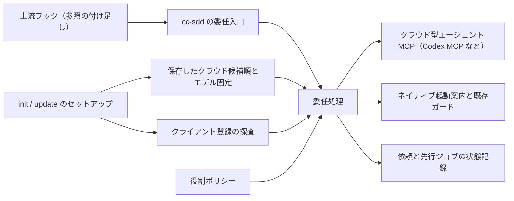
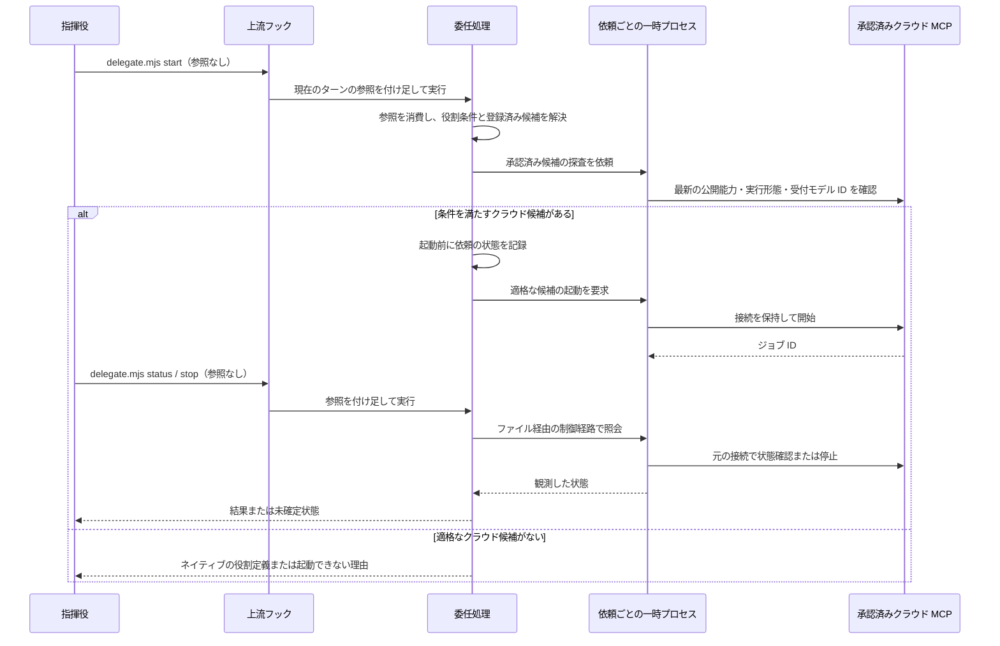

# Design Document: codex-delegation

## Overview

cc-sdd-bootstrap の導入・更新で登録済みのエージェント型 MCP を探査し、利用するクラウド型の候補と優先順を保存する。cc-sdd の委任時には管理された委任処理が役割条件を解決し、公開されているモデルと機能を照合してから起動する。外部の起動や状態確認は接続先固有の処理（アダプター。MCP ごとの公開操作を共通の形に写す部品）に任せ、候補選択と失敗時の規則を共通化する。

> 改訂（2026-11-22）: ローカル型のエージェント MCP（Pi など）を委任先から外し、優先順を「異系統のクラウド MCP → ネイティブ」の 2 段にした。Pi 用アダプター・Pi の登録の読み取り・Pi を使う実機検証を設計から外し、実機で見つかった G1・G3 の解決方針を加えた。理由と影響は `research.md` の「ローカル除外の決定」と本書末尾の「変更の影響」に書く。

### Goals

- 設定済みの候補に対し、異系統のクラウド MCP、ネイティブの順を機械的に適用する。
- 登録の変更とモデル一覧の変更を区別し、明示設定を保存したまま自動選択を更新する。
- 書き込みを伴う依頼では、開始結果が不明なときに別の委任先を起動しない。
- 管理入口（`delegate.mjs`）を、モデルに一回限りの参照を見せずに実機で通せるようにする（G1）。ネイティブだけの構成でも事前確認を使えるようにする（G3）。

### Non-Goals

- エージェント本体、モデル、認証の導入や管理。
- cc-sdd 本体のスキルの改変、MCP のモデル提供先への直接照会。
- 未検証のハーネスに対する設定ファイル形式やネイティブ機能の推測。
- ローカル実行のエージェント MCP（Pi など）への委任と、そのための能力の正規化・登録の読み取り。

## Boundary Commitments

### This Spec Owns

- 登録済み MCP の探査、選択した登録の識別とクラウド段内の順序、モデルの明示固定。
- Claude Code 向けの管理対象 Codex MCP の登録内容と所有判定。
- 委任ごとの候補確認と選択、cc-sdd 作業中のエージェント MCP 直接起動の拒否、開始・状態・停止の接続契約、切り替えの判断。
- 確認済みの Codex MCP の変換、Codex MCP が公開する受付モデル・権限・実行形態の契約。
- 「実際に有効な外部候補がある」かの判定規則（G3。上流の単独の事前確認が参照する）。

### Out of Boundary

- 役割 ID、権限・推論量の既定値、ネイティブ定義・起動拒否は subagent-model-policy が扱う。上流の `RolePolicy.localModelIds` と設定の `subagents.localModels` は上流に残るが、本仕様は使わない。
- インストーラの実行入口、所有する生成物の配置記録と変更適用は installer-core が扱う。
- 利用者の MCP 登録や、ホスト側の信頼・承認・認証の変更。
- ローカル型と確認できる MCP の利用（候補から外すだけで、登録には触れない）。

### Allowed Dependencies

- installer-core の導入・更新時の設定解決と既存の配置処理。
- subagent-model-policy の `RoleId`、`RolePolicy`（`access`・`effort` のみ使う）、`resolveRole`、`resolveNative`、cc-sdd 作業範囲とネイティブ起動の事前確認契約、管理入口の参照の発行と消費（上流フックによる Bash 呼び出しの書き換え）。
- Node.js 22 以上の標準機能、対象クライアントの登録情報、MCP の初期化・ツール一覧・呼び出し、Codex CLI のモデルカタログと実行。配置物からインストーラ本体を読み込まない。

### Revalidation Triggers

- 役割 ID や推論量・権限の契約を変更したときは全候補の適格判定を再検証する。
- MCP が公開する名前・プロトコル・スキーマ・実行形態・接続寿命を変更したときは探査、起動前後の分類、停止を再検証する。
- ホストの登録の優先順位・信頼判定・ネイティブ起動の入口、フックによる入力の書き換えの可否を変更したときは再設定、委任直前の確認、同系統除外、管理入口の参照付与を再検証する。
- 将来ローカル型を再導入する場合は、要件 1・3・4 と上流の `localModelIds` の使い方を合わせて再検討する。

## Architecture

### Existing Architecture Analysis

installer-core は `init` / `update` で設定を解決してから変更計画を適用する。委任設定は同じ適用に含める。既存の `codex.enabled` は Claude Code 向けの Codex MCP の利用選択として残す。クライアントの導入対象とクラウド段内の候補順位は個別に設定する。現行の skyshare 版 Codex MCP は `codex_exec` の一括実行が中心である。Codex 側は実行・権限検査の既存処理を再利用し、モデル・実行形態・状態の契約を追加する。

### Architecture Pattern & Boundary Map



設定の検証と候補選択は外部 I/O から分ける。依存は設定・役割の契約 → 選択 → 登録の解決と MCP・状態への入出力 → 呼び出し入口とする。MCP の接続は、ホストが公開する登録・承認情報に基づく。最初の接続経路は、ホストが承認済みとして解決した stdio 登録（標準入出力でつなぐ形の登録）。クラウド型の Codex MCP はこの経路で接続できる。接続方式は実行形態の根拠にしない（stdio でもクラウド型のことがあり、stdio だからといってクラウド型とも言えない）。ホストが取得済みの認証を必要とする登録は、その認証を保持した正規の呼び出しを行える接続が用意されている場合に使う。

### Technology Stack

| 領域 | 採用する形式 |
|---|---|
| 設定・選択・起動状態 | Node.js 22、ESM、JSDoc、既存の設定形式 1 |
| 登録と能力探査 | クライアントの有効な登録情報と MCP JSON-RPC |
| 確認済みの実行経路 | Codex CLI を呼ぶ登録済み Codex MCP（stdio） |
| ネイティブ | 上流仕様で承認したクライアント別定義と起動ガード |

## File Structure Plan

| 道筋 | 責任 |
|---|---|
| `lib/delegation-setup.mjs`、`lib/cli.mjs` | 導入・更新の設定解決に候補の探査、選択、並べ替えを接続する（クラウド段のみ） |
| `lib/delegation-registration.mjs` | 管理対象の Codex MCP 登録を生成し、既存のプロジェクト設定に対する変更を計算する |
| `lib/plan.mjs`、`lib/target.mjs`、`lib/ledger.mjs` | 管理対象の登録を既存の変更計画と配置記録に組み込む |
| `.agent-hooks/cc-sdd-bootstrap/config-schema.mjs`（委任設定の検証） | 委任設定を検証し、旧利用設定との優先関係と、廃止した `local` の拒否を定義する |
| `.agent-hooks/cc-sdd-bootstrap/delegation-registry.mjs` | クライアント（Claude Code・Codex）から有効な登録・承認・接続情報を取得し、保存した識別子を解決する |
| `.agent-hooks/cc-sdd-bootstrap/delegation-select.mjs` | 段の順、実行形態、役割条件、候補内のモデル選択を適用する |
| `.agent-hooks/cc-sdd-bootstrap/delegation-mcp.mjs` | MCP の接続、Codex の公開契約の変換を扱う |
| `.agent-hooks/cc-sdd-bootstrap/delegate.mjs` | 委任要求の管理入口、ネイティブの事前確認記録の発行、状態確認・停止要求の配送 |
| `.agent-hooks/cc-sdd-bootstrap/delegation-job-worker.mjs` | 依頼ごとに元の MCP 接続を保持し、起動・状態取得・停止を直列化する一時プロセス |
| `.agent-hooks/cc-sdd-bootstrap/delegation-job-store.mjs` | 依頼 ID・作業の識別子・所有プロセス・未確定状態の記録 |
| `.agent-hooks/cc-sdd-bootstrap/delegation-mcp-gate.mjs` | cc-sdd 作業中のエージェント MCP の直接起動を拒否するホストフック |
| `.agent-hooks/cc-sdd-bootstrap/codex-agent-mcp.mjs` | 選択時に利用する Codex MCP のモデル・実行形態・起動・状態・停止と CLI 実行 |
| 上流の `subagent-model-policy-hook.mjs`・`kiro-delegation-context.mjs`（拡張） | G1: `delegate.mjs` の呼び出しへの参照の付け足し。G3: 単独の事前確認での外部候補の判定 |
| `lib/catalog.mjs`、`package.json` | 配置物、管理区画の委任手順、配布の登録 |
| `test/delegation-registration.test.mjs`、`test/delegation-job-worker.test.mjs`、`test/delegation-mcp-gate.test.mjs` | 登録統合、プロセスをまたぐジョブ制御、直接起動拒否 |
| `test/delegation-setup.test.mjs`、`test/delegation-select.test.mjs`、`test/delegation-mcp.test.mjs`、`test/delegate.test.mjs` | 設定・優先順・能力判定と異常時の試験 |
| `test/codex-agent-mcp.test.mjs`、`test/cli.e2e.test.mjs` | Codex MCP の公開契約と実行制限、導入から委任までの通し試験 |

## System Flows



管理区画は、cc-sdd の作業を登録し、サブエージェント段階では管理入口に依頼 ID と役割を渡す手順を記載する。参照（`--reference`）は案内しない。管理作業中、ホスト上の既知のエージェント MCP の起動ツールは `PreToolUse` で直接呼び出しを拒否する。対象は確認済みのアダプターが公開するエージェント起動操作（現在は Codex MCP の `codex_start`）で、登録名・スコープと操作名を照合する。モデル一覧・状態確認や通常の非エージェント MCP 操作は対象にしない。対象ホストで直接起動を検出・拒否できる経路と、管理入口への参照の付け足しが動くことを検証してから管理委任を有効化する。内部のツール呼び出しがフックに現れない合成ツールや実行モードは、そのまま管理された委任経路に接続しない。通常作業には適用しない。

管理入口は上流の呼び出し参照を消費して確定したホスト・セッション・ターンを使う。MCP 起動は、登録・役割・優先順を検査した一時プロセスが行う。入口がネイティブを選んだ場合だけ、上流の契約で一回限りの事前確認記録を発行する。指揮役は返された役割名と検証済みの引数で起動する。上流フックが記録を原子的に消費し、起動条件を再検査する。入口を通らない組み込みの起動も作業中は拒否する。

### 管理入口への参照の受け渡し（G1）

- 方針: 研究メモの案 B を採る。指揮役は `node .agent-hooks/cc-sdd-bootstrap/delegate.mjs start|status|stop …` を参照なしで Bash から呼ぶ。上流の `PreToolUse` フックが、`enter` と同じ方法で現在のターンに結び付けた参照を発行し、命令の末尾に `--reference <参照>` を付け足した入力に書き換える（Claude Code では `updatedInput`）。参照はモデルの文脈と出力に現れない。
- 書き換える対象は、管理する `delegate.mjs` への決まった形の呼び出しだけとする。命令の連結・リダイレクト・別名など決まった形から外れる呼び出しは書き換えず、拒否して決まった形を案内する。モデルが自分で `--reference` を書いた呼び出しは拒否する（偽装の防止）。
- `delegate.mjs` は今と同じく `--reference` を必須とし、無い・消費済み・ターン不一致なら起動せずに理由を返す（フックが働かなかった場合の安全側）。状態確認・停止は、開始ターンの終了後でも、新しいターンの参照と依頼記録（作業ツリー・依頼の所有者）の照合で受け付ける。
- 要確認（Research Needed）: Codex の `PreToolUse` フックが Bash の入力を書き換えられるか。上流フックは Codex にも書き換えの応答を返す実装があるが、実機で効くかは未確認（利用上限のため）。確認できるまで Codex を指揮役とする管理委任は有効化しない。書き換えが効かないと分かった場合は、案 C（フックが書いた作業コンテキストのファイルから入口が解決する）などを改めて設計判断にかける。

### ネイティブだけの構成での事前確認（G3）

- 方針: 上流の単独の事前確認が「外部委任の配置あり」として拒否する条件を、導入台帳に `delegate.mjs` が載っていることから、現在の指揮役ホストに**実際に有効な外部候補**があることへ改める。
- 「実際に有効な外部候補がある」とは、`.cc-sdd-bootstrap.json` の `delegation[<現在のホスト>].cloud` に保存された候補（未設定なら `codex.enabled=true` から引き継ぐ管理対象 Codex MCP）のうち、現在のホストと同じ系統を除いたものが 1 つ以上あることとする。判定は設定の静的な内容だけで行い、フックの中でホストの CLI を呼んで承認状態を確かめることはしない。
- 有効な外部候補がある構成では、従来どおり単独発行を拒否し、管理入口を使うよう案内する（管理入口は外部候補が全部使えなければネイティブの事前確認を発行する）。外部候補がない構成では、`delegate.mjs` が配置されていても単独発行を許す。
- 判定の規則は本仕様が定め、上流の単独発行の検査がその規則で判定するよう上流の部品を拡張する。上流から本仕様の配置物を読み込む向きの依存にしないため、規則は上流側に保存形式を読む小さな関数として置くか、上流の契約に判定の差し込み口を足す。どちらにするか、上流仕様の改訂で扱うかは要確認とする。

## Requirements Traceability

| ID | 設計要素 |
|---|---|
| 1.1 | 導入・更新に組み込む設定手順 |
| 1.2 | Registry のクライアント別探査（Claude Code・Codex） |
| 1.3 | 登録の表示（識別名・系統・クラウド型）と能力契約 |
| 1.4 | 検証不能・単純応答型・クラウド型と確認できないもの（ローカル型を含む）の除外 |
| 1.5 | クラウド段の順序を設定に保存 |
| 1.6 | 利用者が設定した候補だけを起動 |
| 1.7 | 現行設定との統合と未変更時の保持 |
| 2.1 | Runner の委任直前の再照会、管理入口への参照の付け足し（G1） |
| 2.2 | MCP の公開モデル一覧 |
| 2.3 | Selection の候補内自動選択 |
| 2.4 | 明示モデル指定の保持と候補除外 |
| 3.1 | 固定の 2 段の順（クラウド → ネイティブ）とネイティブへの移行、ネイティブ単独の事前確認（G3） |
| 3.2 | クラウド段内の保存順 |
| 3.3 | クライアントと同系統のクラウド除外 |
| 3.4 | Codex MCP の共通能力への変換 |
| 3.5 | 理由つきの利用不可 |
| 4.1 | 対応エージェント MCP の公開能力（実行形態を含む）とモデル一覧 |
| 4.2 | 開始要求とジョブ ID |
| 4.3 | 読み取り専用の権限の強制 |
| 4.4 | 作業先を書き込める権限の指定 |
| 4.5 | 非対応の組み合わせを起動前に拒否 |
| 4.6 | ジョブ状態と停止 |
| 5.1 | 起動前の不成立の処理 |
| 5.2 | 起動結果が不明な場合の照会 |
| 5.3 | 未確定の書き込み依頼の再起動禁止 |

## Components and Interfaces

### Setup と Registry

- Claude Code の登録状態は `claude mcp list` / `mcp get` と有効な登録から取得し、承認待ち、無効化、設定元を照合する。Codex は `codex mcp list --json` を使い、対象のプロジェクト設定が信頼済みかを確認する。その他のホストは有効な登録と信頼状態を取得できる接続を組み込んだ場合に対応し、それまでは登録を列挙せず「未対応のホスト」と理由を返す。
- 現在のハーネスの系統は呼び出し元の確認済みの識別値で決める。ホストごとの管理区画はそのホストの識別値で入口を呼ぶ。Pi・Muse のようなほかの呼び出し元を Claude Code や Codex とみなさない。ほかのクライアントが指揮役の場合、そのクライアントの登録の読み取りとネイティブの起動経路が確認されるまでは、候補を選べなかった理由を返す。
- Registry は登録名、設定元、ホストが認可した状態、接続種別、登録先の識別値を返す。接続する場合は同じ登録元から実行ファイル・引数・環境参照を読み直し、ホストの承認と識別値を再照合する。stdio の起動はシェルを介さず行う。コマンドや環境変数の値は診断に出さない。
- 設定では、既にホストが利用を許した登録について能力を調べ、表示名・系統・実行形態・利用可否を表示する。ローカル型と確認できた登録は「対象外（ローカル型）」、実行形態を確認できない登録は「対象外（実行形態を確認できません）」と示し、選べないようにする。設定ファイルには選択した識別子とクラウド段内の順序を保存する。登録の実行コマンド、認証情報、モデル一覧の複製は保存しない。
- 既存の `codex.enabled` と `--codex` はそのまま保持する。Claude Code で旧設定が無効なら管理対象の Codex MCP を自動採用しない。有効で新しい順序が未設定なら、承認済みの管理対象 Codex MCP を従来の候補として引き継ぐ。外部の登録は明示選択された候補として扱う。更新で利用者が選択を変えなければ、欠落中の候補も含め順序を保存する。
- 実行時に同名登録の識別情報が変わった場合は保存済みの登録と同一と扱わず、セットアップをやり直す理由を返す。ホストが認証済み接続を提供できない登録は取得不能とし、認証トークンを別プロセスへ引き出さない。

### 管理対象の Codex MCP を登録する

- 導入対象に Claude Code が含まれ、`codex.enabled=true` の場合は、配置する Codex MCP に対する `.mcp.json` の `mcpServers.cc-sdd-codex` を同じ変更計画で追加する。登録は stdio とし、既存のプロジェクトルート解決のパターンを使う。リポジトリのサブディレクトリから開始しても、管理するサーバーの入口へ解決する。固定のランチャーには利用者の入力、端末固有の絶対パス、認証情報を埋め込まない。
- 既存のルート項目および他の `mcpServers` エントリは値を保持する。対象のキーが存在しない場合に追加し、配置記録に残した管理エントリの正規化済み内容と現在値が一致する場合に限って更新する。同名の利用者登録を発見したら上書きせず、競合するキーを表示する。リンクや壊れた設定を更新時に上書きしない。管理エントリだけを失効・削除し、利用者が編集した値の削除は行わずに理由を表示する。
- 初回セットアップでは変更計画に基づく予定登録と、ホストが現在選べる候補を区別する。登録後は「承認待ち」と承認方法を表示する。ホストから承認済みの有効な登録として取得できた後、未設定のクラウド順では従来の明示的な利用選択 `codex.enabled=true` に基づいて候補へ含める。利用者が保存した順序や空の候補一覧は保持する。同名の別スコープの登録によって管理対象が隠れている場合は、別の登録を自動採用せず状況を示す。
- ホストの承認・拒否はホスト側で管理する。セットアップは `enableAllProjectMcpServers`、個別承認、利用者のグローバル設定を編集しない。登録が承認待ち、破損、無効である間は通常の候補にならない。Claude Code 向けの対象を外す場合や無効化・アンインストール時は、記録で所有を確認できるエントリだけを削除する。

### Selection と RolePolicy

- `resolveRole` の `access` と `effort` を使う。`localModelIds` は使わない（上流の値はそのまま残る）。
- 能力の実行形態（`tier`）が `cloud` でない候補は、役割条件の照合より前に外す。理由に「クラウド型と確認できません」を残す。
- クラウドでは、役割に割り当てた互換モデル ID の順序付き一覧と最新の公開一覧を照合する。Codex MCP では `resolveNative(settings, "codex", role, options)` のモデルを初期候補として優先する。セットアップで同じ役割に追加の適格 ID を選べるようにし、優先モデルが公開一覧から消えたら次の適格 ID を使う。互換性を確認済みの候補が一つもなければ次のサーバーへ進む。現在のクライアントが Codex 系統であれば、この照合より前にクラウド側の Codex を除外する。
- 保存済みの固定モデルは公開済みで役割の条件に適合するときに使う。固定指定が消えた場合は当該候補を外し、保存値は保持する。
- ネイティブ判定では Claude Code と Codex の役割契約を再利用する。ほかのハーネスでは、対応するネイティブ定義と検証可能な起動経路が得られるときにネイティブを返す。いずれも得られない場合は、候補を選べなかった理由を返す。

### 依頼ごとの接続所有と制御

- 委任入口は、依頼ごとに一時プロセスを一つ作る。プロセスが探査から終了まで同じ MCP 接続を所有する。呼び出し元のコマンドが終了した後も、処理中の依頼のためだけに生存する。端末常駐設定は不要。端末またはホストが子プロセスを終了させた場合は、接続喪失として扱う。
- 一時プロセスは、利用者限定の実行時領域に依頼ごとの制御ディレクトリを作る。別プロセスからの制御要求は一時ファイルからの原子的な置換でキューに入れ、所有者が順に受け取り、対応する応答ファイルを返す。専用ソケットを開く権限は不要。状態確認と停止は依頼記録から所有者へ配送し、所有者だけが元の接続の状態確認・停止の操作を呼ぶ。制御要求と応答は依頼・所有者・世代を照合する。発行した PID やジョブ ID だけを元の接続へ到達できる証拠にしない。
- 接続を所有しているプロセスが起動、照会、停止の順序を管理する。各照会には時間上限を設け、停止要求を次の処理機会に取り出す。端末との通信の失敗で二度目の起動を送らない。所有者が先行ジョブの終了を確認したら終端状態を記録し、制御要求の受け付けを終了してプロセスを閉じる。後続の状態要求は、終了を確認済みの記録から応答できる。
- 起動要求の送信前に書き込み作業を排他登録する。同じ作業の再送は cc-sdd の作業ツリーと手順・タスクの安定した識別子で元の記録に結び付ける。呼び出し側の依頼 ID を変えても同じ作業を新しく起動しない。先行の未確定作業と区別できない書き込みは、状態を確認できるまで保留する。
- 所有者または接続を失った場合、到達不能を停止の証拠とは扱わない。利用者に対象と確認方法を返し、元の実行が終了したことを確認するまでは同じ書き込み作業を再委任しない。確認のために別の MCP を起動して同一ジョブ ID を送らない。
- 一時プロセスは、確認済みのアダプターがない登録（Codex MCP 以外）を接続後に不適格として扱い、既定のアダプターを当てはめない。

### MCP と Runner

```typescript
type Tier = "cloud" | "local"; // 公開された実行形態。値の名前は実装済みの Codex MCP の公開形式（tier）に合わせる
type Access = "read-only" | "workspace-write";
type Effort = "off" | "medium" | "high";
type Capability = {
  harness: string;
  tier: Tier; // "cloud" だけを候補にする。欠落・その他の値は確認できないものとして外す
  models: readonly { id: string; accepted: readonly { access: Access; effort: Effort }[] }[];
};
type DelegateRequest = {
  requestId: string; host: string; role: RoleId; cwd: string;
  instruction: string; readOnly?: boolean;
};
type DelegateResult =
  | { kind: "completed"; result: string }
  | { kind: "native"; agentName: string; reason: string }
  | { kind: "unavailable"; reasons: readonly string[] }
  | { kind: "pending"; requestId: string; reason: string };
type Job = { serverId: string; connectionId: string; jobId: string };
type JobState = "running" | "succeeded" | "failed" | "stopped" | "unknown";
type StartResult =
  | { kind: "started"; job: Job }
  | { kind: "not-started"; reason: string }
  | { kind: "unknown"; reason: string; job?: Job };
```

管理入口は起動と、既存の依頼 ID に対する状態確認・停止を受け付け、機械可読の結果を返す。既存依頼への状態確認・停止は同じ作業ツリーと依頼の所有者に限り、開始ターンが終わっていても受け付ける。この操作から新しいジョブは起動しない。入口で役割と作業先を検査し、指示本文をログへ書かない。状態記録を安全に更新できない書き込み依頼は起動しない。

| 操作 | Codex MCP |
|---|---|
| 能力・受付モデル | サーバーの能力（エージェント型・系統 `codex`・実行形態 `tier: "cloud"`）と受付モデル一覧を公開する。Codex の実行で受け付けるモデル・推論量の範囲に絞る |
| 起動 | 検査済みの作業先と明示されたモデル・推論量・権限で Codex CLI を起動し、識別子を返す |
| 状態・停止 | ジョブ識別子から CLI の状態を返し、停止が確認できたときに停止済みとする |

- 能力を示す名前や説明の文字列だけでは採用しない。確認済みの接続・プロトコルで、対応する起動・状態・停止のスキーマを検査する。実行形態は公開された値で判断し、接続方式（stdio など）を根拠にしない。
- Codex MCP は、モデルの推論を OpenAI のクラウドで行う Codex CLI を起動するため、実行形態 `tier: "cloud"` を公開する（実装済み）。
- Codex 側は、CLI のモデルカタログを MCP 自身が利用して、公開リストに受け付けるモデル ID と推論量を載せる。カタログは請求上の利用可否や実際の認証成功を保証しない。MCP 呼び出し側はカタログの取得先を再照会しない。接続先を利用できる環境では、選択した権限を Codex CLI のサンドボックス指定と権限を昇格しない実行設定に反映する。非対応の入力、作業先が許可範囲外、CLI 起動前に判明した実行不可は `not-started` として返す。
- 読み取り専用では Codex CLI のサンドボックスで作業先への書き込みを禁止し、製造では指定先での編集・試験を許す。サーバーは指定された組み合わせが不適合なら理由を返し、既定モデルへの置き換えをしない。

## Data Models

- `.cc-sdd-bootstrap.json` に `delegation` を追加し、ホストごとに `cloud` の順序付き候補だけを保存する（`delegation[host] = { cloud: [...] }`）。候補は、ホストの登録を識別する値（系統・スコープ・登録名・登録先識別子）と、役割ごとの固定モデルまたは自動選択用の互換モデル ID 一覧を持てる。固定モデルと自動選択の設定は同じ候補・役割で併用しない。未設定と空配列を区別し、旧設定の補完を未設定のときだけ適用する。
- 廃止した `local` キー（実装済みだが未リリース）は移行しない。設定に残っていれば、黙って無視せず、既存の設定適用の前に「`delegation.<host>.local` は廃止しました。ローカル型のエージェントは委任先に使いません。削除してください」と理由を表示して拒否する。CLI の `--delegation-order <host>:local=…` も同じ理由で使い方の誤りとして拒否する。黙って無視しないのは、利用者がローカルに委任されると思い込んだまま進むことを防ぐため。
- 未承認の登録は実行用設定へ書かない。スキーマ不正・重複した候補は、既存の設定適用前に理由を表示する。候補が一時的に無効化されたことを理由に設定から削除しない。
- ジョブの状態と制御ディレクトリは利用者限定の実行時領域に置き、対象エージェントの書き込み許可の外に置く。実行入口がこの領域に書けない場合や、実行先への書き込み制限を証明できない場合は、書き込み依頼を開始しない。記録は作業ツリー、依頼 ID、再送判定用の作業識別子、接続所有者と世代、対象登録、起動段階、ジョブ ID、権限と終端確認状態を含む。指示本文・認証情報・モデル一覧を記録しない。同じ作業の再送は排他登録と原子的な更新で元の記録を保つ。

## Error Handling

| 状態 | 取り扱い |
|---|---|
| 起動前に候補が無効、能力を取得できない、クラウド型と確認できない、実行前に拒否された | 構成と役割を変更せず、保存順の次候補へ進む |
| 起動要求送信後に応答が途切れた | 既知のジョブを同じ接続で照会する。ジョブ ID が接続に結び付くサーバーでは、別接続のジョブとして扱わない |
| 書き込みジョブの終了・停止を確認できない | 同じ作業の別起動を保留し、対象・確認方法を通知する |
| 先行ジョブの終了・停止が確認できた | 終了結果または停止結果を返す。書き込みが残り得る場合はその状態を確認した依頼として扱う |
| MCP がすべて不適格で、ネイティブも利用不可 | 起動せず、確認できた理由を返す |
| 管理入口に参照が無い、または消費済み | 起動せず、決まった形での呼び出しを案内する（G1） |
| 設定に廃止した `local` が残っている | 設定を適用せず、削除を求める理由を表示する |

MCP の通信エラーや汎用の `isError` だけを起動前の拒否とみなさない。接続を維持している間は同じ接続で状態を照会する。接続を失った場合のジョブ ID は別接続で復元できないことがあるため、終了を確認できるまで書き込みの再委任を保留する。切り替え前に停止・終了の確認と実際のファイル変更の扱いを分ける。

## Testing Strategy

- **設定・導入** — 旧 `codex.enabled` の保持、クラウド段の並べ替え、空と未設定、未承認・登録差し替え、非対話更新での保持、廃止した `local` の拒否（設定ファイルと CLI）を一時プロジェクトで確認する（1.1–1.7）。管理対象が存在しない初回の有効化から承認後の検出、同名競合、無効化・アンインストールまでを追加で確認する。
- **選択** — 公開モデルの入れ替え、固定モデルの消失、推論量が合わないモデルの除外、実行形態が `local`・不明の候補の除外、同系統クラウド除外、複数候補の順序、ネイティブ・利用不可への移行を検証する（1.4、2.1–3.5）。
- **MCP 契約** — 一覧・実行形態・対応権限・推論量、読み取り専用の強制、書き込み先、停止、組み合わせ不適合を Codex MCP の一時依頼で確認する（4.1–4.6）。異常系と接続契約の確認には、要件 4 を満たす模擬 MCP（テスト用のサーバー）を使う。
- **起動経路** — 通常作業、cc-sdd の明示起動、自然文からの手順利用、管理入口を飛ばしたエージェント MCP と組み込みネイティブ、ネイティブ事前確認の再使用を実機のフックで比較する（2.1、3.1、3.5）。参照なしの `delegate.mjs` 呼び出しにフックが参照を付け足して通ること、決まった形から外れた呼び出しと自分で書いた参照が拒否されることを確認する（G1）。外部候補のない構成で単独の事前確認が通り、外部候補のある構成では拒否されることを確認する（G3）。
- **障害時** — 入口を呼んだプロセス以外から元の接続へ状態照会・停止が届くこと、応答欠落・接続断・所有者消失・部分書き込みでは未確定の書き込みが別起動されないことを確認する。同じ作業に異なる依頼 ID を付けた再送も含む（4.6、5.1–5.3）。実機の障害再現は模擬 MCP または Codex MCP で行う（Pi は使わない）。

## 変更の影響（2026-11-22 のローカル除外による改訂）

### 要件番号の対応（旧 → 新）

番号は詰めていない。tasks.md が参照する番号は、2.5 を除いてそのまま有効。

| 旧 | 新 | 変更 |
|---|---|---|
| 1.3 | 1.3 | 表示する区分を「ローカル型かクラウド型か」から「クラウド型であること」へ |
| 1.4 | 1.4 | 「ローカル／クラウドの区分を確認できない」を「クラウド型と確認できない（ローカル型を含む）」へ |
| 1.5 | 1.5 | 「ローカル段とクラウド段のそれぞれ」を「クラウド型の候補」へ |
| 2.5 | （削除） | ローカル割り当てを有効にしない、を削除（欠番） |
| 3.1 | 3.1 | 3 段から 2 段（クラウド → ネイティブ）へ |
| 4.1〜4.6 | 4.1〜4.6 | 主語を「対応ローカル MCP」から「対応エージェント MCP」へ。4.1 の「ローカル実行であること」を「実行形態（クラウド型であること）」へ |
| その他 | 同じ | 変更なし |

### 実装済みのコード・テストへの影響

| 対象 | 必要な変更 | 種類 |
|---|---|---|
| `delegation-mcp.mjs` の `createPiAdapter` | 削除。`Capability.tier` は残し、受け付ける値を `cloud` だけにする | 廃止・縮小 |
| `delegation-select.mjs` | ローカル段のループと `localModelIds` の参照を削除。実行形態が `cloud` でない候補を外す判定を追加 | 縮小・変更 |
| `config-schema.mjs`（`validateDelegation`）・`lib/config.mjs` | `local` キーを廃止の理由つきで拒否。`cloud` だけを受け付ける | 変更 |
| `lib/delegation-setup.mjs` | `tier` の判定から `local` を外し、ローカル型・実行形態不明を「対象外」と表示 | 縮小・変更 |
| `lib/cli.mjs` | `--delegation-order` の `local` を理由つきで拒否、「ローカル」の表示と対話入力のローカル段を削除 | 縮小 |
| `delegation-registry.mjs` | `readPi` と `HOSTS` の `pi` を削除。`pi` などは未対応のホストとして理由を返す | 廃止 |
| `delegation-job-worker.mjs` | 既定のアダプターの選び方（Codex 以外は Pi）をやめ、確認済みアダプターがない登録は不適格にする。能力の形の検査で `tier: "local"` を候補にしない | 変更 |
| `delegate.mjs` | 保存済み候補の読み取りから `saved.local` を削除。参照の扱い（必須のまま）と拒否の案内を G1 に合わせる | 縮小・変更 |
| `delegation-mcp-gate.mjs` | `START_OPERATIONS` から `pi_start` を外す（確認済みアダプターの起動操作だけにする） | 縮小 |
| `codex-agent-mcp.mjs` | 変更なし（`tier: "cloud"` を公開済み） | なし |
| `lib/catalog.mjs`（管理区画の文章） | `--reference` を案内せず、参照なしの呼び方を案内する（G1） | 変更 |
| 上流 `subagent-model-policy-hook.mjs` | `delegate.mjs start|status|stop` の決まった形の呼び出しに参照を付け足す書き換えを追加（G1） | 上流の拡張 |
| 上流 `kiro-delegation-context.mjs` | 単独の事前確認の「外部委任の配置」判定を、実際に有効な外部候補の有無に変更（G3） | 上流の変更 |
| テスト | `delegation-mcp.test`（Pi アダプター）、`delegation-select.test`（ローカル段）、`delegation-setup*.test`・`delegation-cli-models.test`・`cli.test`・`cli.e2e.test`（ローカルの表示・入力）、`delegation-config.test`・`config.test`・`config-keep-templates.test`（`local` の拒否）、`delegation-registry.test`（Pi）、`delegation-mcp-gate.test`（`pi_start`）、`delegate.test`、`delegation-job-worker*.test`・`delegation-control-boundaries.test`・`delegation-job-terminal-regression.test`（`tier: "local"` の偽物）、`kiro-delegation-context.test`・`subagent-model-policy-hook.test`（G1・G3）を修正 | 変更 |
| `poc/codex-delegation-live/` | `pi_live.py` は廃止。`faults.mjs` は Pi 接続を模擬 MCP または Codex MCP に置き換える。`selection.mjs` はローカル段の例を除く。`result.md` は記録として残す | 廃止・変更 |

### 既存タスクとの対応

tasks.md は変更していない。次の段階（tasks の再生成）で次の対応を反映する。

| タスク | 影響 |
|---|---|
| 1.1 | 「Pi/Codex の検証入口」の Pi を外す。上流確認の結果は有効 |
| 1.2 | 保存形式を `cloud` のみにし、`local` を理由つきで拒否する修正が要る（再オープン） |
| 2.1 | Pi の登録の読み取りを外す修正が要る（再オープン。範囲は小） |
| 2.2 | 影響なし |
| 3.1 | Pi の操作を削除し、接続の初期化と公開スキーマの照合だけを残す。要件 4.1・4.2・4.6 の参照は Codex 側（3.4）で満たす（再オープン） |
| 3.2・3.3 | 影響なし（`tier: "cloud"` は公開済み） |
| 3.4 | 影響なし（`tier: "cloud"` の変換は既存のまま） |
| 4.1 | ローカル段・`localModelIds`・旧 2.5 を外し、実行形態による除外を加える（再オープン。旧 2.5 の参照は削除） |
| 4.2〜4.5 | 偽物の能力の形の修正だけ。設計上の影響なし |
| 5.1 | ローカル段の表示・入力を外し、ローカル型を対象外と示す（再オープン） |
| 5.2 | G1（参照の付け足し）と G3（外部候補の判定）を加える（再オープン。上流の部品の変更を含む） |
| 5.3 | ガードの対象から `pi_start` を外し、管理区画の案内を G1 に合わせる（再オープン） |
| 6.1 | G1・G3 の解決後に再検証。Codex の実機（G5）も含める（ブロック理由のうち G1 は設計で解消方針あり） |
| 6.2 | Pi の実機検証を Codex MCP と模擬 MCP に置き換える。旧 2.5 の参照を削除（ブロック理由の G2 は対象外になった） |

### 実機で見つかった問題の扱い

| 問題 | 扱い |
|---|---|
| G1 管理入口の参照がモデルに届かない | 残る。上の「管理入口への参照の受け渡し」（案 B）で解決する。Codex のフックの書き換え可否は要確認 |
| G2 Pi の能力応答の形が合わない | 対象外（Pi を委任先にしないため） |
| G3 ネイティブ単独の事前確認が常に拒否される | 残る。上の「ネイティブだけの構成での事前確認」で解決する |
| G4 Pi の登録一覧の形が未確認 | 対象外（Pi の登録を読まないため） |
| G5〜G13 | 変更なし（G7 の系統の照合は、Codex MCP の公開する系統との突き合わせとして引き続き検討） |

### 他仕様への影響

| 仕様 | 影響 | 再検証 |
|---|---|---|
| subagent-model-policy | `localModelIds`・`subagents.localModels`: 変更なし（本仕様が使わなくなるだけ。将来ローカルを再導入する場合は再検討）。G1・G3 のため上流の部品（`subagent-model-policy-hook.mjs`・`kiro-delegation-context.mjs`）の拡張が要る | 要。上流の再検証の引き金（管理入口・事前確認の契約）に当たる。上流仕様の改訂を伴うかは要確認 |
| installer-core | 設定の保存形式（`delegation` の中身）が変わるが、installer-core は検証の関数を呼ぶだけで形を持たない。CLI の `--delegation-order` の受け付ける値が変わる | 設定の検証と CLI の試験の再実行で足りる（仕様の変更は不要） |
| steering の roadmap.md | 「ローカル・クラウドのエージェント型 MCP」の言及が残る（本改訂では変更しない） | 利用者の判断で最小の修正を検討 |

## Supporting References

- [調査と実機で得た能力情報](research.md)
- [実機の通し検証の結果](../../../poc/codex-delegation-live/result.md)
- [上流の役割・ネイティブ定義](../subagent-model-policy/design.md)
- [MCP のトランスポート](https://modelcontextprotocol.io/specification/2025-11-25/basic/transports)
- [MCP のツール契約](https://modelcontextprotocol.io/specification/2025-11-25/server/tools)
