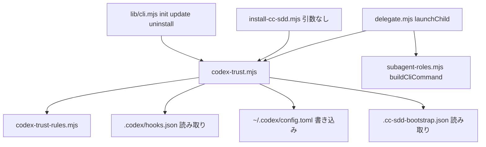
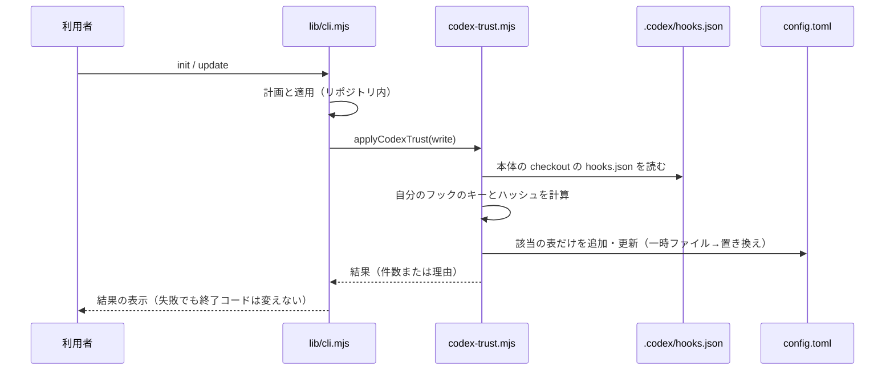

# 設計書: codex-hook-trust

## Overview

**目的**: 導入・更新の行程で Codex のフックの信頼の承認の記録（利用者全体の `config.toml` の `trusted_hash`）を自動で書き、Claude から起動する Codex の子では承認の確認を省く。利用者が確認画面で手で承認する手間をなくす。

**利用者**: cc-sdd-bootstrap を導入する開発者。Codex を指揮役にする場合と、Claude から Codex の子へ委任する場合の両方。

**影響**: 導入コマンドは、リポジトリの外（利用者の Codex の設定）を書く段階を持つ。これまでは「リポジトリ内の許可された道筋だけを変更する」計画・適用の枠だけだった。この段階は計画に混ぜず、適用の後（`uninstall` では前）の別の段階とし、失敗しても導入・更新の結果を変えない。

### Goals
- `init`・`update`・起動前の導入で、自分のフックの承認の記録を正しく書く（1.x・2.x・3.x）。
- 書き込みを設定で止められ、書いた内容を表示し、`uninstall` で取り除ける（4.x・6.1）。
- Claude から起動する Codex の子で承認の確認を省く（5.x）。
- 記録が効かなくなっても壊れず、手での承認と文章の補いに戻れる（6.3〜6.5）。

### Non-Goals
- フックの登録そのもの・役割表・子のモデルの決まり（既存の仕様）。
- 承認以外の Codex の設定の変更、Claude Code 側の許可の設定。
- 古い番号の承認の記録の後始末（Research 6、下の「既知の制約」）。
- シンボリックリンク経由で開いたリポジトリの承認（下の「既知の制約」）。

## Boundary Commitments

### This Spec Owns
- 承認の記録のキーとハッシュの計算（自分のフックだけ）。
- `config.toml` の `[hooks.state."<キー>"]` の表の追加・更新・取り除き（該当の表の `trusted_hash` の行だけ）。
- 設定項目 `codex.trustHooks`（既定 true）。書き込みと子の承認の省略の両方のスイッチ。
- 子の `codex exec` に承認を省く指定を付ける（`buildCliCommand` の引数）と、指定が使えない Codex の検出。
- 結果の表示（導入コマンドと準備スクリプト）、運用の区画の文章の更新（手での承認の方法）。

### Out of Boundary
- フックの登録内容の決定（`lib/catalog.mjs` の `hooks`、`lib/hooks-merge.mjs`）。
- 導入の計画（`lib/plan.mjs`）。承認の記録は計画の対象にしない。
- 利用者自身のフックの承認の記録。`enabled` など承認以外の項目。
- Codex 本体の承認の確認画面と照合の仕様。
- Codex のクラウドセッションでの承認の記録の効き方の保証（2 回の確認でも確かめられなかった。利用者の決定、2026-11-25）。
- Codex の「プロジェクトの信頼」（`[projects."<道筋>"] trust_level`）の付与。利用者が最初の確認画面または `codex exec --trust` で与える前提とする（利用者の決定、2026-11-25）。

### Allowed Dependencies
- `.codex/hooks.json`（読み取りのみ）、`.cc-sdd-bootstrap.json`（読み取りのみ）、`git`（本体の checkout の特定）。
- Node の標準モジュールだけ。外部パッケージなし。
- 配置物（`.agent-hooks/cc-sdd-bootstrap/`）は `lib/` を import しない。`lib/` は配置物を使ってよい（既存の方向）。

### Revalidation Triggers
- Codex の承認の識別情報（ハッシュの入力）の形、キーの形、`hooks.state` の書式の変更 → `poc/codex-hook-trust` を再実行し、`codex-trust-rules.mjs` を直す。
- 導入のフックの登録形式（`OWNED_MARKER`、`hooks-merge` の書き出す項目）の変更。自分のフックの判定とハッシュの入力が変わる。
- `buildCliCommand` の呼び出し側の変更（`delegate.mjs`）。
- 設定ファイルの `format` を上げる変更（本機能の項目は `format: 1` のまま足す）。

## Architecture

### Existing Architecture Analysis
- 導入コマンド（`lib/cli.mjs`）は「読み取り → 計画（純粋）→ 適用」で、リポジトリ内だけを変更し、リポジトリ外・シンボリックリンクを拒否する。
- 配置物は「入出力の入口 `<名前>.mjs`」と「純粋な `<名前>-rules.mjs`」の組で、`lib/` を読まない。準備スクリプト `install-cc-sdd.mjs` は引数なしの実行で導入する。
- 子の起動は `delegate.mjs` の `launchChild` が `buildCliCommand`（`subagent-roles.mjs` の純粋な関数）の結果で行う。

### Architecture Pattern & Boundary Map



- 選んだ型: 既存の「入出力＋純粋」の組を 1 つ足す。計画（`computePlan`）には混ぜない。
- 新しい部品の理由: 準備スクリプトと導入コマンドが同じ書き込みを使うため、実体は配置物の側に置く（`structure.md` の規約）。
- 守る型: 配置物は `lib/` を読まない。`lib/` は配置物を呼ぶだけ。

### Technology Stack

| 層 | 選択 | 役割 | 備考 |
|---|---|---|---|
| CLI / 配置物 | Node.js 22+（ESM、外部パッケージなし） | ハッシュ計算、設定の部分編集、起動 | `node:crypto`・`node:fs`・`node:child_process` のみ |
| 保存先 | `~/.codex/config.toml`（`CODEX_HOME` があればそちら） | 承認の記録 | TOML の該当の表だけを行単位で編集 |
| 検証 | `node --test`、`poc/codex-hook-trust/` | 単体試験と実機の確認 | PoC は Codex の版を上げるたびに再実行 |

## File Structure Plan

### 新規
```
.agent-hooks/cc-sdd-bootstrap/
├── codex-trust-rules.mjs   # 純粋: 識別情報・ハッシュ・キー、config.toml の差分の計算、表示文の組み立て
└── codex-trust.mjs         # 入出力: 設定の場所の決定、hooks.json・config.toml の読み書き、本体の checkout の特定、承認を省く指定の有無の確認
test/
├── codex-trust-rules.test.mjs  # 純粋な部分の試験（実機で承認された記録を試験データに使う）
└── codex-trust.test.mjs        # 入出力の試験（一時ディレクトリ）
```

### 変更
- `.agent-hooks/cc-sdd-bootstrap/config-schema.mjs` — 項目 `codex.trustHooks`（boolean、既定 true）を足す。
- `.agent-hooks/cc-sdd-bootstrap/subagent-roles.mjs` — `buildCliCommand` の `setting.bypassHookTrust` が true のとき、Codex の引数に承認を省く指定を足す。
- `.agent-hooks/cc-sdd-bootstrap/delegate.mjs` — `launchChild` で設定を読み、指定を付ける・使えない Codex を止める・付けたことを標準エラー出力へ出す。
- `.agent-hooks/cc-sdd-bootstrap/install-cc-sdd.mjs` — 引数なしの経路の終わりで書き込みを呼び、結果を出力する（フックの経路では呼ばない）。
- `lib/cli.mjs` — `init`・`update` は適用の後、`uninstall` は適用の前に承認の段階を呼び、`formatSuccess` に結果を渡す。
- `lib/catalog.mjs` — `files` に新しい 2 ファイルを登録し、Codex 向けの運用の区画の文章に手での承認の方法を足す。
- `package.json` — `files` に新しい 2 ファイルを登録する。
- `test/cli.test.mjs`・`test/subagent-roles.test.mjs`・`test/delegate.test.mjs`・`test/install-cc-sdd.test.mjs`・`test/config-schema.test.mjs`・`test/catalog.test.mjs` — 上の変更に合わせて足す。`CODEX_TRUST` の案内の表示条件の試験も更新する。
- `.cc-sdd-bootstrap.json`・`.agent-hooks/` の自己適用の結果 — `update` で反映してコミットする。

## System Flows



判断:
- `init`・`update` は、計画の変更が 0 件でも承認の段階を呼ぶ（記録が無いだけの場合を直すため）。
- `uninstall` は、フックの登録を外す前に `hooks.json` を読んでキーを求め、現在のハッシュと一致する記録だけを取り除く（利用者が別の定義で承認した記録・手で変えた記録は残す）。
- 設定が false のときは、`init`・`update`・`uninstall` のいずれでも Codex の設定を変更せず、理由（設定で止めている）を表示する（4.2・4.4）。過去に書いた記録を外したい場合は、設定を true に戻して `uninstall` を実行するか、手で消す。
- 準備スクリプトは、導入の成否に関わらず（導入に失敗して停止する経路を除く）、成功した経路の最後に呼ぶ。失敗しても導入の結果を変えない。

## Requirements Traceability

| 要件 | 概要 | 部品 | 契約・流れ |
|---|---|---|---|
| 1.1 | init・update で記録を書く | `lib/cli.mjs`、`codex-trust.mjs` | `applyCodexTrust(write)` |
| 1.2 | 定義が変われば置き換える | `codex-trust-rules.mjs` | `planTrustEdit`（ハッシュを毎回再計算し、差があれば更新） |
| 1.3 | 一致していれば変更しない | `codex-trust-rules.mjs` | `planTrustEdit` が同じ本文を返し、書き込みを省く |
| 1.4 | 該当の記録だけを触る | `codex-trust-rules.mjs` | 表の `trusted_hash` の行だけを編集 |
| 1.5 | 確認画面なしで動く | 実機の確認 | `poc/codex-hook-trust/run.mjs --e2e` |
| 1.6 | 読めない・書けない・想定外は変更せず案内 | `codex-trust.mjs` | `status: "failed"` と理由、手での承認の案内 |
| 2.1 | 本体と worktree の両方で動く | `codex-trust.mjs` | 本体の checkout の `hooks.json` のキーで書く |
| 2.2 | worktree から実行しても本体の記録 | `codex-trust.mjs` | `git rev-parse --git-common-dir` で本体を特定 |
| 2.3 | 本体が未導入・内容が違えば案内 | `codex-trust.mjs`、`codex-trust-rules.mjs` | `notes` に「承認が効かない可能性」を載せる |
| 3.1 | 準備スクリプトでも書く | `install-cc-sdd.mjs` | 引数なしの経路の終わりで呼ぶ |
| 3.2 | Codex が未導入でも失敗にしない | `codex-trust.mjs` | 設定の置き場所が無ければ `status: "skipped"` と理由 |
| 3.3 | フックの中から書かない | `install-cc-sdd.mjs` | `session-start`・`user-prompt-submit` の経路は呼ばない |
| 4.1 | 設定で切り替え、既定は書く | `config-schema.mjs`、`readTrustSetting` | `codex.trustHooks`（既定 true） |
| 4.2 | 止めたら変更せず、子の省略もしない | `codex-trust.mjs`、`delegate.mjs` | 設定が false なら `write`・`remove` とも `disabled`、指定も付けない |
| 4.3 | 書いた場所と件数を表示 | `codex-trust-rules.mjs` | `messageTrust`（追加・更新・変更なしの件数と設定ファイルの道筋。末尾にプロジェクトの信頼が前提である旨） |
| 4.4 | 書かなかった理由を表示 | `codex-trust-rules.mjs`、`install-cc-sdd.mjs` | `messageTrust`（無効・失敗・未導入の理由。準備スクリプトでも表示） |
| 5.1 | 子の起動に省く指定を付ける | `subagent-roles.mjs`、`delegate.mjs` | `buildCliCommand` の `bypassHookTrust` |
| 5.2 | 付けたことを表示 | `delegate.mjs` | 標準エラー出力へ 1 行 |
| 5.3 | 設定に保存しない | `subagent-roles.mjs` | 引数だけ（`--config` は使わない） |
| 5.4 | 使えない指定は起動せず案内 | `codex-trust.mjs`、`delegate.mjs` | `codex exec --help` に指定が無ければ `Stop` |
| 6.2 | worktree からの uninstall は外さず理由を表示 | `lib/cli.mjs`、`codex-trust.mjs` | `applyCodexTrust(remove)` が `skipped` を返す |
| 6.1 | 本体の checkout の uninstall で一致する記録だけ外す | `lib/cli.mjs`、`codex-trust.mjs`、`codex-trust-rules.mjs` | `applyCodexTrust(remove)`（外す前の `hooks.json` から求め、現在のハッシュと一致する記録だけを外す。worktree からは外さない） |
| 6.3 | 合わなくなっても壊れない | Codex の挙動 | 未承認になるだけ。設計での対応は不要 |
| 6.4 | 手での承認の方法を文章で案内 | `lib/catalog.mjs` | Codex 向けの運用の区画の文章 |
| 6.5 | 再実行できる確認手順 | `poc/codex-hook-trust/` | `run.mjs`・`probe.mjs`・`result.md` |

## Components and Interfaces

| 部品 | 層 | 役割 | 要件 | 主な依存 | 契約 |
|---|---|---|---|---|---|
| codex-trust-rules | 配置物（純粋） | ハッシュ・キー・設定の差分・表示文 | 1.2〜1.4、2.3、4.3、4.4 | なし | 関数 |
| codex-trust | 配置物（入出力） | 設定の場所・読み書き・本体の特定・指定の有無 | 1.1、1.6、2.x、3.x、5.4、6.1 | rules（P0）、git（P1） | 関数 |
| lib/cli 統合 | 導入コマンド | 段階の順序・表示 | 1.1、4.x、6.1 | codex-trust（P0） | 呼び出し |
| install-cc-sdd 統合 | 準備スクリプト | 引数なしの経路の終わりで呼ぶ | 3.1〜3.3 | codex-trust（P0） | 呼び出し |
| delegate 統合 | 入口のコマンド | 指定を付ける・使えなければ止める | 5.1〜5.4 | codex-trust（P0）、buildCliCommand（P0） | 呼び出し |

### codex-trust-rules.mjs

**責務**: 入出力なしで、承認の記録の内容と、`config.toml` の新しい本文を計算する。

```js
/** 自分のフックの印（lib/catalog.mjs の OWNED_MARKER と同じ値。試験で一致を確かめる） */
export const OWNED_MARKER = "/.agent-hooks/cc-sdd-bootstrap/";

/** @typedef {{ key: string, hash: string }} TrustEntry */
/** @typedef {{ added: number, updated: number, unchanged: number, removed: number }} TrustCounts */

/**
 * hooks.json の文章から、自分のフック（コマンドに印を含む command フック）の承認の記録を求める。
 * キーは `<hooksJsonPath>:<イベント>:<グループ番号>:<フック番号>`（番号は利用者のフックも数える）。
 * 扱えない項目を持つ自分のフック（timeout・type・command 以外の項目）は skipped に理由を載せる。
 * @returns {{ ok: true, entries: TrustEntry[], skipped: string[] } | { ok: false, reason: string }}
 */
export function computeTrustEntries(hooksJsonText, hooksJsonPath) {}

/**
 * config.toml の新しい本文を計算する。mode "write": 表を追加・trusted_hash を更新。
 * mode "remove": 現在のハッシュと一致する trusted_hash の行だけを外し、他に項目が無くなった表は表ごと外す（一致しない記録は残して counts.unchanged に数える）。
 * 想定外の書き方（hooks.state の別の書式、同じキーの表の重複、見出しの崩れ）では ok: false。
 * @param {string} configText
 * @param {TrustEntry[]} entries
 * @param {"write" | "remove"} mode
 * @returns {{ ok: true, text: string, counts: TrustCounts } | { ok: false, reason: string }}
 */
export function planTrustEdit(configText, entries, mode) {}

/** 結果の表示行を作る（4.3・4.4・2.3・1.6）。 */
export function messageTrust(result) {}
```

- 識別情報とハッシュ: `{ event_name, matcher?, hooks: [{ type: "command", command, timeout, async: false }] }` をキーの辞書順の JSON にして sha256（`poc/codex-hook-trust/result.md`）。`timeout` は未指定なら 600、1 未満は 1。`matcher` は指定があるときだけ含める。
- イベント名は `SessionStart`→`session_start`、`UserPromptSubmit`→`user_prompt_submit`、`PreToolUse`→`pre_tool_use`、`PostToolUse`→`post_tool_use`、`Stop`→`stop`。表にないイベントは skipped。
- 行単位の編集の規則: 見出し `[hooks.state."<キー>"]` を完全一致で探す。表の本体は次の見出しの前まで。`trusted_hash = "…"` の行だけを置き換える。無ければ見出しの直後へ足す。新しい表は本文の末尾に空行を挟んで足す。改行コード（LF・CRLF）と末尾の改行の有無を保つ。
- 表に `enabled` など他の項目があるとき、`remove` は `trusted_hash` の行だけ外し表は残す。
- 扱える構文の限定: 本文に複数行の文字列（`"""` または `'''`）が 1 つでもあれば、見出しや `trusted_hash` の行を安全に識別できないので `ok: false`（変更しない）。行の先頭が `[` の見出しは、閉じた `]` で終わる行だけを見出しとみなす。
- 想定外の書き方の判定（`ok: false`）: 見出し以外の行で `hooks` から始まるキー（`hooks = {…}`・`hooks.state.…`）、`[hooks]` の表の中の `state`、同じキーの表の重複、閉じていない見出し、複数行の文字列。

### codex-trust.mjs

```js
/** @typedef {"written" | "unchanged" | "removed" | "skipped" | "failed" | "disabled"} TrustStatus */
/** @typedef {{ status: TrustStatus, configPath: string | null, counts: TrustCounts | null, reason: string | null, notes: string[] }} TrustResult */

/** 設定ファイルから codex.trustHooks を読む。読めない・項目が無いときは true（既定）。 */
export function readTrustSetting(repoRoot) {}

/**
 * 承認の記録を書く・外す。例外は投げない（失敗は status: "failed" と理由で返す）。
 * @param {{ repoRoot: string, mode: "write" | "remove", env?: NodeJS.ProcessEnv, home?: string }} options
 * @returns {TrustResult}
 */
export function applyCodexTrust(options) {}

/** `codex exec --help` に承認を省く指定が出るか。codex を起動できない・出ないときは false。 */
export function bypassFlagSupported() {}
```

- 設定の場所: `CODEX_HOME` があれば `$CODEX_HOME/config.toml`、無ければ `<home>/.codex/config.toml`。置き場所の**ディレクトリが無ければ** `skipped`（理由は「Codex が未導入、または一度も起動されていない」。`codex` の実行ファイルの有無とは分けて判定しない。初回の起動が作るディレクトリを導入側が先に作って、初回の動作を変えないため、ディレクトリは作らない）。ファイルだけ無いときは空の本文として新しく作る。
- 設定ファイルがシンボリックリンクなら、リンク先の実体へ書く（リンクを置き換えない）。
- 本体の checkout: `git rev-parse --path-format=absolute --git-common-dir` の末尾が `.git` ならその親。取れない・ベアなら `repoRoot` の実体の道筋。キーの `hooks.json` の道筋は本体の checkout のもの（Codex が読む側）。`repoRoot` が worktree で、本体の `.codex/hooks.json` が無い、または自分のフックの一覧が worktree と違うときは `notes` へ 2.3 の案内を足す。
- 書き込み: 同じディレクトリへ一時ファイルを書き（元の権限を保つ）、直前に元の本文を読み直して変わっていなければ置き換える。変わっていたら 1 回だけ計算し直し、それでも変わっていたら `failed`。保証の範囲: 読み直しと置き換えの間の極めて短い隙間での他のプロセスの更新までは防げない（ロックは Codex と共有していない）。承認の確認画面は利用者が対話で操作するので実際に重なる確率は低く、起きても次の `update` で記録が直る。シンボリックリンクは書く直前に実体を求め直し、置き換え先を 1 回の呼び出しの中で固定する。
- 設定が false のとき、`write`・`remove` とも `disabled` を返し何も変更しない。
- 例外（読み書きの失敗・想定外の書式・`hooks.json` の解析失敗）は `failed` に変換する。

### lib/cli.mjs 統合

- `init`・`update`: `applyPlan` の成功後、`applyCodexTrust({ repoRoot: root, mode: "write" })`。計画の変更が 0 件でも呼ぶ。
- `uninstall`: `applyPlan` の前に `applyCodexTrust({ repoRoot: root, mode: "remove" })`。結果は表示するだけで、取り外しの成否は変えない。**worktree から実行したときは取り除かない**（本体の checkout の登録が残り、Codex が読む承認を消してしまうため。`skipped` と理由「本体の checkout で `uninstall` を実行したときに取り除きます」を返す）。
- `formatSuccess(operation, plan, trust)`: `trust` の結果行を足す。`status` が `written`・`unchanged` のとき、既存の「Codex のフックは信頼の承認が必要です…」の案内を出さない。それ以外は理由と、手での承認の案内を出す。worktree の案内は残す。`computePlan` と `CODEX_TRUST` の通知は変えない（表示の条件だけ変える）。
- 終了コード: 承認の段階の失敗は終了コードを変えない（要件 1.6）。

### install-cc-sdd.mjs 統合
引数なしの経路で、導入・導入済みの省略・区画の書き直しのいずれかが成功した後（失敗で停止する経路の前）に、`applyCodexTrust({ repoRoot: root, mode: "write" })`（設定の確認は関数の中で行う）を呼び、`messageTrust` の結果を標準出力へ出す。`session-start`・`user-prompt-submit` の経路には足さない（3.3）。設定が false のときも `applyCodexTrust` を呼び、`disabled` の理由（設定 `codex.trustHooks` で止めている）を表示する（4.4）。

### delegate.mjs 統合
Codex を起動する前に、`readTrustSetting(root)` が true なら `bypassFlagSupported()` を確かめる。使えなければ `Stop`（「この Codex は承認を省く指定を受け付けません。Codex を更新するか、設定 codex.trustHooks を false にして対話の画面で手で承認してください」）。使えるなら `buildCliCommand` に `bypassHookTrust: true` を渡し、標準エラー出力へ `delegate: 承認の確認を省く指定（--dangerously-bypass-hook-trust）を付けて起動します` を出す。設定が false なら付けない（4.2）。Claude の子には関係しない。`--help` の事前確認は指定が受理される保証ではないので、指定を付けた子が終了コード 2（引数の拒否）で終わったときは、標準エラー出力へ「承認を省く指定が拒否された可能性があります。Codex を更新するか、設定 `codex.trustHooks` を false にして手で承認してください」を足す（5.4）。

### subagent-roles.mjs（buildCliCommand）
`target === "codex"` で `setting.bypassHookTrust === true` のとき、`exec` の直後に `--dangerously-bypass-hook-trust` を足す。既存の引数の並びと、`--config` を使わないこと（設定に保存されない、5.3）を保つ。

### config-schema.mjs
```js
{ path: "codex.trustHooks", kind: "boolean", defaultValue: true,
  validate: (v) => typeof v === "boolean" ? null : "true か false で指定してください" }
```
`flag`・`question` は持たない。`update` が既定値を足し、設定ファイルへ現れる（`CONFIG_CREATED` 相当の既定値の表示に含まれる）。

## Data Models

- **承認の記録（`config.toml` の表）**: `[hooks.state."<hooks.json の道筋>:<イベント>:<グループ番号>:<フック番号>"]` と `trusted_hash = "sha256:<64 桁の 16 進>"`。Codex が確認画面で書くものと同じ形。本機能は `trusted_hash` の行だけを扱う。
- **設定 `codex.trustHooks`**: boolean、既定 true、`.cc-sdd-bootstrap.json` に保存。
- 本機能は状態ファイルを持たない（書き込みの有無は `config.toml` と `hooks.json` の突き合わせで毎回決める）。

## Error Handling

| 場面 | 扱い | 要件 |
|---|---|---|
| `config.toml` を読めない・書けない・書式が想定外 | 変更せず `failed` と理由、手での承認の案内。導入・更新は続ける | 1.6 |
| `hooks.json` を読めない・自分のフックが無い | `failed` または `unchanged`（記録 0 件）と理由 | 1.6 |
| Codex の設定ディレクトリが無い | `skipped` と理由 | 3.2 |
| 設定が false | `disabled`（`write`・`remove` とも変更しない）。理由を表示 | 4.2、4.4 |
| 書き込み中に利用者側の更新が起きた | 1 回だけやり直し、だめなら `failed` | 1.4 |
| 承認を省く指定が使えない Codex | 子を起動せず `Stop` と案内 | 5.4 |
| 記録が効かない（Codex の版の変更） | Codex は未承認として扱う。文章の補いに戻る | 6.3、6.4 |

## 既知の制約
- **Codex のクラウドセッション**: 確認できた範囲（`poc/codex-hook-trust/cloud-result.md`、2 回）では、セッションの中の `~/.codex` は読み取り専用で `config.toml` は空、`codex exec` も初期化に失敗し、対象のリポジトリはセッション開始時には checkout されていなかった。セッションの中からは承認の記録を書けず、`failed`（要件 1.6）になる。クラウドでの承認の要否・準備スクリプトの時点での `~/.codex` の状態は未確認で、本機能の保証の範囲外とする（利用者の決定）。
- **プロジェクトの信頼が前提**: Codex は、信頼していないプロジェクトでは `.codex/hooks.json` を読まない（承認を省く指定を付けても読まれない。`probe.mjs` の確認、信頼済みなら子のフックは約 4.5 秒で完了）。本機能はプロジェクトの信頼を与えず、検出もしない。結果の表示の末尾と運用の区画の文章で「プロジェクトが未信頼だとフックは読まれない。最初の確認画面か `codex exec --trust` で信頼する」と案内する。
- **シンボリックリンク経由で開いたリポジトリ**: Codex は起動した道筋でキーを照合する（`poc/codex-hook-trust/probe.mjs` の A1・A2）。導入側は実体の道筋（`git` が返すもの）で書くので、リンク経由で開くと効かず、未承認として扱われる。手での承認か、実体の道筋で起動することで対処する。運用の区画の文章に 1 文で書く。
- **古い番号の記録**: 利用者がフックを足して番号がずれると、旧番号の記録が残る。無害だが溜まる。本機能は消さない（他の記録を変更しない、1.4）。
- **`uninstall` で番号が詰まる**: 自分のフックを外すと、後ろにある利用者のフックの番号が変わり、その記録が効かなくなる場合がある。外す前の番号で、ハッシュが一致する自分の記録だけを外し、利用者のフックの記録には触れない。必要なら利用者が手で再承認する。
- **「自分が書いた記録」の識別**: 状態ファイルを持たないので、書いたのが本機能か利用者の承認かは区別できない。`uninstall` では、外す定義と同じハッシュの記録は不要になる記録とみなして外し、一致しない記録は残す。
- 計算式は Codex の内部実装に依存する。履歴の調査では導入以来ほぼ不変（`poc/codex-hook-trust/result.md`）。変わったら `run.mjs` が不一致を示し、案 B（子の承認の省略）が保険になる。

## Testing Strategy

### 単体（純粋な部分）— `test/codex-trust-rules.test.mjs`
- 実機で承認された記録を試験データにする: このリポジトリの Codex 用の `hooks.json`（8 件）から求めたハッシュが、Codex の確認画面で承認されて `config.toml` に残った 8 件と一致する（1.1・1.2）。代表: `session_start:0:0` → `sha256:dae1248d3bfbde04c6994e47b28a87389bf5331cb5c35efdf713634c3ad1aa0e`。
- 利用者のフックが先にあるとき、自分のフックの番号が利用者のフックを数えた値になる。印のないフックは対象外（1.4）。
- `planTrustEdit`: 追加・更新（古いハッシュ）・変更なし（同じ本文を返す）・コメントと他の表を保つ・CRLF と末尾の改行の有無を保つ・`enabled` を持つ表で `remove` が表を残す・`remove` はハッシュが一致しない記録を残す・想定外の書式（インラインの `hooks`・重複する表・複数行の文字列・閉じていない見出し）で `ok: false`（1.2〜1.4、1.6、6.1）。
- `OWNED_MARKER` が `lib/catalog.mjs` の値と一致する。`messageTrust` の各 `status`（4.3・4.4）。

### 入出力 — `test/codex-trust.test.mjs`（一時ディレクトリ）
- 書き込み・変更なし・設定ディレクトリが無いとき `skipped`・設定が false のとき `write`・`remove` とも `disabled`・`remove`・worktree からの `remove` は `skipped` で記録を残す・書く直前に別のプロセスが本文を変えたときのやり直しと `failed`・`CODEX_HOME` の優先・シンボリックリンクの `config.toml` で実体へ書く・読み取り専用で `failed`・worktree から実行して本体の道筋で書く・本体の `hooks.json` が違うとき `notes`（1.x、2.x、3.2、4.2、6.1、6.2）。
- `bypassFlagSupported`: 偽の `codex` を `PATH` に置いて、指定が出る・出ない・起動できないを確かめる（5.4）。

### 統合
- `test/cli.test.mjs`: `init`・`update` の後に結果行が出る、計画が 0 件でも呼ばれる、`uninstall` は外す前に呼ばれる、失敗しても終了コードが変わらない、設定が false のとき書かない、`written`・`unchanged` のとき「承認が必要です」の案内が出ない（1.1、1.6、4.x、6.1）。
- `test/install-cc-sdd.test.mjs`・`test/entry-harness.test.mjs`: 引数なしの経路で呼ばれ、`session-start`・`user-prompt-submit` では呼ばれない・設定が false のとき理由が出る（3.1・3.3・4.4）。
- `test/subagent-roles.test.mjs`・`test/delegate.test.mjs`: Codex の子の引数に指定が入る・`--config` に入らない・設定が false なら入らない・使えない Codex で `Stop`・指定を付けた子が終了コード 2 で終わったときの案内（5.1〜5.4）。
- `test/config-schema.test.mjs`・`test/catalog.test.mjs`: 新しい項目と登録（4.1）、運用の区画の文章に手での承認の方法がある（6.4）。

### 実機（再実行できる確認）
- `poc/codex-hook-trust/run.mjs --e2e`・`probe.mjs`: Codex の版を上げたときに再実行する（6.5）。
- 自己適用: `update` の後に、実際に書かれた記録で Codex が確認画面なしでフックを動かす（このリポジトリの普通の checkout と worktree）。

## Migration Strategy
1. 配置物・設定項目・`lib` の変更を実装し、`node bin/cc-sdd-bootstrap.mjs update` で自己適用する。
2. 自己適用の結果（配置物・設定ファイル）をコミットし、`develop` へ取り込む。
3. 取り込み後、普通の checkout と worktree で Codex を起動し、確認画面が出ないことを確かめる（既存の仕様の 4.8 と同じ手順）。
