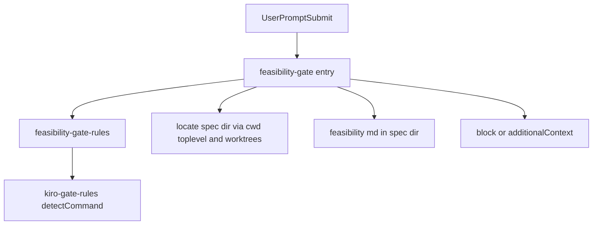
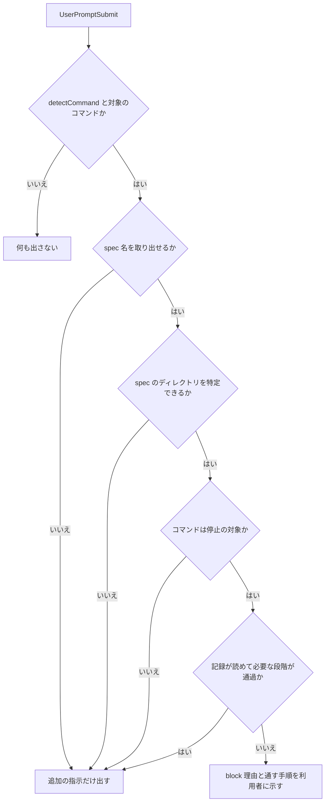

# 設計文書: feasibility-review

## Overview

**Purpose**: 設計とタスク計画の実現性を、推測ではなく根拠（一次資料か実機の PoC）で確かめた状態にしてから次の段階へ進める。cc-sdd には手を入れず、入力時の追加の指示（要件の段階の実機検証の要否の判定・設計とタスク計画の根拠の確認）と、spec ごとの「実現性の記録」を見る入力の停止（`/kiro-spec-tasks`・`/kiro-impl`・`/kiro-spec-quick`・`/kiro-spec-batch`）を外から足す。

**Users**: cc-sdd-bootstrap を導入したリポジトリで、Claude Code または Codex を指揮役にして spec を作り実装する人。

**Impact**: 新しいフックのスクリプトを 1 組（UserPromptSubmit だけ）足し、運用の区画を 1 つ足す。設定の項目は足さない。状態は持たず、spec のディレクトリの記録ファイルだけを見る。cc-sdd が持つファイル（spec.json・requirements.md・design.md・tasks.md）は変えない。

### Goals
- 要件の段階で実機検証の要否を判定させ、必要なら PoC を基本とする。
- 設計・タスク計画の承認の前に、各前提の根拠を確かめさせ、結果を記録に残させる。
- 記録が通っていなければ、次の段階の入力を止め、通す手順を利用者に示す。
- 実機の確認をタスク計画の最初に置かせ、実装中の食い違いは段階を戻させる。
- 判定できないとき・内部の失敗では、入力を止めずに通す。

### Non-Goals
- cc-sdd のスキルの改変、cc-sdd が持つファイルへの印や項目の追加。
- PoC の中身の正しさの自動判定、観点が使われたことの出力の形での検証。
- 実装中の requirements.md・design.md への書き込みの機械的な拒否。
- 子のレビュー役の依頼文の機械的な検査（Codex ではフックから読めない。文章で決める）。
- 確認の後で設計・タスクが変更されたことの検知。

## Boundary Commitments

### This Spec Owns
- `feasibility-gate.mjs`（UserPromptSubmit の入口。spec のディレクトリの特定・記録の読み取り・出力）と `feasibility-gate-rules.mjs`（コマンドと spec 名の取り出し、記録の解析、停止と追加の指示の判断、文言）。
- 実現性の記録の形（`.kiro/specs/<spec 名>/feasibility.md` の見出しと判定の行）。
- カタログの feasibility-review の項目（スクリプト 2 つ、両ツール分の UserPromptSubmit のフック、運用の区画 `feasibility-review` の文章）。
- 既存の完了済み 5 つの spec と、この 2 つの spec 自身の実現性の記録（データ）。

### Out of Boundary
- `/kiro-*` の検出の規則そのもの（kiro-gate。`detectCommand` を読み込んで使うだけ）。
- 手順書の先読みの拒否（kiro-gate）、作業ブランチの確保と PR（work-branch-flow）、子のモデルの確認（subagent-delegation）。
- フックの登録の仕組み・運用の区画の組み立て（installer-core）。設定の項目は足さない。
- cc-sdd のレビュー（`/kiro-validate-design`・`/kiro-spec-tasks` の独立したレビュー）の中身。観点を追加の指示と運用の文章で渡すだけ。
- PoC の作り方・置き場所の規則（steering の、前提ごとの置き場所の規則。この spec は求めるだけ）。

### Allowed Dependencies
- Node.js 22 の標準モジュール（`node:fs/promises`・`node:path`・`node:child_process`。`git` は引数の配列で起動する）。
- 依存の向き: `feasibility-gate-rules`（純粋）→ `feasibility-gate`（入出力と入口）。判定は `kiro-gate-rules.mjs` の `detectCommand` だけを読み込む（一方向）。
- `lib/` と他の配置物（`detectCommand` 以外）は読み込まない。
- 前提: spec は `.kiro/specs/<名前>/` にある（cc-sdd の標準の置き場所）。

### Revalidation Triggers
- `detectCommand` の形の変更。
- cc-sdd の spec の置き場所・コマンドの引数の形（`/kiro-spec-tasks <名前> [-y]`・`/kiro-impl <名前> [番号…]`・`/kiro-spec-quick <名前> [--auto]`）の変更。
- 実現性の記録の見出し・判定の語の変更（既存の記録の書き直しが要る）。
- フックの入力・入力の停止（`decision: "block"`）の出力の形の変更（Claude Code・Codex の版）。実機で再確認し、結果は PoC 文書に残す。

## Architecture

### Existing Architecture Analysis
- 配置物は「入口＋純粋な判定」の組。登録は `lib/catalog.mjs`（`hooks`・`agentSections`・`files`）と `package.json` の `files`（structure.md）。
- 入力の停止は `install-cc-sdd.mjs` の UserPromptSubmit が `{"decision":"block","reason":…}` を出す先例がある。両ツールで効く（実機検証で確認済み。記録は削除済み）。
- kiro-gate は根を「スクリプトの位置」から求める。worktree で作業すると、spec が本体の checkout に無いことがある。この spec では `cwd` と worktree の一覧からも探す（下記）。

### Architecture Pattern & Boundary Map



- **Selected pattern**: 新しい入口＋純粋な判定。状態を持たない（記録のファイルが唯一の状態）。kiro-gate を拡張しない。
- **観点が使われた証拠は記録に求める。** 追加の文脈はレビューには届くが、手順書が決めた出力の形には反映されない（実機検証の A）。そのため、関門が見るのは「文脈を渡したか」ではなく「記録に通過の判定があるか」。
- **子のレビュー役への観点**: Codex は子の依頼文が暗号化されてフックから読めない（同 B）。両ツールで同じ規則にするため、機械的な検査は持たず、運用の区画の文章（親が依頼文に入れる。同 B3 で両ツール OK）と、記録の確認で担保する。
- **spec のディレクトリの特定**: 候補の根を順に探し、`.kiro/specs/<名前>/` が最初に見つかったものを使う。候補は ① 入力の `cwd` の git の根、② スクリプトの位置から求めた根、③ ① で `git worktree list --porcelain` に出る各 worktree の根。どこにも無ければ「特定できない」として通す（5.7）。
- **停止の出力**: `decision: "block"` の理由は利用者に示され、モデルには届かない（実機検証で確認済み。記録は削除済み）。理由は利用者向けに、止めた理由と通す手順を書く（5.5）。

### Technology Stack

| Layer | Choice / Version | Role in Feature | Notes |
|-------|------------------|-----------------|-------|
| 実行 | Node.js 22（`.mjs`） | フック | 標準モジュールだけ |
| フック | Claude Code・Codex の UserPromptSubmit | 追加の指示と入力の停止 | 他のイベントは使わない |
| 外部コマンド | `git`（任意） | worktree の一覧・git の根 | 失敗したら候補を減らすだけ |

## File Structure Plan

### Directory Structure
```
.agent-hooks/cc-sdd-bootstrap/
├── feasibility-gate.mjs          # 入口: 標準入力の JSON を読み、spec のディレクトリ・記録を探して読み、出力する
└── feasibility-gate-rules.mjs    # 純粋: コマンドと spec 名の取り出し、記録の解析、判断、文言
test/
├── feasibility-gate-rules.test.mjs   # 規則の単体試験
└── feasibility-gate.test.mjs         # 一時の git リポジトリ（worktree を含む）と標準入力での入口の試験
.kiro/specs/
├── <既存の 5 spec>/feasibility.md    # 実現性の記録（installer-core・session-install・kiro-gate・subagent-delegation・codex-hook-trust）
├── work-branch-flow/feasibility.md   # この 2 つの spec 自身の記録
└── feasibility-review/feasibility.md
```

### Modified Files
- `lib/catalog.mjs` — `hooks` に両ツール分の UserPromptSubmit（timeout 10）、`agentSections` に `feasibility-review`、`files` に 2 つのスクリプトを足す。
- `package.json` — `files` に 2 つのスクリプトを足す。
- `test/catalog.test.mjs`・`test/package.test.mjs` — 新しい項目の確認を足す。

## System Flows



- 停止の対象と必要な段階: `kiro-spec-tasks`・`kiro-spec-quick`・`kiro-spec-batch`（spec 名あり）は「設計の確認が通過」、`kiro-impl` は「タスク計画の確認が通過」。
- 追加の指示だけ出す対象: `kiro-spec-requirements`（1）、`kiro-spec-design`・`kiro-validate-design`（2）、`kiro-spec-tasks`（通過のとき 3）、`kiro-impl`（通過のとき 6）、`kiro-spec-batch` で spec を特定できないとき（5.12 の案内）。
- 記録が無い・読めない・形が想定と違う場合は、spec のディレクトリが見つかっている限り止める（5.3）。ディレクトリを特定できない・入口が失敗したときは通す（5.7・8.4）。

## Requirements Traceability

| Requirement | Summary | Components | Interfaces | Flows |
|-------------|---------|------------|------------|-------|
| 1.1 | 要件の段階で要否の判定を求める | Rules | `messageContext("kiro-spec-requirements")` | A→X |
| 1.2 | 必要の条件（外部の動作に依存する前提） | Rules | 同上（文言） | — |
| 1.3 | 不要にできるのは外部の動作に依存しない場合に限る | Rules | 同上（文言） | — |
| 1.4 | 必要なら前提ごとに PoC を基本とする | Rules | 同上（文言） | — |
| 1.5 | PoC を作らない判断は前提と理由を記録 | Rules | 同上（文言） | — |
| 1.6 | 不要でも判定と理由を記録 | Rules | 同上（文言）、`FeasibilityRecord` | — |
| 2.1 | 設計で前提ごとに根拠を確認させる | Rules | `messageContext("kiro-spec-design")`・`messageContext("kiro-validate-design")` | A→X |
| 2.2 | 認める一次資料は出典を示せるもの | Rules | 同上（文言） | — |
| 2.3 | 認める PoC は再実行でき結果が残るもの | Rules | 同上（文言） | — |
| 2.4 | 設計の確認の結果を記録に残す | Rules, Record | 記録の「設計の確認」節 | — |
| 2.5 | 根拠の無い前提は未確認として残す | Rules | 同上（文言・記録の「未確認」） | — |
| 2.6 | レビュー役にも観点を渡す | Catalog entry | 運用の区画の文章（子の依頼文に入れる） | — |
| 3.1 | タスク計画で前提の根拠と段取りを確認させる | Rules | `messageContext("kiro-spec-tasks")` | A→X |
| 3.2 | 実機の確認を最初の実装タスクに | Rules | 同上（文言） | — |
| 3.3 | タスク計画の確認の結果を記録に残す | Rules, Record | 記録の「タスク計画の確認」節 | — |
| 3.4 | 実機の確認が最後・欠けているなら未解決で残す | Rules | 同上（文言） | — |
| 3.5 | タスク計画のレビュー役にも観点を渡す | Catalog entry | 運用の区画の文章 | — |
| 4.1 | 記録は spec のディレクトリの 1 ファイル | Record | `.kiro/specs/<名前>/feasibility.md` | — |
| 4.2 | 判定と理由・設計・タスクを段階ごとに | Record | 3 つの節 | — |
| 4.3 | 各段階に通過の判定 | Record, Rules | `parseRecord` | — |
| 4.4 | cc-sdd のファイルに印を足さない | Record | 別ファイル | — |
| 4.5 | 日本語で人が読める形 | Record | 記録の書式 | — |
| 4.6 | やり直したら更新し、古い結果を通過のまま残さない | Rules | `messageContext`（文言） | — |
| 5.1 | `kiro-spec-tasks` を設計未通過で止める | Rules, Gate | `decideInput` | F |
| 5.2 | `kiro-impl` をタスク計画未通過で止める | Rules, Gate | `decideInput` | F |
| 5.3 | 記録が無い・読めないなら止める | Rules | `decideInput`（`record` が null） | F |
| 5.4 | 導入前の spec にも適用 | Record | 既存 spec の記録（データ） | — |
| 5.5 | 理由と通す手順を示す | Rules | `messageBlock` | G |
| 5.6 | 通過になれば止めない | Rules | `decideInput` | F |
| 5.7 | spec を特定できなければ通す | Gate | `locateSpec` が null | D |
| 5.8 | 止めたことをリポジトリに残さない | Gate | 状態を持たない | — |
| 5.9 | 不要の判定は未確認と扱わない | Rules | `parseRecord`（要否は停止の条件に使わない） | — |
| 5.10 | `kiro-spec-quick`・`kiro-spec-batch` も入力時に止める | Rules, Gate | `decideInput`（停止の対象に含める） | F |
| 5.11 | 5.10 の理由と手順を示す | Rules | `messageBlock` | G |
| 5.12 | `kiro-spec-batch` で特定できなければ通し、案内する | Rules, Catalog | `decideInput`・運用の区画の文章 | X |
| 6.1 | 実装中の食い違いは段階を戻させる | Rules | `messageContext("kiro-impl")` | A→X |
| 6.2 | 戻した後に記録を更新し直す | Rules | 同上（文言） | — |
| 6.3 | 書き込みを機械的に拒否しない | Gate | 出力は追加の指示と入力の停止だけ | — |
| 7.1 | 運用の区画に 5 つの内容を含める | Catalog entry | `agentSections.feasibility-review` | — |
| 7.2 | 子のレビュー役に観点を入れる | Catalog entry | 同上 | — |
| 7.3 | 両ツールに同じ内容 | Catalog entry | 同上 | — |
| 7.4 | 記録が無ければ止まること・通す手順 | Catalog entry | 同上 | — |
| 8.1 | 両ツールに同じ規則 | Gate | `--tool` は出力の形だけ | — |
| 8.2 | 他の追加の文脈と並べて届ける／止めるなら利用者に示す | Gate | 追加の文脈の出力・`decision: "block"` | — |
| 8.3 | 信頼未承認のときは文章で促す | Catalog entry | 運用の区画の文章 | — |
| 8.4 | 内部の失敗は通す | Gate | `run().catch` で終了コード 0 | — |
| 8.5 | 5.3 の停止と 8.4 の通過を区別 | Gate | 記録の読み取りの失敗＝止める／入口の例外＝通す | — |

## Components and Interfaces

| Component | Domain/Layer | Intent | Req Coverage | Key Dependencies | Contracts |
|-----------|--------------|--------|--------------|------------------|-----------|
| Rules | 純粋な判定 | コマンド・spec 名・記録・判断・文言 | 1, 2, 3, 5, 6 | `detectCommand`（P0） | Service |
| Gate | 入口（入出力） | spec の特定・記録の読み取り・出力 | 5, 6.3, 8 | Rules（P0）、git（P1） | Event |
| Record | データ（ファイル） | 実現性の確認の結果 | 4, 2.4, 3.3 | — | State |
| Catalog entry | データ | フック・区画・ファイルの登録 | 2.6, 3.5, 7, 8.3 | installer-core（P0） | — |

### 純粋な判定

#### Rules（`feasibility-gate-rules.mjs`）

| Field | Detail |
|-------|--------|
| Intent | 入力から結果だけを計算する。ファイル・git・環境変数を読まない |
| Requirements | 1, 2, 3, 5, 6 |

**Responsibilities & Constraints**
- 対象のコマンドと spec 名を取り出し、記録の解析結果から「止める／追加の指示だけ出す／何もしない」を決める。
- 文言は日本語。停止の理由は利用者向け、追加の指示はエージェント向けに書く。

**Dependencies**
- Inbound: Gate — 判断の呼び出し（P0）
- External: `kiro-gate-rules.mjs` の `detectCommand`（P0）

**Contracts**: Service [x]

##### Service Interface
```typescript
type Command = { skill: string; spec: string | null };   // spec は規則に合う名前だけ。無ければ null

/** 先頭の kiro コマンドを、対象のコマンドと spec 名に分ける。対象外は null。 */
function classifyPrompt(prompt: string): Command | null;

type Verdict = "pass" | "fail" | null;                   // 判定の行が無い・語が違うときは null
type FeasibilityRecord = { need: "required" | "unneeded" | null; design: Verdict; tasks: Verdict };

/** 記録の本文を解析する。想定の見出しが無い・判定の語が違う箇所は null になる。 */
function parseRecord(text: string): FeasibilityRecord;

type InputDecision =
  | { kind: "none" }
  | { kind: "context"; text: string }
  | { kind: "block"; reason: string };

/** record は、記録が読めたら解析結果、記録が無い・読めないなら null。specFound は spec のディレクトリが特定できたか。 */
function decideInput(command: Command, specFound: boolean, record: FeasibilityRecord | null): InputDecision;

function messageContext(skill: string): string;            // 追加の指示（段階ごと）
function messageBlock(spec: string, stage: "design" | "tasks", reason: "no-record" | "not-passed", skill: string): string;
```
- Preconditions: `spec` は `^[a-z0-9][a-z0-9-]*$` に合うときだけ非 null（パスの意図しない解決を防ぐ）。
- Postconditions: `decideInput` は、`command.spec` が null または `specFound` が偽なら、止めずに追加の指示だけ（対象の段階があれば）を返す。止める対象で `record` が null、または必要な段階が `pass` でないときだけ `block` を返す。`need` は判断に使わない（5.9）。
- Invariants: 乱数・時刻・外部の状態に依存しない。

**Implementation Notes**
- `classifyPrompt`: `detectCommand` の結果のうち、`kiro-spec-requirements`・`kiro-spec-design`・`kiro-validate-design`・`kiro-spec-tasks`・`kiro-impl`・`kiro-spec-quick`・`kiro-spec-batch` を対象にする。spec 名は、コマンド名の後の最初の単語（`-` で始まる引数を除く）が名前の規則に合えば採る。`kiro-spec-quick` の最初の単語が説明文のときは null（5.12 と同様に通す）。
- 記録の書式（`parseRecord` が読む形）: `## 実機検証の要否`・`## 設計の確認`・`## タスク計画の確認` の 3 つの節。各節に `- 判定: <語>` の行が 1 つ。要否の語は `必要`・`不要`、段階の語は `通過`・`未通過`。節の他の内容（前提の表・理由・未確認）は自由。
- `messageContext` の骨子:
  - `kiro-spec-requirements`: 実機検証の要否の判定（外部の動作に依存する前提が 1 つでもあれば必要）、必要なら PoC を基本とする、PoC を作らない前提は理由を残す、不要でも理由を残す、結果を記録の「実機検証の要否」節へ（1.1〜1.6）。
  - `kiro-spec-design`・`kiro-validate-design`: 各前提の根拠（一次資料は出典の場所と版、PoC は再実行できる手順と実行日・環境・結果）を確認し、根拠の無い前提は未確認として残して設計の承認前に足す。結果を記録の「設計の確認」節へ。レビュー役（子）を起動するときは依頼文にこの観点を入れる（2.1〜2.6）。
  - `kiro-spec-tasks`: タスク計画の各前提の根拠と段取りが確実に実施できるかを確認する。実機検証が必要なら、実際の配置物を使う確認を最初の実装タスクに置く。最後に置かれている・無いときは「未解決」として記録し計画を直す。結果を「タスク計画の確認」節へ。レビュー役の依頼文に観点を入れる（3.1〜3.5）。
  - `kiro-impl`: 実装中に要件・設計と現実の食い違いが見つかったら、その場で requirements.md・design.md を書き換えず、cc-sdd の Blocked の扱いで該当する段階へ戻し、戻した後に記録の該当節を更新し直す（6.1・6.2）。
  - 共通: 確認をやり直したら記録の該当節の判定をまず `未通過` に戻してから更新する（4.6）。
- `messageBlock`: 利用者向け。「spec `<名前>` の <設計 or タスク計画> の実現性の確認が通っていません（記録が無い／判定が通過ではありません）。`/kiro-spec-design`・`/kiro-spec-tasks`（または `/kiro-validate-design`）で根拠を確認し、`.kiro/specs/<名前>/feasibility.md` の `## 設計の確認`（または `## タスク計画の確認`）の `- 判定:` を `通過` にしてから、もう一度同じ入力を送ってください。実機検証が不要なら、`## 実機検証の要否` に `- 判定: 不要` と理由を書いてください。」。`kiro-spec-quick`・`kiro-spec-batch` では「これらは設計とタスクを続けて作るため、個別の段階のコマンドで確認を済ませてから送ってください」を足す（5.11）。

### 入出力

#### Gate（`feasibility-gate.mjs`）

| Field | Detail |
|-------|--------|
| Intent | UserPromptSubmit の入力を読み、spec の記録を探して Rules に判断させ、出力する |
| Requirements | 5.3, 5.7, 5.8, 6.3, 8.1, 8.2, 8.4, 8.5 |

**Responsibilities & Constraints**
- 引数: `user-prompt-submit --tool <claude|codex>`。
- spec のディレクトリの特定（`locateSpec`）: 候補の根を ① 入力の `cwd` の git の根（`git rev-parse --show-toplevel`、timeout 3 秒）、② スクリプトの位置から求めた根、③ ① の `git worktree list --porcelain` の各 worktree の順に並べ、`.kiro/specs/<名前>/` が最初に存在するものを返す。git の失敗は候補を減らすだけ。
- 記録の読み取り: 見つかった spec のディレクトリの `feasibility.md`。存在しない・読めない（権限・ディレクトリなど）は `record = null`（止める側）。読めて解析結果の段階が `null`（判定の行が無い・語が違う）の場合も、その段階は通過ではない（止める側）。
- 出力: 追加の指示は `{"hookSpecificOutput":{"hookEventName":"UserPromptSubmit","additionalContext":…}}`、停止は `{"decision":"block","reason":…}`（Claude Code・Codex 共通）。状態は持たない（5.8）。
- 失敗（入力の JSON・内部の例外）は標準エラーに日本語で 1 行を書き、出力せずに終了コード 0（通す）。**記録が読めないことは失敗ではなく、停止の条件（5.3）。** 入口自身の失敗と区別する（8.5）。

**Dependencies**
- Inbound: Claude Code・Codex のフック（P0）
- Outbound: Rules（P0）、git（P1）、spec のディレクトリのファイル（P0）

**Contracts**: Event [x]

##### Event Contract
- UserPromptSubmit: `classifyPrompt(prompt)` が null なら何も出さない。`spec` が null なら `decideInput` に `specFound = false` を渡す（追加の指示だけ）。`spec` があれば `locateSpec` し、見つかれば記録を読んで `decideInput`、見つからなければ `specFound = false`。
- 他のイベントは登録しない。

**Implementation Notes**
- Integration: kiro-gate と同じ UserPromptSubmit で並んで動く。追加の文脈は複数のフックのものが並んで届く（Claude Code で確認）。停止のときは入力が止まり、理由は利用者に示される（Codex はモデルの応答が無い）。kiro-gate は停止した入力に対して手順書の先読みの状態を作るが、モデルの応答が無いので影響しない見込み（実機の確認で確かめる）。
- Validation: `prompt` が文字列でない・`cwd` が無いときは、`cwd` を使う候補を省いて続ける。`prompt` が文字列でなければ通す。
- Risks: spec 名の取り出しは cc-sdd のコマンドの引数の形に依存する（取り出せなければ通す側に倒れる）。`kiro-spec-quick` の新規作成で spec のディレクトリがまだ無いときは特定できず通る（`kiro-discovery` が `brief.md` を作った後のディレクトリは見つかる）。

### データ

#### Record（`.kiro/specs/<名前>/feasibility.md`）

```markdown
# 実現性の記録: <spec 名>

## 実機検証の要否
- 判定: 必要
- 理由: （外部の動作に依存する前提があるか。PoC を作らない前提とその理由）

## 設計の確認
- 判定: 通過
- 根拠:
  | 前提 | 根拠の種別 | 出典・PoC（場所と版／実行日・環境・結果） |
  |---|---|---|
- 未確認: なし

## タスク計画の確認
- 判定: 通過
- 実機の確認の位置: （最初のタスクの番号）
- 未解決: なし
```
- 判定の語は固定: 要否は `必要`・`不要`、段階は `通過`・`未通過`。それ以外の節の内容は自由。
- 記録は cc-sdd のファイルと別に置き、cc-sdd のスキルは読み書きしない。

#### Catalog entry（`lib/catalog.mjs`）
- `hooks`: ツールごとに `UserPromptSubmit`（timeout 10）を `feasibility-gate.mjs` へ。
- `agentSections`: `feasibility-review`（両ツールで同じ趣旨）。内容: 要件の段階の実機検証の要否の判定、設計・タスク計画の承認前に前提ごとの根拠を確認して記録すること、実機の確認をタスク計画の最初に置くこと、記録の置き場所と書式、子（レビュー役）を起動するときは依頼文に実現性の観点を入れること、実装中の食い違いは書き換えず段階を戻すこと、記録が通っていなければ `/kiro-spec-tasks`・`/kiro-impl`・`/kiro-spec-quick`・`/kiro-spec-batch` の入力が止まること・通す手順、`/kiro-spec-batch` で spec を特定できないときは個別の段階のコマンドで確認すること。
- `files`: 2 つのスクリプト。`package.json` の `files` にも同じ 2 つ。

## Error Handling

### Error Strategy
入口自身の失敗は通す側。ただし「spec が特定でき、記録が無い・読めない」は失敗ではなく停止の条件。

### Error Categories and Responses
- **入力・内部の不正**（JSON・例外）: 標準エラーに理由を書き、通す（8.4）。
- **spec を特定できない**（名前が取れない・どの候補にもディレクトリが無い）: 通す。追加の指示は出す（5.7・5.12）。
- **記録が無い・読めない・判定の語が想定外**: 止める（5.3）。利用者に通す手順を示す。
- **git が使えない**: 候補が減るだけ。見つからなければ「特定できない」で通す。

## Testing Strategy

### Unit Tests（`test/feasibility-gate-rules.test.mjs`）
- `classifyPrompt`: `/kiro-spec-tasks foo -y`・`$kiro-impl foo 1.1`・`/kiro-spec-quick foo --auto`・`/kiro-spec-batch`・説明文が先頭の `kiro-spec-quick`（spec が null）・対象外のコマンド（5.1・5.2・5.10・5.12）。
- `parseRecord`: 通過・未通過・必要・不要、判定の行が無い、語が違う、節が欠ける、`## ` の位置が前後する（4.3・5.9）。
- `decideInput`: 設計未通過で `kiro-spec-tasks`・`kiro-spec-quick`・`kiro-spec-batch` を止める、タスク未通過で `kiro-impl` を止める、記録なし（null）で止める、通過なら追加の指示だけ、`spec` が null・`specFound` が偽は通す、`need` が `unneeded` でも段階が通過でなければ止める（5.1〜5.12）。
- 文言: 停止の理由に spec 名・段階・通す手順・記録のパスを含む（5.5・5.11）、追加の指示に要否の条件・根拠の定義・実機の確認の位置・段階を戻すこと・やり直しで判定を戻すことを含む（1・2・3・4.6・6）。

### Integration Tests（`test/feasibility-gate.test.mjs`、一時の git リポジトリ）
- 記録なし → `decision: "block"`、記録に通過の判定を書く → 同じ入力が通る（5.1・5.3・5.6）。
- 本体の checkout に spec が無く、worktree にだけある構成で、worktree の記録を見つけて止める／通す（spec のディレクトリの特定。5.7 の取りこぼしを避ける）。
- 入力の `cwd` が git の外・spec 名なし・ディレクトリなしで通る（5.7）。
- 入力の JSON が不正で通る（8.4）。リポジトリの中に状態のファイルが作られない（5.8）。
- カタログ・`package.json` の `files` の一致、運用の区画の文章が両ツールで同じ項目を含む（7.1〜7.4）。

### E2E（実機。実機検証の場面 C）
- 実際の配置物を入れた一時リポジトリで、記録のない spec の `/kiro-spec-tasks`・`/kiro-impl`（Codex は `$kiro-…`）が、両ツールで入力の停止になり、通過の記録を書いた後は通ること。
- kiro-gate と並んで追加の文脈が出る入力（`/kiro-spec-design`）で、両方の文脈が届くこと（Claude Code）。

## Migration Strategy


- 既存の完了済み 5 つの spec には、実現性の記録を足す（要件 5.4）。内容は、実現性の確認が既に行われた（実装・検証済み。PoC の記録は削除済み）ことを示す短い記録で、3 つの判定をすべて埋める。設計のやり直しではない。
- この 2 つの spec 自身の記録は、設計・タスクの確認の後に足す。自己適用の直後に `/kiro-impl` が止まらないようにする。
- 取り込み後の worktree の Codex は、本体の checkout にも同じ登録が入るまでフックが動かない（roadmap の取り込み後の確認の対象）。

## Supporting References
- 実機の前提と結果: 実機検証で確認済み（記録は削除済み。A: 文脈の反映、B1〜B3: 子の依頼文、同じイベントに複数のフック・入力の停止の見え方、入力の停止・Stop）。
- 調査と判断の記録: 同じディレクトリの `research.md`。
