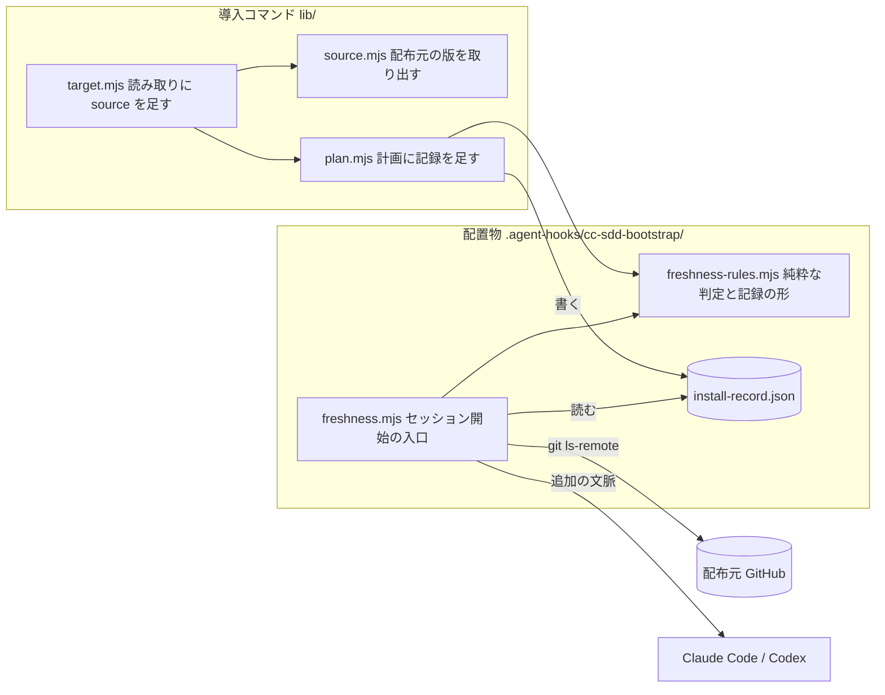
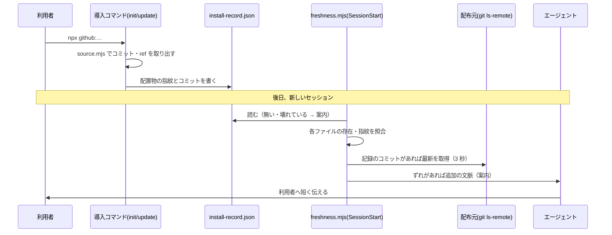

# 設計書: install-freshness

## Overview

導入先の配置物（`.agent-hooks/cc-sdd-bootstrap/`）が古い・欠けている・版が混ざっているときに、セッション開始時に短い案内を出す。導入・更新のときに「配布元のコミットと、配置したファイルごとの指紋（SHA-256）」を記録し、セッション開始のフックが記録と実物を照合し、通信できるときは配布元の最新とも比べる。検知は案内までで、入力は止めず、自動更新もしない。

**対象の利用者**: cc-sdd-bootstrap を導入したリポジトリで Claude Code または Codex を使う人。
**影響**: 導入コマンドの計画に記録ファイル 1 つを足し、配置物に「照合の入口」と「判定だけの部品」を 1 組足し、セッション開始のフックを両ツールに 1 つずつ足す。session-install の導入判断・入力の停止は変えない。

### Goals
- 導入・更新のたびに、実際に配置した配布物の版（コミット）と各ファイルの指紋を記録する（1.1〜1.5）。
- セッション開始時に、欠け・内容の違い・最新との差を、更新コマンドつきの短い案内にする（2.1〜2.6、3.1〜3.6、4.1〜4.6）。
- 記録が無い・読めない・通信できないとき、止めずに通す（3.3、5.1〜5.4）。

### Non-Goals
- 自動更新、cc-sdd 本体の導入物の検査、フックの登録・運用の区画の欠けの検査（配置物ファイルだけを対象にする）。
- 利用者が配置物を編集したかの追及（内容の違いは「版の混在・不完全な更新の可能性」とだけ案内する。2.5）。
- 本仕様の導入前の配置物の検知（検知の仕組みが無い。初回は手で更新する。5.5）。

## Boundary Commitments

### This Spec Owns
- 記録ファイル `install-record.json` の形・書き込み（導入・更新の計画の一部）と、その読み取り・照合の規則。
- 配布元のコミットの取り出し方（`npx` が配布物の隣に残す `.package-lock.json` と、取得時の指定）。
- 配布元の最新の取得（`git ls-remote`）と、失敗・待ち時間超過を通す扱い。
- セッション開始時の案内の文面と、更新コマンドの組み立て。

### Out of Boundary
- 導入・更新の計画の枠組み（`computePlan` の骨格、`applyPlan` の順序・失敗の扱い）は installer-core の持ち物。本仕様は項目を足すだけで、枠組みは変えない。
- 導入未完了での入力の停止・cc-sdd 本体の導入判断は session-install の持ち物（変更しない）。
- Codex のフックの承認の記録の書き方は codex-hook-trust の持ち物（新しいフックの登録は、既存の仕組みで承認の記録に反映される）。
- worktree 導入の案内文面、Codex の読み取り専用の子の表示文面（別の直接実装）。

### Allowed Dependencies
- installer-core: `lib/plan.mjs`・`lib/target.mjs`・`lib/catalog.mjs` に項目を足す（依存の向き: データ → 純粋な処理 → 入出力 → cli を守る）。
- 配置物同士は互いを読み込まない（入口 `freshness.mjs` は自分の純粋部品 `freshness-rules.mjs` だけを読む）。導入コマンド側（`lib/`）は、配置物の純粋部品 `freshness-rules.mjs` を読み込んでよい（`config-schema.mjs`・`subagent-roles.mjs` と同じ向き）。
- Node の標準モジュール（`node:crypto`・`node:fs`・`node:child_process`）と `git` コマンド。外部パッケージは使わない。

### Revalidation Triggers
- 記録ファイルの形（`format`・キー）の変更 → 照合側・導入側・利用先の古い記録の扱いを再確認。
- 照合の対象ファイルの範囲の変更（`catalog.files`・運用の区画のファイルの増減）→ 記録の欠けの判定を再確認。
- 配布元（リポジトリの場所）や取得の方法（`npx github:`）の変更 → 最新の取得とコミットの取り出しを再確認。
- セッション開始のフックの出力の形（追加の文脈）の変更 → 案内が届くかを再確認。

## Architecture

### Existing Architecture Analysis
- 導入コマンド（`lib/`）は「`readSnapshot`（読み取り）→ `computePlan`（純粋な計画）→ `applyPlan`（書き込み）」の順で動く。`computePlan` は `snapshot` だけを見て変更の一覧を作る。
- 配置物は `<名前>.mjs`（入出力）と `<名前>-rules.mjs`（純粋な判定）の組で、`--tool claude|codex` で呼ばれる。状態を持つ関門は、読み書きに失敗したら通す側へ倒す。
- 配置物のうち `catalog.files` に載ったものは、導入先の `.agent-hooks/cc-sdd-bootstrap/` へ写され、載っていないファイルは計画が削除する（`desiredPaths`）。

### Architecture Pattern & Boundary Map



- 選んだ形: 既存の「入口 + 純粋な部品」の組を 1 つ足し、記録は導入の計画の 1 ファイルとして書く。新しい関門は session-install のフックに混ぜず、独立したフックにする（鮮度の検知が失敗しても導入判断に影響しないため）。
- 依存の向きと配置物は導入コマンドの部品を読み込まない決まりを保つ。記録の形・指紋の計算は純粋部品に 1 か所だけ置き、導入側と照合側が同じ部品を使う（食い違いを防ぐ）。
- 止める側の判断: 本機能は「判定できないときは通す」。案内は追加の文脈として出し、入力の拒否・ブロックは使わない。

### Technology Stack

| Layer | Choice | Role | Notes |
|---|---|---|---|
| 導入コマンド | Node.js 22+（ESM、標準モジュールのみ） | 版の取り出し・記録の書き込み | 外部パッケージなし |
| 配置物 | Node.js 22+（ESM、標準モジュールのみ） | 照合・最新の取得・案内 | `--tool claude\|codex` |
| 最新の取得 | `git ls-remote`（`GIT_TERMINAL_PROMPT=0`、待ち時間 3 秒） | 配布元の先頭コミットの取得 | PoC B1〜B4 |
| 記録 | JSON ファイル | 版・指紋の保存 | 配置物と同じ場所に置き、コミット対象 |

## File Structure Plan

```
.agent-hooks/cc-sdd-bootstrap/
├── freshness.mjs        # 新規。セッション開始の入口（読み取り・ls-remote・出力）。失敗は通す
├── freshness-rules.mjs  # 新規。純粋な判定（記録の形・指紋・照合・最新の比較・案内文）
└── install-record.json  # 導入・更新が書く記録（コミット対象。catalog.files には載せない）
lib/
└── source.mjs           # 新規。配布物の位置から配布元のコミット・取得時の指定を取り出す（入出力）
test/
├── freshness-rules.test.mjs   # 純粋部品の単体テスト
├── freshness.test.mjs         # 入口（entry-harness を使う）
├── source.test.mjs            # コミットの取り出し
└── plan-record.test.mjs       # 計画に記録が入ること（または既存の plan 関連テストへ追加）
```

### Modified Files
- `lib/catalog.mjs` — `catalog.files` に `freshness.mjs`・`freshness-rules.mjs` を追加。`catalog.hooks` に両ツールの `SessionStart`（`freshness.mjs session-start --tool <tool>`、timeout 10）を追加。
- `lib/plan.mjs` — 配置物の変更を求めた後で、記録の内容を `freshness-rules.mjs` の `buildRecord` で作り、`install-record.json` の書き込みとして計画へ足す（`desiredPaths` に記録を加えて削除対象から外す）。
- `lib/target.mjs` — `readSnapshot` が `source.mjs` を呼び、`snapshot.source` に取り出した版を入れる。
- `lib/cli.mjs` — 変更なし（既存の `formatSuccess` が「作成・更新」に記録も載せる）。
- `package.json` — `files` に新しい 2 つの配置物を追加（記録は配布物に含めない。導入先で作る）。
- `README.md` — 導入先向けの案内（古い導入は初回に手で更新する、記録の位置、案内の意味）を追記する。
- `.agent-hooks/cc-sdd-bootstrap/install-record.json` と `.claude/settings.json`・`.codex/hooks.json` — 自己適用（`update`）の結果として更新する。

## System Flows



- 通信の失敗・待ち時間超過は、最新との比較だけを省く。照合の結果は引き続き出す（3.3・3.4）。
- 届け方（4.5）: 出力は 1 つの JSON に、`hookSpecificOutput.additionalContext`（エージェントの文脈。「利用者の質問への回答より前に、次の 1 文をそのまま出力する」指示と案内文）と `systemMessage`（Claude Code が利用者向けに表示する欄。案内文）を入れる。PoC の結果（場面 D・E）: 文脈はどちらのツールにも届く。無関係な入力に対して利用者へ伝えるかは、Codex は毎回伝え、Claude Code はモデルにより伝えない場合がある（haiku は 1 回伝え、sonnet は 2 回とも伝えなかった）。`systemMessage` の画面表示は実機で未確認。このため、利用者への伝達は保証せず、要件 4.5 は「文脈と表示欄へ届ける」までとした。
- ずれが無いとき、出力は何も出さない（2.6・4.6）。出力は失敗でも例外でも出さず、終了コードは常に 0（5.3）。

## Requirements Traceability

| Requirement | Summary | Components | Interfaces | Flows |
|---|---|---|---|---|
| 1.1 | 導入時に版と指紋を記録 | `plan.mjs`、`freshness-rules.mjs`（`buildRecord`）、`source.mjs` | `buildRecord`、`readSource` | 導入の流れ |
| 1.2 | 更新で置き換える | `plan.mjs`（`record()` が差のあるときだけ書く） | 同上 | 導入の流れ |
| 1.3 | 取り出せた実際の版／取り出せないと明示 | `source.mjs`、`buildRecord`（`commit: null`） | `readSource` | 導入の流れ |
| 1.4 | 最新と偽らず実際の版を記録 | `source.mjs`（配置した配布物から取り出す） | `readSource` | 導入の流れ |
| 1.5 | 記録の書き込み失敗を示す | `applyPlan` の既存の失敗の扱い（記録も 1 つの変更） | 既存 | 導入の流れ |
| 2.1 | 記録のファイルの存在確認 | `freshness.mjs`、`inspectFiles` | `inspectFiles` | 照合 |
| 2.2 | 指紋の比較 | 同上 | `inspectFiles`、`fingerprint` | 照合 |
| 2.3 | 欠けの案内 | `decideNotice`、`messageNotice` | 同上 | 照合 |
| 2.4 | 内容の違いの案内 | 同上 | 同上 | 照合 |
| 2.5 | 編集と断定しない文面 | `messageNotice` | 同上 | — |
| 2.6 | 一致なら案内しない | `decideNotice`（`null`） | 同上 | 照合 |
| 3.1 | 最新を取得して比べる | `freshness.mjs`（`fetchLatest`）、`compareLatest` | `fetchLatest`、`compareLatest` | 最新の比較 |
| 3.2 | 異なれば案内 | `decideNotice`、`messageNotice` | 同上 | 最新の比較 |
| 3.3 | 取得できなくても止めない | `fetchLatest`（失敗は `null`）、`freshness.mjs` の通す設計 | `fetchLatest` | 最新の比較 |
| 3.4 | 取得失敗でも照合は案内 | `decideNotice`（最新が `null` でも続行） | 同上 | 最新の比較 |
| 3.5 | 待ち時間の上限 | `fetchLatest`（3 秒） | `fetchLatest` | 最新の比較 |
| 3.6 | 版が取り出せない記録は比較せず、ほかの案内があるときに添える | `decideNotice`（`commit: null` は比較を省略し、ほかの案内がある場合に一文を添える） | 同上 | 照合 |
| 4.1 | 要点と更新コマンドの案内 | `messageNotice`、`updateCommand` | 同上 | 案内 |
| 4.2 | 開始時だけ | フックは `SessionStart` にだけ登録 | `catalog.hooks` | 案内 |
| 4.3 | 入力を止めない | 追加の文脈だけを出力（`decision: block` を使わない） | 出力の形 | 案内 |
| 4.4 | 自動更新しない | 書き込みは導入コマンドの `update` のみ。入口は読み取り専用 | — | — |
| 4.5 | 両ツールの文脈へ届く（利用者への伝達は保証しない） | `freshness.mjs --tool claude\|codex`、PoC D・E | 出力の形（`additionalContext` と `systemMessage`） | 案内 |
| 4.6 | ずれが無ければ出さない | `decideNotice`（`null`）→ 出力なし | 同上 | 案内 |
| 5.1 | 記録が無い導入の案内 | `decideNotice`（`record: "missing"`） | 同上 | 照合 |
| 5.2 | 記録が壊れている案内 | `decideNotice`（`record: "broken"`） | 同上 | 照合 |
| 5.3 | 想定外の失敗は通す | `freshness.mjs` 全体の `try/catch` と終了コード 0 | — | 照合 |
| 5.4 | 記録が無いことで作業を拒否しない | 同上（拒否の出力を持たない） | — | — |
| 5.5 | 古い導入には仕組みが無いと明記 | `README.md`、`messageNotice`（記録なしの文面） | — | — |

## Components and Interfaces

| Component | Layer | Intent | Req | Key Dependencies | Contracts |
|---|---|---|---|---|---|
| `freshness-rules.mjs` | 配置物（純粋） | 記録の形・指紋・照合・比較・案内文 | 1.1〜1.4、2.1〜2.6、3.1〜3.6、4.1、4.5、5.1、5.2、5.5 | なし | Service |
| `freshness.mjs` | 配置物（入出力） | 記録とファイルを読み、最新を取得し、案内を出す | 2.1、2.2、3.1、3.3、3.5、4.2〜4.6、5.3、5.4 | `freshness-rules.mjs`（P0）、`git`（P1） | Batch（フック） |
| `source.mjs` | 導入コマンド（入出力） | 配布物の位置から配布元のコミット・取得時の指定を取り出す | 1.3、1.4 | `node:fs`（P0） | Service |
| `plan.mjs`（変更） | 導入コマンド（純粋） | 計画に記録の書き込みを足す | 1.1、1.2、1.5 | `freshness-rules.mjs`（P0） | Service |

### 配置物

#### `freshness-rules.mjs`（純粋）

```typescript
type Source = { commit: string | null; ref: string | null };           // commit は 40 桁の 16 進数
type InstallRecord = { format: 1; source: Source; files: Record<string, string> }; // files: 相対パス → SHA-256（16 進）

export const RECORD_PATH = ".agent-hooks/cc-sdd-bootstrap/install-record.json";
export const DISTRIBUTION_REPO = "https://github.com/nekono-dev/cc-sdd-bootstrap";
export function fingerprint(content: Buffer | string): string;                                  // SHA-256 の 16 進
export function buildRecord(input: { source: Source; files: Record<string, Buffer | string> }): string; // JSON 文字列（キー順固定・末尾改行）
export function parseRecord(text: string | null): { state: "missing" } | { state: "broken" } | { state: "ok"; record: InstallRecord };
export function inspectFiles(record: InstallRecord, actual: Record<string, string | null>): { missing: string[]; changed: string[] }; // actual: 相対パス → 指紋（無ければ null）
export function pickRemoteCommit(stdout: string, ref: string | null): string | null;             // ls-remote の出力から 40 桁を選ぶ
export function compareLatest(record: InstallRecord, latest: string | null): "same" | "behind" | "unknown";
export function updateCommand(source: Source): string;                                           // 例: npx -y github:nekono-dev/cc-sdd-bootstrap#dev/x update
export function decideNotice(input: { parsed: ReturnType<typeof parseRecord>; inspection: { missing: string[]; changed: string[] } | null; latest: "same" | "behind" | "unknown" }): Notice | null;
export function messageNotice(notice: Notice): string;                                           // 利用者へ短く伝える指示つきの案内文
```

- 前提: `files` のキーは、導入先のリポジトリのルートからの相対パス（`/` 区切り）。
- 事後条件: `buildRecord` の出力は同じ入力で同じ文字列（キーを昇順で並べ、改行は `\n`）。
- `parseRecord` は、`format` が 1 でない・JSON でない・`files` の値が 64 桁の 16 進でないものを `broken` にする。
- `compareLatest`: `record.source.commit` が `null` のときや `latest` が `null` のときは `unknown`。
- `updateCommand`: `ref` がブランチ・タグなら `#<ref>` を付ける。`ref` が無い・40 桁の 16 進（固定のコミット）のときは付けない。

#### `freshness.mjs`（入出力）

- 入力: 引数 `session-start --tool claude|codex`。ほかの引数・未対応は、何も出さず終了コード 0（案内の失敗で作業を止めない）。
- 手順: ① リポジトリのルートを自分の位置（`import.meta.url`）から求める。② `RECORD_PATH` を読み、`parseRecord`。③ `ok` なら記録の各ファイルを読んで `fingerprint`（無ければ `null`）→ `inspectFiles`。④ `ok` かつ `commit` があれば `git ls-remote <DISTRIBUTION_REPO> <ref|HEAD>`（`GIT_TERMINAL_PROMPT=0`、待ち時間 3 秒）→ `pickRemoteCommit` → `compareLatest`。⑤ `decideNotice`。`null` なら何も出さない。⑥ あれば `{ systemMessage: <案内文>, hookSpecificOutput: { hookEventName: "SessionStart", additionalContext: messageNotice(...) } }` を標準出力へ 1 行出す（`messageNotice` は、利用者向けの案内文と、エージェントへ「回答より前にそのまま出力する」指示を返す）。
- 失敗の扱い: 記録の読み取りは「無い（ENOENT）→ `missing`」「それ以外の読み取りの失敗・不正な形式 → `broken`」と分類して案内へ渡す（5.1・5.2）。分類できた後の、指紋の計算・`git`・出力の失敗は握りつぶし、何も出さずに終了コード 0。出力は 1 回だけ。
- `ref` が 40 桁の 16 進（固定のコミット）のとき、利用者が版を固定しているので、最新との比較は行わない（`unknown`。要件 3.1）。更新コマンドは固定のコミットを含めず、既定の最新を取る形（`npx -y github:nekono-dev/cc-sdd-bootstrap update`）にする。
- 最新の取得の指定: `ref` があれば `git ls-remote <repo> refs/heads/<ref> refs/tags/<ref> refs/tags/<ref>^{}`、無ければ `HEAD`。タグは注釈つきのとき `^{}` の行（指す先のコミット）を優先する。

#### `source.mjs`（入出力、導入コマンド側）

```typescript
export function readSource(packageRoot: string): Source; // 失敗・形が違うときは { commit: null, ref: null }（例外を投げない）
```

- `packageRoot` の親ディレクトリ名が `node_modules` のときだけ読む。それ以外（手元の checkout からの実行）は `{ commit: null, ref: null }`。
- コミット: `<packageRoot>/../.package-lock.json` の `packages["node_modules/cc-sdd-bootstrap"].resolved` の末尾 `#<40 桁の 16 進>`。
- 取得時の指定: `<packageRoot>/../../package-lock.json` の `packages[""].dependencies["cc-sdd-bootstrap"]` の `#` より後。無ければ `null`。
- 根拠: PoC A2・A3・A5。

#### `plan.mjs`（変更点の契約）

- `computePlan` は、配置物の変更を決めた後で、書き込み後の内容になるファイル（`catalog.files` の同梱の内容と運用の区画の 2 ファイル）の指紋から `buildRecord` で記録を作り、`record(changes, RECORD_PATH, content, snapshot.deployDirFiles[RECORD_PATH])` を呼ぶ（一致していれば変更なし）。
- 記録は変更の一覧の末尾に足す。`applyPlan` は並べ替えるが、配置ディレクトリの書き込みの中では一覧の順で適用されるため、記録は配置物の書き込みの最後になる（フックの登録・`.gitignore` はその後）。途中で失敗しても、古い記録が残るか記録が無いかのどちらかで、次のセッションで案内される。適用の順序は変更しない。
- 記録のパスは `desiredPaths` に含め、`uninstall` では触らない。

## Data Models

`install-record.json`（コミット対象。UTF-8、JSON、キーは昇順、インデント 2、末尾改行）:

```json
{
  "files": {
    ".agent-hooks/cc-sdd-bootstrap/agent-section-claude.md": "<sha256>",
    ".agent-hooks/cc-sdd-bootstrap/freshness.mjs": "<sha256>"
  },
  "format": 1,
  "source": { "commit": "<40 桁の 16 進 または null>", "ref": "<ブランチ・タグ または null>" }
}
```

- 「取り出せなかった」は `commit: null` で表す（1.3）。
- 記録自身の指紋は含めない。記録に載せるのは、`catalog.files` の各配置物と運用の区画の 2 ファイル（`agent-section-*.md`）。
- 不変条件: `files` のキーは、導入先で `catalog.files` と運用の区画のファイルと一致する。

## Error Handling

- 導入時: 記録は計画の 1 つの変更。書き込みに失敗すれば `applyPlan` の既存の失敗の表示（完了・未処理・再実行の案内）になり、成功扱いにしない（1.5）。`readSource` の失敗は例外にせず `commit: null` で記録する（1.3）。
- セッション開始時: 記録が読めない・形が違う → 「壊れている可能性」と更新コマンドを案内する（5.2）。通信の失敗・待ち時間超過 → 最新との比較だけを省く（3.3）。想定外の例外 → 何も出さず終了コード 0（5.3）。案内の出力自体の失敗も作業に影響しない。
- 止める側には使わない: 入力の拒否・停止の出力（`decision: block`）を一切持たない（4.3・5.4）。

## Testing Strategy

### Unit Tests（`freshness-rules.test.mjs`）
- `buildRecord`: 同じ入力で同じ文字列、キー順が昇順、`commit: null` を保つ（1.1・1.3）。
- `parseRecord`: `null`→`missing`、壊れた JSON・`format` 違い・64 桁でない指紋→`broken`、正常→`ok`（5.1・5.2）。
- `inspectFiles`: 欠け・内容の違い・一致を分ける（2.1〜2.4、2.6）。
- `pickRemoteCommit` / `compareLatest`: ブランチ・タグ・`HEAD` の出力、`null` や固定版は `unknown`（3.1〜3.3、3.6）。
- `decideNotice` / `messageNotice`: 組み合わせごとの有無と文面（編集と断定しない、更新コマンドを含む、`commit: null` の一文は他の案内があるときだけ）（2.5、3.2、3.6、4.1、4.6、5.5）。

### Integration Tests
- `source.test.mjs`: 擬似の `node_modules` の配置で、コミットと `#ref` を取り出す／形が違えば `null`／`node_modules` の下でなければ `null`（1.3、1.4）。
- 計画のテスト: `init`・`update` の計画に `install-record.json` が入り、同じ内容なら変更なし、同梱が変わると記録の指紋が変わる、`uninstall` では触らない（1.1、1.2）。
- `freshness.test.mjs`（`entry-harness`）: 一致→出力なし、欠け・違い→追加の文脈、記録なし・壊れ→案内、`git` が失敗（擬似）でも照合は案内、想定外の失敗でも終了コード 0 で出力なし（2.x、3.3、3.4、5.x）。両ツールの `--tool` で同じ形になる（4.5）。

### E2E / 実機
- 実際の `npx github:…#ref update` を一時のリポジトリで行い、記録のコミットが配布元のブランチの先頭に一致する（実機検証の場面 A の延長。1.1・1.4）。
- 古い記録（コミットを書き換え）で、実際の `claude -p`・`codex exec` の文脈に案内が届く（場面 D の延長。4.5）。利用者への伝達そのものは保証しないため、合否には含めず、観測として記録する。
- このリポジトリ自身に `update` を実行し、記録が作られ、次のセッションで案内が出ない（自己適用。2.6）。

## Security Considerations
- 通信は公開リポジトリへの `git ls-remote` だけ（認証・書き込みなし）。`GIT_TERMINAL_PROMPT=0` で認証の入力を求めない。
- 記録は利用者のリポジトリに置く平文の JSON で、秘密情報を含まない。指紋は改変の検出が目的ではないため、改ざんへの対策はしない（要件の範囲外）。
- 案内の文面はエージェントへの追加の文脈と表示欄になる。配布元の最新の取得結果は、40 桁の 16 進だけを取り出して使い、取得した文字列をそのまま文面に入れない。

## Migration Strategy
- 既存の導入先は、本機能を含む版へ `update` した時点で記録が作られる。それ以前は記録が無く、検知の仕組みも無い（5.5）。更新後の初回のセッションから、照合が働く。
- 新しいフックの登録は `update` が両ツールの設定へ書く。Codex は承認の記録（`codex.trustHooks`）も `update` が更新する。
