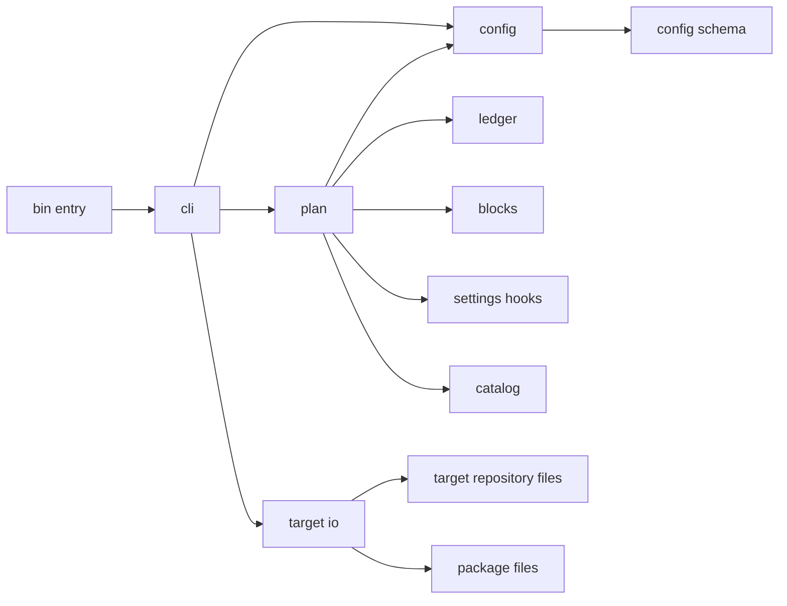
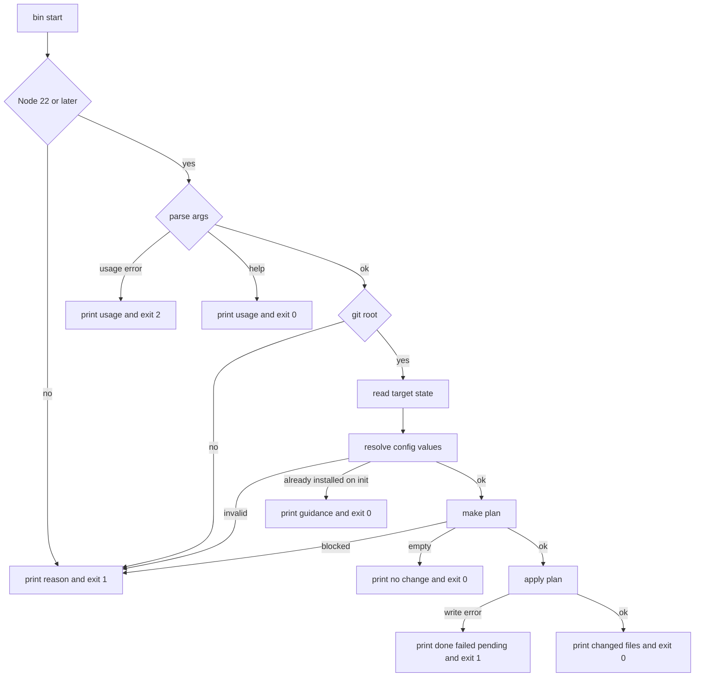
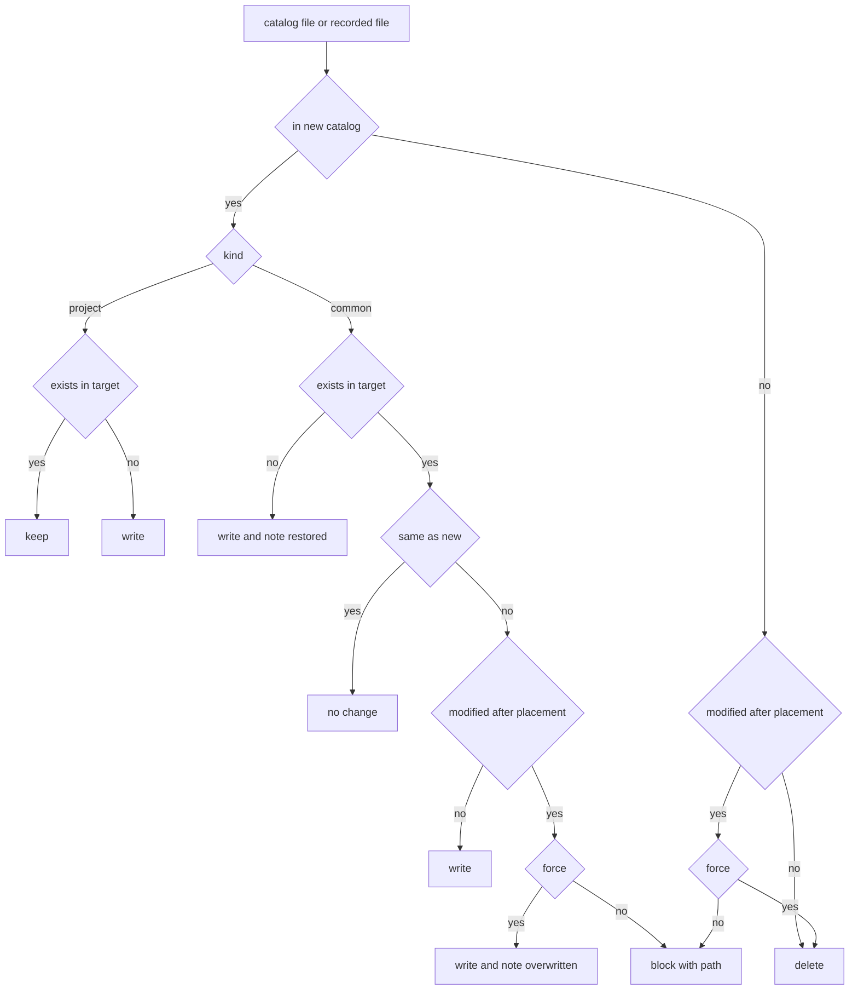

# Design Document: installer-core

## Overview
**Purpose**: cc-sdd の運用一式を、利用先のリポジトリへ 1 つのコマンドで配置・更新・削除する導入コマンド（以下「導入コマンド」）を提供する。
**Users**: cc-sdd の運用を始める開発者と、複数のリポジトリで運用を保守する開発者が、`npx github:nekono-dev/cc-sdd-bootstrap <init|update|uninstall>` で使う。下流の spec は、導入コマンドの「カタログ」と「設定の定義」に項目を足して、自分の配置物を届ける。
**Impact**: このリポジトリに初めて製品のコード（`package.json`・`bin/`・`lib/`・`.agent-hooks/cc-sdd-bootstrap/`）を置く。自己適用で、暫定の導入の仕組み（`scripts/agent/`）を配置物に置き換える。

### Goals
- `init`・`update`・`uninstall` を、中止の条件をすべて確かめてから書き込む形で実現する（中止のときは 1 ファイルも変えない）。
- プロジェクト固有の部分（設定ファイルの値、利用者のフック、管理区画の外、書き換えられた共通部分）を、利用者の明示なしに失わない。
- 下流の spec が、カタログと設定の定義に項目を足すだけで配置物を増やせる。
- このリポジトリ自身に同じコマンドで導入し、直後の `update` で変更が出ない。

### Non-Goals
- 各部品（cc-sdd の入れ直し、手順書の強制、モデルの判定、Codex）の中身。
- Windows での動作の保証（フックはシェルの書き方で登録する）。
- 同じリポジトリでの同時実行の排他。
- 利用者の書き換えと新しい版の自動の混ぜ合わせ（3 方向のマージ）。

## Boundary Commitments

### This Spec Owns
- 導入コマンドの入口（`bin/cc-sdd-bootstrap.mjs`）と、3 つの操作の流れ・引数・対話・出力・終了コード。
- 設定ファイル `.cc-sdd-bootstrap.json` の形式、項目の定義の仕組み（設定の定義）、既定値・検証・補い。installer-core が定義する項目は `ccSdd.version`・`ccSdd.lang`・`codex.enabled`・`models`（役割の名前→モデルの対応。役割の一覧は持たない）。
- カタログ（配置するファイル・フックの登録・`.gitignore` の行・CLAUDE.md の文章）の形式と、その読み方。
- 配置の記録 `.agent-hooks/cc-sdd-bootstrap/installed.json` の形式と、書き換えの検出。
- `.claude/settings.json`・`.gitignore`・CLAUDE.md への統合の規則（目印・見分け方・並び）。
- 初期の配置物として、暫定の 2 本を `.agent-hooks/cc-sdd-bootstrap/` に移すこと（場所に依る文言の修正まで）と、それらのカタログへの登録。
- このリポジトリへの自己適用。

### Out of Boundary
- 初期の配置物（`install-cc-sdd.sh`・`install-gate.mjs`）の振る舞いの変更。設定ファイルの版・言語を読むことを含め、session-install が引き継ぐ。
- `.kiro/settings/cc-sdd-guide.md` の生成（session-install）。
- 役割の一覧・各役割の既定のモデル・モデルの値の検証の詳細（subagent-model-policy）。installer-core は「文字列から文字列への対応」までを検証する。
- Codex を使うときに置く物（codex-delegation）。installer-core は `codex.enabled` を記録するだけ。
- 会話からの呼び出し（plugin-skill）。
- 設定ファイルの値から内容を組み立てて生成するファイル（エージェント定義など）。カタログのファイルは同梱の内容をそのまま写す。

### Allowed Dependencies
- Node.js 22 以上の標準モジュールだけ（`node:fs`・`node:path`・`node:url`・`node:util`・`node:readline/promises`・`node:crypto`・`node:test`）。外部パッケージは使わない。
- `lib/` の中の依存の向きは「データ（`catalog`・`config-schema`）→ 純粋な処理（`config`・`ledger`・`blocks`・`settings-hooks`・`plan`）→ 入出力（`target`）→ `cli` → `bin`」。左から右へだけ import してよい。
- 配置物（`.agent-hooks/cc-sdd-bootstrap/` の下）は `lib/` を import しない（利用先には配置物しか無い）。
- git の実行ファイルには依存しない（git のリポジトリの最上位かどうかは `.git` の有無で見る）。

### Revalidation Triggers
- 設定ファイルの形式（`format`・項目の道筋・既定値）を変える → 全ての下流の spec。
- カタログの項目の形（`CatalogFile`・`CatalogHook`・`CatalogSection`）を変える → 全ての下流の spec。
- 一式のフックの見分け方（コマンドに `/.agent-hooks/cc-sdd-bootstrap/` を含む）や、配置先のディレクトリ名を変える → session-install・kiro-gate・subagent-model-policy・codex-delegation。
- CLAUDE.md・`.gitignore` の目印の文字列を変える → 導入済みの全ての利用先（古い目印を読める移行が要る）。
- 初期の配置物の扱い（直書きの版）→ session-install（設定ファイルの `ccSdd.version`・`ccSdd.lang` を読むように引き継ぐ）。
- 引数の名前・終了コード・出力の形 → plugin-skill。

## Architecture

### Existing Architecture Analysis
- 製品のコードは無い。暫定の `scripts/agent/install-cc-sdd.sh`（SessionStart で cc-sdd 3.1.0 を入れ直す）と `install-gate.mjs`（失敗の記録があれば UserPromptSubmit で止める）が `.claude/settings.json` に登録されている。
- 2 本はリポジトリのルートを自分の位置から `../..` で求める。`.agent-hooks/cc-sdd-bootstrap/` も同じ深さなので、移すだけで動く。
- steering（structure.md）の方針「配置物はこのリポジトリの中でも配置後と同じ相対パスで持ち、導入コマンドはそれを写すだけ」に従う。このため、このリポジトリでは配置物の元と配置先が同じファイルになる（自己適用で写すときは、内容が同じなので書かない）。

### Architecture Pattern & Boundary Map
採用する形は「計画してから書く」。対象の今の内容を読み、書く内容と中止の条件をすべて純粋な関数で計算し、中止が無いときだけ書く。



**Architecture Integration**:
- Selected pattern: 計画してから書く（純粋な計算と入出力の分離）。要件の多くが「ファイルを変更せずに中止」を求めるため。
- Domain/feature boundaries: 下流の spec が触るのは `lib/catalog.mjs`・`lib/config-schema.mjs` のデータと `.agent-hooks/cc-sdd-bootstrap/` の下のファイルだけ。処理（`plan` など）は触らない。
- Existing patterns preserved: 配置物は自分の位置からルートを求める。フックは `$CLAUDE_PROJECT_DIR` から呼ぶ。
- Steering compliance: 外部パッケージなし、日本語の出力、`decide…` の命名（判定を返す関数）、kebab-case のファイル名。

### Technology Stack

| Layer | Choice / Version | Role in Feature | Notes |
|-------|------------------|-----------------|-------|
| CLI | Node.js 22 以上（ESM、`.mjs`） | 入口・引数・対話・出力 | `parseArgs` の `allowNegative` は 22.4 以降なので使わない |
| Data / Storage | JSON（設定ファイル・配置の記録・`.claude/settings.json`）、テキスト（`.gitignore`・CLAUDE.md） | 利用先の状態 | 照合は SHA-256（`node:crypto`） |
| Infrastructure / Runtime | `npx github:nekono-dev/cc-sdd-bootstrap#<ref>` | 配布 | 公開リポジトリ、認証なし。`package.json` の `files` で同梱を絞る（PoC 済み） |
| Test | `node --test` | 単体・結合・端から端まで | 一時ディレクトリに git のリポジトリを作って実行 |

## File Structure Plan

### Directory Structure
```
package.json                         # name・version・type: module・bin・files・engines（node >=22）。files は bin/・lib/ と配置物のファイルを個別に挙げる（installed.json を配らない）
bin/
└── cc-sdd-bootstrap.mjs             # 入口。先頭に #!/usr/bin/env node。Node の版を確かめてから lib/cli.mjs を動的に読み込む
lib/
├── node-version.mjs                 # Node の版の判定（decideNodeSupported）。古い Node でも読み込めるよう標準の構文だけで書き、他の lib を import しない
├── config-schema.mjs                # 設定の定義（項目の道筋・引数の名前・既定値・検証・質問文）。下流の spec が項目を足す
├── catalog.mjs                      # 共有の定数（配置先・一式の見分けの文字列・設定ファイル名・記録の道筋）と、カタログ（写すファイル・フックの登録・.gitignore の行・CLAUDE.md の文章）。下流の spec が項目を足す
├── config.mjs                       # 設定ファイルの解釈・検証・補い・値の決定・書き出し（純粋）
├── ledger.mjs                       # 配置の記録の解釈・作成と、書き換えの判定（純粋）
├── blocks.mjs                       # 目印の行で囲んだ区画の作成・置き換え・削除（純粋。.gitignore と CLAUDE.md で使う）
├── settings-hooks.mjs               # .claude/settings.json の一式のフックの組の取り除きと追加（純粋）
├── plan.mjs                         # 操作ごとの計画（書く内容・削除・権限・中止の理由）の作成（純粋）
├── target.mjs                       # 入出力: 対象の読み取り、同梱のファイルの読み取り、計画の適用（書き込み・削除・権限・空のディレクトリの削除）
└── cli.mjs                          # 引数の解析、対話、操作の流れ、出力、終了コード
.agent-hooks/
└── cc-sdd-bootstrap/
    ├── install-cc-sdd.sh            # 初期の配置物（scripts/agent/ から移す。中身は session-install が引き継ぐ）
    ├── install-gate.mjs             # 初期の配置物（同上）
    └── installed.json               # このリポジトリの配置の記録（自己適用で作られる。カタログには載せない）
test/
├── node-version.test.mjs            # Node の版の判定の単体テスト
├── config.test.mjs                  # config・config-schema の単体テスト
├── ledger.test.mjs                  # ledger の単体テスト
├── blocks.test.mjs                  # blocks の単体テスト
├── settings-hooks.test.mjs          # settings-hooks の単体テスト
├── plan.test.mjs                    # plan の単体テスト（メモリ上の対象の状態から計画を作る）
├── target.test.mjs                  # target の単体テスト（一時ディレクトリでの書き込み・権限・削除・途中失敗）
├── cli.test.mjs                     # cli の引数の解析と対話の単体テスト（擬似の入出力）
├── catalog.test.mjs                 # 共有の定数の値、カタログのファイルが実在すること、配置物が lib/ を import しないことの確認
├── cli.e2e.test.mjs                 # 一時ディレクトリの git のリポジトリで bin を実行する端から端までのテスト
└── package.test.mjs                 # npm pack --dry-run で同梱の範囲（.agent-hooks を含み、test/・poc/ を含まない）を確かめる
poc/
├── npx-bin/run.sh, result.md        # 設計の前提の PoC（作成済み）
└── settings-merge/run.sh, result.md # 設計の前提の PoC（作成済み）
```

### Modified Files（自己適用）
- `scripts/agent/install-cc-sdd.sh`・`scripts/agent/install-gate.mjs` — `.agent-hooks/cc-sdd-bootstrap/` へ移し、元を消す。移した後の文言（再試行のコマンドの道筋・コメントの「暫定」）を直す。
- `.claude/settings.json` — 暫定のフックの登録を消し、`init` に一式のフックの組を足させる。プラグインの設定は残す。
- `.gitignore` — `init` が区画を足す。区画の行と重なる既存の行（cc-sdd の導入物の行など）を手で消す。
- `CLAUDE.md` — 「cc-sdd の標準の決まり」の節（区画と重なる）と「cc-sdd の導入（自己適用ができるまでの暫定の仕組み）」の節を消し、`init` に管理区画を足させる。導入の失敗時の再試行の案内を新しい道筋で書き直す。
- `poc/self-install/run.sh`・`poc/self-install/result.md` — 暫定の道筋（`scripts/agent/`）を新しい道筋に直す。
- `.kiro/steering/structure.md` — 決めたディレクトリ名（`bin/`・`lib/`・`.agent-hooks/cc-sdd-bootstrap/`・`test/`・`poc/`）を追記する。
- `.kiro/steering/tech.md` — 「よく使うコマンド」に `node --test` と導入コマンドの実行例を書く。
- `README.md` — 使い方（3 つの操作・引数・版の固定 `#<タグ>`・設定ファイル・書き換えの扱い・同時実行は想定しないこと）を書く。

## System Flows

### 操作の流れ（3 つの操作で共通）


- 中止の条件（不正な設定・壊れた目印・読めない `.claude/settings.json`・書き換えられた共通部分）は、すべて「make plan」までに判定する。書き込みは「apply plan」だけが行う。
- `blocked` は理由の一覧を持つ。書き換えられた共通部分は、`--force` があれば中止の理由にしない。

### 共通部分のファイルの扱い（update・uninstall）


- 「modified after placement」は、記録の SHA-256 と今の内容の SHA-256 が違うこと。記録にそのファイルが無い（記録が無い・壊れているを含む）ときは、新しい版の内容と違えば書き換えられたとみなす。
- 「in new catalog」が no の側で、記録の種類が固有の部分（project）のファイルは、書き換えられていなければ消し、書き換えられていれば中止せずに残して知らせる（利用者の物として扱う。9.2 と同じ考え方）。
- 記録に載る道筋でも、相対の道筋で `..` を含まず `DEPLOY_DIR` の下にあるものだけを扱う。外れた道筋（記録が壊れた・手で書き換えられた）は、`--force` があっても消さずに無視し、知らせる（4.4）。
- `uninstall` では全てのファイルを消す側で扱う。書き換えの判定は、カタログに載るファイルは同梱の内容も比べる相手に使う（記録が無い・壊れているときも、同梱と同じ内容なら失うものが無いので消す）。カタログに無く記録だけにあるファイルは、記録との比較だけで判定する。固有の部分は、配置した内容のままなら消し、書き換えられていれば中止せずに残す（9.2）。

## Requirements Traceability

| Requirement | Summary | Components | Interfaces | Flows |
|-------------|---------|------------|------------|-------|
| 1.1 | 3 つの操作をカレントで実行 | Cli, Target | `runCli` | 操作の流れ |
| 1.2 | 使い方の表示 | Cli | `runCli` | 操作の流れ |
| 1.3 | 未知の操作・指定 | Cli | `parseCliArgs` | 操作の流れ |
| 1.4 | Node の版 | Bin | — | 操作の流れ |
| 1.5 | git の最上位でない | Target | `isGitRoot` | 操作の流れ |
| 1.6 | 成功時の一覧 | Cli, Target | `ApplyResult` | 操作の流れ |
| 1.7 | 失敗の理由と次の手 | Cli | `PlanBlock`, `CliOutcome` | 操作の流れ |
| 1.8 | 日本語の出力 | Cli, Plan | 全ての利用者向けの文言 | — |
| 1.9 | 標準の機能だけ | 全体 | Allowed Dependencies | — |
| 2.1 | 対話で項目を尋ねる | Cli, ConfigSchema | `promptValues` | — |
| 2.2 | 引数の値を使う | Cli, Config | `resolveValues` | — |
| 2.3 | 非対話は既定値で補う | Cli, Config | `resolveValues` | — |
| 2.4 | 設定と各統合を行う | Plan, Target | `makePlan`, `applyPlan` | 操作の流れ |
| 2.5 | 不正な値で中止 | Config | `validateConfig` | 操作の流れ |
| 2.6 | 導入済みなら update を案内 | Cli | `CliOutcome` | 操作の流れ |
| 2.7 | コミットと次のセッションの案内 | Cli | — | — |
| 3.1 | `.cc-sdd-bootstrap.json` | Config, Target | `serializeConfig` | — |
| 3.2 | 記録する項目 | ConfigSchema | `ConfigField` | — |
| 3.3 | 型と値の検証 | Config | `validateConfig` | — |
| 3.4 | 読めない・不正で中止 | Config | `parseConfig` | 操作の流れ |
| 3.5 | 増えた項目を補う | Config | `fillDefaults` | — |
| 3.6 | 知らない項目を残して警告 | Config | `findUnknownKeys` | — |
| 3.7 | 既存の値を書き換えない | Config | `resolveValues` | — |
| 4.1 | `.agent-hooks/cc-sdd-bootstrap/` に置く | Catalog | `CatalogFile` | — |
| 4.2 | 共通部分を置き換える | Plan | `makePlan` | ファイルの扱い |
| 4.3 | 固有の部分は無いときだけ | Plan | `makePlan` | ファイルの扱い |
| 4.4 | 他のファイルに触れない | Plan, Target | `FileChange` | — |
| 4.5 | 版と内容の記録 | Ledger | `buildLedger` | — |
| 4.6 | 書き換えの検出 | Ledger, Plan | `decideModified` | ファイルの扱い |
| 4.7 | 実行権限 | Catalog, Target | `CatalogFile.executable` | — |
| 4.8 | 書き込み途中の失敗 | Target, Cli | `ApplyResult` | 操作の流れ |
| 5.1 | 値を引き継いで更新 | Cli, Plan | `makePlan` | 操作の流れ |
| 5.2 | 書き換えがあれば中止 | Plan | `PlanBlock` | ファイルの扱い |
| 5.3 | 強制で上書き | Plan | `PlanInput.force` | ファイルの扱い |
| 5.4 | 外れたファイルを削除 | Plan, Ledger | `makePlan` | ファイルの扱い |
| 5.5 | 未導入なら init を案内 | Cli | `CliOutcome` | 操作の流れ |
| 5.6 | update で値を変える | Cli, Config | `resolveValues` | — |
| 5.7 | 変更が無いことの表示 | Plan, Cli | `Plan.changes` が空 | 操作の流れ |
| 6.1 | フックの登録を加える | SettingsHooks | `mergeHooks` | — |
| 6.2 | 他の内容を残す | SettingsHooks | `mergeHooks` | — |
| 6.3 | 置き換えて重複させない | SettingsHooks | `mergeHooks` | — |
| 6.4 | 繰り返しで同じ内容 | SettingsHooks | `mergeHooks` | — |
| 6.5 | 読めない形式で中止 | SettingsHooks | `mergeHooks` | 操作の流れ |
| 7.1 | 除外の行を加える | Blocks, Catalog | `upsertBlock` | — |
| 7.2 | 他の行を残す | Blocks | `upsertBlock` | — |
| 7.3 | 揃えて重複させない | Blocks | `upsertBlock` | — |
| 7.4 | 設定などを除外しない | Catalog | `catalog.gitignore` | — |
| 8.1 | 管理区画を作る | Blocks | `upsertBlock` | — |
| 8.2 | 取り込みの行と下流の文章 | Catalog, Plan | `CatalogSection` | — |
| 8.3 | 標準の決まりの中身を書かない | Catalog | `CatalogSection` | — |
| 8.4 | 区画の中だけ置き換える | Blocks | `upsertBlock` | — |
| 8.5 | 壊れた目印で中止 | Blocks | `findBlock` | 操作の流れ |
| 8.6 | 区画が無ければ作り直す | Blocks, Plan | `upsertBlock` | — |
| 9.1 | 一式を取り除く | Plan, Blocks, SettingsHooks | `makePlan` | ファイルの扱い |
| 9.2 | 他を残す | Plan | `makePlan` | ファイルの扱い |
| 9.3 | 書き換えがあれば中止 | Plan | `PlanBlock` | ファイルの扱い |
| 9.4 | 強制で削除 | Plan | `PlanInput.force` | ファイルの扱い |
| 9.5 | 空のディレクトリの削除 | Target | `applyPlan` | — |
| 9.6 | 未導入なら中止 | Cli | `CliOutcome` | 操作の流れ |
| 9.7 | cc-sdd の導入物と成果物を消さない | Plan | `FileChange` | — |
| 10.1 | 同じ配置を持つ | 自己適用 | `init` の実行 | — |
| 10.2 | 暫定の仕組みを持たない | 自己適用 | Modified Files | — |
| 10.3 | 直後の update で変更なし | Plan, Ledger | `makePlan` | 操作の流れ |

## Components and Interfaces

| Component | Domain/Layer | Intent | Req Coverage | Key Dependencies | Contracts |
|-----------|--------------|--------|--------------|------------------|-----------|
| Bin | 入口 | Node の版を確かめて Cli を動かす | 1.4 | Cli (P0) | — |
| Cli | 入出力 | 引数・対話・流れ・出力・終了コード | 1.1, 1.2, 1.3, 1.6, 1.7, 1.8, 2.1–2.3, 2.6, 2.7, 5.1, 5.5, 5.6, 5.7, 9.6 | Config, Plan, Target (P0) | Service |
| ConfigSchema | データ | 設定の項目の定義 | 3.2 | — | State |
| Config | 純粋な処理 | 設定の解釈・検証・補い・値の決定 | 2.2, 2.3, 2.5, 3.1, 3.3–3.7, 5.6 | ConfigSchema (P0) | Service |
| Catalog | データ | 配置するものの一覧 | 4.1, 4.7, 7.1, 7.4, 8.2, 8.3 | — | State |
| Ledger | 純粋な処理 | 配置の記録と書き換えの判定 | 4.5, 4.6, 10.3 | — | Service |
| Blocks | 純粋な処理 | 目印の区画の操作 | 7.1–7.3, 8.1, 8.4–8.6 | — | Service |
| SettingsHooks | 純粋な処理 | フックの組の統合 | 6.1–6.5 | Catalog (P0) | Service |
| Plan | 純粋な処理 | 操作ごとの計画 | 2.4, 4.2–4.4, 4.6, 5.2–5.4, 5.7, 9.1–9.4, 9.7, 10.3 | Config, Ledger, Blocks, SettingsHooks, Catalog (P0) | Service |
| Target | 入出力 | 対象の読み取りと計画の適用 | 1.5, 4.7, 4.8, 9.5 | Node の fs (P0) | Service |

型は JSDoc（`@typedef`）で書く。以下は読みやすさのために TypeScript の記法で示す。

### データ

#### ConfigSchema（`lib/config-schema.mjs`）

| Field | Detail |
|-------|--------|
| Intent | 設定ファイルの各項目の道筋・引数の名前・既定値・検証・質問文を 1 か所で定義する |
| Requirements | 3.2 |

**Contracts**: State [x]

```typescript
type ConfigValue = string | boolean | Record<string, string>;

interface ConfigField {
  path: string;            // 設定ファイルの中の道筋。例 "ccSdd.version"
  flag: string;            // 引数の名前。例 "cc-sdd-version"（--cc-sdd-version <値>）
  kind: "string" | "boolean" | "map";
  defaultValue: ConfigValue;
  question: string;        // 対話で示す日本語の質問文
  validate(value: ConfigValue): string | null; // 不正なら日本語の理由、正しければ null
  mapKeys?: string[];      // kind が map のとき、対話で尋ねるキーの一覧（models では役割の名前）
}

const CONFIG_FORMAT = 1;
const configFields: ConfigField[];
```

installer-core が定義する項目:

| path | flag | kind | 既定値 | 検証 |
|------|------|------|--------|------|
| `ccSdd.version` | `cc-sdd-version` | string | `"3.1.0"` | `数字.数字.数字` と任意の `-` 以降 |
| `ccSdd.lang` | `lang` | string | `"ja"` | `xx` または `xx-YY` の形（cc-sdd の対応言語の一覧は持たない） |
| `codex.enabled` | `codex` | boolean | `false` | 真偽 |
| `models` | `model` | map | `{}`（`mapKeys` は空） | 値が空でない文字列の対応 |

- 引数の書き方: 文字列は `--lang ja`、真偽は `--codex yes|no`（`true|false` も受ける）、対応は `--model <役割>=<モデル>` を繰り返す。
- 下流の spec は `configFields` に項目を足すか、`models` の `mapKeys` と既定値に役割を足す。どちらも、導入済みのリポジトリの次の `update` で既定値が補われる（`fillDefaults`）。

#### Catalog（`lib/catalog.mjs`）

| Field | Detail |
|-------|--------|
| Intent | 配置するファイル・フックの登録・`.gitignore` の行・CLAUDE.md の文章の一覧 |
| Requirements | 4.1, 4.7, 7.1, 7.4, 8.2, 8.3 |

**Contracts**: State [x]

```typescript
// 共有の定数（他の lib はここから import する）
const DEPLOY_DIR = ".agent-hooks/cc-sdd-bootstrap";
const OWNED_MARKER = "/.agent-hooks/cc-sdd-bootstrap/";     // 一式のフックの見分け
const CONFIG_PATH = ".cc-sdd-bootstrap.json";
const LEDGER_PATH = ".agent-hooks/cc-sdd-bootstrap/installed.json";

interface CatalogFile {
  path: string;                 // リポジトリのルートからの道筋。DEPLOY_DIR の下に限る
  kind: "common" | "project";   // common は版で置き換える、project は無いときだけ置く
  executable: boolean;          // true なら写した後に 0o755 にする
}

interface CatalogHook {
  event: string;                // "SessionStart" など
  matcher?: string;
  command: string;              // 必ず "$CLAUDE_PROJECT_DIR/.agent-hooks/cc-sdd-bootstrap/" を含む
  timeout?: number;
}

interface CatalogSection {
  id: string;                   // 並びと重複の確認に使う
  body: string;                 // 管理区画に入れる文章（Markdown）
}

interface Catalog {
  files: CatalogFile[];
  hooks: CatalogHook[];
  gitignore: string[];
  claudeSections: CatalogSection[];
}
```

installer-core が載せる項目:
- files: `install-cc-sdd.sh`（common、実行権限あり）、`install-gate.mjs`（common、実行権限なし）。
- hooks: SessionStart `"$CLAUDE_PROJECT_DIR/.agent-hooks/cc-sdd-bootstrap/install-cc-sdd.sh" --claude`（timeout 600）、UserPromptSubmit `node "$CLAUDE_PROJECT_DIR/.agent-hooks/cc-sdd-bootstrap/install-gate.mjs" user-prompt-submit`（timeout 10）。
- gitignore: `.claude/skills/kiro-*/`、`.kiro/settings/`、`/.cache/cc-sdd-install.failed`。
- claudeSections: `cc-sdd-guide` — 見出し「cc-sdd の標準の決まり」、一文の説明（cc-sdd の導入物でコミットしないこと）、`@.kiro/settings/cc-sdd-guide.md` の行。

不変条件（`test/catalog.test.mjs` で確かめる）: files の道筋は全て `DEPLOY_DIR` の下にあり、パッケージの中に実在する。hooks の command は全て一式の見分けの文字列を含む。gitignore は設定ファイル・配置物・配置の記録・`.claude/settings.json` に一致しない（7.4）。claudeSections の id は重複しない。

### 純粋な処理

#### Config（`lib/config.mjs`）

| Field | Detail |
|-------|--------|
| Intent | 設定ファイルの解釈・検証・補い・値の決定・書き出し |
| Requirements | 2.2, 2.3, 2.5, 3.1, 3.3, 3.4, 3.5, 3.6, 3.7, 5.6 |

**Contracts**: Service [x]

```typescript
type ConfigObject = { format: number } & Record<string, unknown>;
type ConfigError = { code: "CONFIG_UNREADABLE" | "CONFIG_INVALID"; messages: string[] }; // messages は「項目: 理由」

function parseConfig(text: string): { ok: true; config: ConfigObject } | { ok: false; error: ConfigError };
function validateConfig(config: ConfigObject, fields: ConfigField[]): ConfigError | null;
function findUnknownKeys(config: ConfigObject, fields: ConfigField[]): string[];
function fillDefaults(config: ConfigObject, fields: ConfigField[]): { config: ConfigObject; filled: string[] };
function resolveValues(input: {
  base: ConfigObject | null;                 // init では null、update では読んだ設定
  given: Record<string, ConfigValue>;        // 引数で渡された値（path をキーにする）
  prompted: Record<string, ConfigValue>;     // 対話で答えた値
  fields: ConfigField[];
}): { config: ConfigObject; defaulted: string[] };
function serializeConfig(config: ConfigObject): string; // 2 文字の字下げ、末尾に改行
```
- 値の優先順位: 引数 > 対話の答え > 既存の値（update）> 既定値。update では引数が無い項目の既存の値を変えない（3.7）。
- `fillDefaults` は、無い項目を既定値で補う。`map` の項目は、項目そのものがあっても、既定値のキーのうち無いキーだけを補う（例: 既存 `{ "a": "x" }` と既定 `{ "b": "y" }` から `{ "a": "x", "b": "y" }`）。既存のキーの値は変えない（3.5・3.7）。補った道筋は `models.b` の形で `filled` に入れる。
- `findUnknownKeys` は葉の道筋を返す。`map` の項目の下のキーは知らない項目に数えない。`format` は知っている項目。
- `format` が `CONFIG_FORMAT` より大きいときは `CONFIG_INVALID`（新しい導入コマンドで書かれた設定）として、導入コマンドの版を上げる案内を出す。

#### Ledger（`lib/ledger.mjs`）

| Field | Detail |
|-------|--------|
| Intent | 配置の記録の解釈・作成と、書き換えの判定 |
| Requirements | 4.5, 4.6, 10.3 |

**Contracts**: Service [x]

```typescript
interface LedgerEntry { kind: "common" | "project"; sha256: string }
interface Ledger { format: 1; bootstrapVersion: string; files: Record<string, LedgerEntry> }

// LEDGER_PATH は catalog から import する

function parseLedger(text: string | null): Ledger | null;  // 無い・壊れているときは null
function buildLedger(version: string, placed: Array<{ path: string; kind: "common" | "project"; content: Buffer }>): Ledger;
function decideModified(input: {
  ledger: Ledger | null; path: string; current: Buffer; incoming: Buffer | null;
}): boolean;
function sha256(content: Buffer): string;
function serializeLedger(ledger: Ledger): string; // 2 文字の字下げ・末尾に改行。同じ配置なら同じ文字列（10.3）
```
- `decideModified`: 記録にあれば「今の SHA-256 ≠ 記録の SHA-256」。記録に無ければ「incoming があり、今の内容 ≠ incoming」（incoming が無い＝削除の対象なら、記録の無いファイルは消さずに中止の側へ倒す）。
- 記録はキーを道筋の順に並べて書く（同じ配置なら同じ内容になり、10.3 で差分が出ない）。

#### Blocks（`lib/blocks.mjs`）

| Field | Detail |
|-------|--------|
| Intent | 目印の行で囲んだ区画を探す・作る・置き換える・取り除く |
| Requirements | 7.1, 7.2, 7.3, 8.1, 8.4, 8.5, 8.6 |

**Contracts**: Service [x]

```typescript
interface Markers { begin: string; end: string } // 行の先頭がこの文字列で始まれば目印の行とみなす
type BlockError = { code: "MARKERS_BROKEN"; file: string; detail: string };

const CLAUDE_MD_MARKERS: Markers; // begin: "<!-- cc-sdd-bootstrap:begin"、end: "<!-- cc-sdd-bootstrap:end"
const GITIGNORE_MARKERS: Markers; // begin: "# >>> cc-sdd-bootstrap"、end: "# <<< cc-sdd-bootstrap"

function findBlock(text: string, markers: Markers): { found: false } | { found: true; start: number; end: number } | BlockError;
function upsertBlock(input: { text: string | null; markers: Markers; beginLine: string; endLine: string; body: string; file: string }):
  { text: string; created: boolean } | BlockError;
function removeBlock(input: { text: string; markers: Markers; file: string }): { text: string; removed: boolean } | BlockError;
```
- 目印の行が片方だけ、順序が逆、または 2 組以上のときは `MARKERS_BROKEN`（8.5。`.gitignore` も同じ規則）。
- 区画が無いときは末尾に足す（直前に空行を 1 つ）。区画の外の文字は変えない。改行の種類（LF・CRLF）は元のファイルに合わせる。
- `removeBlock` は区画と、区画の直前に足した空行を取り除く。

#### SettingsHooks（`lib/settings-hooks.mjs`）

| Field | Detail |
|-------|--------|
| Intent | `.claude/settings.json` の一式のフックの組を取り除き、カタログの組を後ろに足す |
| Requirements | 6.1, 6.2, 6.3, 6.4, 6.5 |

**Contracts**: Service [x]

```typescript
// OWNED_MARKER は catalog から import する
type SettingsError = { code: "SETTINGS_UNREADABLE"; detail: string };

function mergeHooks(input: { text: string | null; hooks: CatalogHook[] }):
  { text: string | null; changed: boolean } | SettingsError;  // hooks が空で結果が {} なら text は null（ファイルを消す）
```
- 見分け方: フックの組の `hooks` の各要素のうち、`command` に `OWNED_MARKER` を含むものを一式のものとみなす。
- 手順: 一式のものを取り除く → 空になった組・イベント・`hooks` の鍵を取り除く → カタログの各項目を 1 組ずつ、イベントの配列の後ろに足す（カタログの順）。
- 結果を元と深く比べて同じなら `changed: false`（書かない。6.4）。書くときは 2 文字の字下げで整形する。
- `uninstall` は `hooks: []` で呼ぶ。

#### Plan（`lib/plan.mjs`）

| Field | Detail |
|-------|--------|
| Intent | 操作・対象の今の状態・カタログ・設定から、書く内容と中止の理由を計算する |
| Requirements | 2.4, 4.2, 4.3, 4.4, 4.6, 5.2, 5.3, 5.4, 5.7, 9.1, 9.2, 9.3, 9.4, 9.7, 10.3 |

**Contracts**: Service [x]

```typescript
type Operation = "init" | "update" | "uninstall";

interface TargetSnapshot {                       // Target が読んだ対象の状態（無いファイルは null）
  config: string | null;
  ledger: string | null;
  settings: string | null;
  gitignore: string | null;
  claudeMd: string | null;
  files: Record<string, Buffer | null>;          // カタログと記録に載る道筋の今の内容
  ignoredPresent: string[];                      // catalog.gitignore の行のうち、対象に実在する道筋（uninstall の知らせに使う）
}

interface PlanInput {
  operation: Operation;
  config: ConfigObject | null;                   // uninstall では null
  snapshot: TargetSnapshot;
  catalog: Catalog;
  packageFiles: Record<string, Buffer>;          // 同梱の配置物の内容
  bootstrapVersion: string;
  force: boolean;
}

type FileChange =
  | { action: "write"; path: string; content: Buffer; executable: boolean; note?: "restored" | "overwritten" }
  | { action: "delete"; path: string };

interface PlanBlock { kind: "modified" | "markers" | "settings"; path: string; detail: string }

interface Plan {
  changes: FileChange[];                         // 空なら「変更はありません」
  blocks: PlanBlock[];                           // 1 つでもあれば書かずに中止
  notices: string[];                             // 補った項目、作り直した区画など
  pruneDirs: string[];                           // uninstall で、空なら消すディレクトリ（深い順）
}

function makePlan(input: PlanInput): Plan;
```
- 計画が触れてよい道筋は、カタログの files、記録の files、`.cc-sdd-bootstrap.json`、`LEDGER_PATH`、`.claude/settings.json`、`.gitignore`、`CLAUDE.md` だけ（4.4・9.7）。`pruneDirs` は `.agent-hooks/cc-sdd-bootstrap` と `.agent-hooks` だけ。
- 内容が今と同じファイルは `changes` に入れない（10.3・5.7）。
- init・update: ファイルの扱いは「System Flows」の図に従う。続けて設定ファイル、記録、`.claude/settings.json`、`.gitignore`、CLAUDE.md の順に書く内容を計算する。
- uninstall: 共通部分の書き換えは中止の理由（`--force` で削除）、固有の部分の書き換えは残す。設定ファイルと記録を消す。統合の 3 ファイルは一式の部分を取り除き、結果が空（空白だけ、または `{}`）ならファイルを消す。`snapshot.ignoredPresent` が空でなければ、「`.gitignore` の除外が外れたため、次の道筋が git の未追跡のファイルとして現れる。cc-sdd の導入物はライセンスが異なるのでコミットせず、不要なら削除する」という知らせを、道筋の一覧つきで `notices` に入れる（9.7 で消さないものを、誤ってコミットさせないため）。
- CLAUDE.md の区画の本文は、`claudeSections` の `body` をカタログの順に空行でつないだもの。目印の行には「この区画は cc-sdd-bootstrap が管理する。手で書き換えると update で戻る」を添える。

### 入出力

#### Target（`lib/target.mjs`）

| Field | Detail |
|-------|--------|
| Intent | 対象と同梱のファイルを読み、計画を適用する |
| Requirements | 1.5, 4.7, 4.8, 9.5 |

**Contracts**: Service [x]

```typescript
interface ApplyResult {
  ok: boolean;
  done: FileChange[];
  failed?: { change: FileChange; message: string };
  pending: FileChange[];
  prunedDirs: string[];
}

function isGitRoot(dir: string): boolean;        // dir 直下に .git（ディレクトリまたはファイル）があるか
function readSnapshot(root: string, paths: string[], ignored: string[]): TargetSnapshot;
function readPackageFiles(packageRoot: string, catalog: Catalog): Record<string, Buffer>;
function applyPlan(root: string, plan: Plan): ApplyResult;
```
- 書き込みは、同じディレクトリの一時ファイルに書いてから名前を変える（壊れたファイルを残さない）。既存のファイルの権限は保つ。`executable` のファイルは 0o755 にする（4.7）。
- 写す元と先が同じファイル（自己適用）でも、内容が同じなら計画に入らないので書かない。
- 1 つ失敗したらそこで止め、`done`・`failed`・`pending` を返す（4.8）。
- `pruneDirs` は中身が空のときだけ消す（9.5）。
- `readSnapshot` は `ignored`（`catalog.gitignore`）の各行を対象の道筋として調べ、実在するものを `ignoredPresent` に入れる。先頭の `/` は取り、最後の区切りの中の `*` だけを展開する（`.claude/skills/kiro-*/` など）。それより複雑な書き方は調べない。

#### Cli（`lib/cli.mjs`）と Bin（`bin/cc-sdd-bootstrap.mjs`）

| Field | Detail |
|-------|--------|
| Intent | 引数・対話・操作の流れ・出力・終了コード |
| Requirements | 1.1, 1.2, 1.3, 1.4, 1.6, 1.7, 1.8, 2.1, 2.2, 2.3, 2.6, 2.7, 5.1, 5.5, 5.6, 5.7, 9.6 |

**Contracts**: Service [x]

```typescript
interface CliIo {
  cwd: string;
  stdin: NodeJS.ReadableStream; stdout: NodeJS.WritableStream; stderr: NodeJS.WritableStream;
  interactive: boolean;                          // stdin と stdout の両方が端末のとき true
  packageRoot: string;
}

type ParsedArgs =
  | { kind: "help" }
  | { kind: "usage-error"; message: string }
  | { kind: "run"; operation: Operation; given: Record<string, ConfigValue>; force: boolean };

function parseCliArgs(argv: string[], fields: ConfigField[]): ParsedArgs;
function promptValues(io: CliIo, fields: ConfigField[], base: ConfigObject | null, given: Record<string, ConfigValue>): Promise<Record<string, ConfigValue>>;
function runCli(argv: string[], io: CliIo): Promise<number>; // 終了コードを返す
```
- 引数: 1 つめが操作（`init`・`update`・`uninstall`）。指定は `--help`/`-h`、`--force`、設定の定義から作る `--<flag>`。設定の項目の指定は `init` と `update` で受け付ける（5.6）。`uninstall` に渡したら使い方の誤り。`--force` は 3 つの操作すべてで受け付ける。`init` では、記録も設定ファイルも無いのに配置先に内容の違う同名のファイルがある（手で置いた、別の方法で写した、など）ときに、それを置き換える。
- 対話: `init` で `interactive` のときだけ、引数で渡されていない項目を尋ねる（`[既定値]` を示し、空の入力は既定値。不正なら理由を示して尋ね直す）。`update` では尋ねない。
- 終了コード: 0＝成功・変更なし・導入済みの init（2.6）・使い方の表示、1＝操作の失敗（Node の版、git の最上位でない、設定・目印・settings の不正、書き換えによる中止、未導入の update・uninstall、書き込みの失敗）、2＝使い方の誤り。
- 出力: 成功時は「作成」「更新」「削除」に分けた道筋の一覧、補った項目、警告（知らない項目）。init の成功時は、設定ファイルと配置物をコミットすること、cc-sdd 本体は次のセッション開始時に入ること、版の固定は `npx github:nekono-dev/cc-sdd-bootstrap#<タグ>` で行えることを示す（2.7）。uninstall の成功時は、Plan の `notices`（除外が外れて残る cc-sdd の導入物など）も示す。中止時は理由ごとに次の手（`--force` で再実行、目印を直す、`init` を使う、など）を示す（1.7）。
- Bin は `lib/node-version.mjs` の `decideNodeSupported(process.versions.node)` で Node の版（先頭の数）を確かめ、22 未満なら必要な版を出して 1 で終わる（1.4）。その後で `lib/cli.mjs` を動的に読み込む（古い Node で読み込みの段階の誤りにしないため）。

## Data Models

### 設定ファイル `.cc-sdd-bootstrap.json`
```json
{
  "format": 1,
  "ccSdd": { "version": "3.1.0", "lang": "ja" },
  "codex": { "enabled": false },
  "models": {}
}
```
- コミットする。利用者が手で書き換えてよい。`format` は形式の版で、形式を変えるときに上げる。

### 配置の記録 `.agent-hooks/cc-sdd-bootstrap/installed.json`
```json
{
  "format": 1,
  "bootstrapVersion": "0.1.0",
  "files": {
    ".agent-hooks/cc-sdd-bootstrap/install-cc-sdd.sh": { "kind": "common", "sha256": "…" },
    ".agent-hooks/cc-sdd-bootstrap/install-gate.mjs": { "kind": "common", "sha256": "…" }
  }
}
```
- コミットする（別の clone の update でも書き換えを検出するため。4.5）。`bootstrapVersion` は `package.json` の `version`。

### 統合した後の形（例）
- `.claude/settings.json`: 既存の各イベントの配列の後ろに、一式の組 `{ "hooks": [ { "type": "command", "command": "…/.agent-hooks/cc-sdd-bootstrap/…", "timeout": … } ] }` が並ぶ。
- `.gitignore`: 末尾に `# >>> cc-sdd-bootstrap（この区画は cc-sdd-bootstrap が管理する）` から `# <<< cc-sdd-bootstrap` までの区画。
- `CLAUDE.md`: 末尾に `<!-- cc-sdd-bootstrap:begin … -->` から `<!-- cc-sdd-bootstrap:end -->` までの区画。

## Error Handling

### Error Strategy
- 中止の条件は全て計画の段階で集め、一度に表示する（1 つ直して再実行、を繰り返させない）。
- 書き込みの段階の失敗だけが「一部が変わった」状態を作る。そのときは変えたもの・失敗したもの・残りを示す（4.8）。

### Error Categories and Responses

| 種類 | 例 | 終了コード | 表示する次の手 |
|------|----|-----------|----------------|
| 使い方の誤り | 未知の操作・指定、値の形の誤り | 2 | 使い方 |
| 前提の不足 | Node 22 未満、git の最上位でない | 1 | 必要な版 / リポジトリの最上位で実行する |
| 状態の不一致 | 未導入の update・uninstall、導入済みの init | 1（導入済みの init は 0） | `init` / `update` を使う |
| 内容の不正 | 設定の不正・知らない新しい形式、壊れた目印、読めない `.claude/settings.json` | 1 | ファイルと項目と理由。直してから再実行 |
| 利用者の書き換え | 書き換えられた共通部分 | 1 | 一覧と `--force` での再実行 |
| 書き込みの失敗 | 権限・容量 | 1 | 変えたもの・失敗したもの・残り |

### Monitoring
- 記録や送信はしない。利用者向けの出力だけ。予期しない例外は標準エラーに理由を出して 1 で終わる。

## Testing Strategy

### Unit Tests
- Config: 既定値の補い（3.5）と、既存の値を変えないこと（3.7）。引数 > 対話 > 既存 > 既定値の優先順位（2.2・2.3・5.6）。項目ごとの検証の理由（3.3・3.4）。`map` の下のキーを知らない項目に数えないこと（3.6）。`map` の項目で、無いキーだけが既定値で補われ、既存のキーの値が変わらないこと（3.5・3.7）。
- Ledger: 記録の SHA-256 と今の内容の比較（4.6）。記録が無いときの安全側の判定。同じ配置で同じ記録の文字列になること（10.3）。
- Blocks: 区画の作成・置き換え・削除で区画の外が 1 文字も変わらないこと（7.2・8.4）。片方だけ・2 組・逆順の目印で `MARKERS_BROKEN`（8.5）。CRLF の保持。
- SettingsHooks: 利用者のフック・許可・プラグインの設定を残すこと（6.2）。前の版の一式の組を置き換え重複させないこと（6.3）。2 回続けて同じ結果（6.4）。読めない JSON（6.5）。
- Plan: 「ファイルの扱い」の図の各分岐（4.2・4.3・5.2・5.3・5.4・9.3・9.4）。記録の無い init で同名の違うファイルがあると中止し、`--force` で置き換わること。uninstall で `ignoredPresent` があると知らせが出ること。触れてよい道筋の外に変更を出さないこと（4.4・9.7）。

### Integration Tests（`test/cli.e2e.test.mjs`。一時ディレクトリに git のリポジトリを作り、`node bin/cc-sdd-bootstrap.mjs` を実行する）
- 非対話の `init`（引数なし）で既定値が使われ、使った値が表示され、設定ファイル・配置物・記録・3 つの統合が揃う（2.3・2.4）。直後の `update` が「変更はありません」（5.7・10.3）。
- 既存の `.claude/settings.json`（利用者のフックあり）・`.gitignore`・CLAUDE.md がある状態で `init` → `uninstall` し、元の内容に戻る（6.2・7.2・8.4・9.1・9.2）。
- 共通部分を書き換えて `update` → 終了コード 1 で何も変わらない。`--force` で置き換わる（5.2・5.3）。同様に `uninstall`（9.3・9.4）。
- 導入済みの `init` は何も変えずに 0、未導入の `update`・`uninstall` は何も変えずに 1（2.6・5.5・9.6）。git の最上位でない場所では 1（1.5）。未知の指定は 2（1.3）。
- 書き込みの失敗（書けないディレクトリを用意する）で、変えたもの・失敗したもの・残りが表示される（4.8）。

### Package Tests（`test/package.test.mjs`）
- `npm pack --dry-run --json` の一覧に `bin/`・`lib/`・カタログの全てのファイルが含まれ、`installed.json`・`test/`・`poc/`・`.kiro/` が含まれない（下流の spec がカタログにファイルを足したとき、`package.json` の `files` への追記漏れをここで見つける）。

### Self-application Check（自己適用のタスクで確かめる）
- このリポジトリで `node bin/cc-sdd-bootstrap.mjs init` の後に `update` が「変更はありません」（10.3）。
- `poc/self-install/run.sh` が新しい道筋で全て OK になる（自己適用の後も cc-sdd が入り、失敗で止まる）。
- `scripts/agent/` が無く、`.claude/settings.json` に暫定のフックの登録が無い（10.2）。

## Security Considerations
- 導入コマンドは、カタログに載った道筋と決まった 5 つのファイル（設定・記録・settings・`.gitignore`・CLAUDE.md）以外に書かない。道筋はカタログの不変条件（`DEPLOY_DIR` の下）で縛り、`..` を含む道筋を拒む。
- 設定ファイルの値をコマンドの文字列に埋め込まない（フックのコマンドはカタログの固定の文字列）。

## Migration Strategy（このリポジトリの自己適用）
1. 導入コマンド（`package.json`・`bin/`・`lib/`・テスト）を実装する。
2. 暫定の 2 本を `.agent-hooks/cc-sdd-bootstrap/` に移し、文言を直す。`.claude/settings.json` の暫定の登録、CLAUDE.md の暫定の節と「cc-sdd の標準の決まり」の節、`.gitignore` の重なる行を手で消す。
3. `node bin/cc-sdd-bootstrap.mjs init` を実行し、`update` で変更が無いことと、`poc/self-install/run.sh` が通ることを確かめる。
4. steering（structure.md・tech.md）と README を更新する。
- 2 と 3 は 1 つのコミットにする（途中の状態で cc-sdd が入らないセッションを作らない）。
