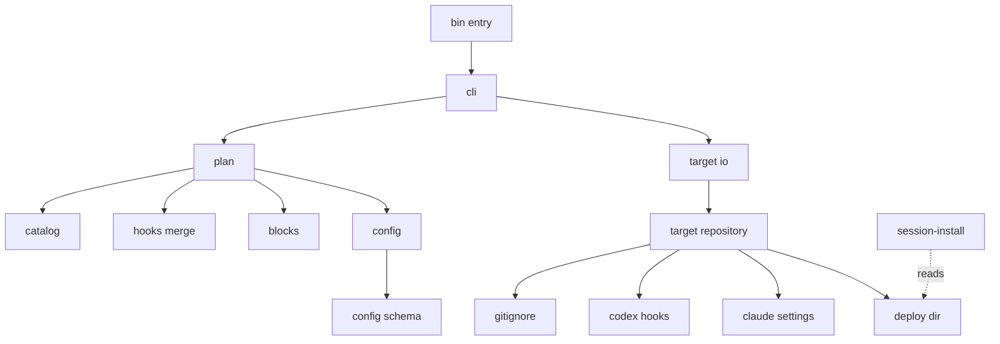
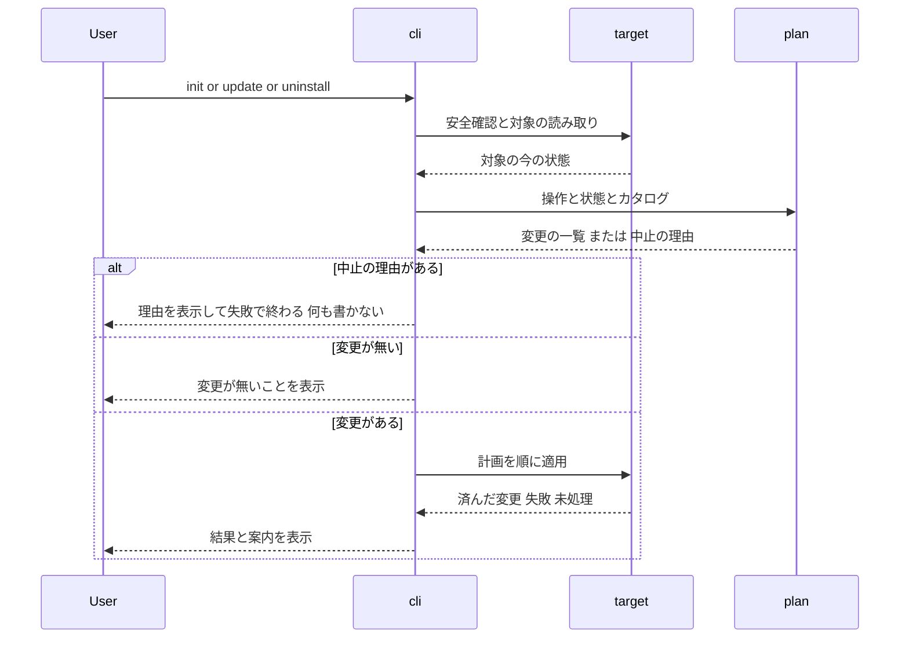

# 設計文書: installer-core

> 改訂（2026-11-23）: 単純化後の要件に合わせて書き直した。旧版（配置記録・改変検出・対話・CLAUDE.md の管理区画）は git の履歴にある。
>
> 改訂（2026-11-24）: タスク 7.2 で、Codex は git の worktree（同じリポジトリの別の作業フォルダ）の中でも本体の checkout の `.codex/hooks.json` だけを読むことが分かった。フックのコマンドはセッションの作業場所で動くので、今のコマンドの形のままで worktree 側のスクリプトが呼ばれる。登録の形は変えず、worktree での前提（本体の checkout にも導入が要る）を導入の案内と実機の確認の段取りに足した。

## Overview

**Purpose**: 導入コマンド（`npx github:nekono-dev/cc-sdd-bootstrap <操作>`）が、cc-sdd を使うための共通の配置物・設定ファイル・フックの登録・運用の区画の文章・`.gitignore` の除外設定を、Claude Code と Codex の両方に向けて 1 回の操作で揃える。

**Users**: cc-sdd の運用を複数のリポジトリへ導入・更新する開発者。このリポジトリ自身も同じ操作で使う（自己適用）。

**Impact**: develop の導入コマンドから、配置記録・改変検出・`--force`・設定値の引数・対話・CLAUDE.md の管理区画の作成を外す。Codex のフックの設定（`.codex/hooks.json`）への登録と、CLAUDE.md・AGENTS.md の末尾に書き足す運用の区画の文章の配置を足す。

### Goals
- `init`・`update`・`uninstall` を、対話なしで、変更の範囲を限って行う。
- 共通の配置物は再実行で版の内容に揃い、旧版の残りは消える（記録を持たない）。
- 下流の spec（session-install・kiro-gate・subagent-delegation）は、カタログと設定の項目定義に項目を足すだけで、配置・登録・除外・区画の文章を増やせる。

### Non-Goals
- cc-sdd 本体の取得・導入、CLAUDE.md・AGENTS.md の書き出しと区画の書き足し（session-install）。
- 各フックが実行時に何をするか（session-install・kiro-gate・subagent-delegation）。
- 版管理の操作（追跡を外すなど）。案内だけを出す。
- 設定の自動移行、利用者が配置先に置いたファイルの保護。

## Boundary Commitments

### This Spec Owns
- 導入コマンドの入口と操作（`init`・`update`・`uninstall`・使い方の表示）、結果と失敗の日本語の表示。
- カタログ（配置するスクリプト・フックの登録・`.gitignore` の行・運用の区画の文章の一覧）の形と、installer-core 自身の項目。
- 設定ファイル `.cc-sdd-bootstrap.json` の初期作成・読み取り・検証・補いと、項目定義の形。
- 配置先ディレクトリ `.agent-hooks/cc-sdd-bootstrap/` の中身（カタログのスクリプトと、組み立てた運用の区画のファイル）。
- カタログの `generated` が返すファイル（`owns` の型の範囲。中身は各 spec が決める）の書き出しと片付け。
- `.claude/settings.json` と `.codex/hooks.json` の中の、一式の登録（コマンドに `/.agent-hooks/cc-sdd-bootstrap/` を含む組）。
- `.gitignore` の中の目印で囲んだ区画。
- 運用の区画の目印の定義と、`uninstall` で CLAUDE.md・AGENTS.md から区画を外す処理。
- 変更先の安全策（git の最上位、リポジトリの外とシンボリックリンクの拒否、Node.js 22 以上）。

### Out of Boundary
- CLAUDE.md・AGENTS.md への区画の書き足しと、標準の文書の書き出し（session-install。installer-core は区画のファイルを用意するだけ）。
- 区画の文章の中身のうち、導入・手順書の強制・子の委任の案内（各 spec がカタログに足す）。
- 配置するスクリプトの中身と実行時の振る舞い。
- 役割表の内容とエージェント定義の生成（subagent-delegation）。
- このリポジトリの CLAUDE.md の中身の移し替え（`handoff-self-apply.md` の手順で、自己適用のタスクとして行う）。

### Allowed Dependencies
- Node.js 22 の標準モジュールだけ（外部パッケージなし）。
- 依存の向き: `catalog`・`config-schema`（データ）→ `config`・`blocks`・`hooks-merge`・`plan`（純粋な計算）→ `target`（入出力）→ `cli`（操作の流れと表示）→ `bin`（入口）。逆向きの読み込みは誤りとして扱う。
- 配置先のスクリプトは `lib/` を読み込まない（利用先には `lib/` が無い）。`lib/` は配置先の `config-schema.mjs`（`lib/config-schema.mjs` の 1 行の公開し直し）と、カタログの `generated` の `render` に使う配置物の純粋な関数（subagent-delegation の `subagent-roles.mjs` の `renderDefinitions`）だけを読み込んでよい。例外として、`lib/config-schema.mjs` は設定の項目をつなぐため、配置物の関数として `subagent-roles` の `subagentsField` も読み込んでよい（subagent-delegation 1.12）。

### Revalidation Triggers
- カタログの形（項目の名前・意味）の変更 → session-install・kiro-gate・subagent-delegation の追加分を見直す。`generated`（設定から作るファイル）は subagent-delegation の設計で足した（2026-11-23）。
- 運用の区画のファイルの道筋・目印の行の変更 → session-install の書き足しを見直す。
- フックのコマンドの形（根の求め方・見分けの文字列）の変更 → 各フックのスクリプトの起動のされ方を見直す。
- Codex がフックの設定を読む場所の変更（今は worktree でも本体の checkout の `.codex/hooks.json`。Codex の版を上げたとき実機で再確認し、結果は PoC 文書に残す）→ 導入の案内と、下流のフックの「登録とスクリプトの版がずれる」前提を見直す。
- 設定の項目定義の形の変更 → 設定を読むフック（session-install・subagent-delegation）を見直す。
- 配置先ディレクトリの道筋の変更 → すべての下流を見直す。

## Architecture

### Existing Architecture Analysis
- 今の導入コマンドは「計画してから書く」形（`plan.mjs` が純粋に計算し、`target.mjs` が読み書きする）。この形は保つ。
- 外すもの: `lib/ledger.mjs`（配置記録）、`plan.mjs` の記録との比較・改変の検出・`force`、`cli.mjs` の設定値の引数と対話、`blocks.mjs` を使った CLAUDE.md の管理区画の作成・置き換え、カタログの `kind: "project"`・`executable`・条件つきの `.gitignore` の行。
- 足すもの: Codex のフックの設定への登録、運用の区画のファイルの組み立て、`uninstall` での区画の取り外し、`init` での既存の文書の案内。

### Architecture Pattern & Boundary Map



**Architecture Integration**:
- Selected pattern: 計画してから書く。中止の条件（設定の誤り・目印の破損・読めない JSON・危険な道筋）をすべて計画の段階で見つけ、1 つでもあれば何も書かない。
- Domain boundaries: データ（カタログ・項目定義）と計算と入出力を分ける。下流の spec はデータだけを足す。
- New components rationale: `hooks-merge` は今の `settings-hooks` を Claude Code・Codex の両方に使えるよう一般化したもの。新しい部品はこれだけ。
- Steering compliance: Node.js 22・外部パッケージなし・日本語の出力・厳密さのためにコードを増やさない。

### Technology Stack

| Layer | Choice / Version | Role in Feature | Notes |
|-------|------------------|-----------------|-------|
| CLI | Node.js 22 以上、ES モジュール（`.mjs`） | 入口と処理の本体 | 外部パッケージなし |
| 配布 | `npx github:nekono-dev/cc-sdd-bootstrap` | 認証なしの取得と実行 | `package.json` の `files` で配る範囲を絞る |
| 設定 | JSON（`.cc-sdd-bootstrap.json`、`.claude/settings.json`、`.codex/hooks.json`） | 設定と登録 | 2 つの登録先は同じ形 |
| テスト | `node --test` | 単体と一時ディレクトリでの通しの試験 | |

## File Structure Plan

### Directory Structure
```
bin/
└── cc-sdd-bootstrap.mjs        # 入口。Node の版を確かめてから cli を動的に読み込む（io から interactive を外すだけ）
lib/
├── catalog.mjs                 # データ: 道筋の定数・カタログ・運用の区画の目印
├── config-schema.mjs           # 配置先の config-schema.mjs の公開し直し（変更なし）
├── config.mjs                  # 設定の解釈・検証・補い・書き出し（純粋）
├── blocks.mjs                  # 目印で囲んだ区画の作成・置き換え・削除（純粋）
├── hooks-merge.mjs             # 新設（settings-hooks.mjs を置き換え）: 両ツールのフックの登録の統合と取り外し（純粋）
├── plan.mjs                    # 操作ごとの計画の計算（純粋）
├── target.mjs                  # 対象の読み取り・道筋の安全確認・計画の適用（入出力）
├── node-version.mjs            # Node の版の判定（変更なし）
└── cli.mjs                     # 引数の解析・操作の流れ・表示
.agent-hooks/cc-sdd-bootstrap/
├── config-schema.mjs           # 設定の項目定義（配置物。フックからも読む。installer-core では変えない）
├── agent-section-claude.md     # 生成物: CLAUDE.md の末尾に書き足す運用の区画（目印の行を含む）
└── agent-section-codex.md      # 生成物: AGENTS.md の末尾に書き足す運用の区画（目印の行を含む）
test/
├── catalog.test.mjs            # カタログの整合（実在・package.json の files・除外の行が共有物を外さない）
├── config.test.mjs             # 設定の検証・補い・未知の項目の保持
├── blocks.test.mjs             # 区画の検出と破損の判定
├── hooks-merge.test.mjs        # 両ツールの登録の統合・重複なし・利用者の組の保持・読めない JSON
├── plan.test.mjs               # 操作ごとの計画（配置先の片付け・区画の組み立て・uninstall・中止の条件）
├── target.test.mjs             # 道筋の安全確認と適用・途中の失敗の報告
├── cli.test.mjs                # 引数の解析・使い方・表示の文言
└── cli.e2e.test.mjs            # 一時の git リポジトリでの init → update → uninstall の通し
```

### Modified Files
- `lib/catalog.mjs` — `LEDGER_PATH` と `kind`・`executable`・`claudeSections`・条件つきの行を外す。`hooks` に `tools`（`claude`・`codex`）とスクリプト名・引数を持たせ、`agentSections` と `AGENT_SECTION_MARKERS`・`AGENT_SECTION_FILES` を足す。`.gitignore` の行に Codex 向けの導入物と CLAUDE.md・AGENTS.md を足す。
- `lib/config.mjs` — 設定値の引数（`given`）の解決を外す。読み取り・検証・既定値の補い・書き出しだけにする。
- `lib/plan.mjs` — 記録・改変検出・`force`・CLAUDE.md の管理区画を外す。配置先の片付け、区画のファイルの組み立て、`.codex/hooks.json`、`uninstall` の区画の取り外し、`init` の既存の文書の案内を足す。
- `lib/target.mjs` — 記録の読み書きを外す。配置先ディレクトリの一覧、`.codex/hooks.json`・CLAUDE.md・AGENTS.md の読み取りを足す。
- `lib/cli.mjs` — `--force` と設定値の引数と対話（`promptValues`）を外す。入口の `runCli` の名前は保ち、`io` から `interactive` を外す。表示に Codex の信頼の承認（worktree では本体の checkout の導入と承認が要ること）・既存の文書・共有の方法の案内を足す。
- `.agent-hooks/cc-sdd-bootstrap/config-schema.mjs` — installer-core では変更しない。項目定義の形（`path`・`kind`・`defaultValue`・`validate`）は、配置中の導入スクリプト（`install-rules.mjs`）も使うので保つ。`lib/` は対話用の `flag`・`question`・`mapKeys`・`notice` を使わなくなるだけ。`keepTemplates`・`models` などの項目の見直しは、それを使う spec（session-install・subagent-delegation）が行う。
- `package.json` — `files` をカタログのスクリプトに合わせる（生成物の区画のファイルは含めない）。
- 削除: `lib/ledger.mjs`・`lib/settings-hooks.mjs`、`test/ledger.test.mjs`・`test/settings-hooks.test.mjs`・`test/config-keep-templates.test.mjs`・`test/cli-field-notice.test.mjs`・`test/plan-gitignore-make.test.mjs`・`test/target-ignore-lines.test.mjs` など記録・対話・条件つきの行に依る試験。残す試験は新しい振る舞いに合わせて直す。
- 自己適用（要件 9）: `.kiro/steering/project-rules.md` を新設し、`handoff-self-apply.md` の表どおりに今の CLAUDE.md の決まりを移す。この手順の実施は installer-core と session-install の両方の実装が済んでから行う。

## System Flows



- 適用の順: 設定ファイル → 配置先ディレクトリ（消す → 書く）→ `.claude/settings.json` → `.codex/hooks.json` → `.gitignore`（`uninstall` は 2 つのフックの設定 → CLAUDE.md → AGENTS.md）。途中で失敗したら残りを行わず、済んだもの・失敗・未処理・再実行する操作を表示する（8.5）。
- 再実行で同じ結果になる（各変更は「この内容にする」形で、差が無ければ変更に載せない）。

## Requirements Traceability

| Requirement | Summary | Components | Interfaces | Flows |
|-------------|---------|------------|------------|-------|
| 1.1 | init で両ツールに一式を配置 | Plan, Target, Catalog | `computePlan` | 導入の流れ |
| 1.2 | update で設定を保ち揃える | Plan, Config | `computePlan` | 導入の流れ |
| 1.3 | init で設定があれば変えず update を案内 | Plan, Cli | `PlanAbort` `CONFIG_EXISTS` | 中止 |
| 1.4 | update で設定が無ければ init を案内して失敗 | Plan, Cli | `PlanAbort` `CONFIG_MISSING` | 中止 |
| 1.5 | 差が無ければ変更なしと表示 | Plan, Cli | `Plan.changes` が空 | 変更なし |
| 1.6 | 対話しない | Cli | `parseArgs` | — |
| 1.7 | 使い方の表示 | Cli | `buildUsage` | — |
| 1.8 | 未知の操作・指定で失敗 | Cli | `parseArgs` の `usage-error` | — |
| 2.1 | init で設定を既定値で作る | Plan, Config | `fillDefaults` `serializeConfig` | 導入の流れ |
| 2.2 | 既定値と直接編集の案内 | Cli | `formatSuccess` | — |
| 2.3 | update で必要な項目を検証 | Config | `validateConfig` | — |
| 2.4 | 設定が読めない・不正なら失敗 | Config, Plan, Cli | `ConfigError` | 中止 |
| 2.5 | 記入した値と使わない項目を保つ | Config | `fillDefaults` は無い項目だけ足す | — |
| 3.1 | 共通の配置物を作成・置き換え | Plan, Target, Catalog | `FileChange` write | 導入の流れ |
| 3.2 | 強制の指定なしで置き換え | Plan | — | — |
| 3.3 | 直接編集しない・差分は git で確認の案内 | Cli | `formatSuccess` | — |
| 3.4 | 配置先を入れ直し旧版を残さない | Plan, Target | `TargetSnapshot.deployDirFiles`、`FileChange` delete | 導入の流れ |
| 3.5 | cc-sdd 本体を同梱しない | Catalog, package.json | catalog 試験 | — |
| 4.1 | 両ツールにフックを登録 | HooksMerge, Plan, Catalog | `mergeHooks` `buildCommand` | 導入の流れ |
| 4.2 | 自分の組だけ置き換える | HooksMerge | `OWNED_MARKER` | — |
| 4.3 | 重複させない | HooksMerge | — | — |
| 4.4 | 読めない設定は変えず失敗 | HooksMerge, Plan | `HooksError` | 中止 |
| 4.5 | Codex の信頼の承認の案内（最初の承認は対話の画面で。worktree では本体の checkout の導入と承認が要り、揃うまでは起動前に導入のコマンドを実行） | Cli | `formatSuccess` | — |
| 5.1 | 区画の文章を両ツール向けに配置 | Plan, Catalog | `renderAgentSection` | 導入の流れ |
| 5.2 | 各 spec の案内と steering を読む案内 | Catalog | `agentSections` | — |
| 5.3 | 標準の文書の本文を複製しない | Catalog | catalog 試験 | — |
| 5.4 | CLAUDE.md・AGENTS.md を自ら書き換えない | Plan | init・update の計画に両文書が載らない | — |
| 5.5 | init で既存の文書の案内 | Plan, Cli | `Plan.notices` `EXISTING_AGENT_DOCS` | — |
| 6.1 | 導入物と手元の状態を除外 | Catalog, Plan, Blocks | `GITIGNORE_MARKERS` | 導入の流れ |
| 6.2 | 自分の区画だけ更新 | Blocks | `replaceBlock` | — |
| 6.3 | 重複させない | Blocks, Plan | — | — |
| 6.4 | 共有物を除外しない | Catalog | catalog 試験 | — |
| 6.5 | 共有の方法の案内 | Cli | `formatSuccess` | — |
| 7.1 | uninstall で登録と区画を外す | Plan, HooksMerge, Blocks | `removeHooks` `removeBlock` | 取り外し |
| 7.2 | それ以外は残す | Plan | uninstall の計画の範囲 | — |
| 7.3 | 外したものと残るものを表示 | Cli | `formatSuccess` | — |
| 7.4 | 読めない設定・壊れた目印は変えず失敗 | Plan, Blocks, HooksMerge | `PlanAbort` | 中止 |
| 8.1 | git の最上位でなければ失敗 | Target, Cli | `isGitRoot` | 中止 |
| 8.2 | リポジトリの外・シンボリックリンクを拒否 | Target | `checkPathSafety` | 中止 |
| 8.3 | 変更の範囲を限る | Plan | `ALLOWED_PATHS` | — |
| 8.4 | 成功の表示 | Cli | `formatSuccess` | — |
| 8.5 | 途中の失敗の表示 | Target, Cli | `ApplyResult` `formatApplyFailure` | 適用 |
| 8.6 | Node.js 22 未満で失敗 | Bin, NodeVersion | `decideNodeSupported` | — |
| 8.7 | 依存パッケージを求めない | package.json, Catalog | package 試験 | — |
| 9.1 | このリポジトリにも同じ操作で揃える | Cli（`node bin/cc-sdd-bootstrap.mjs update`） | — | 導入の流れ |
| 9.2 | 旧配置記録が残らない | Plan（3.4 の片付け） | — | — |
| 9.3 | 再実行で変更なし | Plan | — | — |
| 9.4 | 独自の決まりを steering に移し両文書を除外 | project-rules.md、Catalog の除外の行 | `handoff-self-apply.md` | 自己適用 |

## Components and Interfaces

| Component | Domain/Layer | Intent | Req Coverage | Key Dependencies | Contracts |
|-----------|--------------|--------|--------------|------------------|-----------|
| Catalog | データ | 配置・登録・除外・区画の文章の一覧と道筋の定数 | 3.1, 3.5, 4.1, 5.1–5.3, 6.1, 6.4 | なし | State |
| ConfigSchema | データ（配置物） | 設定の項目定義 | 2.1, 2.3 | なし | State |
| Config | 計算 | 設定の解釈・検証・補い・書き出し | 2.1–2.5 | ConfigSchema (P0) | Service |
| Blocks | 計算 | 目印で囲んだ区画の操作 | 6.2, 6.3, 7.1, 7.4 | なし | Service |
| HooksMerge | 計算 | 両ツールのフックの登録の統合と取り外し | 4.1–4.4, 7.1, 7.4 | Catalog (P0) | Service |
| Plan | 計算 | 操作ごとの変更と中止の理由の計算 | 1.1–1.5, 2.1, 3.1–3.4, 5.1, 5.4, 5.5, 6.1, 7.1, 7.2, 8.3, 9.2, 9.3 | Config, Blocks, HooksMerge, Catalog (P0) | Service |
| Target | 入出力 | 安全確認・読み取り・適用 | 8.1, 8.2, 8.5 | Plan の型 (P0) | Service |
| Cli | 流れと表示 | 引数・操作の流れ・日本語の表示 | 1.3, 1.4, 1.6–1.8, 2.2, 3.3, 4.5, 5.5, 6.5, 7.3, 8.4, 8.5 | Target, Plan (P0) | Service |
| Bin / NodeVersion | 入口 | Node の版の確認 | 8.6 | Cli (P0) | — |

### データ

#### Catalog

| Field | Detail |
|-------|--------|
| Intent | 一式として配置・登録・除外するものと、運用の区画の文章をデータで持つ |
| Requirements | 3.1, 3.5, 4.1, 5.1, 5.2, 5.3, 6.1, 6.4 |

**Responsibilities & Constraints**
- データだけを持ち、他の `lib/` を読み込まない。下流の spec はここに項目を足す。
- `files` の道筋は `DEPLOY_DIR` の下に限る。cc-sdd 本体のスキル・雛形は載せない（3.5）。
- `gitignore` の行は、設定ファイル・配置先・`.claude/settings.json`・`.codex/hooks.json`・`.kiro/specs/`・`.kiro/steering/` に当たらない（6.4、試験で確かめる）。

**Contracts**: State [x]

##### State Management
```typescript
const DEPLOY_DIR = ".agent-hooks/cc-sdd-bootstrap";
const OWNED_MARKER = "/.agent-hooks/cc-sdd-bootstrap/";
const CONFIG_PATH = ".cc-sdd-bootstrap.json";
const CLAUDE_SETTINGS_PATH = ".claude/settings.json";
const CODEX_HOOKS_PATH = ".codex/hooks.json";
const AGENT_DOCS = { claude: "CLAUDE.md", codex: "AGENTS.md" } as const;
const AGENT_SECTION_FILES = { claude: `${DEPLOY_DIR}/agent-section-claude.md`, codex: `${DEPLOY_DIR}/agent-section-codex.md` } as const;
const AGENT_SECTION_MARKERS = {
  begin: "<!-- cc-sdd-bootstrap:begin（この区画は cc-sdd の導入のたびに書き足される。編集しない） -->",
  end: "<!-- cc-sdd-bootstrap:end -->",
};
const GITIGNORE_MARKERS = { begin: "# >>> cc-sdd-bootstrap（この区画は cc-sdd-bootstrap が管理する）", end: "# <<< cc-sdd-bootstrap" };

type Tool = "claude" | "codex";
interface CatalogFile { path: string }                       // DEPLOY_DIR の下。同梱の同じ道筋から写す
interface CatalogHook {
  tools: Tool[];                                             // 登録先
  event: "SessionStart" | "UserPromptSubmit" | "PreToolUse" | "PostToolUse" | "Stop";
  matcher?: string;
  script: string;                                            // DEPLOY_DIR の中のファイル名
  args: string[];
  timeout?: number;                                          // 秒
}
interface AgentSection { id: string; claude: string; codex: string } // Markdown。両ツールで同じ趣旨
interface CatalogGenerated {                                 // 設定から作るファイル（subagent-delegation の役割定義）
  id: string;
  owns: string[];                                            // "*" を 1 つ含む道筋の型（例 ".claude/agents/cc-sdd-*.md"）
  render(config: ConfigObject): { files: { path: string; content: string }[]; notices: string[] };
}
interface Catalog {
  files: CatalogFile[];
  hooks: CatalogHook[];
  gitignore: string[];
  agentSections: AgentSection[];
  generated: CatalogGenerated[];
}
```
- installer-core 自身の項目:
  - `gitignore`: `.claude/skills/kiro-*/`、`.agents/skills/kiro-*/`、`.kiro/settings/`、`/CLAUDE.md`、`/AGENTS.md`、`/.cache/`。
  - `agentSections` の先頭 `bootstrap-intro`: この区画は導入のたびに書き足されること、配置先（`.agent-hooks/cc-sdd-bootstrap/`）を直接編集しないこと、プロジェクト独自の決まりは作業の前に `.kiro/steering/` の文書（`product.md`・`tech.md`・`structure.md` と独自の文書）から読むこと（5.2）。標準の文書の本文は書かない（5.3）。
- 今ある session-install のスクリプト（`install-cc-sdd.mjs`・`install-rules.mjs`・`install-gate.mjs`）と Claude Code 向けの 2 つのフックは、session-install の設計で置き換わるまで、`tools: ["claude"]` の項目として残す。

#### ConfigSchema（`.agent-hooks/cc-sdd-bootstrap/config-schema.mjs`）

```typescript
type ConfigValue = string | boolean | Record<string, unknown>;
interface ConfigField {                       // 今の形を保つ（配置中の導入スクリプトも読む）
  path: string;                               // "ccSdd.version" のような点区切り
  kind: "string" | "boolean" | "map";
  defaultValue: ConfigValue;
  validate(value: unknown): string | null;    // 不正なら日本語の理由
  // flag・question・mapKeys・notice は旧版の対話と引数の名残。lib/ は使わない（項目の持ち主の spec が整理する）
}
const CONFIG_FORMAT = 1;
function formatProblem(format: unknown): string | null;  // format が無い・1 でないときの理由
const configFields: ConfigField[];            // 項目は各 spec が持つ（installer-core が初期作成で使うのは全項目の既定値）
```
- 設定ファイルの形: `{ "format": 1, "ccSdd": { "version": "3.1.0", "lang": "ja" }, ... }`。`format` は 1 のまま（移行しない）。
- **必須値**（2.3）: `format` だけを必須とし、無い・1 でなければ `CONFIG_INVALID`。項目定義にある項目は、値があれば `validate` で確かめ、無ければ既定値で補って補った項目を表示する（既定値を持つので欠けても不正にしない）。

### 計算

#### Config

```typescript
type ConfigObject = { format: number } & Record<string, unknown>;
type ConfigError = { code: "CONFIG_UNREADABLE" | "CONFIG_INVALID"; file: string; messages: string[] };
function parseConfig(text: string): { ok: true; config: ConfigObject } | { ok: false; error: ConfigError };
function validateConfig(config: ConfigObject, fields: ConfigField[]): ConfigError | null;  // format と、値のある項目の validate
function fillDefaults(config: ConfigObject, fields: ConfigField[]): { config: ConfigObject; filled: string[] };
function serializeConfig(config: ConfigObject): string;  // 2 字下げ、末尾改行
```
- 項目定義に無い項目（旧版の `keepTemplates` など）は検証も削除もしない（2.5）。

#### Blocks

```typescript
type Markers = { begin: string; end: string };
type BlockError = { code: "MARKERS_BROKEN"; file: string; detail: string };
function findBlock(text: string, markers: Markers): { start: number; end: number } | null | BlockError;
function replaceBlock(text: string | null, markers: Markers, body: string): string | BlockError; // 無ければ末尾に足す
function removeBlock(text: string, markers: Markers): string | BlockError;
```
- 目印が片方だけ・順序が逆・複数組なら `BlockError`。改行の種類は元の文書に合わせる（今の実装を保つ）。

#### HooksMerge（新設。`settings-hooks.mjs` を置き換え）

```typescript
type HooksError = { code: "HOOKS_UNREADABLE"; file: string; detail: string };
function buildCommand(tool: Tool, hook: CatalogHook): string;
// claude: node "$CLAUDE_PROJECT_DIR/.agent-hooks/cc-sdd-bootstrap/<script>" <args>
// codex : node "$(git rev-parse --show-toplevel)/.agent-hooks/cc-sdd-bootstrap/<script>" <args>
function mergeHooks(input: { file: string; text: string | null; tool: Tool; hooks: CatalogHook[] }): { text: string; changed: boolean } | HooksError;
function removeHooks(input: { file: string; text: string | null }): { text: string | null; changed: boolean } | HooksError;
```
- 形: `{ "hooks": { "<イベント>": [ { "matcher"?: string, "hooks": [ { "type": "command", "command": string, "timeout"?: number } ] } ] } }`（両ツール共通）。
- 一式のコマンド = `hooks` の中の `command` に `OWNED_MARKER` を含むもの。統合は「各組から一式のコマンドだけを外し（外して空になった組は捨てる）、そのツール向けのカタログの組を各イベントの最後に足す」。同じ組にある利用者のコマンド、利用者の組、その他の鍵は順序も保つ（4.2。今の `settings-hooks.mjs` の選別を引き継ぐ）。同じ版での再実行は同じ文字列になる（4.3）。
- JSON として読めない、または `hooks` が期待の形でない場合は `HooksError`（4.4・7.4）。`removeHooks` も同じ選別で一式のコマンドだけを外し、空になった組とイベントの配列は消す。
- **git の worktree での Codex**（実機検証で確認）: Codex は worktree の中でも本体の checkout の `.codex/hooks.json` だけを読む（worktree 側のファイルは、本体側に無くても読まれない）。コマンドはセッションの作業場所で動くので、`$(git rev-parse --show-toplevel)` は worktree の根になり、worktree 側の配置物のスクリプトが呼ばれる。そのため、コマンドの形は変えない（本体側の道筋を書き込む形や、利用者の全体の設定への登録は採らない。後者は要件 8.2 のリポジトリの外への書き込みになる）。
  - 結果として、worktree では「登録（どのイベントで何を呼ぶか）」は本体の checkout の版、「スクリプトの中身」は worktree の版になる。本体側に登録があれば、cc-sdd の導入のフック（session-install が SessionStart・UserPromptSubmit に登録する）が、Codex の作業の前に worktree へ cc-sdd を入れる（実際の配置物で確認。PoC の場面 9）。
  - 本体側が未導入ならフックは動かず、登録が worktree に無いスクリプトを指すとそのフックは失敗するだけでセッションは止まらない（PoC の場面 4・6）。AGENTS.md とスキルはコミットしないので、作ったばかりの worktree ではこのとき AGENTS.md も無い。そのため、本体側が揃うまでは worktree で Codex を起動する前に導入のコマンド（`node .agent-hooks/cc-sdd-bootstrap/install-cc-sdd.mjs`。session-install の再試行と同じもの）を手で実行するよう案内する（4.5）。
  - 信頼の承認は、本体の checkout の `.codex/hooks.json` に対して行う。対話の画面の `codex` を worktree で起動すると、確認の画面の出どころに本体側のファイルが示され、承認の記録も本体側のファイルの道筋で残る。1 回の承認でその worktree にも効く。`codex exec` は未承認のフックを黙って飛ばすので、最初の承認は対話の画面で行う（PoC の場面 7・8）。
  - 版のずれを防ぐ仕組み（登録の一本化・版の照合など）は作らない（roadmap の「厳密さのためにコードを増やさない」）。下流の spec は、Codex のフックのスクリプトが登録と別の版で呼ばれうること、呼ばれないことがありうることを前提にする。

#### Plan

```typescript
type Operation = "init" | "update" | "uninstall";
interface TargetSnapshot {
  config: string | null;
  claudeSettings: string | null;
  codexHooks: string | null;
  gitignore: string | null;
  agentDocs: { claude: string | null; codex: string | null };   // uninstall と init の案内だけに使う
  deployDirFiles: Record<string, Buffer>;                         // 配置先ディレクトリの今のファイル（道筋 → 中身）
  generatedFiles: Record<string, Buffer>;                         // generated の owns の型に当たる今のファイル
  sourceFiles: Record<string, Buffer>;                            // 同梱のカタログのファイル
}
type FileChange =
  | { kind: "write"; path: string; content: string | Buffer; created: boolean }
  | { kind: "delete"; path: string };
type PlanAbort =
  | { code: "CONFIG_EXISTS" } | { code: "CONFIG_MISSING" }
  | ConfigError | HooksError | BlockError;
type PlanNotice = { code: "EXISTING_AGENT_DOCS"; files: string[] } | { code: "CODEX_TRUST" } | { code: "CONFIG_CREATED"; defaults: string[] } | { code: "GENERATED_NOTICE"; id: string; messages: string[] };
type Plan = { ok: true; changes: FileChange[]; notices: PlanNotice[]; removed: string[] } | { ok: false; aborts: PlanAbort[] };
function computePlan(input: { operation: Operation; snapshot: TargetSnapshot; catalog: Catalog; fields: ConfigField[] }): Plan;
function renderAgentSection(tool: Tool, sections: AgentSection[]): string; // 目印の行・各区画の文章を空行で区切って連結
```
- `init`・`update`:
  - 設定: `init` は無ければ既定値で作る。あれば `CONFIG_EXISTS`。`update` は無ければ `CONFIG_MISSING`、あれば検証し、欠けた項目だけ補う。
  - 配置先: `deployDirFiles` のうちカタログと 2 つの区画のファイルに無いものを `delete`、カタログのファイルと区画のファイルを内容が違えば `write`（3.1・3.4）。
  - 2 つのフックの設定へ `mergeHooks`、`.gitignore` へ `replaceBlock`。
  - `generated`: 設定を検証した後に各 `render` を呼び、返したファイルを内容が違えば `write`、`owns` の型に当たる今のファイルのうち返さなかったものを `delete`。`notices` は `PlanNotice` の `GENERATED_NOTICE` として表示する。`render` が `owns` に当たらない道筋を返したら実装の誤りとして例外にする。`uninstall` は生成物を消さない（7.2 の共通の配置物と同じ扱い）。
  - CLAUDE.md・AGENTS.md は変更に載せない（5.4）。`init` でどちらかがあれば `EXISTING_AGENT_DOCS`（5.5）。
- `uninstall`: 2 つのフックの設定へ `removeHooks`、CLAUDE.md・AGENTS.md があれば `removeBlock`（区画が無ければ変更なし）。それ以外は変更に載せない（7.2）。設定ファイル・配置先は読まない（壊れていても取り外しを妨げない）。
- 変更の道筋は `ALLOWED_PATHS`（設定ファイル・配置先の下・2 つのフックの設定・`.gitignore`・`generated` の `owns` の型・`uninstall` のときの CLAUDE.md・AGENTS.md）に限る。外れたら実装の誤りとして例外にする（8.3）。
- 中止の理由はすべて集めてから返す。1 つでもあれば変更は空。

### 入出力

#### Target

```typescript
function isGitRoot(dir: string): boolean;                                  // .git の有無
function checkPathSafety(root: string, relPath: string): { ok: true } | { ok: false; reason: "OUTSIDE" | "SYMLINK"; at: string };
function readSnapshot(root: string, packageRoot: string, catalog: Catalog): TargetSnapshot | { ok: false; reason: "OUTSIDE" | "SYMLINK"; at: string };
type ApplyResult = { ok: boolean; done: FileChange[]; failed?: { change: FileChange; message: string }; pending: FileChange[] };
function applyPlan(root: string, changes: FileChange[]): ApplyResult;      // 順に書き、失敗したら止める。空になったディレクトリは消す
```
- 読み取りと書き込みの前に、すべての対象の道筋で安全確認を行う（8.2）。配置先ディレクトリの一覧はシンボリックリンクをたどらない。

#### Cli

```typescript
type ParsedArgs = { kind: "help" } | { kind: "usage-error"; message: string } | { kind: "run"; operation: Operation };
function parseArgs(argv: string[]): ParsedArgs;   // 受け付けるのは init・update・uninstall・help・--help・-h だけ
function buildUsage(fields: ConfigField[]): string;
function runCli(argv: string[], io: { cwd: string; stdout: Writable; stderr: Writable; packageRoot: string }): Promise<number>; // 終了コード。bin が呼ぶ今の入口の名前を保つ
```
- 表示（日本語）:
  - 成功（8.4）: 作成・更新・削除した対象の一覧。設定を作ったら既定値と直接編集の案内（2.2）。配置先は直接編集せず差分は git で確かめる（3.3）。Codex のフックは信頼の承認が要り、未承認なら AGENTS.md の指示に従う（4.5）。最初の承認は対話の画面の `codex` で行う（`codex exec` は未承認のフックを黙って飛ばす）。git の worktree で Codex を使うときは、フックの登録が本体の checkout の `.codex/hooks.json` から読まれるため、本体の checkout にも同じ導入（この版を取り込んだ状態）が要り、信頼の承認も本体側のファイルに対して行う。本体側が揃うまでは、worktree で Codex を起動する前に `node .agent-hooks/cc-sdd-bootstrap/install-cc-sdd.mjs` を実行して cc-sdd と AGENTS.md を入れる（4.5・6.5）。設定と配置物はコミットし、cc-sdd 本体は session-install の手順で入る（6.5）。既存の文書の案内（5.5）。
  - `uninstall`（7.3）: 外した登録・区画と、残る設定ファイル・配置物・除外設定。
  - 中止: 理由ごとにファイル名・問題箇所・直し方。
  - 途中の失敗（8.5）: 失敗した対象と理由、済んだ対象、未処理の対象、再実行する操作。`init` で設定ファイルを書き終えた後の失敗なら、再実行する操作は `update`（1.3 で `init` は止まるため）。

## Data Models

### Data Contracts & Integration
- **運用の区画のファイル**（session-install が読む）: `AGENT_SECTION_FILES` の 2 つ。中身は `AGENT_SECTION_MARKERS.begin` の行で始まり `end` の行で終わる 1 つの区画で、末尾は改行。session-install は解釈せず、そのまま文書の末尾へ足す。
- **カタログ**（下流が足す）: 上の `Catalog` の形。`agentSections` は配列の順に区画へ並ぶ（installer-core の `bootstrap-intro` が先頭）。
- **設定の項目定義**（下流が足す）: `ConfigField`。下流の項目も `init` で既定値が入り、`update` で欠けた項目が補われる。

## Error Handling

| 状況 | 扱い | 要件 |
|---|---|---|
| git の最上位でない | 何も書かず、最上位で実行するよう案内して失敗 | 8.1 |
| Node.js 22 未満 | 何も読み込まず、必要な版を表示して失敗 | 8.6 |
| 未知の操作・指定 | 何も書かず、問題の指定と使い方を表示して失敗 | 1.8 |
| init で設定がある／update で設定が無い | 何も書かず、正しい操作を案内（update が無いときは失敗） | 1.3, 1.4 |
| 設定が読めない・不正 | 何も書かず、ファイル名・項目・理由を表示して失敗 | 2.4 |
| フックの設定が読めない | 何も書かず、ファイル名と理由を表示して失敗 | 4.4, 7.4 |
| 区画の目印が壊れている | 何も書かず、ファイルと目印の状態・直し方を表示して失敗 | 7.4 |
| リポジトリの外・シンボリックリンク | 何も書かず、対象と理由を表示して失敗 | 8.2 |
| 書き込みの途中の失敗 | 残りを行わず、済んだ・失敗・未処理・再実行を表示して失敗 | 8.5 |

## Testing Strategy

- **単体（計算）**
  - `hooks-merge`: Claude Code と Codex の両方で、利用者の組と他の鍵を保ったまま一式の組だけ置き換わる（4.2）。再実行で同じ文字列（4.3）。読めない JSON・形の違う `hooks` で `HooksError`（4.4）。Codex 向けのコマンドがシェルの展開の形になる（4.1）。`removeHooks` で一式の組だけ消える（7.1）。
  - `plan`: 旧版の `installed.json` などカタログに無い配置先のファイルが `delete` に載る（3.4・9.2）。CLAUDE.md・AGENTS.md が init・update の変更に載らない（5.4）。init で既存の文書があれば案内が付く（5.5）。update の再実行で変更が空（1.5・9.3）。中止の理由があれば変更が空（1.3・1.4・2.4・7.4）。変更の道筋が `ALLOWED_PATHS` に収まる（8.3）。`renderAgentSection` が目印の行で囲んだ 1 つの区画を返し、両ツールで `bootstrap-intro` を先頭に持つ（5.1・5.2）。
  - `config`: 欠けた項目だけ補い、未知の項目を残す（2.5）。不正な値で `CONFIG_INVALID`（2.3・2.4）。
  - `blocks`: 片方だけ・逆順・複数組で `BlockError`。区画の外の文章は変わらない（6.2）。
- **カタログの試験**: カタログのファイルが同梱に実在し `package.json` の `files` と一致する（3.1・8.7）。cc-sdd 本体の道筋（`skills/kiro-*`・`settings/templates`）を含まない（3.5）。`.gitignore` の行が共有物に当たらない（6.4）。区画の文章に cc-sdd の標準の文書の見出し（`# Agentic SDLC and Spec-Driven Development`）が無い（5.3）。
- **通しの試験（一時の git リポジトリ）**: `init` → 配置先・2 つのフックの設定・`.gitignore`・設定ファイルが揃う（1.1・2.1・4.1・6.1）→ 利用者のフックと `.gitignore` の行を足して `update` → 利用者の分が残る（4.2・6.2）→ 再実行で変更なし（1.5）→ CLAUDE.md・AGENTS.md に区画を足して `uninstall` → 登録と区画だけ外れ、標準の文書の部分・設定・配置物・`.gitignore` が残る（7.1・7.2）。git の最上位でない・シンボリックリンクの経路で何も変わらない（8.1・8.2）。書き込みの途中の失敗（書けないディレクトリ）で表示が出る（8.5）。
- **実機の確認（PoC 済み）**: Codex のフックのコマンドの形、worktree での読まれ方と信頼の承認、worktree での実際の配置物による cc-sdd の導入は、実機で確かめた（記録は削除済み）。
- **案内の文言（`cli.test.mjs`）**: `init`・`update` の成功の表示に、Codex の最初の承認は対話の画面で行うこと、worktree では本体の checkout の導入と承認が要ること、揃うまでは起動前に導入のコマンドを実行することが含まれる（4.5）。
- **自己適用の後の実機の確認（9.1、`handoff-self-apply.md` の手順 4）**: `claude -p` と `codex exec` を起動し、登録したフックが動き、運用の区画が `.kiro/steering/` を読むよう案内し、`/kiro-spec-status`（Codex は `$kiro-spec-status`）がスキルとして動くことを確かめる。場所は次のとおり分ける。
  - Claude Code: 自己適用した作業ブランチの worktree（Claude Code は worktree の `.claude/settings.json` を読む。2026-11-24 に確認済み）。
  - Codex: 自己適用した作業ブランチを、`~/.cache` の下に普通の checkout として写した場所（worktree ではない）。このリポジトリの本体の checkout（develop）に自己適用が取り込まれるまで、worktree では Codex のフックが動かないため。
  - 本体の checkout に取り込まれた後の worktree での Codex のフックの確認は、develop への取り込み（利用者の許可が要る）の後の作業とし、このタスクには含めない。
  - 確認のスクリプト（自己適用の実機検証用）は起動する場所を引数で受け取り、Claude Code の判定 2 件（スキルの起動の観測・拒否の検出）を直してから使う。

## Migration Strategy

- 利用先: 旧版の導入済みのリポジトリでも `update` で揃う（旧版の `installed.json` は 3.4 の片付けで消える）。旧版の設定の項目は使わない項目として残る。CLAUDE.md の旧版の管理区画は、session-install の導入で CLAUDE.md が置き換わるときに消える。
- このリポジトリ: installer-core と session-install の実装が済んだら、`handoff-self-apply.md` の手順で、決まりを `.kiro/steering/project-rules.md` へ移し、CLAUDE.md の追跡を外し、`node bin/cc-sdd-bootstrap.mjs update` を実行する（9.1〜9.4）。それまでは今の配置物とフックのまま動く。worktree で作業する間、Codex のフックは本体の checkout（develop）の登録に従うため、自己適用が develop に取り込まれるまで worktree では Codex のフックが動かない（AGENTS.md の指示で補う）。
