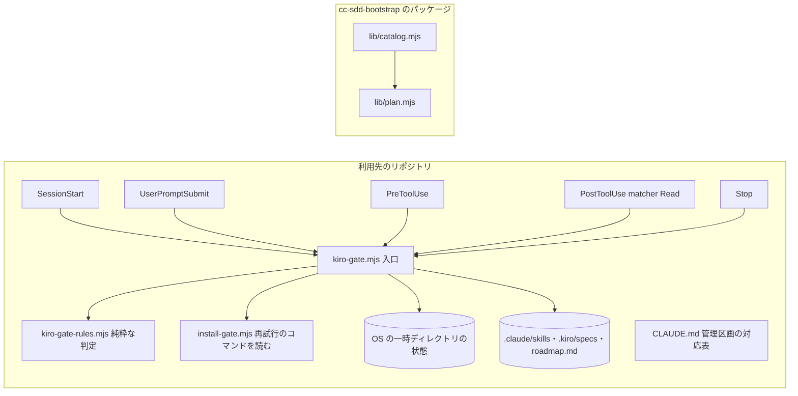
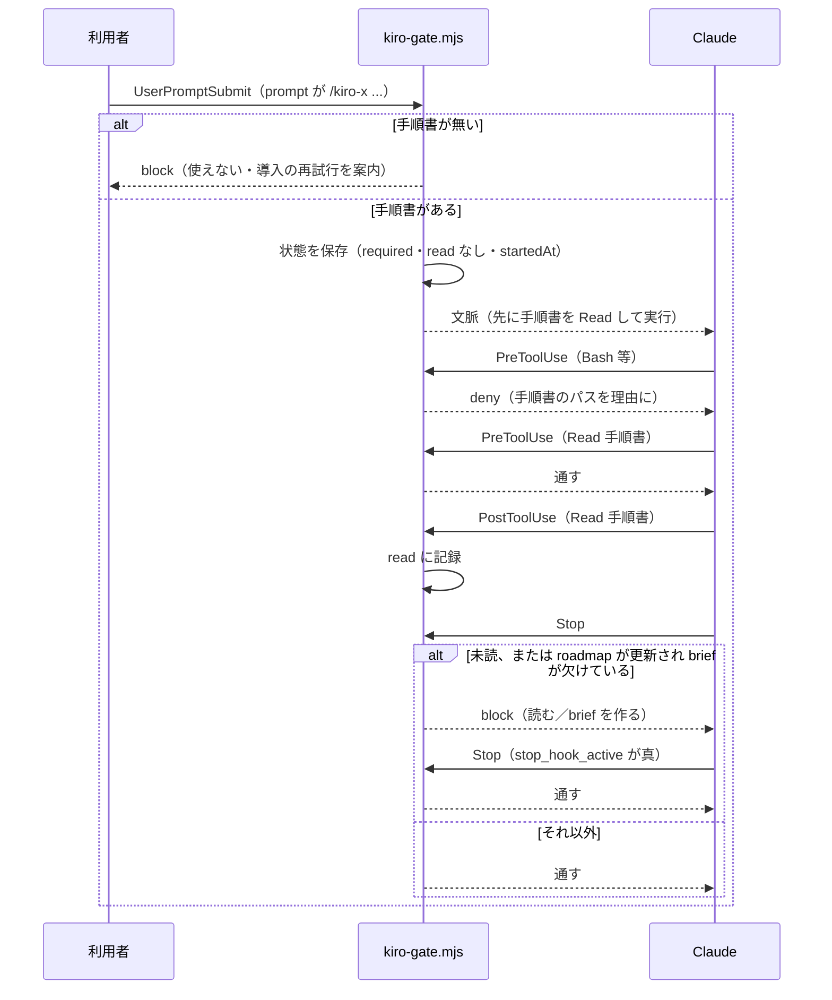

# Design Document: kiro-gate

## Overview
**Purpose**: cc-sdd-bootstrap を導入したリポジトリで、`/kiro-*` で始めた作業が手順書（SKILL.md）を読まずに進まないこと、roadmap に載せた spec の brief.md が欠けたまま終わらないことを、フック（Claude Code の動作の節目で自動実行される処理）で強制する。自然文の依頼では、依頼の種類に合うスキルを使うよう、CLAUDE.md の対応表で促す。
**Users**: 導入先のリポジトリの開発者と、そこで作業する Claude Code。
**Impact**: 配置物に 2 ファイル（判定と入口）を足し、フック 5 件と CLAUDE.md の管理区画の 1 節をカタログに足す。skyshare の `kiro-gate.mjs` と同じ動きを、導入先のどのリポジトリでも得られるようにする。

### Goals
- `/kiro-*` で始めた入力は、手順書を Read するまで他のツールを拒否する。手順書が無いときは、導入の再試行を案内して入力を止める。
- ターン終了時に、未読と、roadmap の spec の brief.md の欠けを、1 回だけ止める。
- 判定できないとき（例外・書式の違い）は通す。
- 自然文の依頼向けの対応表を、導入・更新・取り除きで保守する。

### Non-Goals
- 自然文の依頼の検出と強制、spec.json の承認や tasks.md のチェックの判定、roadmap.md 以外のファイルの判定。
- cc-sdd の導入（session-install）、サブエージェントのモデルの判定（subagent-model-policy）。
- 強制を設定で無効にする仕組み、状態ファイルの掃除。

## Boundary Commitments

### This Spec Owns
- 配置物 `.agent-hooks/cc-sdd-bootstrap/kiro-gate.mjs`（入口: 入出力・状態の読み書き・終了コード）と `kiro-gate-rules.mjs`（純粋な判定と利用者向けの文章）の中身。
- セッションごとの状態（`os.tmpdir()` の下 `cc-sdd-bootstrap-kiro-gate/<session_id>.json`）の形式と扱い。
- カタログの kiro-gate の項目（ファイル 2 件・フック 5 件・CLAUDE.md の節 1 件）と、`package.json` の `files` への登録。
- roadmap.md の「Specs (dependency order)」節を読む規則。

### Out of Boundary
- 設定ファイル・配置・フックの統合・管理区画の仕組み（installer-core）。この spec はカタログに項目を足すだけ。
- スキルの導入と、導入の失敗の記録・再試行のコマンドの決定（session-install）。この spec は読むだけ。
- 自然文の依頼へのフックによる強制（しない）。
- サブエージェントのモデルの判定（subagent-model-policy。同じ PreToolUse で独立に動く）。

### Allowed Dependencies
- `kiro-gate.mjs` → 同じディレクトリの `kiro-gate-rules.mjs` と `install-gate.mjs`（`installFailures` の読み取りだけ）、Node の標準モジュール。`lib/` は読み込まない。
- `kiro-gate-rules.mjs` → Node の標準モジュールの `node:path` だけ。ファイルを読まない（純粋）。
- カタログ → 配置物の道筋の文字列だけ（配置物を import しない）。

### Revalidation Triggers
- 手順書の場所（`.claude/skills/<名前>/SKILL.md`）の変更 → session-install（導入物の場所）と、この spec の `skillPathFor`。
- `install-gate.mjs` の `installFailures` の形の変更 → この spec の再試行コマンドの読み取り。
- roadmap.md の節の見出し・行の書式の変更（cc-sdd の版による） → この spec の `newestSpecNames`（書式が合わなければ何もしない）。
- カタログのフック・CLAUDE.md の節の形の変更 → installer-core のテストと、この spec のカタログの項目。
- subagent-model-policy が同じイベントのフックを足すとき → 互いの判定が独立であることの再確認。

## Architecture

### Existing Architecture Analysis
- installer-core は、カタログのファイルを同じ道筋で利用先へ写し、フックを一式の見分けの文字列で全部入れ替える。カタログの項目は 1 件ずつ別のフックの組として足されるので、利用者のフックと session-install のフックを壊さない。取り除きは記録（ledger）とカタログで自動になる。
- session-install の `install-gate.mjs` は、失敗の記録の一覧（`installFailures`）と再試行のコマンドを持ち、標準モジュールだけに依存する。
- structure.md の型: データ → 純粋な処理 → 入出力 → cli。配置物は導入コマンドの部品を import しない。

### Architecture Pattern & Boundary Map



矢印は「左が右を使う」。入口だけがファイル・標準入出力・時刻を扱い、判定は入力だけで結果を返す。CLAUDE.md の対応表は文章で、フックは参照しない。

- Selected pattern: 純粋な判定 + 入口（session-install と同じ型）。
- Existing patterns preserved: 配置物は `lib/` を読み込まない。判定できなければ通す。カタログに項目を足す。
- Steering compliance: コメントと出力は日本語、外部パッケージなし、Node 22 以上。

### Technology Stack

| Layer | Choice / Version | Role in Feature | Notes |
|-------|------------------|-----------------|-------|
| 実行環境 | Node.js 22 以上（標準モジュールだけ） | 入口・判定 | `fs`・`os`・`path`・`url` |
| フック | Claude Code の SessionStart・UserPromptSubmit・PreToolUse・PostToolUse・Stop | 検出・拒否・記録・終了の判定 | PostToolUse は matcher `Read`、他は付けない。時間制限は各 10 秒 |
| 状態 | OS の一時ディレクトリの JSON | セッションごとの強制の状態 | リポジトリに残さない |
| テスト | `node --test` | 判定の単体、入口の通し | 実物の通しは `poc/kiro-gate`（PoC は前提の確認） |

## File Structure Plan

### Directory Structure
```
.agent-hooks/cc-sdd-bootstrap/
├── kiro-gate.mjs        # 新規。入口: 標準入力の JSON・状態の読み書き・ファイルの確認・出力・例外の扱い
└── kiro-gate-rules.mjs  # 新規。判定（純粋）: コマンドの検出・拒否・記録・終了・roadmap の解釈・spec の要約・文章
test/
├── kiro-gate-rules.test.mjs  # 新規。判定の単体テスト
└── kiro-gate.test.mjs        # 新規。入口を子のプロセスで動かす通しの試験（一時ディレクトリ、TMPDIR を差し替える）
poc/kiro-gate/               # 作成済み（前提の確認）。実装後に、実物の入口を使う通しを足す
```

### Modified Files
- `lib/catalog.mjs` — `files` に 2 件、`hooks` に 5 件、`claudeSections` に 1 件（`kiro-gate`）を足す
- `package.json` — `files` に 2 件を足す
- `test/catalog.test.mjs`・`test/package.test.mjs` — 項目の数・内容の期待を更新する
- 自己適用: `node bin/cc-sdd-bootstrap.mjs update` で、`.claude/settings.json`・`CLAUDE.md` の管理区画・`installed.json` が更新される
- `.kiro/steering/structure.md` — 配置物の例に kiro-gate を足す必要があるか、実装の完了時に見直す（型に沿うなら更新しない）

## System Flows



- 拒否・停止の理由は、モデルに届く文として具体的なパスと次の行動を含める（PoC で、モデルが理由に従って手順書を読むことを確認済み）。
- `/kiro-` で始まらないプロンプトでは、状態を解除し、以後の判定はすべて通す。

## Requirements Traceability

| Requirement | Summary | Components | Interfaces | Flows |
|-------------|---------|------------|------------|-------|
| 1.1 | 手順書を読む指示 | Entry, Rules | `promptContext` | 手順書がある |
| 1.2 | 未読の間は拒否 | Rules | `decidePreToolUse` | 拒否 |
| 1.3 | 手順書の Read は通し、記録 | Rules, Entry | `decidePreToolUse`, `markRead` | 記録 |
| 1.4 | ToolSearch は拒否しない | Rules | `decidePreToolUse` | 拒否 |
| 1.5 | 読んだ後は拒否しない | Rules | `unreadRequired` | 拒否 |
| 1.6 | `/kiro-` で始まらなければ解除 | Entry, Rules | `parseKiroCommand`, `deactivate` | 解除 |
| 1.7 | 最新のコマンドだけ要求 | Rules | `startState`（上書き） | 手順書がある |
| 1.8 | 先頭だけを判定 | Rules | `parseKiroCommand` | — |
| 2.1 | 手順書が無いと止め再試行を案内 | Rules, Entry | `noSkillReason`, `readRetryCommand` | 手順書が無い |
| 2.2 | 止めた後は拒否しない | Entry | 状態を非有効で保存 | 手順書が無い |
| 2.3 | Claude の外で実行する形 | Rules | `noSkillReason` | 手順書が無い |
| 3.1 | 未読で終了を止める | Rules | `decideStop` | 終了 |
| 3.2 | brief の欠けで終了を止める | Rules, Entry | `decideStop`, `newestSpecNames`, `collectBriefs` | 終了 |
| 3.3 | 2 回目以降は止めない | Rules | `decideStop`（`stopHookActive`） | 終了 |
| 3.4 | roadmap が未更新なら止めない | Rules | `decideStop`（`roadmapMtimeMs`） | 終了 |
| 3.5 | 強制が無ければ止めない | Rules | `decideStop` | 終了 |
| 3.6 | roadmap 以外を理由にしない | Rules | `decideStop` の判定対象 | — |
| 4.1 | 最後の節の行を読む | Rules | `newestSpecNames` | — |
| 4.2 | 書式が違えば何もしない | Rules | `newestSpecNames`（空を返す） | — |
| 4.3 | 見出しが複数なら最後 | Rules | `newestSpecNames` | — |
| 4.4 | 完了済みも調べる | Rules | `newestSpecNames`（`[ ]`・`[x]`） | — |
| 5.1 | spec ごとの状態を知らせる | Rules, Entry | `summarizeSpecs`, `collectSpecs` | — |
| 5.2 | roadmap の有無を知らせる | Rules | `sessionStartContext` | — |
| 5.3 | `.kiro/specs` が無い旨 | Rules | `summarizeSpecs` | — |
| 5.4 | 読めない spec.json | Rules, Entry | `summarizeSpecs`（`null`） | — |
| 5.5 | spec.json が無いディレクトリは対象外 | Entry | `collectSpecs` | — |
| 6.1 | 誤りは標準エラーに出し通す | Entry | `main` の例外処理 | — |
| 6.2 | 状態は一時ディレクトリ | Entry | `stateFile`, `writeState` | — |
| 6.3 | 状態が無ければ強制なし | Entry | `readState`（`null`） | — |
| 6.4 | リポジトリのルートを位置から求める | Entry | `repoRoot` | — |
| 6.5 | 利用先だけで動く | Entry, Rules | 依存の向き | — |
| 7.1 | 配置とフックの登録 | Catalog | `files`, `hooks` | — |
| 7.2 | 既存のフックを残す | installer-core（既存） | `mergeHooks` | — |
| 7.3 | update で揃える | installer-core（既存） | カタログ・記録 | — |
| 7.4 | uninstall で取り除く | installer-core（既存） | カタログ・記録 | — |
| 7.5 | 管理区画に説明 | Catalog | `claudeSections` | — |
| 8.1 | 対応表 | Catalog | `claudeSections`（`kiro-gate`） | — |
| 8.2 | SKILL.md を Read して実行 | Catalog | 対応表の文章 | — |
| 8.3 | 判断できなければ尋ねる | Catalog | 対応表の文章 | — |
| 8.4 | 自然文に強制しない | Rules | `parseKiroCommand`（先頭が `/kiro-` でなければ `null`） | 解除 |
| 8.5 | update で揃える | installer-core（既存） | 管理区画 | — |
| 8.6 | uninstall で取り除く | installer-core（既存） | 管理区画 | — |

## Components and Interfaces

| Component | Domain/Layer | Intent | Req Coverage | Key Dependencies (P0/P1) | Contracts |
|-----------|--------------|--------|--------------|--------------------------|-----------|
| KiroGateRules | 配置物 / 純粋な判定 | 検出・拒否・記録・終了・解釈・文章 | 1, 2.1, 2.3, 3, 4, 5, 8.4 | `node:path` (P0) | Service |
| KiroGateEntry | 配置物 / 入出力 | 5 つのフックの入口、状態・ファイル・出力 | 1.3, 1.6, 2, 3, 5, 6 | KiroGateRules (P0), install-gate.mjs (P1) | Event, State |
| Catalog 項目 | installer-core のデータ | 配置・登録・CLAUDE.md の節 | 7, 8.1–8.3, 8.5–8.6 | installer-core (P0) | Batch |

### 配置物 / 純粋な判定

#### KiroGateRules（`kiro-gate-rules.mjs`）

| Field | Detail |
|-------|--------|
| Intent | 入力だけから結果を返す判定と、利用者向けの文章 |
| Requirements | 1.1–1.8, 2.1, 2.3, 3.1–3.6, 4.1–4.4, 5.1–5.4, 8.4 |

**Responsibilities & Constraints**
- ファイル・時刻・標準入出力を使わない。時刻・存在の確認は引数で受ける。
- 判定できない入力（`undefined`・想定外の型）は、通す側（`null`・空）に倒す。

**Contracts**: Service [x]

##### Service Interface
```javascript
/** @typedef {{ active: boolean, command: string, required: string[], read: string[], startedAt: number }} GateState */
/** @typedef {{ name: string, spec: object | null }} SpecEntry  spec が null は spec.json を読めない */

parseKiroCommand(prompt: string): string | null          // 先頭（前の空白を除く）の /kiro-<名前>。名前の直後は空白か末尾
skillPathFor(root: string, command: string): string       // <root>/.claude/skills/<command>/SKILL.md
startState(args: { command: string, skillPath: string, now: number }): GateState
inactiveState(command: string, now: number): GateState    // 手順書が無くて止めたとき。active: false
unreadRequired(state: GateState | null): string[]
decidePreToolUse(state: GateState | null, toolName: string, targetPath: string | null): string | null
  // deny の理由。通すなら null。ToolSearch と、未読の手順書の Read は通す。targetPath は入口が実体のパスにそろえる
markRead(state: GateState | null, toolName: string, targetPath: string | null): GateState | null
decideStop(args: {
  state: GateState | null, stopHookActive: boolean,
  roadmapMtimeMs: number | null, roadmapText: string, existingBriefs: ReadonlySet<string>
}): string | null                                         // block の理由。通すなら null
newestSpecNames(roadmapText: string): string[]            // 最後の「Specs (dependency order)」節の `- [ ]`・`- [x]` の行。無ければ []
summarizeSpecs(entries: SpecEntry[] | null): string[]     // 1 行ずつ。null は .kiro/specs が無い
sessionStartContext(args: { specLines: string[], roadmapExists: boolean }): string
promptContext(skillPath: string): string                  // 手順書を先に Read する指示
denyReason(command: string, skillPath: string): string
noSkillReason(args: { command: string, skillPath: string, retry: string | null }): string
```
- Preconditions: 引数は入口が検証済みの型。`stopHookActive` は真偽値にそろえる。
- Postconditions: `decideStop` は、`state` が無効・`stopHookActive` が真のとき `null`。未読があれば未読の理由を、なければ roadmap の条件（`roadmapMtimeMs >= state.startedAt` かつ一覧に brief が無い spec がある）のときだけ理由を返す。
- Invariants: 一覧の読み取りは `^#{2,3} Specs \(dependency order\)` の最後の見出しから、次の `^#{1,6} ` の見出しの手前まで。行は `^- \[[ x]\] ([a-z0-9][a-z0-9-]*) --`。

**Implementation Notes**
- Integration: 文章は日本語で、拒否の理由には手順書のパスを、停止の理由には取るべき行動（読む／brief.md を作る）を入れる。再試行のコマンドが `null` のときは、案内のコマンドの行を省く。
- Validation: `parseKiroCommand` は `^\s*\/(kiro-[a-z0-9-]+)(?=\s|$)`。
- Risks: cc-sdd の版による roadmap の書式の違いは、空を返して通す（要件 4.2）。

### 配置物 / 入出力

#### KiroGateEntry（`kiro-gate.mjs`）

| Field | Detail |
|-------|--------|
| Intent | 5 つのイベントごとの入口。標準入力の読み取り、状態・ファイルの確認、出力、例外の扱い |
| Requirements | 1.3, 1.6, 2.1–2.3, 3.2, 3.3, 5.1–5.5, 6.1–6.5 |

**Responsibilities & Constraints**
- 起動: `node .agent-hooks/cc-sdd-bootstrap/kiro-gate.mjs <session-start|user-prompt-submit|pre-tool-use|post-tool-use|stop>`。
- リポジトリのルートは、自分の位置の 2 つ上（`path.resolve(scriptDir, "../..")`）。
- 状態は `path.join(os.tmpdir(), "cc-sdd-bootstrap-kiro-gate", <session_id の英数・`_`・`-` 以外を `_` にした名前>.json)`。読めなければ `null`（強制なし）。
- 判定の途中の例外は、標準エラーに `kiro-gate: <内容>` を出して終了コード 0（何も出力しない）。

**Dependencies**
- Inbound: Claude Code のフック — 5 イベント (P0)
- Outbound: KiroGateRules — 判定 (P0)、`install-gate.mjs` の `installFailures` — 再試行のコマンド (P1)

**Contracts**: Event [x] / State [x]

##### Event Contract（フックの入出力。PoC で確認）
| イベント | 入力（使うキー） | 出力 |
|----------|------------------|------|
| session-start | — | `hookSpecificOutput.additionalContext`（spec の要約・roadmap の有無） |
| user-prompt-submit | `session_id`, `prompt` | 手順書がある: `additionalContext`（手順書を先に Read する指示）。無い: `decision: "block"` と `reason`。`/kiro-` で始まらない: 出力なし（状態を解除） |
| pre-tool-use | `session_id`, `tool_name`, `tool_input.file_path`, `cwd` | 拒否: `hookSpecificOutput.permissionDecision: "deny"` と `permissionDecisionReason`。通す: 出力なし |
| post-tool-use（matcher `Read`） | `session_id`, `tool_name`, `tool_input.file_path`, `cwd` | 出力なし（状態の更新だけ） |
| stop | `session_id`, `stop_hook_active` | 止める: `decision: "block"` と `reason`。通す: 出力なし |

##### State Management
- State model: `GateState`（上の型）。UserPromptSubmit で作り（`/kiro-` で始まらないときは `active: false` に更新）、PostToolUse で `read` に足す。
- Persistence & consistency: 1 セッションの中のフックは順に動く前提で、排他しない。壊れた状態は読めない状態として通す側に倒す。
- Concurrency strategy: セッションごとの別ファイルなので、他のセッションとは衝突しない。

**Implementation Notes**
- Integration: UserPromptSubmit では、手順書が無いとき `inactiveState` を保存して block を返す。再試行のコマンドは `installFailures` の `name === "cc-sdd"` の `retry`。取り込み・探索に失敗したときは `null` を渡す（案内からコマンドを省くだけで、止めることは変えない）。session-install の失敗の記録があって `install-gate.mjs` も止めるときは、2 つの理由が示されうる（許容する）。
- Validation: 入力の JSON が読めない・`session_id` が無いときは、`"unknown"` を使うか通す（例外にしない）。パスの比較は、手順書のパスと Read の対象を `cwd` を基準に絶対化し、存在すれば `fs.realpathSync` にそろえてから `KiroGateRules` に渡す。
- Risks: サブエージェントのフックの動きは PoC 未確認（research.md）。実装後の通しで観察する。

### installer-core のデータ

#### Catalog 項目（`lib/catalog.mjs`）

| Field | Detail |
|-------|--------|
| Intent | 配置するファイル・フック・CLAUDE.md の節を、カタログに足す |
| Requirements | 7.1, 7.5, 8.1–8.3 |

**Contracts**: Batch [x]
- ファイル: `${DEPLOY_DIR}/kiro-gate.mjs`・`kiro-gate-rules.mjs`（`kind: "common"`、`executable: false`）。
- フック（順に足す。`command` は `node "$CLAUDE_PROJECT_DIR${OWNED_MARKER}kiro-gate.mjs" <イベント>`、`timeout: 10`）: SessionStart、UserPromptSubmit、PreToolUse、PostToolUse（`matcher: "Read"`）、Stop。
- CLAUDE.md の節: `id: "kiro-gate"`、既存の `cc-sdd-session-install` の後ろ。内容は次の骨子（日本語、`.claude/skills/<名前>/SKILL.md` を Read して実行する形）。

```markdown
## cc-sdd のスキルの使い方
- `/kiro-*` で始めた入力は、対応する `.claude/skills/<名前>/SKILL.md` を Read するまで、他のツールが拒否される。手順書が無いときは入力が止まり、導入の再試行を案内する。
- roadmap.md を更新したターンの終了は、最後の「Specs (dependency order)」節の spec に brief.md が欠けていると 1 回止まる。
- `/kiro-*` で始めない依頼でも、次に当たるときは、対応するスキルの SKILL.md を Read して手順を最後まで実行する。当たるかどうか判断できないときは、使うかを利用者に尋ねる。

| 依頼の種類 | 使うスキル |
|---|---|
| 新機能・新プロジェクトの相談、分割の検討 | `kiro-discovery` |
| 次にやること・進み具合の確認 | `kiro-spec-status` |
| 既存コードと要件の差の確認 | `kiro-validate-gap` |
| 設計のレビュー | `kiro-validate-design` |
| 実装後の最終確認 | `kiro-validate-impl` |
| プロジェクトの方針（ステアリング）の整備・更新 | `kiro-steering` |
| 完了・成功と報告する前 | `kiro-verify-completion` |
```

**Implementation Notes**
- Integration: 追加の仕組みは要らない。再配置・取り除き・管理区画の書き換えは installer-core の既存の処理が行う。
- Risks: フックの組の並びで、`install-gate.mjs` の後に `kiro-gate.mjs`（UserPromptSubmit）が来る。両方が止めうるが、互いの判定は独立。

## Error Handling

### Error Strategy
「判定できないときは通す」を原則とし、止めるのは仕様で決めた 2 つ（手順書が無いプロンプトの停止、手順書が未読・brief 欠けの終了の停止）だけ。

### Error Categories and Responses
- **入力・状態の誤り**（JSON が読めない、状態が壊れている）: 標準エラーに出して通す。強制なしとして扱う。
- **ファイルの誤り**（roadmap.md・spec.json が読めない）: roadmap は「判定しない」、spec.json は「spec.json を読めない」と要約する。
- **書式の違い**（roadmap の見出し・行）: 空を返して通す。
- **モデルが拒否に従わない**: Stop が 1 回止め、2 回目は通す。

## Testing Strategy

### Unit Tests（`test/kiro-gate-rules.test.mjs`）
- `parseKiroCommand`: 先頭の `/kiro-x` は取る、前の空白は許す、文中や `/kiro-x/y` は取らない、`/kiro-` だけは取らない（1.6, 1.8, 8.4）。
- `decidePreToolUse`: 未読で Bash は deny、未読の手順書の Read と ToolSearch は通す、別のファイルの Read は deny、読んだ後は通す、状態なしは通す（1.2–1.5）。
- `decideStop`: 未読は止める、読了後は roadmap が更新されて brief 欠けのときだけ止める、`stopHookActive` が真・状態なし・無効・roadmap 未更新は通す（3.1–3.5）。
- `newestSpecNames`: 見出しが複数なら最後、`[x]` も含む、見出しなし・行なし・書式違いは空、水準 2・3 の見出し、次の見出しで止まる（4.1–4.4）。
- `summarizeSpecs`・`sessionStartContext`: spec の要約の行、読めない spec、`.kiro/specs` なし、roadmap の有無（5.1–5.4）。
- `noSkillReason`: パス・再試行のコマンド・Claude の外で実行する旨を含む。`retry` が `null` ならコマンドの行を省く（2.1, 2.3）。

### Integration Tests（`test/kiro-gate.test.mjs`）
- 一時ディレクトリに小さなリポジトリ（スキル・roadmap・brief）を作り、入口を子のプロセスで動かして、5 つのイベントの入出力を確かめる（`TMPDIR` を差し替えて状態を隔離）。
- UserPromptSubmit → PreToolUse の deny → Read の PostToolUse → Stop の通し（1.1–1.5, 3.1）。
- 手順書が無い `/kiro-ghost` の block と、再試行のコマンドの案内（2.1–2.3）。
- roadmap を更新し、brief が欠けた spec を置いた状態の Stop の block と、2 回目の通し（3.2, 3.3）。
- 壊れた JSON・壊れた状態で、何も出力せず終了 0 になる（6.1, 6.3）。状態がリポジトリの中に作られない（6.2）。
- 呼び出し元のカレントがリポジトリの外でも、ルートを自分の位置から求める（6.4）。
- 手順書のパスの別名（相対パス・シンボリックリンク）の Read でも、読んだ記録が付く。

### Catalog・導入の試験（既存の更新）
- `test/catalog.test.mjs`: ファイル・フック（5 件。PostToolUse だけ matcher あり）・CLAUDE.md の節の項目と、対応表に 7 つのスキル名と「SKILL.md を Read」が含まれること（7.1, 7.5, 8.1–8.3）。
- `test/package.test.mjs`: `files` に 2 件が載っている。
- 導入・更新・取り除きの通し（既存の e2e の延長）: 既存のフック（利用者のもの・session-install のもの）が残り、取り除きで kiro-gate の分だけが消える（7.2–7.4, 8.5, 8.6）。

### 実物の確認
- `poc/kiro-gate/run.sh`（前提の確認、12 件）に、実物の `kiro-gate.mjs` を使う通しを足す（実装後）。cc-sdd と Claude Code の版を上げたときに再実行する。

## Security Considerations
- 状態ファイルは一時ディレクトリの JSON で、機微な情報（プロンプトの本文など）を入れない。持つのはコマンド名・手順書のパス・時刻・読んだ記録だけ。
- `session_id` はファイル名にするため、英数・`_`・`-` 以外を `_` に置き換え、他のディレクトリに出られないようにする。
