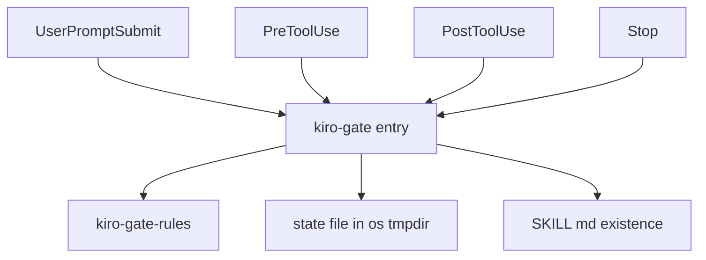
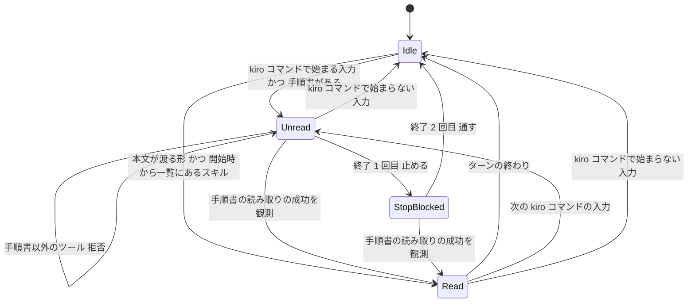

# 設計文書: kiro-gate

> 改訂（2026-11-23）: 単純化後の要件に合わせて書き直した。旧版は git の履歴にある。

## Overview

**Purpose**: `/kiro-*`（Codex では `$kiro-*` も）で始めた依頼で、対応する手順書（SKILL.md）を読むまで、他の作業ツールを拒否する。Claude Code と Codex に同じ規則を適用し、自然文の依頼には対応表の文章で適切なスキルを促す。

**Users**: cc-sdd-bootstrap を導入したリポジトリで、Claude Code または Codex を指揮役にして開発する人。

**Impact**: 新しいフックのスクリプトを 1 つ足し、運用の区画に対応表を足す。

### Goals
- 明示した `/kiro-*` では、エージェントが手順書を読む前に作業を始められない。
- 判定できないときに通常の作業を止めない。
- 状態をリポジトリに残さず、セッションをまたいで持ち越さない。

### Non-Goals
- 自然文の依頼への機械的な強制、手順書が無いときの停止、成果物・承認状態の検査、開始時の通知。
- 子のモデルの判定（subagent-delegation）。

## Boundary Commitments

### This Spec Owns
- `kiro-gate.mjs`（5 つのフックの入口と状態の読み書き）と `kiro-gate-rules.mjs`（純粋な判断と文言）。
- 先読みの状態（OS の一時ディレクトリの下。リポジトリの外）。
- カタログの kiro-gate の項目（スクリプト・両ツールの 4 つのフック・運用の区画の `kiro-gate` の文章と対応表）。

### Out of Boundary
- 導入と導入未完了の停止（session-install）。
- フックの登録・運用の区画の組み立て（installer-core）。
- 子の起動のモデルの確認（subagent-delegation。同じ PreToolUse の時点で別のスクリプトとして動く）。

### Allowed Dependencies
- Node.js 22 の標準モジュール。`lib/` と他の配置物のスクリプトは読み込まない。
- 依存の向き: `kiro-gate-rules`（純粋）→ `kiro-gate`（入出力と入口）。
- 前提: 手順書の場所は session-install の導入物（Claude Code は `.claude/skills/<名前>/SKILL.md`、Codex は `.agents/skills/<名前>/SKILL.md`）。

### Revalidation Triggers
- 手順書の置き場所の変更（session-install・cc-sdd の版）。
- フックの入力の形の変更（Claude Code・Codex の版）。PoC を再実行する。
- 拒否の出力の形の変更 → 同じ時点の subagent-delegation のフックとの関係を見直す。

## Architecture

### Architecture Pattern & Boundary Map



- 状態のキー: `sha256(<根の絶対の道筋> + "\0" + <session_id>)`。根は `kiro-gate.mjs` の位置から求め（`../..`）、入力の `cwd` は使わない（3.5・3.6）。
- 状態の置き場所: `<os.tmpdir()>/cc-sdd-bootstrap-kiro-gate/<キー>.json`（3.4）。中身はセッション開始時に一覧にあったスキルの名前（`listed`）と、今のターンの先読みの状態（`turn`）。
- 本文が渡る形の扱い（2.4）: セッション開始時から一覧にあるスキルを、本文が渡る形（Claude Code の `/kiro-*`、Codex の `$kiro-*`）で呼んだときは、手順書の本文がスキルとして渡るので、最初から読み取り済みにする（追加の文脈も出さない）。読み直しを求めるのは、Codex の `/kiro-*`（スキルとして扱われず、ただの文になる）と、セッションの途中で導入して一覧に無いスキルだけ（PoC: 実機検証で確認済み。記録は削除済み、b の場面）。

### Technology Stack

| Layer | Choice / Version | Role in Feature | Notes |
|-------|------------------|-----------------|-------|
| 実行 | Node.js 22（`.mjs`） | フック | 標準モジュールだけ |
| フック | Claude Code・Codex の UserPromptSubmit・PreToolUse・PostToolUse・Stop | 検出・拒否・記録・終了の停止 | 登録は installer-core |

## File Structure Plan

### Directory Structure
```
.agent-hooks/cc-sdd-bootstrap/
├── kiro-gate.mjs           # 入口: 標準入力の JSON を読み、状態を読み書きし、判断を出力する
└── kiro-gate-rules.mjs     # 純粋: コマンドの検出、手順書の道筋、許可の判断、読み取りの判定、文言
test/
├── kiro-gate-rules.test.mjs  # 規則の単体試験
└── kiro-gate.test.mjs        # 一時ディレクトリと標準入力での入口の試験
```

### Modified Files
- `lib/catalog.mjs` — kiro-gate の項目を足す（下の「カタログの項目」）。
- `package.json` — `files` に 2 つのスクリプトを足す。
- 実機の確認のスクリプト（PoC の記録は削除済み） — 実装後の確認に、配置したスクリプトを使う形を足す（Claude Code）。Codex は実機検証で使った手順の c・d・e を流用する。

## System Flows



- `StopBlocked` でもツールの拒否は続く（2.3）。2 回目の終了は通し、`turn` を消す（2.7）。状態の図の Idle は `turn` が無い状態で、`listed` はセッションの間ずっと残る。
- 新しい `/kiro-*` の入力は、前の状態を引き継がずに上書きする（1.4）。

## Requirements Traceability

| Requirement | Summary | Components | Interfaces | Flows |
|-------------|---------|------------|------------|-------|
| 1.1 | 先頭の `/kiro-*`・`$kiro-*` で手順書を対象に | Rules, Gate | `detectCommand` `skillPath` | Idle→Unread |
| 1.2 | 直後が空白か末尾のときだけ | Rules | `detectCommand` | — |
| 1.3 | 先頭以外の言及は対象外 | Rules | `detectCommand` | — |
| 1.4 | 次の依頼は引き継がない | Gate | 状態の上書き | Read→Unread |
| 1.5 | `/kiro-*` で始まらない入力で解除 | Gate | 状態の削除 | →Idle |
| 2.1 | 手順書の場所と先に読む指示を渡す | Rules, Gate | `messageAdditionalContext` | — |
| 2.2 | 手順書の読み取りと探す操作は通す | Rules | `decidePreToolUse` | — |
| 2.3 | それ以外は拒否し理由を示す | Rules | `decidePreToolUse` `messageDeny` | Unread |
| 2.4 | 読み取りの成功で読み取り済み | Rules, Gate | `isSkillRead` | Unread→Read |
| 2.5 | 読み取り済みなら拒否しない | Rules | `decidePreToolUse` | Read |
| 2.6 | 未読の終了を 1 回止める | Rules, Gate | `decideStop` | Unread→StopBlocked |
| 2.7 | 2 回目は止めない | Rules | `decideStop` | StopBlocked→Idle |
| 3.1 | 判定できなければ止めない | Gate | 例外時は出力なし | — |
| 3.2 | 予期しない誤りは日本語で確認できる | Gate | 標準エラー | — |
| 3.3 | 手順書が無ければ独自に止めない | Gate | 状態を作らない | — |
| 3.4 | 状態をリポジトリに残さない | Gate | `statePath` | — |
| 3.5 | 別のリポジトリ・セッションに適用しない | Gate | 状態のキー | — |
| 3.6 | 作業ディレクトリの変更で取り違えない | Gate | 根はスクリプトの位置から | — |
| 4.1 | 対応表を両文書の区画に | カタログの項目 | `agentSections.kiro-gate` | — |
| 4.2 | 表に該当すれば手順書を読んで実行 | カタログの項目 | 同上 | — |
| 4.3 | ツールごとの手順書の読み方 | カタログの項目 | 同上 | — |
| 4.4 | 判断できなければ尋ねる | カタログの項目 | 同上 | — |
| 4.5 | `/kiro-*` では読むまで拒否される旨 | カタログの項目 | 同上 | — |
| 4.6 | AGENTS.md の未承認時の先読みの指示 | カタログの項目（Codex の文章） | 同上 | — |
| 4.7 | 自然文では止めない | Gate | 自然文は `turn` を消すだけ | →Idle |

## Components and Interfaces

| Component | Domain/Layer | Intent | Req Coverage | Key Dependencies | Contracts |
|-----------|--------------|--------|--------------|------------------|-----------|
| Rules（`kiro-gate-rules.mjs`） | 純粋 | 検出・判断・文言 | 1.1–1.3, 2.1–2.7 | なし | Service |
| Gate（`kiro-gate.mjs`） | 入出力・入口 | 入力の読み取り、状態の読み書き、出力 | 1.4, 1.5, 2.4, 3.1–3.6, 4.7 | Rules (P0) | Event, State |
| カタログの項目 | データ | スクリプト・フック・区画の文章 | 4.1–4.6 | installer-core の Catalog (P0) | State |

### Rules

```typescript
type Tool = "claude" | "codex";
type TurnState = { skill: string; skillPath: string; read: boolean; stopBlocked: boolean };
type GateState = { listed: string[]; turn: TurnState | null };   // listed: セッション開始時にあった kiro-* の名前

function detectCommand(prompt: string): { skill: string; sigil: "/" | "$" } | null;
// 先頭の空白を除き、/^([\/$])(kiro-[a-z0-9-]+)(?=\s|$)/ に合えば名前と記号（1.1–1.3）
function isExpandedInvocation(tool: Tool, sigil: "/" | "$", skill: string, listed: string[]): boolean;
// (claude かつ "/") または (codex かつ "$")、かつ skill が listed にある（2.4）
function skillPath(tool: Tool, skill: string): string;
// claude: .claude/skills/<skill>/SKILL.md、codex: .agents/skills/<skill>/SKILL.md（根からの相対）

type ToolCall = { toolName: string; toolInput: Record<string, unknown> };
function decidePreToolUse(state: TurnState | null, call: ToolCall, root: string): { allow: true } | { allow: false; reason: string };
// state が無い・read が真 → allow（2.5）
// 未読のとき allow: Claude Code の Read で file_path が手順書（絶対の道筋で比べる）、ToolSearch（ツールを探す操作）
//                    Codex の Bash で isReadCommand が真（2.2）
// それ以外 → 拒否。理由は messageDeny（2.3）
function isReadCommand(command: string, cwd: string, absSkillPath: string): boolean;
// 最初のコマンド（&&・;・| より前）の先頭の語が読み取りだけのコマンド（cat・head・nl。書き換えの形を持つ sed などは含めない）で、
// その引数のどれかを入力の cwd から解いた絶対の道筋が、対象の手順書の絶対の道筋と一致する。
// ls などの存在の確認、別のリポジトリの同じ名前のファイルは一致しない（2.3・3.6）
function isSkillRead(state: TurnState, call: ToolCall & { toolResponse: unknown }, firstLine: string, root: string): boolean;
// Claude Code の Read で file_path が手順書、または Codex の Bash で isReadCommand が真で、
// かつ tool_response（文字列にしたもの）に手順書の最初の空でない行が含まれる（2.4）。
// Codex の tool_response は出力の文字列だけで終了コードが無いため、中身で成功を確かめる。ToolSearch は読み取りにしない
function decideStop(state: TurnState | null, stopHookActive: boolean): { block: true; reason: string } | { block: false };
// state があり、未読で、stopBlocked でも stopHookActive でもなければ止める（2.6）。それ以外は通す（2.7）

function messageAdditionalContext(state: TurnState): string;  // 手順書の場所と、作業の前に読んで手順に従う旨（2.1）
function messageDeny(state: TurnState): string;              // 読むべき手順書の場所と、先に読む必要（2.3）
function messageStop(state: TurnState): string;              // 同上（2.6）
```
- Codex のまとめたコマンド（`cat <手順書> && 別のコマンド`）は、最初のコマンドが手順書の読み取りなので通り、読んだ扱いになる。読み取りの後の別のコマンドまで止めることはしない（汎用のシェルの解析はしない。厳密さのためにコードを増やさない）。

### Gate

##### Event Contract
- 起動: `node <根>/.agent-hooks/cc-sdd-bootstrap/kiro-gate.mjs <session-start|user-prompt-submit|pre-tool-use|post-tool-use|stop> --tool <claude|codex>`（コマンドの形は installer-core）。
- 入力: 標準入力の JSON（`session_id`・`prompt`・`tool_name`・`tool_input`・`tool_response`・`stop_hook_active`）。
- 出力:
  - SessionStart: そのツールの手順書の置き場所にある `kiro-*` の名前を `listed` に書く（Claude Code の `source` が `compact` のときは書き換えない）。何も出さない。
  - UserPromptSubmit: 対象が決まり、`isExpandedInvocation` が真なら `turn` を読み取り済みで書いて何も出さない（2.4）。偽なら未読で書き、`hookSpecificOutput.additionalContext` に `messageAdditionalContext`。`/kiro-*` で始まらない、または手順書が無い（3.3）なら `turn` を消し（`listed` は残す）、何も出さない（1.5・4.7）。
  - PreToolUse: 拒否なら `hookSpecificOutput: { hookEventName: "PreToolUse", permissionDecision: "deny", permissionDecisionReason }`。それ以外は何も出さない。
  - PostToolUse: 手順書の最初の空でない行を読み、`isSkillRead` なら `turn.read` を真にする。何も出さない。
  - Stop: 止めるなら `{ decision: "block", reason }` を出し `turn.stopBlocked` を真にする。通すときは `turn` を消す（`listed` は残す）。
- 例外・判定できない入力（`session_id` が無い、JSON でないなど）: 標準エラーに日本語で理由を出し、何も出力せず終了 0（3.1・3.2）。
- 両ツールで出力の形は同じ（PoC で確認）。

##### State Management
- 置き場所とキーは Architecture のとおり。書き込みは一時ファイルに書いて名前を変える。
- 同じセッションの中のフックは順に呼ばれる前提（1 つのセッションの中で並行に書かない）。

### カタログの項目（installer-core の `lib/catalog.mjs` に足す）
- `files`: `kiro-gate.mjs`・`kiro-gate-rules.mjs`。
- `hooks`（`tools: ["claude", "codex"]`、`script: "kiro-gate.mjs"`、引数は `[<イベント>, "--tool", <ツール>]`。ツールごとに別の項目にする）:
  - SessionStart（timeout 10 秒）、UserPromptSubmit（timeout 10 秒。カタログでは session-install の項目の後に並べるが、同じイベントのフックは並行に動くことがあり、順序は保証にしない。初回の導入と同じターンでは手順書がまだ無く、そのターンは対象にならない（3.3）。session-install の追加の文脈が手順書を直接読むよう伝える）、PreToolUse（matcher なし＝すべてのツール、10 秒）、PostToolUse（matcher なし、10 秒）、Stop（10 秒）。
- `agentSections` の `kiro-gate`（両ツールで同じ内容。Codex にだけ 4.6 の一文）:
  - 要件 4.1 の対応表（依頼の種類 → 使うスキル）。
  - 表に該当する依頼は `/kiro-*` で始まっていなくても、対応する手順書を読んで手順を最後まで実行する（4.2）。
  - 手順書の読み方: Claude Code は `.claude/skills/<スキル名>/SKILL.md`、Codex は `.agents/skills/<スキル名>/SKILL.md` を直接読む（4.3）。
  - 依頼の種類を判断できなければ、スキルを使うか利用者に尋ねる（4.4）。
  - `/kiro-*`（Codex は `$kiro-*`）で始めた依頼では、フックが有効なら手順書を読むまで他の作業ツールが拒否される（4.5）。
  - Codex の文章だけ: フックの信頼が承認されていない環境でも、作業の前に対応する手順書を読む（4.6）。

## Error Handling
- 判定できない入力・状態の読み書きの失敗・予期しない例外: 通す（出力なし、終了 0）。理由は標準エラーに日本語で出す（3.1・3.2）。
- 手順書が無い: 状態を作らず通す（3.3）。導入の失敗は session-install が止める。

## Testing Strategy
- **単体（Rules）**:
  - `isExpandedInvocation`: Claude Code の `/kiro-x` と Codex の `$kiro-x` で `listed` にあれば真、Codex の `/kiro-x`・一覧に無いスキル・Claude Code の `$kiro-x` は偽（2.4）。
  - `detectCommand`: `/kiro-spec-init x`・`  $kiro-impl`・`/kiro-steering` を検出、`/kiro-spec-init:` のように直後が空白でないものや `文中の /kiro-impl` は検出しない（1.1–1.3）。`/kiro-specx` は名前として検出されるが、手順書が無いので入口で状態を作らない（1.1・3.3）。
  - `decidePreToolUse`: 未読で Claude Code の手順書の Read と ToolSearch は通し、Bash・Edit・別のファイルの Read・Agent は拒否して理由に道筋を含む。Codex は `cat .agents/skills/<名前>/SKILL.md`（相対・絶対）を通し、`ls <手順書>`・`sed -i '1d' <手順書>`・別のリポジトリの同じ道筋の `cat`・他の Bash を拒否（2.2・2.3・3.6）。読み取り済みなら通す（2.5）。
  - `isSkillRead`: 応答に手順書の最初の行が無い（`cat: ...: No such file or directory` など）ときと ToolSearch では読んだ扱いにしない（2.4）。
  - `decideStop`: 未読の 1 回目は止め、`stopBlocked` または `stop_hook_active` なら通す（2.6・2.7）。
- **入口（一時ディレクトリ、標準入力）**: SessionStart で一覧を記録 → 一覧にあるスキルの Claude Code の `/kiro-x` は拒否しない（2.4）→ Stop・自然文の入力・手順書の無い `/kiro-y` を挟んだ後の `/kiro-x` も拒否しない（`listed` が残る）。一覧に無いスキル（SessionStart の後に作った手順書）で UserPromptSubmit → PreToolUse 拒否 → PostToolUse で読み取り → PreToolUse 通過、の一連。次の `/kiro-*` で未読に戻る、自然文で解除（1.4・1.5・4.7）。手順書が無いと状態を作らない（3.3）。別の `session_id`・別の根の状態を使わない（3.5）。`cwd` を変えても同じ根を使う（3.6）。状態がリポジトリの中に作られない（3.4）。壊れた JSON の入力で出力なし・終了 0・標準エラーに理由（3.1・3.2）。
- **カタログの試験**: 対応表の行が要件 4.1 と同じ、Codex の文章にだけ 4.6 の一文がある。
- **実機（PoC 済み）**: Claude Code と Codex で実機検証済み（Codex は c・d・e。記録は削除済み）。実装後は配置したスクリプトで同じ確認を行う。
