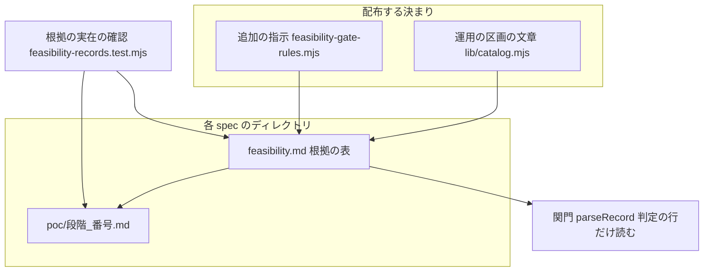
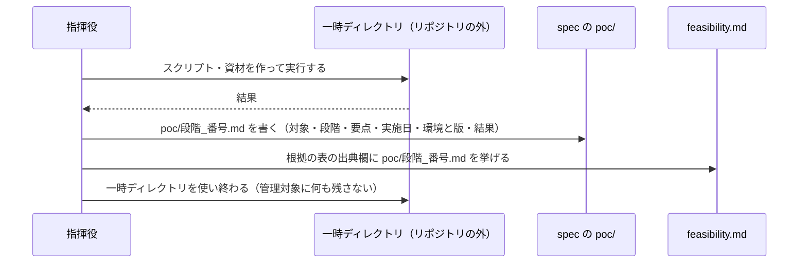

# 設計文書: poc-records

## Overview

**Purpose**: 設計の前提を確かめる PoC の記録を、リポジトリ直下の `poc/`（再実行用のスクリプトと結果）から、spec のディレクトリの中の短い文書 `poc/<段階>_<通し番号>.md` に置き換える。導入先のリポジトリにも配る決まりを同じ形にし、コードと関係のないファイルを置かずに、仕様の根拠をたどれるようにする。

**Users**: cc-sdd-bootstrap を導入したリポジトリの開発者と、そこで指揮役として作業する Claude Code・Codex。このリポジトリの開発者（既存の `poc/` を無くす側）。

**Impact**: 運用の区画の文章と、入力のたびに出る追加の指示を変える（導入先全体に効く）。このリポジトリの steering・既存 8 spec の記録・テストを新しい置き方にそろえ、`poc/`（49 ファイル）を削除する。関門の判定（`- 判定:` の行を読む処理）と、導入・配置の動作は変えない。

### Goals
- PoC の記録の置き場所・名前・必須の内容を 1 つの定義にそろえ、運用の区画の文章と追加の指示で配る。
- 根拠の条件を「位置付けと結果が文書で追える」に変え、「再実行できる」を外す。
- 根拠として挙げた PoC 文書の実在を自動で確かめる。
- リポジトリに `poc/` が無い前提で、steering・既存の記録・テストを構成し直す。

### Non-Goals
- 既存の `poc/` の内容の PoC 文書への移行（移さない。実行日と版を添えた一文にする）。
- 関門の判定の仕組み・実現性の記録の 3 つの節と判定の語の変更。
- PoC 文書の中身の正しさの自動判定。
- 導入先の既存の `poc/` や記録の自動的な書き換え。

## Boundary Commitments

### This Spec Owns
- PoC 文書の定義: 置き場所 `.kiro/specs/<spec 名>/poc/<段階>_<通し番号>.md`、`<段階>`（`requirements`・`design`・`tasks`・`impl`）、2 桁の通し番号、冒頭の `- 対象:`・`- 段階:` の行、必須の内容（実施内容の要点・実施日・環境と版・結果・仕様への反映）。
- 根拠として認める条件の文面（一次資料、または必須の内容がそろった PoC 文書）。
- 運用の区画の文章（`feasibilityReviewSection`）と、追加の指示（`messageContext` の要件・設計・タスク計画の段階）の、PoC に関する文面。
- 実現性の記録が挙げる PoC 文書の実在の自動の確認（テスト）。
- 既存 8 spec の記録（`feasibility.md`）・steering・配布物のコメントの、`poc/` を挙げた記述の書き換えと、`poc/` の削除。

### Out of Boundary
- 関門の判定（`parseRecord`・`decideInput`）と、記録の 3 つの節・判定の語（feasibility-review が持つ）。
- 導入・更新のコマンドの配置の動作と配置ファイルの一覧（installer-core・session-install が持つ）。
- PoC を実際にどう行うか（スクリプトの書き方・使うツール）。この spec は置き場所と記録の形だけを定める。

### Allowed Dependencies
- feasibility-review の実現性の記録の形（`parseRecord` が読む 3 つの節と判定の行）。変えない。
- `lib/catalog.mjs` の運用の区画の文章の組み立て（`feasibilityReviewSection`）と `agent-section-*.md` の再生成（`update` コマンド）。
- 既存のテストの仕組み（`node --test`）。

### Revalidation Triggers
- 実現性の記録の根拠の表の書式（PoC 文書を挙げる書き方）の変更 → テストの抽出と、各 spec の記録の見直し。
- PoC 文書の必須の内容の変更 → 運用の区画の文章・追加の指示・レビューの観点の見直し。
- 関門が根拠の表の中身を読むように変わる場合 → この spec の前提（関門は判定の行だけを見る）が崩れる。

## Architecture

### Existing Architecture Analysis
- `lib/catalog.mjs` の `feasibilityReviewSection`（157〜161 行）が、運用の区画の文章の実現性の項を組み立てる。`.agent-hooks/cc-sdd-bootstrap/agent-section-claude.md`・`agent-section-codex.md` は、`update` で再生成される git 管理のコピー。
- `.agent-hooks/cc-sdd-bootstrap/feasibility-gate-rules.mjs`（318・334 行）の `messageContext` が、入力のたびに追加の指示を出す（配布物に入る）。
- 関門は `parseRecord` で 3 つの節の `- 判定:` の行だけを読む。根拠の表は読まない（コードの確認、2026-11-26。`feasibility.md` の根拠を参照）。そのため、表の書式変更は関門に影響しない。
- 現在のテストは、`test/feasibility-records.test.mjs` が記録の中の `` `poc/…` `` の場所の実在を確かめ、`test/package.test.mjs` 59 行が `poc/` の非同梱を確かめ、`test/catalog.test.mjs`（389 行）・`test/feasibility-gate-rules.test.mjs`（411・425・515 行）が「再実行」「PoC の場所」の語を必須にしている。

### Architecture Pattern & Boundary Map



**Architecture Integration**:
- Selected pattern: 既存の仕組み（文章・テスト・steering）の書き換え。新しいコードの部品は作らない（案 A）。
- Domain/feature boundaries: 決まりの文章（配布）、記録の置き方（各 spec）、自動の確認（テスト）、過去の記録の書き換え（一度きり）に分ける。
- Existing patterns preserved: 運用の区画の文章は両ツールで同じ項目にし、呼び方（`/` と `$`）だけを変える。関門は判定の行だけを見る。
- New components rationale: 追加の部品は無い。根拠の参照の抽出だけ、テストの中の小さな関数にする。
- Steering compliance: 「コードを増やさない」「決めたことは steering と spec に書く」に沿う。

### Technology Stack

| Layer | Choice / Version | Role in Feature | Notes |
|-------|------------------|-----------------|-------|
| 配布する文章 | JavaScript（ESM）、Node.js 22 | 運用の区画の文章・追加の指示の組み立て | 既存の `catalog.mjs`・`feasibility-gate-rules.mjs` を直す |
| テスト | `node --test` | 文面と記録の参照の確認 | 既存のテストを直す |
| 文書 | Markdown（日本語） | PoC 文書・記録・steering | |

## File Structure Plan

### Directory Structure
```
.kiro/specs/<spec 名>/
└── poc/                       # その spec の PoC 文書だけを置く（スクリプト・資材は置かない）
    ├── requirements_01.md     # 段階ごとに 01 から始まる通し番号
    ├── design_01.md
    ├── tasks_01.md
    └── impl_01.md
```

### Modified Files
- `lib/catalog.mjs` — `feasibilityReviewSection` の PoC に関する文を直す（要件 6.1〜6.4）。
- `.agent-hooks/cc-sdd-bootstrap/feasibility-gate-rules.mjs` — `messageContext` の要件・設計・タスク計画の段階の文面を直す（6.5）。
- `.agent-hooks/cc-sdd-bootstrap/agent-section-claude.md`・`agent-section-codex.md` — `update` コマンドで再生成する（10.4）。
- `.agent-hooks/cc-sdd-bootstrap/codex-trust-rules.mjs` — 3 行目のコメントの出典を、`poc/` に依存しない形に直す（8.6）。
- `test/feasibility-records.test.mjs` — `poc/…` の実在の確認を、`poc/<段階>_<番号>.md` の実在の確認に置き換える（5.2・5.3・9.1）。
- `test/catalog.test.mjs`・`test/feasibility-gate-rules.test.mjs` — 文面の必須の語を新しい文面に合わせる（9.4）。
- `test/package.test.mjs` — `poc/` の非同梱の確認（59 行）を除く（9.3）。`.kiro/` の非同梱の確認で足りる。
- `.kiro/steering/structure.md`・`project-rules.md`・`tech.md`・`roadmap.md` — `poc/` の記述を新しい置き方に直す（7.1〜7.5）。
- `.kiro/specs/{installer-core,session-install,kiro-gate,subagent-delegation,codex-hook-trust,work-branch-flow,feasibility-review,install-freshness}/` の `feasibility.md` — 根拠を一文に書き換える（8.3・8.4）。同じ spec の `design.md`・`research.md`・`tasks.md`・`requirements.md`・`brief.md` と `installer-core/handoff-self-apply.md` — `poc/` の場所の部分だけ取り除く（8.5）。
- 削除: リポジトリ直下の `poc/`（49 ファイル。8.1）。

## System Flows

PoC を行って記録するまでの流れ（導入先でも同じ）。



- 一時ディレクトリは `mktemp -d` で作る。リポジトリの中にファイルを作った場合は、確認の後に取り除く（3.3）。
- 実機での確認結果（`poc/design_01.md`・`design_02.md`）: 両ツールで、この流れが成り立つ。

## Requirements Traceability

| Requirement | Summary | Components | Interfaces | Flows |
|-------------|---------|------------|------------|-------|
| 1.1〜1.3, 1.5〜1.6 | 置き場所・段階・通し番号・採番の規則 | PoC 文書の定義、運用の区画の文章 | 文章の定義 | 記録の流れ |
| 1.4 | 通し番号は要件・設計の番号と対応させない | PoC 文書の定義 | 文章の定義 | — |
| 1.7, 1.8 | 日本語で書く・cc-sdd のファイルに印を足さない | PoC 文書の定義 | 文章の定義 | — |
| 1.9 | 複数 spec の根拠は 1 か所に置き相対パスで指す | PoC 文書の定義 | 根拠の表の書式 | — |
| 2.1〜2.9 | 必須の内容・追記の扱い（新しい番号）・再現の詳しさを求めない | PoC 文書の定義 | 文章の定義 | 記録の流れ |
| 3.1〜3.4 | 資材を残さない・外で使う・残ったら取り除く・前後で変えない | 運用の区画の文章 | 文章の定義 | 記録の流れ |
| 4.1〜4.5 | 根拠の条件・欠けたら未確認 | 運用の区画の文章、追加の指示 | 文章の定義 | — |
| 5.1〜5.3 | 根拠の表から相対パスで指す・実在の確認 | 根拠の実在の確認 | `poc/<段階>_<番号>.md` の抽出 | — |
| 5.4, 5.5, 10.1 | 記録の形・判定を変えない・関門は判定の行だけ | 関門（変更なし） | — | — |
| 6.1〜6.4, 6.6 | 運用の区画の文章の PoC の説明・置き場所・条件・両ツール | 運用の区画の文章 | — | — |
| 6.5 | 追加の指示の条件の文面 | 追加の指示 | — | — |
| 6.7, 10.3 | 導入先の既存の `poc/` を書き換えない・配置の動作を変えない | 変更なし | — | — |
| 7.1〜7.5 | steering の更新 | steering | — | — |
| 8.1, 8.2 | `poc/` を削除・移行しない | 既存記録の書き換え | — | 書き換えの手順 |
| 8.3, 8.4 | `feasibility.md` の根拠を一文に（実行日・環境と版は元の記録のまま、無ければ「記録なし」） | 既存記録の書き換え | 一文の書式 | 書き換えの手順 |
| 8.5, 8.8 | ほかの文書の `poc/` の場所を取り除く・参照を残さない | 既存記録の書き換え | — | 書き換えの手順 |
| 8.6 | 配布物のコメントの直し | `codex-trust-rules.mjs` | — | — |
| 8.7 | 繰り返す確認手順の扱い | steering（project-rules） | 手順の文章 | — |
| 9.1〜9.3, 9.5 | テストの置き換え・`poc/` を前提にしない | テスト | — | — |
| 9.4 | 文面の変更を既存の確認で確かめる | テスト | — | — |
| 10.2 | 導入先の古い記録を止めない | 関門（変更なし）、テスト | `parseRecord` | — |
| 10.4 | 配置の更新を反映する | `update` の実行 | — | — |

## Components and Interfaces

| Component | Domain/Layer | Intent | Req Coverage | Key Dependencies (P0/P1) | Contracts |
|-----------|--------------|--------|--------------|--------------------------|-----------|
| PoC 文書の定義 | 決まり（文章） | 置き場所・名前・必須の内容を 1 つに定める | 1, 2 | 運用の区画の文章 (P0) | 文章 |
| 運用の区画の文章 | 配布する決まり | PoC の置き方と根拠の条件を導入先に配る | 1〜4, 6 | `catalog.mjs` (P0) | 文章 |
| 追加の指示 | 配布する決まり | 入力のたびに、段階ごとの条件を出す | 4, 6.5 | `feasibility-gate-rules.mjs` (P0) | 文章 |
| 根拠の実在の確認 | テスト | 記録が挙げた PoC 文書の実在を確かめる | 5.2, 5.3, 9 | `parseRecord` (P1) | 関数 |
| 既存記録の書き換え | 一度きりの作業 | `poc/` を削除し、参照を直す | 8 | steering (P1) | 手順 |
| steering の更新 | 文書 | 新しい決まりをこのリポジトリに定める | 7, 8.7 | — | 文章 |

### 決まり（文章）

#### PoC 文書の定義

| Field | Detail |
|-------|--------|
| Intent | PoC の記録の形を、運用の区画の文章・追加の指示・steering で同じ内容にする |
| Requirements | 1.1〜1.9, 2.1〜2.9 |

**書式（定義）**
- 場所: `.kiro/specs/<spec 名>/poc/<段階>_<通し番号>.md`。`<段階>` は `requirements`・`design`・`tasks`・`impl`、`<通し番号>` は段階ごとに 01 から始まる 2 桁（追加は最大の番号の次。取り除いた番号は詰めない）。
- 冒頭の 2 行: `- 対象: <確かめた前提と、関係する要件・設計の番号>`、`- 段階: <段階>`。
- 本文（見出しは自由。項目がそろっていればよい）: 実施内容の要点（数行）、実施日、環境と版（確かめた外部のツールの版を含む）、結果と仕様への反映、確かめられなかったこと（あれば）。
- 再現できるだけの詳しさ・スクリプトの全文・コマンドの完全な列挙は求めない。同じ前提を別の段階で確かめ直すときは、新しい番号の文書を作り、前の文書は書き換えない。
- 複数の spec が同じ PoC を根拠にするときは、最初に確かめた spec のディレクトリに置き、ほかの spec の記録からは、その文書を相対パス（例: `../kiro-gate/poc/design_01.md`）で挙げる。

**根拠の表の書式（実現性の記録）**: 出典の欄に、PoC 文書を `poc/design_01.md` のようにバッククォートで囲んで挙げる。一次資料は従来どおり出典の場所と版を書く。

**決定の根拠（要件 1.4）**: 通し番号を要件の番号と同期させない。要件の番号は改訂でずれることがあり、1 つの PoC が複数の要件に効くため。対応は文書の `- 対象:` の行に書く。

#### 運用の区画の文章（`feasibilityReviewSection`）

| Field | Detail |
|-------|--------|
| Intent | 導入先の指揮役に、PoC の置き方と根拠の条件を伝える |
| Requirements | 1〜4, 6.1〜6.4, 6.6 |

**変更の内容（要点）**
- 要件の段階の文: 「PoC（実機で再実行できる試作）」を「PoC（実機で前提を確かめる試作。結果は PoC 文書に残す）」に直す。
- 設計・タスク計画の文: 認める根拠を「一次資料」か「PoC 文書（`.kiro/specs/<spec 名>/poc/<段階>_<通し番号>.md`。冒頭に `- 対象:`・`- 段階:`、続けて実施内容の要点・実施日・環境と版・結果）」にする。
- 新しい項: PoC のスクリプト・入力・出力はリポジトリの外の一時ディレクトリで使い、リポジトリの管理対象に残さない（PoC の前後で、PoC 文書の追加を除き管理対象を変えない）。
- レビュー役への観点: 「前提ごとの根拠が一次資料か、PoC 文書で位置付けと結果が追える PoC で確かめられているか」。
- Claude Code 向けと Codex 向けは、呼び方（`/`・`$`）以外を同じ内容にする。

#### 追加の指示（`messageContext`）

| Field | Detail |
|-------|--------|
| Intent | 入力のたびに、段階ごとの根拠の条件を届ける |
| Requirements | 4, 6.5 |

要件の段階・設計の段階・タスク計画の段階の文面から「再実行できる」を除き、「PoC 文書（`poc/<段階>_<通し番号>.md`）で位置付けと結果が追えるもの」に直す。設計の確認の記入の指示は、「PoC の場所」を「PoC 文書の場所」に直す。

### テスト

#### 根拠の実在の確認

| Field | Detail |
|-------|--------|
| Intent | 実現性の記録が挙げた PoC 文書の実在を確かめる |
| Requirements | 5.2, 5.3, 9.1〜9.3, 9.5, 10.2 |

**Contracts**: 関数（テストの内部）

```typescript
/** 記録の本文から、PoC 文書の相対パスを取り出す（バッククォートで囲まれた poc/<段階>_<2 桁>.md。../<spec>/poc/… も含む） */
function pocDocumentRefs(recordText: string): string[];
```
- Preconditions: 記録は UTF-8 の Markdown。
- Postconditions: 返したパスを記録のあるディレクトリからの相対で解決し、すべて実在するときだけテストが成功する。
- Invariants: `poc/<名前>/`（リポジトリ直下の形）は対象にしない。リポジトリ直下に `poc/` があることを失敗とするテストは置かない（9.2）。

**Implementation Notes**
- 抽出の正規表現: `` `((?:\.\./[a-z0-9-]+/)?poc/(?:requirements|design|tasks|impl)_\d{2}\.md)` ``。
- 導入先の古い記録（`poc/` の場所が残る）で判定が `通過` のものが、関門を通ることを `parseRecord`・`decideInput` の既存の呼び出しで確かめる（10.2）。
- 既存の記録の確認は、完了済み 5 spec の記録が 3 つの判定を読め通過と読めること（既存）を保つ。実在の確認の対象は、PoC 文書を挙げた記録に限る。

### 一度きりの作業

#### 既存記録の書き換え

| Field | Detail |
|-------|--------|
| Intent | `poc/` を削除し、それを根拠にした記述を新しい形にそろえる |
| Requirements | 8.1〜8.8 |

**手順**（スクリプトは一時ディレクトリに置き、リポジトリには残さない。差分は人が確認する）
1. `poc/*/result.md` の先頭にある実行日・環境と版を、一時ディレクトリの対応表に抜き出す。書かれていない項目は「記録なし」とする（推測で補わない）。
2. 8 つの spec の `feasibility.md` の根拠の表を、前提ごとの一文に書き換える。書式: 「〜が〜であることは、〈段階〉の前の実機検証（〈実行日〉、〈環境と版〉）で確認済み」。リンクは付けない。表の列は `前提 | 根拠の種別 | 出典・確認の記録` のまま、出典・確認の記録の欄に一文の後半（実機検証の実行日・環境と版）を書く。
3. 同じ spec の `design.md`・`research.md`・`tasks.md`・`requirements.md`・`brief.md`、`installer-core/handoff-self-apply.md` から、`poc/…` の場所の部分だけを取り除く（文の意味は残す。例: 「（`poc/kiro-gate/`）」を取る）。
4. steering の記述を直す（7）。
5. `git rm -r poc/` で削除する。
6. 確認: リポジトリのどこにも、リポジトリ直下の `poc/<名前>` の形の参照が無いこと（`poc-records` の定義の説明と、spec の中の `poc/<段階>_<番号>.md` を除く）。

**繰り返す確認手順の扱い（8.7）**: `poc/self-install/run.mjs`・`poc/install-freshness/e2e.mjs` は、実際の `npx`・認証・ネットワークを使う実機の確認で、既存のテスト（偽の `npx` を使う `test/install-cc-sdd.test.mjs` など）は代わりにならない。自動のテストには移さない（外部の環境に依存し、安定して回せないため）。steering の `project-rules.md` に、「cc-sdd の版を上げるときは、一時ディレクトリの使い捨てリポジトリで `node bin/cc-sdd-bootstrap.mjs init` を実行して導入と停止を確かめ、結果を `session-install` の `poc/impl_<通し番号>.md` に残す」と書く。

## Error Handling

### Error Strategy
- 記録が挙げた PoC 文書が無い → テストが失敗し、挙げた文書のパスを示す（5.3）。
- PoC 文書の必須の内容が欠ける → 自動では判定しない。レビューで根拠の無い前提として扱い、記録に未確認として残す（4.4）。
- 一時ディレクトリが使えない環境（承認が必要・書き込み不可）→ PoC を作らない前提として、前提と理由を記録に残す（4.5）。
- 導入先で、古い記録が `poc/` の場所を挙げている → 関門は判定の行だけを見るので、止めない（10.2）。

## Testing Strategy

### Unit Tests
- `catalog` の運用の区画の文章: 置き場所 `poc/<段階>_<通し番号>.md`・`- 対象:`・`- 段階:`・実施日・環境と版・一時ディレクトリ・管理対象に残さない、が含まれ、「再実行できる」を含まない（6.1〜6.4、両ツール同一）。
- `messageContext`（要件・設計・タスク計画の段階）: 「PoC 文書」が含まれ、「再実行」を含まない（6.5）。
- `pocDocumentRefs`: 正しい形の参照を取り出し、`poc/<名前>/`（リポジトリ直下の形）や段階以外の名前を取り出さない（5.1）。

### Integration Tests
- 完了済み 5 spec と、work-branch-flow・feasibility-review・install-freshness の記録が、3 つの判定を読め、挙げた PoC 文書（あれば）が実在する（5.2）。
- `poc/` の場所を根拠に挙げたままの記録（導入先の古い記録を模す）で、判定が `通過` なら、`/kiro-spec-tasks`・`/kiro-impl` の入力が止まらない（10.2）。
- `npm pack`（または同梱ファイルの一覧）に、`poc/`・PoC 文書が含まれない（9.3。既存の `.kiro/` の確認で足りる）。

### E2E（実機）
- 設計の段階の PoC（`poc/design_01.md`・`design_02.md`）で、両ツールでこの流れが成り立つことを確認済み。実装後に、運用の区画の文章を渡した状態で、この流れを両ツールで 1 回確かめ、結果を `poc/impl_01.md` に残す（6.4 の確認）。

## Migration Strategy


- 各段階の終わりに全テストを実行する。途中で失敗したら、その段階の変更だけを戻す。
- `poc/` の削除は、記録の書き換えと全テストの成功の後に行う（根拠の対応表を先に抜き出しておく）。
