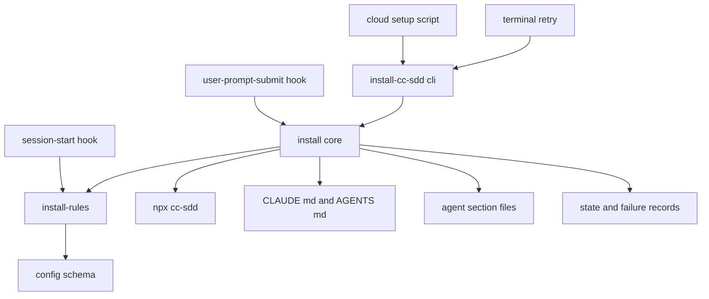
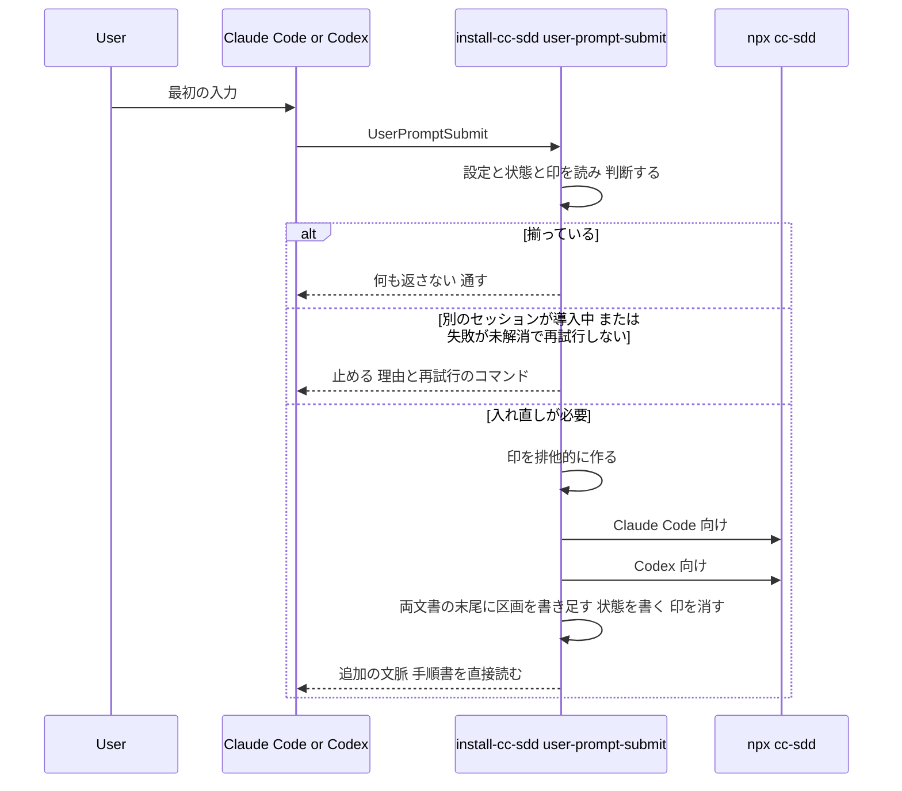
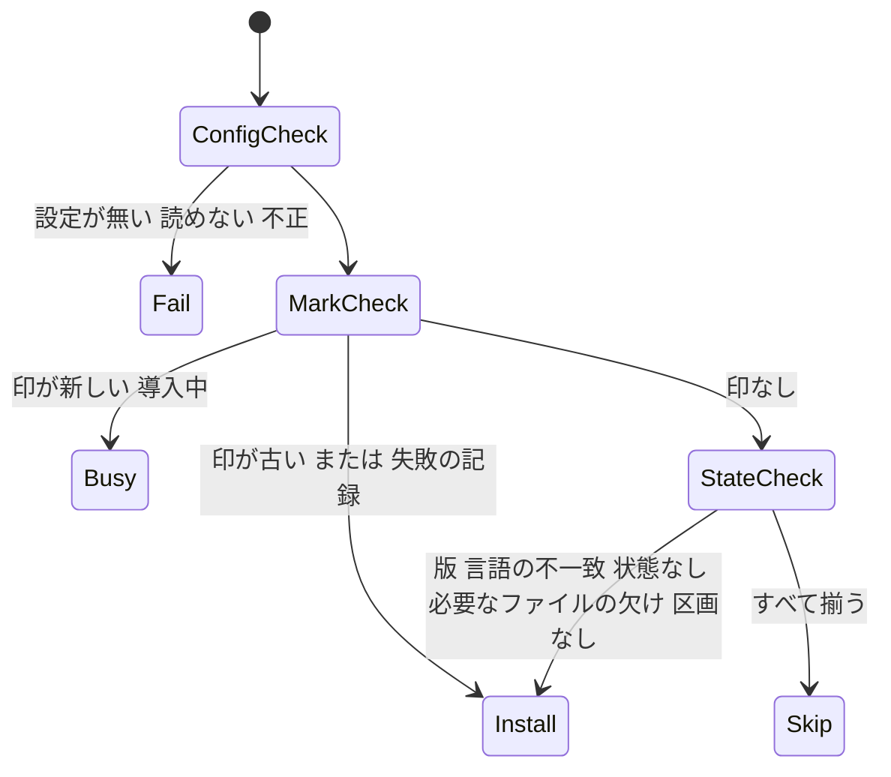

# 設計文書: session-install

> 改訂（2026-11-23）: 単純化後の要件に合わせて書き直した。旧版（SessionStart での導入、内容の照合、雛形の保持、別スクリプトの入力の停止）は git の履歴にある。

## Overview

**Purpose**: 設定した版と言語の cc-sdd（スキル・設定の雛形・標準の決まりの文書）を、Claude Code と Codex の両方に向けて揃える。クラウドでは起動前に、手元では最初の入力時に導入し、導入が終わるまでは作業を止める。標準の決まりの文書は CLAUDE.md・AGENTS.md として書き出し、その末尾に cc-sdd-bootstrap の運用の区画を書き足す。

**Users**: cc-sdd-bootstrap を導入したリポジトリで、Claude Code または Codex を指揮役にして開発する人。

**Impact**: 旧版の「SessionStart で導入・内容の照合・雛形の保持・別スクリプトでの停止」を、「起動前の CLI と最初の入力時のフック」「版・言語と必要なファイルの有無による判断」に置き換える。Codex 向けの導入と、CLAUDE.md・AGENTS.md の書き出しを足す。

### Goals
- 起動前に導入すれば、最初のセッションから `/kiro-*`（Codex は `$kiro-*`）が使える。
- 手元では、最初の入力で導入が始まり、終わるまで作業が進まない。
- 導入物はすべてコミットせずに運用できる。

### Non-Goals
- 手順書を読むまでの操作の拒否（kiro-gate）。
- cc-sdd 本体の改変、BRW の導入、設定の自動移行。
- 導入物の内容の改変の検出。

## Boundary Commitments

### This Spec Owns
- 導入のスクリプト `install-cc-sdd.mjs`（起動前・再試行の CLI、SessionStart と UserPromptSubmit のフック）と、純粋な判断の `install-rules.mjs`。
- 導入物: `.claude/skills/kiro-*/`、`.agents/skills/kiro-*/`、`.kiro/settings/`、CLAUDE.md・AGENTS.md の書き出しと、運用の区画のファイルの書き足し。
- 導入の状態と失敗の記録（`.cache/cc-sdd-install.state.json`・`.cache/cc-sdd-install.failed`）。
- カタログの session-install の項目（スクリプト・両ツールのフック・運用の区画の `session-install` の文章）と、設定の項目 `ccSdd.version`・`ccSdd.lang` の検証規則の利用。
- 導入方法の利用手順（README の節と `--help` の表示）。

### Out of Boundary
- カタログの形・運用の区画の目印と組み立て・フックの登録・`.gitignore` の区画（installer-core）。
- 手順書を読むまでの拒否、自然文の対応表（kiro-gate）。
- 役割表・子のモデルの判定（subagent-delegation）。
- クラウド環境の設定そのもの（利用者が準備スクリプトに 1 行を足す）。

### Allowed Dependencies
- installer-core の配置物: `config-schema.mjs`（設定の検証）、`agent-section-claude.md`・`agent-section-codex.md`（運用の区画）、カタログの形。
- `npx`（cc-sdd の公式の CLI、`cc-sdd@<版>`）と、配布元への通信。
- Node.js 22 の標準モジュール。`lib/` は読み込まない。
- 依存の向き: `config-schema` → `install-rules`（純粋）→ `install-cc-sdd`（入出力と入口）。

### Revalidation Triggers
- 導入物の置き場所や、CLAUDE.md・AGENTS.md の書き出し方の変更 → installer-core の `.gitignore` の行、kiro-gate の手順書の道筋を見直す。
- 失敗の記録・状態の記録の道筋や意味の変更 → kiro-gate（止めている間の扱い）を見直す。
- UserPromptSubmit のフックの出力（止める・追加の文脈）の形の変更 → kiro-gate の同じ時点のフックとの並びを見直す。
- cc-sdd の版の引き上げ（manifest の出力物・標準の文書の場所の変更）→ PoC を再実行する。

## Architecture

### Existing Architecture Analysis
- 旧版: SessionStart で `install-cc-sdd.mjs session-start` が導入し、`install-gate.mjs` が失敗の記録を見て UserPromptSubmit を止める。入れ直しの判断に導入物の全ファイルの指紋を使う。Claude Code 向けだけ。
- 保つもの: 純粋な判断（`install-rules.mjs`）と入出力（`install-cc-sdd.mjs`）の分け方、失敗の記録を「導入中」の印に兼ねる形、npx の時間切れ、根を自分の位置から求める形。

### Architecture Pattern & Boundary Map



**Architecture Integration**:
- Selected pattern: 入口は 3 つ（CLI・SessionStart・UserPromptSubmit）、導入の処理は 1 つ。判断は純粋な関数に集める。
- New components rationale: 新しい部品は無い。`install-gate.mjs` を消して `install-cc-sdd.mjs` に統合する。
- Steering compliance: 外部パッケージなし、厳密さのためにコードを増やさない（内容の照合をやめる）。

### Technology Stack

| Layer | Choice / Version | Role in Feature | Notes |
|-------|------------------|-----------------|-------|
| 実行 | Node.js 22（`.mjs`） | フックと CLI | 標準モジュールだけ |
| 導入 | `npx cc-sdd@<設定の版>`（既定 3.1.0）`--manifest` | スキル・雛形・標準の文書の取得 | `--claude-skills` と `--codex-skills` を続けて実行 |
| フック | Claude Code・Codex の SessionStart と UserPromptSubmit | 状態の知らせ・最初の入力時の導入と停止 | 登録は installer-core |

## File Structure Plan

### Directory Structure
```
.agent-hooks/cc-sdd-bootstrap/
├── install-cc-sdd.mjs      # 入口と入出力: CLI（起動前・再試行）、session-start、user-prompt-submit
├── install-rules.mjs       # 純粋: 設定の読み取り、状態の解釈、入れ直しの判断、manifest、npx の引数、文言
└── config-schema.mjs       # （installer-core の配置物）ccSdd.keepTemplates の項目を消す
test/
├── install-rules.test.mjs  # 判断・manifest・文言の単体試験
└── install-cc-sdd.test.mjs # 偽の npx（PATH の差し替え）を使った一時ディレクトリでの試験
poc/self-install/run.sh     # このリポジトリでの導入と停止の実機確認（Codex を足して更新）
README.md                   # 導入方法の節（準備スクリプトの 1 行、手元の初回、未導入の /kiro-* の扱い）
```

### Modified Files
- `.agent-hooks/cc-sdd-bootstrap/install-cc-sdd.mjs` — SessionStart での導入をやめ、`user-prompt-submit` を足す。指紋の計算を消す。Codex 向けの導入、CLAUDE.md・AGENTS.md への区画の書き足し、排他的な印の作成を足す。
- `.agent-hooks/cc-sdd-bootstrap/install-rules.mjs` — `keepTemplates`・指紋（`isFingerprintTarget`）を消す。`decideInstall`・`buildManifest`・`npxArgs`・文言をツールごとに直す。
- `.agent-hooks/cc-sdd-bootstrap/config-schema.mjs` — `ccSdd.keepTemplates` の項目を消す（既存の設定にあっても使わない項目として残る）。
- 削除: `.agent-hooks/cc-sdd-bootstrap/install-gate.mjs`、`test/install-gate.test.mjs`、`test/config-keep-templates.test.mjs`。
- `lib/catalog.mjs` — session-install の項目を差し替える（下の「カタログの項目」）。
- `package.json` — `files` から `install-gate.mjs` を外す。

## System Flows

### 最初の入力時（手元）



- 入れ直しに失敗・時間切れしたら、印に理由を書いて残し、入力を止める（5.1・5.2）。
- 判断の途中の例外も入力を止める（5.6）。

### 判断（`decideInstall`）



- `Fail`: 導入しない。CLI は失敗で終わり、フックは止める（3.4）。
- `Busy`: 導入しない。フックは止める（5.5）。CLI は「別の導入が進行中」として失敗で終わる。
- 印が「古い」= 印の更新時刻から npx の時間切れ（540 秒）＋ 60 秒を過ぎたもの。失敗の記録（中身が「失敗」）は古さに関係なく入れ直しの対象（新しいセッション・再試行で回復できる）。

## Requirements Traceability

| Requirement | Summary | Components | Interfaces | Flows |
|-------------|---------|------------|------------|-------|
| 1.1 | 準備スクリプトの 1 行 | README、`--help` | `messageUsage` | — |
| 1.2 | 非対話で両ツールへ導入 | InstallCli, InstallCore | `runInstall` | 判断 |
| 1.3 | 最初のセッションから使える | InstallCore（起動前に完了） | — | — |
| 1.4 | 失敗の結果・理由・再試行 | InstallCli | 終了コード 1、`messageFailed` | — |
| 2.1 | 最初の入力で確認と導入 | PromptHook, InstallCore | `decideInstall` `runInstall` | 最初の入力時 |
| 2.2 | 完了までは作業を止める | PromptHook | `decision: block` | 最初の入力時 |
| 2.3 | 手順書を直接読む旨を伝える | PromptHook, InstallRules | `messageReadSkillDirectly` | 最初の入力時 |
| 2.4 | 手元の初回の使い方 | README、`--help` | `messageUsage` | — |
| 2.5 | 未導入の /kiro-* が拒否された場合 | README、`--help` | `messageUsage` | — |
| 3.1 | 版・言語で両ツールの導入物を揃える | InstallCore, InstallRules | `buildManifest` `npxArgs` | — |
| 3.2 | 版に無いスキルを残さない | InstallCore | `removalTargets` | — |
| 3.3 | 独自のスキル・仕様・方針・隣接の定義を保つ | InstallRules | `removalTargets` の範囲 | — |
| 3.4 | 設定の誤りは失敗 | InstallRules | `readInstallConfig` | 判断 |
| 3.5 | 導入物と記録を除外設定に含める | Catalog（installer-core の行） | catalog 試験 | — |
| 3.6 | 結果と版・言語を知らせる | StartHook, InstallCli | `messageInstalled` `messageSkipped` | — |
| 3.7 | 両文書を標準の文書で置き換える | InstallRules | `buildManifest` の `doc_main` | — |
| 3.8 | 区画を末尾に 1 つ書き足す | InstallCore | `appendSection` | 最初の入力時 |
| 3.9 | 区画の文章が無い・書けないなら失敗 | InstallCore | `appendSection` の誤り | — |
| 4.1 | 揃っていれば通信せず省く | InstallRules | `decideInstall` → skip | 判断 |
| 4.2 | 不一致・欠け・区画なしは省かない | InstallRules | `decideInstall` | 判断 |
| 4.3 | 未解消の失敗中は省かない | InstallRules | `decideInstall` | 判断 |
| 4.4 | 内容の変更は判断に使わない | InstallRules | `InstallFacts` に内容が無い | — |
| 5.1 | 失敗・中断を判別できる | InstallCore | 印（失敗の記録） | — |
| 5.2 | 未完了なら止めて理由と再試行 | PromptHook | `messageBlocked` | 最初の入力時 |
| 5.3 | 詳細が無いときの案内 | InstallRules | `messageBlocked` | — |
| 5.4 | 再試行の成功で停止を解く | InstallCore | 印を消す | — |
| 5.5 | 同時のセッションは導入済み扱いしない | InstallCore, InstallRules | 印の排他的な作成、`busy` | 判断 |
| 5.6 | 判定できない誤りは止める | PromptHook | 例外時の `block` | — |
| 6.1 | 手順書の場所と読み方 | InstallRules | `messageReadSkillDirectly` | — |
| 6.2 | 運用の区画の説明 | Catalog の `session-install` の文章 | — | — |
| 6.3 | Codex 未承認時の指示 | Catalog の `session-install` の Codex の文章 | — | — |
| 6.4 | Codex で停止が保証されない旨 | Catalog の `session-install` の Codex の文章 | — | — |
| 6.5 | 手順書が無いときは進めない | Catalog の `session-install` の文章 | — | — |

## Components and Interfaces

| Component | Domain/Layer | Intent | Req Coverage | Key Dependencies | Contracts |
|-----------|--------------|--------|--------------|------------------|-----------|
| InstallRules | 純粋 | 設定・状態の解釈、判断、manifest、文言 | 2.3, 3.1–3.4, 3.7, 4.1–4.4, 5.3, 5.5, 6.1 | ConfigSchema (P0) | Service |
| InstallCore | 入出力 | 導入の実行（印・削除・npx・区画・状態） | 1.2, 1.3, 3.1, 3.2, 3.8, 3.9, 5.1, 5.4, 5.5 | InstallRules (P0), npx (P0) | Batch |
| InstallCli | 入口 | 起動前・再試行（引数なし） | 1.2, 1.4, 3.6 | InstallCore (P0) | Batch |
| StartHook | 入口 | SessionStart で状態を知らせる | 3.6 | InstallRules (P1) | Event |
| PromptHook | 入口 | UserPromptSubmit で導入・停止・追加の文脈 | 2.1–2.3, 5.2, 5.6 | InstallCore (P0) | Event |
| Catalog の項目 | データ | スクリプト・フック・区画の文章 | 3.5, 6.2–6.5 | installer-core の Catalog (P0) | State |

InstallCore・InstallCli・StartHook・PromptHook は `install-cc-sdd.mjs` の中の関数、InstallRules は `install-rules.mjs`。

### 純粋

#### InstallRules

```typescript
type Tool = "claude" | "codex";
type InstallConfig = { version: string; lang: string };
type ConfigCheck = { ok: true; config: InstallConfig } | { ok: false; reason: string };   // 理由に設定ファイル名と直し方を含む
function readInstallConfig(text: string | null): ConfigCheck;   // config-schema の validate と formatProblem を使う

type InstallState = { format: 2; version: string; lang: string };
function parseState(text: string | null): InstallState | null;  // 読めない・形が違う・format が違うときは null
function buildState(config: InstallConfig): InstallState;

type InstallFacts = {
  config: ConfigCheck;
  state: InstallState | null;
  mark: { kind: "none" } | { kind: "in-progress"; ageMs: number } | { kind: "failed"; text: string | null };
  skillsPresent: Record<Tool, boolean>;     // .claude/skills/kiro-*/SKILL.md・.agents/skills/kiro-*/SKILL.md が 1 つ以上
  templatesPresent: boolean;                // .kiro/settings/templates がある
  sectionPresent: Record<Tool, boolean>;    // CLAUDE.md・AGENTS.md に運用の区画の開始の目印の行がある
};
type Decision =
  | { action: "skip" }
  | { action: "install"; reason: "config-changed" | "no-state" | "files-missing" | "section-missing" | "failed" | "stale" }
  | { action: "busy" }
  | { action: "fail"; reason: string };
function decideInstall(facts: InstallFacts): Decision;
const STALE_MARK_MS = 600_000;              // NPX_TIMEOUT_MS（540 秒）＋ 60 秒

function removalTargets(entries: Record<Tool, string[]>): string[];
// .claude/skills/kiro-*・.agents/skills/kiro-*（名前が kiro- で始まるものだけ）と .kiro/settings。仕様・方針・他のスキル・.codex/agents は含めない（3.3）
function buildManifest(tool: Tool): { version: 1; artifacts: unknown[] };
// skills（toDir {{AGENT_COMMANDS_DIR}}）、doc_main（docs/CLAUDE.md または docs/AGENTS.md を toDir "."）、settings_templates。Codex の codex_agents は含めない
function npxArgs(config: InstallConfig, tool: Tool, manifestPath: string): string[];
// ["--yes", `cc-sdd@${version}`, "--yes", "--overwrite", "force", "--manifest", manifestPath, tool === "claude" ? "--claude-skills" : "--codex-skills", "--lang", lang]

function messageInstalled(config: InstallConfig): string;
function messageSkipped(config: InstallConfig): string;
function messageReadSkillDirectly(tool: Tool, prompt: string): string;
// 一覧に載らないので手順書を直接読む旨。Claude Code は .claude/skills/<名前>/SKILL.md、Codex は .agents/skills/<名前>/SKILL.md。
// 入力が /kiro-<名前> または $kiro-<名前> で始まれば、その手順書の道筋を名指しする
function messageBlocked(detail: string | null): string;  // 未完了の理由（無ければ「完了を確認できない」）と RETRY_COMMAND
function messageUsage(): string;                         // 1.1・2.4・2.5 の利用手順
const RETRY_COMMAND = "node .agent-hooks/cc-sdd-bootstrap/install-cc-sdd.mjs";
const FAILURE_RECORD = ".cache/cc-sdd-install.failed";
const STATE_PATH = ".cache/cc-sdd-install.state.json";
```
- 判断の順は上の状態図のとおり。内容の照合はしない（4.4）。
- `state.format` は 2 にする（旧版の指紋つきの状態は読めない扱いになり、一度だけ入れ直す）。

### 入出力と入口（`install-cc-sdd.mjs`）

#### InstallCore

##### Batch / Job Contract
- **Trigger**: InstallCli、PromptHook（判断が `install` のとき）。
- **手順**:
  1. 印（`FAILURE_RECORD`）を排他的に作る（`wx`）。中身は「導入中」と再試行のコマンド。古い印・失敗の記録は消してから作る。作れなければ `busy`（5.5）。
  2. `removalTargets` を消す（シンボリックリンクの経路は拒否して失敗）。
  3. Claude Code 向け → Codex 向けの順に `npx` を実行（各 540 秒で打ち切り、`stdio` はフックの出力を汚さないよう標準エラーへ）。
  4. `AGENT_SECTION_FILES` の 2 つを読み、CLAUDE.md・AGENTS.md の末尾に書き足す（`appendSection`。文書の末尾が改行で終わらなければ改行を足す）。ファイルが無い・書けないなら失敗（3.8・3.9）。
  5. 状態を一時ファイルに書いて置き換え、印を消す（5.4）。
- **失敗**: 途中の例外は、印に「失敗」と理由を書いて残す（5.1）。
- **冪等性**: 何度実行しても、揃った導入物＋区画 1 つの状態になる（cc-sdd が両文書を作り直すため、区画は重ならない）。

#### InstallCli（引数なし、`--help`）
- 判断して `install`・`skip` を行い、結果（版・言語）を表示する（3.6）。`fail`・`busy`・導入の失敗では理由と再試行の方法を表示し、終了コード 1（1.4）。対話はしない（1.2）。
- `--help` は `messageUsage` を表示する。
- 準備スクリプトの 1 行（1.1）: `if [ -d <リポジトリ> ]; then (cd <リポジトリ> && node .agent-hooks/cc-sdd-bootstrap/install-cc-sdd.mjs); fi`（PoC で確認した形）。

#### StartHook（`session-start --tool <claude|codex>`）

##### Event Contract
- 入力: フックの JSON（標準入力。使わない）。
- 出力: 判断だけを行い、導入はしない。`skip` なら `messageSkipped`、それ以外は「最初の入力で導入する／導入中・未完了なので入力は止まる」旨を、SessionStart の追加の文脈として返す（3.6）。終了コードは常に 0。
- 例外: 何もせず 0 で終わる（入力の時点で PromptHook が止める）。

#### PromptHook（`user-prompt-submit --tool <claude|codex>`）

##### Event Contract
- 入力: フックの JSON（`prompt` を使う）。
- 出力:
  - `skip`: 何も出さない（通す）。
  - `install` が成功: `hookSpecificOutput.additionalContext` に `messageInstalled` と `messageReadSkillDirectly`（2.3・6.1）。
  - `install` が失敗・`busy`・`fail`: `{ "decision": "block", "reason": messageBlocked(...) }`（2.2・5.2・5.3・5.5）。
  - 例外: `block` と「判定できなかった理由」と再試行のコマンド（5.6）。
- Claude Code と Codex で出力の形は同じ（PoC で確認）。終了コードは 0。

### データ

#### カタログの項目（installer-core の `lib/catalog.mjs` に足す）
- `files`: `install-cc-sdd.mjs`・`install-rules.mjs`（`config-schema.mjs` は installer-core の項目）。
- `hooks`: 次の 4 つ（timeout は SessionStart 30 秒、UserPromptSubmit 600 秒）。UserPromptSubmit は kiro-gate の項目より前に並べる。
  - `{ tools: ["claude"], event: "SessionStart", script: "install-cc-sdd.mjs", args: ["session-start", "--tool", "claude"] }`
  - `{ tools: ["codex"], event: "SessionStart", script: "install-cc-sdd.mjs", args: ["session-start", "--tool", "codex"] }`
  - `{ tools: ["claude"], event: "UserPromptSubmit", script: "install-cc-sdd.mjs", args: ["user-prompt-submit", "--tool", "claude"] }`
  - `{ tools: ["codex"], event: "UserPromptSubmit", script: "install-cc-sdd.mjs", args: ["user-prompt-submit", "--tool", "codex"] }`
- `agentSections` の `session-install`（両ツールで同じ趣旨。6.2〜6.5）:
  - 導入は起動前（準備スクリプト）か最初の入力時に行われ、揃っていれば省かれる。`kiro-` で始まる独自のスキルを置かない。
  - 導入が未完了なら入力が止まる。再試行は通常の端末で `node .agent-hooks/cc-sdd-bootstrap/install-cc-sdd.mjs`。
  - スキル一覧に載らないスキルは、Claude Code は `.claude/skills/<名前>/SKILL.md`、Codex は `.agents/skills/<名前>/SKILL.md` を直接読んで手順を最後まで実行する。手順書が見つからなければ、導入を確かめて再試行し、手順書が使えるまで開発作業を進めない。
  - Codex の文章だけ: フックの信頼が承認されていないと入力の停止は機械的には働かない。その場合は作業の前に上の再試行のコマンドで導入を実行・確認し、失敗・未完了なら作業を止めて利用者に復旧方法を伝える（6.3・6.4）。
- 設定の項目: `ccSdd.keepTemplates` を `config-schema.mjs` から消す。

## Error Handling

| 状況 | CLI | PromptHook | StartHook |
|---|---|---|---|
| 設定が無い・読めない・不正 | 理由と直し方、終了 1 | 止める（理由と直し方） | 知らせる |
| 別の導入が進行中 | 理由、終了 1 | 止める | 知らせる |
| npx の失敗・時間切れ・通信できない | 印に理由、終了 1 | 印に理由、止める | — |
| 区画のファイルが無い・文書に書けない | 印に理由、終了 1 | 印に理由、止める | — |
| シンボリックリンクの経路 | 印に理由、終了 1 | 印に理由、止める | — |
| 予期しない例外 | 印に理由、終了 1 | 止める（5.6） | 何もしない |

## Testing Strategy

- **単体（`install-rules`）**:
  - `decideInstall`: 版・言語の一致と両ツールの手順書・雛形・区画が揃えば `skip`（4.1）。版の違い・状態なし・片方の手順書の欠け・区画なしでそれぞれ `install`（4.2）。失敗の記録で `install`（4.3）。新しい「導入中」で `busy`、古い印で `install`（5.5）。設定の誤りで `fail`（3.4）。
  - `removalTargets`: `kiro-` で始まらないスキル・`.kiro/specs`・`.kiro/steering`・`.codex/agents` を含まない（3.3）。
  - `buildManifest`: 両ツールで `doc_main` の出力先が `.`、Codex に `codex_agents` が無い（3.1・3.7）。
  - `messageReadSkillDirectly`: ツールごとの道筋、`/kiro-x`・`$kiro-x` の名指し（2.3・6.1）。
- **一時ディレクトリの試験（偽の npx）**: `PATH` の先頭に偽の `npx` を置き、引数に応じてスキル・雛形・標準の文書を書く、または失敗・遅延する。
  - CLI で両ツールの導入物と、末尾に区画が 1 つある CLAUDE.md・AGENTS.md ができる。2 回目は `skip` で npx を呼ばない（1.2・3.8・4.1）。
  - 既存の CLAUDE.md の利用者の記述が消え、`kiro-` で始まらない独自のスキル・`.kiro/specs` が残る（3.3・3.7）。
  - npx の失敗で印が残り、PromptHook が止め、再試行の成功で止まらなくなる（5.1・5.2・5.4）。
  - 区画のファイルが無いと失敗（3.9）。
  - 2 つの PromptHook をほぼ同時に起動すると、片方だけが npx を呼び、もう片方は止める（5.5）。
  - PromptHook で例外（設定が JSON でない）が止める（5.6）。
- **実機（PoC）**: `poc/req-feasibility/`（両ツールの最初の入力時の導入、Codex の停止）、`poc/first-kiro-command/`（起動前の導入で最初の `/kiro-steering`）。実装後に `poc/self-install/run.sh` を Codex 込みに更新し、このリポジトリで導入と停止を確かめる。

## Migration Strategy

- 旧版の状態（`format` 1、指紋つき）は読めない扱いになり、次の入力時に一度だけ入れ直す。旧版の `.kiro/settings/cc-sdd-guide.md` は `.kiro/settings` ごと消えて作り直される。
- 旧版の `install-gate.mjs` の登録は、installer-core の `update` が一式の登録を差し替えるときに消える。
- 旧版の CLAUDE.md の管理区画は、最初の導入で CLAUDE.md が標準の文書に置き換わるときに消える。このリポジトリでは `installer-core/handoff-self-apply.md` の手順で、先に決まりを `.kiro/steering/` へ移す。
