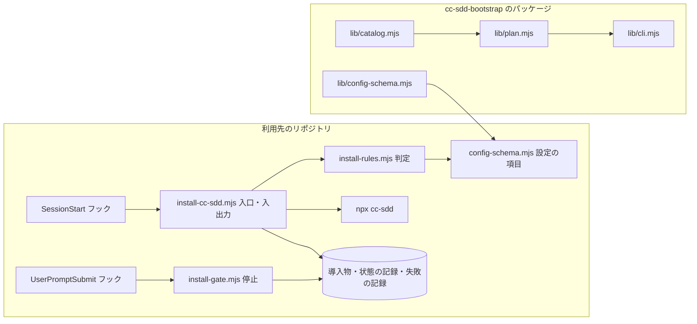
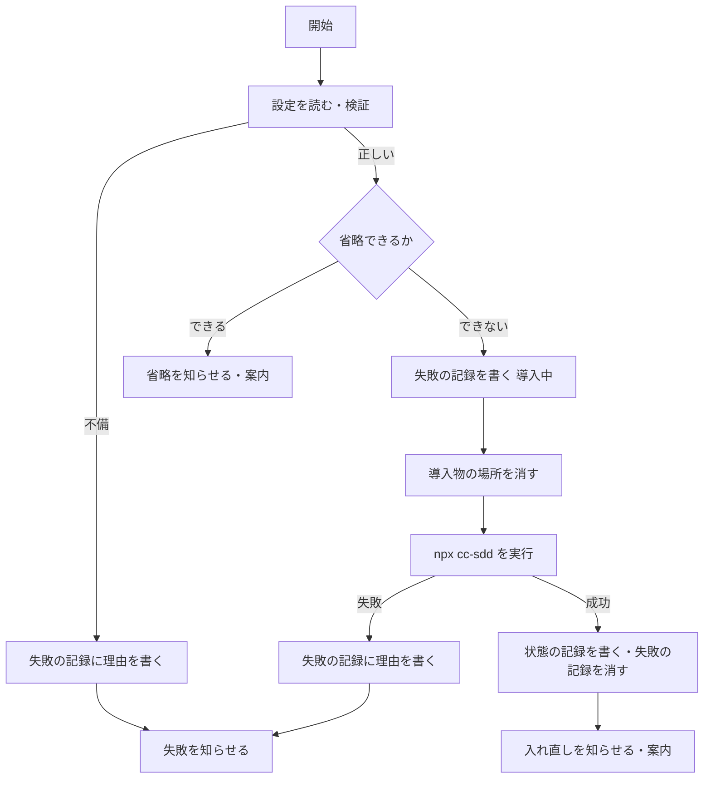

# Design Document: session-install

## Overview
**Purpose**: cc-sdd-bootstrap を導入したリポジトリで、セッションの開始のたびに設定ファイルの版・言語で cc-sdd の導入物（スキル・設定の雛形・標準の決まりの文書）を揃え、揃えられなかったときは次の入力を理由と再試行の方法つきで止める（以下「セッション導入」）。

**Users**: 導入先のリポジトリの開発者。clone 直後・クラウドセッションを含む。

**Impact**: installer-core が初期の配置物として置いた `install-cc-sdd.sh`（版 3.1.0・言語 ja を固定）を、設定を読む Node のスクリプトに置き換える。導入物が揃っていれば入れ直しを省く。設定に「雛形の保持」の項目を足し、選んだときは `.kiro/settings/templates/` を上書きせずコミットできるようにする。

### Goals
- 設定ファイルの `ccSdd.version`・`ccSdd.lang` で導入し、版を変えたら古いスキルを残さない（要件 1）
- 揃っていて中身も変わっていなければ、通信せずに入れ直しを省く（要件 2）
- 失敗・中断・設定の不備では次の入力を止め、理由と再試行の方法を示す（要件 3）
- 既存の導入先は `update` 1 回で置き換わる（要件 5）

### Non-Goals
- 手順書を先に読ませる強制（kiro-gate）、BRW の導入確保
- cc-sdd の Codex 向けの導入物
- cc-sdd のスキルの内容の改変、cc-sdd の対応言語の一覧の保持（不正な言語は cc-sdd の失敗として扱う）
- 同時に始まったセッションの排他（作業の並列性の担保は BRW などの責務。利用者の判断、2026-11-19）
- 設定ファイルの移行（設定が検証の規則に合わないときは、止めて設定の更新を促すだけ）
- Windows のネイティブ環境（初期の配置物と同じく、POSIX のシェルと `npx` がある環境を対象にする）

## Boundary Commitments

### This Spec Owns
- 配置物 `.agent-hooks/cc-sdd-bootstrap/install-cc-sdd.mjs`（入口）・`install-rules.mjs`（判定）・`install-gate.mjs`（入力の停止）の中身と、それぞれの出力の文章
- 導入状態の記録 `.cache/cc-sdd-install.state.json`・失敗の記録 `.cache/cc-sdd-install.failed` の形式と扱い、導入の途中でだけ作る一時ファイル（`.cache/cc-sdd-install.*` の名前）、`.cache/` の `.gitignore` への除外
- 導入物の場所（`.claude/skills/kiro-*`・`.kiro/settings/templates/`・`.kiro/settings/cc-sdd-guide.md`）の削除と導入
- 設定の項目 `ccSdd.keepTemplates` の定義
- カタログの中のセッション導入の項目（ファイル・フック・`.gitignore` の行・CLAUDE.md の文章）
- installer-core のデータの形への 2 つの足し算: `.gitignore` の行の条件（`when`）、設定の項目のお知らせ（`notice`）。それを読む `lib/plan.mjs`・`lib/cli.mjs`・`lib/target.mjs` の該当の処理

### Out of Boundary
- 設定ファイルの読み書き・補い・対話の仕組み（installer-core の `lib/config.mjs`・`lib/cli.mjs`）。この spec は項目を足すだけ。例外は `format` の検査の規則で、配置物と共有するため `config-schema.mjs` へ移し、`lib/config.mjs` はそれを使う形に直す（規則は変えない）
- 配置・記録・フックの統合・管理区画の操作の仕組み（installer-core）
- cc-sdd の導入処理そのもの（`npx cc-sdd`）。この spec は呼び出し方だけを持つ
- スキルを読ませる強制（kiro-gate）、Codex 向けの導入物（codex-delegation）
- 同時に始まったセッションの排他。重なった導入で導入物が壊れても、次のセッションの開始時に指紋の判定（要件 2.2）で検出して入れ直す

### Allowed Dependencies
- 配置物 → 同じディレクトリの配置物（`install-cc-sdd.mjs` → `install-rules.mjs` → `config-schema.mjs`）と Node の標準モジュールだけ。`lib/` を読み込まない
- `install-gate.mjs` → Node の標準モジュールだけ（他の配置物が壊れていても判定できるようにする）
- `lib/config-schema.mjs` → `.agent-hooks/cc-sdd-bootstrap/config-schema.mjs`（公開し直すだけ）
- 外部: `npx` と npm のレジストリ（入れ直すときだけ）

### Revalidation Triggers
- 失敗の記録の道筋・形式の変更 → kiro-gate など、記録を読む下流と `poc/self-install`
- 導入物の場所の変更（`.claude/skills/kiro-*/SKILL.md`）→ kiro-gate
- `catalog.gitignore` の要素の形・`ConfigField.notice` の変更 → installer-core のテスト、他の下流 spec
- `config-schema.mjs` の置き場所の変更 → installer-core の `lib/config.mjs`・`lib/cli.mjs`
- cc-sdd の版を上げる → `poc/self-install/run.sh` を再実行する（manifest の形式の互換）

## Architecture

### Existing Architecture Analysis
- installer-core は、パッケージの中の `.agent-hooks/cc-sdd-bootstrap/` を同じ道筋で利用先へ写す。カタログから外れた記録のファイルは `update` で消す。一式のフックは見分けの文字列（`/.agent-hooks/cc-sdd-bootstrap/`）で全部入れ替える。
- 初期の配置物は bash（導入）と Node（停止）。停止の判定はすでに失敗の記録の一覧（`installFailures`）の形を持つ。
- `poc/session-hooks`: 標準出力は文脈に入り、標準エラーは入らない。新しく置いたスキルは同じセッションの一覧に載らない。時間切れではフックと子が止められる。同時に始めたセッションのフックは重なる（この spec は排他しない）。
- `lib/target.mjs` の未追跡の調べ（`expandIgnored`）は、最後の区間の `*` に対応する。`/.cache/` や `.kiro/settings/*` は調べられる。

### Architecture Pattern & Boundary Map



矢印は「左が右を使う」。配置物の中では、入口だけがファイル・プロセスを扱い、判定はファイルを読まない純粋な処理にする（structure.md の「データ → 純粋な処理 → 入出力」）。

### Technology Stack

| Layer | Choice / Version | Role in Feature | Notes |
|-------|------------------|-----------------|-------|
| 実行環境 | Node.js 22 以上（標準モジュールだけ） | 配置物の入口・判定・停止 | `fs`・`path`・`crypto`・`child_process` |
| 導入の実体 | `npx --yes cc-sdd@<版>` | cc-sdd の導入物を書く | `--yes --overwrite force --manifest <file> --claude-skills --lang <言語>` |
| フック | Claude Code の SessionStart・UserPromptSubmit | 導入の起動・入力の停止 | SessionStart は matcher なし・時間制限 600 秒 |
| テスト | `node --test` | 判定の単体、偽の `npx` を使う通し | 実物の通しは `poc/self-install` |

## File Structure Plan

### Directory Structure
```
.agent-hooks/cc-sdd-bootstrap/
├── install-cc-sdd.mjs   # 新規。入口: 設定の読み取り・削除・npx の実行・記録の読み書き・出力・終了コード
├── install-rules.mjs    # 新規。判定（純粋）: 入れ直すかの判定・manifest・状態の記録の組み立てと解釈・削除の対象・利用者向けの文章
├── config-schema.mjs    # lib/config-schema.mjs から移す。設定の項目の定義（データ）。ccSdd.keepTemplates と format の検査の規則（formatProblem）を足す
├── install-gate.mjs     # 変更。記録の中身（理由）を示す。記録の一覧の形は保つ
└── install-cc-sdd.sh    # 削除（カタログから外す。update で利用先からも消える）
lib/
├── config-schema.mjs    # 変更。配置物の config-schema.mjs を公開し直すだけにする
├── config.mjs           # 変更。format の検査を formatProblem の呼び出しに置き換える（規則・文言は変えない）
├── catalog.mjs          # 変更。ファイル・フック・.gitignore の行（条件つき）・CLAUDE.md の文章を差し替える。型に when を足す
├── plan.mjs             # 変更。設定に合う .gitignore の行だけを管理区画に書く（resolveGitignoreLines）
├── target.mjs           # 変更。未追跡の調べに、条件に関わらずすべての除外の行を使う（打ち消しの行を除く）
└── cli.mjs              # 変更。init・update の完了時に、設定の項目の notice を示す
test/
├── install-rules.test.mjs        # 新規。判定の単体テスト
├── install-cc-sdd.test.mjs       # 新規。偽の npx を PATH の先頭に置き、一時ディレクトリで入口を動かす
├── install-gate.test.mjs         # 新規。停止の判定と文章
├── catalog.test.mjs・plan.test.mjs・cli.test.mjs・package.test.mjs・config.test.mjs  # 変更
poc/self-install/run.sh            # 変更。新しい入口・再試行のコマンドに合わせる
package.json                       # 変更。files の配置物を差し替える
```

### Modified Files（自己適用）
- `.claude/settings.json` — `node bin/cc-sdd-bootstrap.mjs update` で SessionStart の登録が新しい入口に置き換わる
- `.gitignore` — 同じく管理区画の行が変わる。管理区画の外の手書きの `/.cache/` の行は削除する
- `.agent-hooks/cc-sdd-bootstrap/installed.json` — 同じく記録が更新される
- `.cc-sdd-bootstrap.json` — 同じく `ccSdd.keepTemplates: false` が補われる
- `CLAUDE.md` — 管理区画は update で更新。手書きの「cc-sdd の導入」の節を、固定版の記述を外して短くする
- `.kiro/steering/tech.md`・`README.md` — 「版 3.1.0・言語 ja を固定」の記述を、設定の版・言語で入れ直す動きに改める

## System Flows

### セッション開始時の導入



- 省略の判定（`decideInstall`）: 失敗の記録が無い、状態の記録が読める、版・言語・雛形の保持の選択が設定と同じ、記録したファイルがすべてあり指紋が一致する、雛形の保持を選んでいるときは `.kiro/settings/templates/` にファイルがある、のすべてを満たすときだけ省く。
- 時間切れでフックが止められると、失敗の記録が残る（PoC c）。次のセッションは入れ直す。
- 同時に始まったセッションは排他しない。重なった結果、導入物が欠けた・混ざった状態が残っても、次のセッションの開始時に指紋の判定で検出されて入れ直される。
- フックから呼ばれたとき（引数 `session-start`）は、失敗でも終了コード 0 で標準出力に知らせる（文脈に入れる）。手で再試行したとき（引数なし）は、失敗で終了コード 1 にする。

### 次の入力の停止
UserPromptSubmit のたびに `install-gate.mjs` が記録の一覧を調べ、記録のある対象があれば `decision: "block"` と理由（対象ごとの名前・記録の中身・再試行の方法）を返す。判定そのものが例外になったら、標準エラーに出して通す。

## Requirements Traceability

| Requirement | Summary | Components | Interfaces | Flows |
|-------------|---------|------------|------------|-------|
| 1.1 | 設定の版・言語で導入 | InstallEntry, InstallRules | `buildManifest`, `npxArgs` | 導入 |
| 1.2 | 消してから導入 | InstallEntry, InstallRules | `removalTargets` | 導入 |
| 1.3 | CLAUDE.md に触れない | InstallRules | `buildManifest`（doc_main の出力先） | 導入 |
| 1.4 | 他のファイルに触れない | InstallEntry, InstallRules | `removalTargets`, 親のシンボリックリンクの確認 | 導入 |
| 1.5 | 成功の知らせ | InstallRules | `messageInstalled` | 導入 |
| 1.6 | 途中経過を文脈に入れない | InstallEntry | npx の標準出力を標準エラーへ | 導入 |
| 1.7 | 設定の不備は失敗 | InstallRules, ConfigSchema | `readInstallConfig` | 導入 |
| 2.1 | 揃っていれば省略・通信しない | InstallRules | `decideInstall` | 導入 |
| 2.2 | 欠け・変更で入れ直し | InstallRules | `decideInstall` | 導入 |
| 2.3 | 版・言語の違いで入れ直し | InstallRules | `decideInstall` | 導入 |
| 2.4 | 記録が無い・読めないと入れ直し | InstallRules | `parseState`, `decideInstall` | 導入 |
| 2.5 | 失敗の記録があれば省略しない | InstallRules | `decideInstall` | 導入 |
| 2.6 | 省略の知らせ | InstallRules | `messageSkipped` | 導入 |
| 2.7 | 状態の記録 | InstallRules, InstallEntry | `buildState` | 導入 |
| 2.8 | 状態の記録をコミットしない | Catalog | `.gitignore` の行 | — |
| 3.1 | 導入の前に失敗の記録 | InstallEntry | `RECORD_IN_PROGRESS` | 導入 |
| 3.2 | 成功で記録を消す | InstallEntry | — | 導入 |
| 3.3 | 失敗の理由と再試行 | InstallRules, InstallEntry | `failureRecordText`, `messageFailed` | 導入 |
| 3.4 | 中断で記録が残る | InstallEntry | 記録を先に書く順序 | 導入 |
| 3.5 | 記録があれば入力を止める | InstallGate | `decideUserPromptSubmit` | 停止 |
| 3.6 | 記録が無ければ通す | InstallGate | `decideUserPromptSubmit` | 停止 |
| 3.7 | 手の再試行の成功で通す | InstallEntry, InstallGate | 引数なしの実行 | 導入・停止 |
| 3.8 | 判定の誤りは通す | InstallGate | `main` の例外処理 | 停止 |
| 3.9 | 対象ごとに並べる | InstallGate | `installFailures`, `installBlockReason` | 停止 |
| 3.10 | 失敗の記録をコミットしない | Catalog | `.gitignore` の行 | — |
| 4.1 | 一覧に載らないスキルの案内 | InstallRules | `messageGuide` | 導入 |
| 4.2 | CLAUDE.md の管理区画の説明 | Catalog | `claudeSections` | — |
| 5.1 | init・update で配置・登録 | Catalog | `files`, `hooks` | — |
| 5.2 | 初期の配置物の置き換え | Catalog, Plan（既存） | カタログから外れた記録のファイルの削除 | — |
| 5.3 | 置き換え後は入れ直し | InstallRules | 新しい状態の記録の道筋 | 導入 |
| 5.4 | 利用先だけで動く | 配置物すべて | 依存の向き | — |
| 5.5 | uninstall の一覧に記録を含める | Catalog, Target | `.gitignore` の行、`allIgnoreLines` | — |
| 6.1 | 雛形の保持の項目 | ConfigSchema | `ccSdd.keepTemplates` | — |
| 6.2 | 既定は入れ替え・除外 | InstallRules, Catalog | `removalTargets`, `.gitignore` の行の条件 | 導入 |
| 6.3 | 保持では消さず上書きしない | InstallRules | `removalTargets`, `buildManifest` | 導入 |
| 6.4 | 保持で雛形が無ければ置く | InstallRules | `decideInstall`（`templatesMissing`）, `buildManifest` | 導入 |
| 6.5 | 保持では雛形の変更を理由にしない | InstallRules | `isFingerprintTarget` | 導入 |
| 6.6 | 保持では雛形を除外から外す | Catalog, Plan | `when`, `resolveGitignoreLines` | — |
| 6.7 | 選択を変えて update で書き直す | Plan | `resolveGitignoreLines` | — |
| 6.8 | ライセンスの知らせ | ConfigSchema, Cli | `ConfigField.notice`, `formatSuccess` | — |

## Components and Interfaces

| Component | Domain/Layer | Intent | Req Coverage | Key Dependencies | Contracts |
|-----------|--------------|--------|--------------|------------------|-----------|
| ConfigSchema | データ（配置物） | 設定の項目の定義。`ccSdd.keepTemplates` を足す | 1.7, 6.1, 6.8 | — | State |
| InstallRules | 純粋な処理（配置物） | 入れ直すかの判定・manifest・状態・文章 | 1.1–1.5, 1.7, 2.1–2.7, 3.3, 4.1, 5.3, 6.2–6.5 | ConfigSchema (P0) | Service |
| InstallEntry | 入出力（配置物） | 削除・npx・記録・出力 | 1.1, 1.2, 1.4, 1.6, 2.7, 3.1–3.4, 3.7 | InstallRules (P0), npx (P0) | Batch |
| InstallGate | 入出力（配置物） | 記録を見て入力を止める | 3.5–3.9 | Node の fs (P0) | Event |
| Catalog | データ（lib） | セッション導入の項目と `.gitignore` の条件 | 2.8, 3.10, 4.2, 5.1, 5.2, 5.5, 6.2, 6.6 | — | State |
| Plan | 純粋な処理（lib） | 設定に合う `.gitignore` の行を書く | 6.6, 6.7 | Catalog (P0) | Service |
| Target | 入出力（lib） | 未追跡の調べにすべての除外の行を使う | 5.5 | Catalog (P0) | Service |
| Cli | 入出力（lib） | 項目のお知らせを示す | 6.8 | ConfigSchema (P0) | Service |

型は JSDoc（`@typedef`）で書く。以下は読みやすさのために TypeScript の記法で示す。

### データ

#### ConfigSchema（`.agent-hooks/cc-sdd-bootstrap/config-schema.mjs`）

| Field | Detail |
|-------|--------|
| Intent | 設定の項目の定義を、配置物と導入コマンドで共有する |
| Requirements | 1.7, 6.1, 6.8 |

**Contracts**: State [x]

```typescript
interface ConfigField {
  // installer-core の既存の項目はそのまま
  notice?: string; // 値が true のとき init・update の完了時に示す文章（この spec で足す。boolean の項目だけが使う）
}
```

足す項目:

| path | flag | kind | 既定値 | 検証 | notice |
|------|------|------|--------|------|--------|
| `ccSdd.keepTemplates` | `keep-templates` | boolean | `false` | 真偽 | 雛形（`.kiro/settings/templates/`）は cc-sdd の成果物（MIT ライセンス）。コミットする場合はそのライセンスに従う。保持すると cc-sdd の版を上げても雛形は入れ替わらない（入れ替えるには `.kiro/settings/templates/` を消して新しいセッションを開く） |

- 質問文: 「cc-sdd の雛形（.kiro/settings/templates/）を上書きせずに保持し、コミットできるようにしますか」
- `CONFIG_FORMAT`（設定ファイルの書式の版）は、今と同じくこのファイルに置く。
- `format` の検査は `formatProblem(format: unknown): string | null`（問題があれば「format: 理由」の文、無ければ null）としてこのファイルに移す。今の `lib/config.mjs` の `checkFormat` と同じ規則・文言（無い／1 以上の整数でない／`CONFIG_FORMAT` より新しい）で、`lib/config.mjs` と配置物の `readInstallConfig` の両方が使う。規則が 1 か所なので食い違わない。
- `lib/config-schema.mjs` は `export * from "../.agent-hooks/cc-sdd-bootstrap/config-schema.mjs";` だけにする。既存の `import { configFields } from "./config-schema.mjs"` は変えない。
- 導入済みのリポジトリは、次の `update` で `ccSdd.keepTemplates: false` が補われる（installer-core の `fillDefaults`）。セッション導入は、項目が無い設定を既定値 `false` として扱う（補われる前のセッションでも止めない）。

#### Catalog（`lib/catalog.mjs`）

**Contracts**: State [x]

```typescript
type CatalogGitignoreLine = string | { line: string; when: { path: string; equals: ConfigValue } };
interface Catalog { files: CatalogFile[]; hooks: CatalogHook[]; gitignore: CatalogGitignoreLine[]; claudeSections: CatalogSection[] }
```

差し替える中身:

- `files`: `install-cc-sdd.mjs`・`install-rules.mjs`・`config-schema.mjs`・`install-gate.mjs`（いずれも common、実行権限なし）
- `hooks`:
  - SessionStart: `node "$CLAUDE_PROJECT_DIR/.agent-hooks/cc-sdd-bootstrap/install-cc-sdd.mjs" session-start`、timeout 600、matcher なし
  - UserPromptSubmit: 今と同じ（`install-gate.mjs user-prompt-submit`、timeout 10）
- `gitignore`:
  1. `.claude/skills/kiro-*/`
  2. `{ line: ".kiro/settings/", when: { path: "ccSdd.keepTemplates", equals: false } }`
  3. `{ line: ".kiro/settings/*", when: { path: "ccSdd.keepTemplates", equals: true } }`
  4. `{ line: "!.kiro/settings/templates/", when: { path: "ccSdd.keepTemplates", equals: true } }`
  5. `/.cache/`（導入の記録・一時ファイルをすべて除外する）
- `claudeSections`: 既存の `cc-sdd-guide` の前に `cc-sdd-session-install` を足す。本文は次の内容を短く書く: 導入物はセッション開始時に設定の版・言語で入る（揃っていれば省く）／入れ直すと `.claude/skills/kiro-*` は消してから入れる（`kiro-` で始まる独自のスキルを置かない）／導入が完了していないと入力が止まる／再試行は Claude の外で `node .agent-hooks/cc-sdd-bootstrap/install-cc-sdd.mjs`／SKILL.md が見つからないときは導入の未完了を利用者に伝え、再試行を勧める／スキル一覧に載らないスキルは対応する SKILL.md を読んで手順を実行する。

### 純粋な処理

#### InstallRules（`.agent-hooks/cc-sdd-bootstrap/install-rules.mjs`）

| Field | Detail |
|-------|--------|
| Intent | ファイルを読まずに、入れ直すか・何を消すか・何を導入するか・何を記録し何を知らせるかを決める |
| Requirements | 1.1–1.5, 1.7, 2.1–2.7, 3.3, 4.1, 5.3, 6.2–6.5 |

**Contracts**: Service [x]

```typescript
const FAILURE_RECORD = ".cache/cc-sdd-install.failed";
const STATE_PATH = ".cache/cc-sdd-install.state.json";
const RETRY_COMMAND = "node .agent-hooks/cc-sdd-bootstrap/install-cc-sdd.mjs";
const NPX_TIMEOUT_MS = 540_000;    // npx の待ちの上限（フックの 600 秒の内。超えたら理由つきで失敗にする）
const RECORD_IN_PROGRESS: string;  // 「導入が完了していません（導入中、または中断）」と再試行の方法

interface InstallConfig { version: string; lang: string; keepTemplates: boolean }
type ConfigResult = { ok: true; config: InstallConfig } | { ok: false; reason: string };

// 設定ファイルの文字列（無ければ null）を解釈し、`format`（config-schema.mjs の formatProblem）と、
// configFields の validate で ccSdd.version・ccSdd.lang・ccSdd.keepTemplates を確かめる。keepTemplates が無ければ false。
// 理由にはファイル名・項目・直し方（設定を直す、または導入コマンドの update で新しくする）を含める。値の移行はしない（1.7）
function readInstallConfig(text: string | null): ConfigResult;

interface InstallState {
  format: 1;
  version: string; lang: string; keepTemplates: boolean;
  files: Record<string, string>;     // 道筋 → SHA-256（16 進）。保持を選んだときは雛形を含めない
}
function parseState(text: string | null): InstallState | null; // 読めない・形が違えば null（2.4）
function buildState(input: { config: InstallConfig; files: Record<string, string> }): InstallState;

// 指紋を取る対象かどうか（道筋の判定）。保持を選んだときは .kiro/settings/templates/ の下を外す（6.5）
function isFingerprintTarget(path: string, keepTemplates: boolean): boolean;

type InstallDecision =
  | { action: "skip" }
  | { action: "install"; reason: "no-state" | "config-changed" | "files-changed" | "templates-missing" | "failure-record" };
function decideInstall(input: {
  config: InstallConfig;
  state: InstallState | null;
  failureRecordExists: boolean;
  currentHashes: Record<string, string | null>; // state.files の各道筋の今の指紋（無ければ null）
  templatesMissing: boolean;                    // .kiro/settings/templates/ が無い、または中にファイルが 1 つも無い
}): InstallDecision;

// 消す対象（リポジトリの根からの道筋）。skillEntries は .claude/skills の直下の名前の一覧
function removalTargets(input: { skillEntries: string[]; keepTemplates: boolean }): string[];

// cc-sdd の manifest（version 1）。templates を含めるのは keepTemplates が false、または雛形が無いとき（6.3・6.4）
function buildManifest(input: { keepTemplates: boolean; templatesMissing: boolean }): object;
function npxArgs(config: InstallConfig, manifestPath: string): string[];

// 利用者向けの文章（すべて日本語）
function messageInstalled(config: InstallConfig): string;   // 版・言語・場所。CLAUDE.md は変えていない（1.5）
function messageSkipped(config: InstallConfig): string;     // 1 行（2.6）
function messageGuide(): string;                            // 一覧に載らないスキルは SKILL.md を読む（4.1）
function failureRecordText(reason: string): string;         // 理由と再試行の方法（3.3）
function messageFailed(reason: string): string;
```

- `decideInstall` は、失敗の記録があれば `failure-record`、状態が無ければ `no-state`、版・言語・保持の選択が違えば `config-changed`、記録のファイルのどれかが無いか指紋が違えば `files-changed`、保持を選んでいて雛形が無ければ `templates-missing`、どれでもなければ `skip`（要件 6.4 により、雛形が無ければ省かない）。
- `removalTargets` は `kiro-` で始まる直下の項目すべて（ディレクトリ・ファイル・リンク）と `.kiro/settings/cc-sdd-guide.md`、保持を選んでいなければ `.kiro/settings/templates`。
- `buildManifest` の `doc_main` は、今と同じく `templates/agents/{{AGENT}}/docs/CLAUDE.md` を `{{KIRO_DIR}}/settings` へ `cc-sdd-guide.md` の名前で出す（CLAUDE.md に書かせない。1.3）。
- `npxArgs`: `["--yes", "cc-sdd@<版>", "--yes", "--overwrite", "force", "--manifest", <道筋>, "--claude-skills", "--lang", <言語>]`。

### 入出力

#### InstallEntry（`.agent-hooks/cc-sdd-bootstrap/install-cc-sdd.mjs`）

| Field | Detail |
|-------|--------|
| Intent | セッション開始時（と手の再試行）に、判定に従って導入物を揃える |
| Requirements | 1.1, 1.2, 1.4, 1.6, 2.7, 3.1–3.4, 3.7 |

**Contracts**: Batch [x]

##### Batch / Job Contract
- **Trigger**: SessionStart のフック（`node .../install-cc-sdd.mjs session-start`）、または利用者の手の実行（引数なし）。それ以外の引数は使い方を標準エラーに出して終了コード 2。
- **Input / validation**: リポジトリの根は自分の位置（`../..`）から求める。設定は `readInstallConfig` で確かめる。標準入力は読まない。`npx` の待ちの上限は `NPX_TIMEOUT_MS`。試験のためだけに環境変数 `CC_SDD_BOOTSTRAP_NPX_TIMEOUT_MS`（正の整数のミリ秒）で短くできる（不正な値は無視する）。
- **Output**: 標準出力に `messageInstalled`／`messageSkipped` と `messageGuide`、または `messageFailed`。npx の標準出力・標準エラーは標準エラーへ回す（1.6）。終了コードは成功 0、失敗はフックからなら 0（文脈に入れるため）、手の実行なら 1。
- **Idempotency & recovery**: 手順は次の順。排他はしない。
  1. 設定を読む。不備なら失敗の記録に理由を書いて終わる。
  2. 状態の記録・失敗の記録・記録のファイルの指紋・雛形の有無を読み、`decideInstall`。`skip` なら知らせて終わる。
  3. 失敗の記録に `RECORD_IN_PROGRESS` を書く（3.1）。
  4. `.claude`・`.claude/skills`・`.kiro`・`.kiro/settings` がシンボリックリンクなら失敗とする。`removalTargets` を `lstat` で確かめながら消す（リンクはリンクだけを消す）（1.2・1.4）。
  5. manifest を一時ファイル `.cache/cc-sdd-install.manifest.<pid>.json` に書き、`npx` を実行する。`NPX_TIMEOUT_MS` を過ぎたら `npx` を止め、「時間内に取得・導入が終わらなかった（通信を確かめる）」を理由にする。manifest は `finally` で消す。失敗なら終了コードを含む理由を失敗の記録に書く（3.3）。
  6. 成功なら、`isFingerprintTarget` に合う導入物のファイルの指紋を取り、`buildState` を一時ファイル `.cache/cc-sdd-install.state.json.<pid>.tmp` 経由で `STATE_PATH` に書く。失敗の記録を消す（3.2）。
- 一時ファイルは `.cache/cc-sdd-install.` で始まる名前にし、`.cache/` ごと `.gitignore` の対象なのでコミットされない。プロセスの番号を付けるのは、重なって動いたセッションが互いの一時ファイルを消さないため。
- 時間切れでプロセスごと止められた場合は 6 が動かず、失敗の記録が残る。次のセッションが入れ直す（3.4）。

#### InstallGate（`.agent-hooks/cc-sdd-bootstrap/install-gate.mjs`）

| Field | Detail |
|-------|--------|
| Intent | 記録のある導入の対象があれば、次の入力を止める |
| Requirements | 3.5–3.9 |

**Contracts**: Event [x]

```typescript
interface InstallFailure { name: string; record: string; retry: string }
const installFailures: InstallFailure[]; // [{ name: "cc-sdd", record: ".cache/cc-sdd-install.failed", retry: "node .agent-hooks/cc-sdd-bootstrap/install-cc-sdd.mjs" }]
function pendingInstallFailures(root: string): Array<InstallFailure & { detail: string }>; // detail は記録の中身（最大 2000 文字）
function installBlockReason(failures: Array<InstallFailure & { detail: string }>): string;
function decideUserPromptSubmit(root: string): object | null; // 今と同じ形（decision: "block"・reason・suppressOriginalPrompt）
```
- 理由の文章: 導入が完了していない／新しいセッションを開くと再試行される／Claude の外で再試行のコマンドを実行し、成功してから入力し直す／対象ごとに「名前・記録の中身・再試行の方法」（3.5・3.9）。
- 他の配置物を読み込まない。判定の例外は標準エラーに出して終了コード 0（3.8）。

#### Plan・Target・Cli（`lib/`、installer-core の該当の処理）
- `lib/plan.mjs`: `resolveGitignoreLines(lines: CatalogGitignoreLine[], config: object | null): string[]` を足す。文字列はそのまま、`when` つきは `config` の `path` の値が `equals` と一致するときだけ残す（`config` が null なら既定値で判定）。`makePlan` の `.gitignore` の本文に使う（6.6・6.7）。
- `lib/target.mjs`: `allIgnoreLines(lines)` で条件を外した行の一覧（`!` で始まる行を除く）を作り、`readSnapshot` の未追跡の調べに使う（5.5）。`cli.mjs` の呼び出しもこれに揃える。
- `lib/cli.mjs`: `formatSuccess` で、`init`・`update` の後の設定で値が `true` の項目の `notice` を「お知らせ」に足す（6.8）。

## Data Models

### 導入状態の記録 `.cache/cc-sdd-install.state.json`
```json
{
  "format": 1,
  "version": "3.1.0",
  "lang": "ja",
  "keepTemplates": false,
  "files": { ".claude/skills/kiro-impl/SKILL.md": "<sha256>", ".kiro/settings/cc-sdd-guide.md": "<sha256>" }
}
```
- 成功した導入の後にだけ書く。`.cache/` ごと `.gitignore` の対象（`/.cache/`）。
- 道筋はリポジトリの根からの相対で、`..` や絶対の道筋を含む項目があれば記録全体を読めないもの（null）として扱う。

### 失敗の記録 `.cache/cc-sdd-install.failed`
1 行目に要約、続けて理由、最後に再試行の方法を書く平文。中身は停止のフックがそのまま示す。

## Error Handling

### Error Strategy
導入の失敗は「止める側」（tech.md）。設定の不備・削除の失敗・npx の失敗・予期しない例外は、すべて失敗の記録に理由を書いて次の入力を止める。停止のフック自身の誤りだけは「通す側」。

### Error Categories and Responses

| 状況 | 応答 | 要件 |
|------|------|------|
| 設定ファイルが無い・JSON として読めない・`format` や値が不正 | 失敗の記録に、ファイル名・項目・直し方（`.cc-sdd-bootstrap.json` を直すか `npx github:nekono-dev/cc-sdd-bootstrap update`）を書く。移行はしない | 1.7 |
| npx が失敗（通信できない・存在しない版・対応しない言語） | 終了コードと、通信・版・言語を確かめるよう書く | 3.3 |
| npx が `NPX_TIMEOUT_MS` を過ぎても終わらない | `npx` を止め、時間内に終わらなかったこと（通信を確かめる）と再試行の方法を書く | 3.3 |
| 導入物の場所の親がシンボリックリンク | 導入せず、その道筋を書く | 1.4 |
| 時間切れで止められた | 記録は「導入中、または中断」のまま残る | 3.4 |
| 予期しない例外 | 例外の文を理由に書く。記録を書くこと自体が失敗したら標準エラーに出す | 3.3 |
| 停止の判定の例外 | 標準エラーに出し、通す | 3.8 |

### Monitoring
フックの出力（標準出力は会話の文脈、標準エラーは Claude Code の詳細表示）と、失敗の記録のファイルで状態を確かめる。

## Testing Strategy

### Unit Tests（`test/install-rules.test.mjs`）
- `readInstallConfig`: 無い・読めない・`format` が無い／不正／新しすぎる（`formatProblem` と `lib/config.mjs` が同じ結果を返す）・版の形が違う・言語の形が違うときに理由にファイル名と項目が入る。`keepTemplates` が無ければ false（1.7・6.1）
- `decideInstall`: 5 つの入れ直しの理由と省略の条件をそれぞれ確かめる（2.1–2.5・6.4）
- `isFingerprintTarget`: 保持のときに雛形の道筋が外れる（6.5）
- `removalTargets`: `kiro-` で始まる項目だけ・保持のときは雛形を含めない（1.2・1.4・6.2・6.3）
- `buildManifest`: 保持で雛形がある/無い、保持しない、の 3 通りの対象（6.3・6.4）。`doc_main` の出力先が `.kiro/settings/cc-sdd-guide.md`（1.3）
- `buildState`・`parseState`: 往復、不正な道筋を含む記録は null（2.4・2.7）

### Integration Tests（`test/install-cc-sdd.test.mjs`。偽の `npx` を PATH の先頭に置き、manifest に従って印のファイルを書く・失敗する・終わらないを選べるようにする）
- 初回は導入し、状態の記録ができ、失敗の記録が無く、標準出力に版・言語と案内が出て、偽の npx の出力は標準出力に出ない（1.1・1.5・1.6・2.7・4.1）
- 2 回目は偽の npx を呼ばずに省く。記録したファイルを 1 つ消す・書き換える・設定の版を変えると入れ直す（2.1–2.3・2.6）
- 古い版にだけあったスキルのディレクトリが入れ直しで消え、`kiro-` で始まらないスキルと `.kiro/specs/` は残る。CLAUDE.md は変わらない（1.2–1.4）
- 偽の npx が失敗すると、記録に終了コードと再試行の方法が残り、フックからは終了コード 0・手からは 1（3.3・3.7）
- 設定が無い・不正（`format` を含む）なら npx を呼ばずに失敗の記録が残る（1.7）
- 偽の npx が終わらないと、`CC_SDD_BOOTSTRAP_NPX_TIMEOUT_MS` を過ぎた時点で止められ、時間切れの理由が失敗の記録に残る（3.3）
- 保持のとき、雛形の書き換えが残り、入れ直しの理由にならない。雛形を消すと次の開始で置かれる（6.3–6.5）

### Gate Tests（`test/install-gate.test.mjs`）
- 記録が無ければ null、あれば block と理由（記録の中身・再試行のコマンド）。対象が 2 つなら両方が並ぶ（3.5・3.6・3.9）

### installer-core 側（`plan.test.mjs`・`catalog.test.mjs`・`cli.test.mjs`・`package.test.mjs`・`config.test.mjs`）
- `keepTemplates` の真偽で `.gitignore` の管理区画が書き分けられ、選択を変えた `update` で書き直される（6.6・6.7）
- 初期の配置物の記録がある状態の `update` で `install-cc-sdd.sh` が消え、SessionStart の登録が新しい入口に置き換わる（5.1・5.2）
- uninstall で `.cache/`（状態の記録・失敗の記録を含む）が未追跡の一覧に入る（5.5）
- `config.test.mjs`: `format` の検査が `formatProblem` に置き換わっても、今の文言・結果が変わらない
- `keepTemplates` を true にした init で、お知らせにライセンスの文が出る（6.8）
- `package.json` の `files` とカタログのファイルが一致する

### 実物の通し（`poc/self-install/run.sh` を更新して再実行）
- 導入物の無い状態からの導入とプロンプトの通過、2 回目の省略、失敗時の停止（1.1・2.1・3.5）

## Security Considerations
- 削除はリポジトリの根の下の決まった場所だけに限り、親のシンボリックリンクを拒む。リンクそのものはリンクだけを消す。
- 状態の記録の道筋は相対で `..` を含まないものだけを受け付ける（記録の改ざんで外のファイルを読ませない）。
- npx の引数は配列で渡し、シェルを通さない（設定の値で任意のコマンドを実行させない）。版・言語は検証の規則の形に合うものだけを使う。

## Migration Strategy
- 既存の導入先: `update` で配置物と登録が置き換わり、`install-cc-sdd.sh` は消える（書き換えていた場合は installer-core の規則どおり中止し `--force` を案内）。設定に `ccSdd.keepTemplates: false` が補われる。次のセッションで状態の記録が無いため入れ直す（5.2・5.3）。
- このリポジトリ（自己適用）: 実装の後の最後のタスクで、`node bin/cc-sdd-bootstrap.mjs update` を実行し、CLAUDE.md の手書きの節・tech.md・README の固定版の記述を改め、`.gitignore` の管理区画の外にある手書きの `/.cache/` の行を削除し（管理区画の `/.cache/` と重複するため）、`poc/self-install/run.sh` を再実行する。
