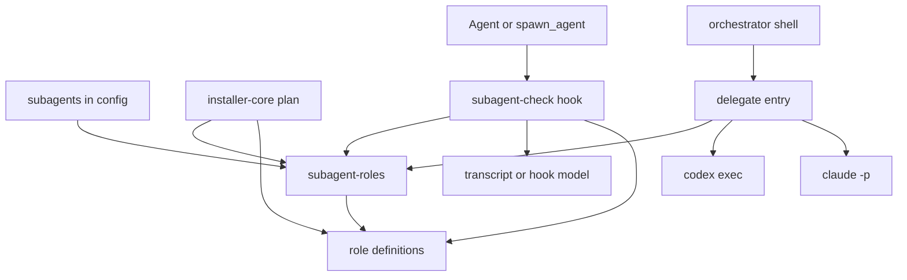
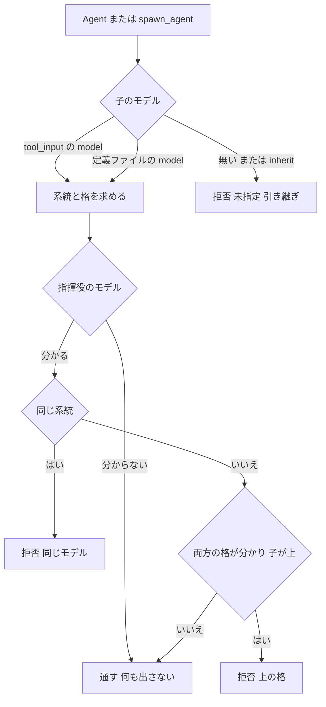
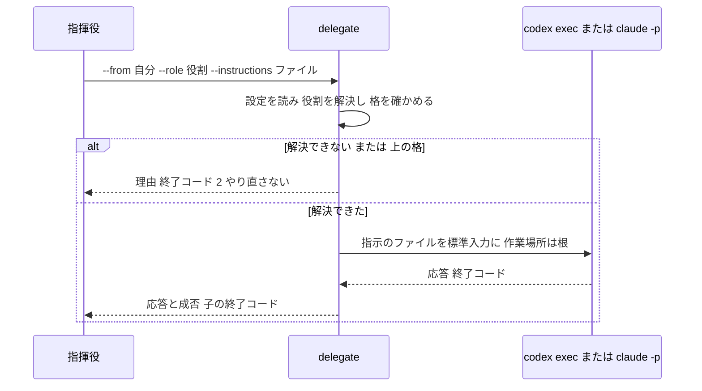

# 設計文書: subagent-delegation

## Overview

**Purpose**: サブエージェント（子のエージェント）に任せる役割（実装・修正、レビュー、調査、デバッグ）のモデル・推論量・権限と受け持つ提供元を役割表で決め、その表から両ツールの役割定義を作る。子の起動の前に、モデルの未指定・指揮役と同じモデル・指揮役より上の格を拒否し、別の提供元の子を起動する入口と、レビューを 1 回に収める作業の流れの手順を示す。

**Users**: Claude Code または Codex を指揮役にして cc-sdd の作業を進める人。

**Impact**: 手作業で CLAUDE.md に書いてきた「子のモデルの決まり」と「別の提供元の子の使い方」を、設定・フック・入口・運用の区画の文章に移す。

### Goals
- 作る役は指揮役と同じ提供元の下位のモデル、レビューは別の提供元が作業単位ごとに 1 回、が既定で行える。
- 指揮役と同じモデル・指揮役より上の格・未指定の子は起動前に止まる（フックが有効な環境）。
- 別の提供元が使えない環境でも、同じ提供元だけで同じ決まりを守れる。

### Non-Goals
- 作業の流れ（どの役割を何回呼んだか）の追跡と強制、入口の認証、MCP、ジョブの管理、委任先の自動切り替え、入口を通さない直接呼びの拒否。

## Boundary Commitments

### This Spec Owns
- 設定の項目 `subagents`（役割表）の形・既定値・検証。
- 役割表から作る役割定義の中身（Claude Code の `.claude/agents/cc-sdd-<役割>.md`、Codex の `.codex/agents/cc_sdd_<役割>.toml`）。
- 子の起動の確認のフック（`subagent-check.mjs`）と、別の提供元の入口（`delegate.mjs`）、純粋な規則（`subagent-roles.mjs`）。
- 運用の区画の `subagent-delegation` の文章（分担・作業の流れ・指示のファイル・結果の確認・通信の許可・未承認時の手順）。
- 設定の項目定義から旧項目 `models`・`codex.enabled` を外すこと。

### Out of Boundary
- 役割定義のファイルを書き出す処理と、古い定義の片付け（installer-core のカタログの「設定から作るファイル」）。
- 手順書を読むまでの拒否（kiro-gate）。cc-sdd の導入（session-install）。
- cc-sdd のスキルの本文の改変（読み替えは文章で示す）。

### Allowed Dependencies
- installer-core: カタログ（`generated` の項目を足す）・設定の項目定義・フックのコマンドの形。
- `codex`・`claude` の CLI（入口から起動する）。
- Node.js 22 の標準モジュール。依存の向き: `config-schema` → `subagent-roles`（純粋）→ `subagent-check`・`delegate`（入出力と入口）。`lib/catalog.mjs` は `subagent-roles` の `renderDefinitions` だけを読み込む（カタログの `generated` のため。installer-core の Allowed Dependencies に同じ例外を書く）。

### Revalidation Triggers
- `subagents` の形の変更 → installer-core の設定の検証、手順の文章。
- 役割定義のファイルの名前・置き場所の変更 → installer-core の片付けの範囲。
- Claude Code・Codex の子の起動のツールの名前や `tool_input` の形の変更 → PoC を再実行する。
- 別の提供元の CLI の指定（権限・推論量の書き方）の変更 → 入口と PoC。

## Architecture

### Architecture Pattern & Boundary Map



- 役割の決まり（既定値・格・系統の判定・定義の中身・CLI の引数）は `subagent-roles.mjs` だけが持つ。フック・入口・installer-core はそれを使う。

### Technology Stack

| Layer | Choice / Version | Role in Feature | Notes |
|-------|------------------|-----------------|-------|
| 実行 | Node.js 22（`.mjs`） | フックと入口 | 標準モジュールだけ |
| 子（組み込み） | Claude Code の `Agent`、Codex の `spawn_agent` | 同じ提供元の子 | 定義ファイルで役割を選ぶ |
| 子（別の提供元） | `codex exec`（Codex CLI 0.167.0）、`claude -p`（Claude Code 2.1.329） | 別の提供元の子 | PoC で指定を確認 |

## File Structure Plan

### Directory Structure
```
.agent-hooks/cc-sdd-bootstrap/
├── subagent-roles.mjs      # 純粋: 既定値、設定の解釈と検証、系統と格、役割の解決、定義の中身、CLI の引数、文言
├── subagent-check.mjs      # 入口: PreToolUse（Agent・spawn_agent）で子のモデルを確かめ、違反を拒否する
└── delegate.mjs            # 入口: 役割と指示のファイルを受け取り、別の提供元の CLI を起動して結果を返す
.claude/agents/cc-sdd-<役割>.md   # 生成物（コミットする）: Claude Code の役割定義（4 つ）
.codex/agents/cc_sdd_<役割>.toml  # 生成物（コミットする）: Codex の役割定義（書き込み可の役割だけ）
test/
├── subagent-roles.test.mjs   # 既定値・検証・系統と格・解決・定義の中身・引数
├── subagent-check.test.mjs   # 標準入力の JSON と一時の会話の記録・定義ファイルでの判定
└── delegate.test.mjs         # 偽の codex・claude（PATH の差し替え）での起動・引数・失敗
poc/subagent-defs/run.mjs     # 実機の確認（実施済み）
```

### Modified Files
- `.agent-hooks/cc-sdd-bootstrap/config-schema.mjs` — `models`・`codex.enabled` の項目を外し、`subagents`（`kind: "map"`、既定 `{}`、`validate` は `subagent-roles` の検証の考え方と同じ規則）を足す。配置物どうしの読み込みの向きを保つため、検証の規則は `config-schema.mjs` に置き、`subagent-roles.mjs` がそれを使う。
- `lib/catalog.mjs` — subagent-delegation の項目（スクリプト 3 つ・フック・`generated`・運用の区画の文章）を足す。
- `package.json` — `files` に 3 つのスクリプトを足す。

## System Flows

### 子の起動の確認（PreToolUse）



### 別の提供元への委任（`delegate.mjs`）



## Requirements Traceability

| Requirement | Summary | Components | Interfaces | Flows |
|-------------|---------|------------|------------|-------|
| 1.1 | 役割ごとに提供元・モデル・推論量・権限を指揮役の提供元ごとに | Roles, ConfigSchema | `SubagentsConfig.roles[指揮役][役割]` | — |
| 1.2 | 格の指定と既定 | Roles | `DEFAULT_TIERS` `familyOf` | — |
| 1.3 | 格 2 の指揮役の既定値の表 | Roles | `DEFAULT_ROLES` | — |
| 1.4 | 格 2 以外の既定のモデル | Roles, Delegate | `defaultModelFor` | 委任 |
| 1.5 | 最下位の指揮役は自分で実装 | Roles, 区画の文章 | `defaultModelFor` が null | — |
| 1.6 | 推論量の目安と選択 | Delegate, 区画の文章 | `--effort` | — |
| 1.7 | 明示した値を使う | Roles | `resolveRole` | — |
| 1.8 | 読めない・確定できない設定 | Roles, ConfigSchema, Delegate | `validateSubagents` | 委任 |
| 1.9 | 系統の名前で扱い起動の名前は実行時に求める | Roles, Delegate | `familyOf` `resolveModelName` | 委任 |
| 2.1 | 両ツールの役割定義 | Roles（中身）, installer-core（書き出し） | `renderDefinitions` | — |
| 2.2 | 定義でモデル・推論量・権限を確認できる | 生成物 | 定義ファイルの項目 | — |
| 2.3 | 適用できない項目を示し置き換えない | Roles | `renderDefinitions` の `notices` | — |
| 3.1 | すべての組み込みの子を確認 | Check | フックの登録（matcher） | 確認 |
| 3.2 | 未指定・引き継ぎを拒否 | Check, Roles | `decideSpawn` | 確認 |
| 3.3 | 同じモデルを拒否 | Check, Roles | `decideSpawn` | 確認 |
| 3.4 | 上の格を拒否 | Check, Roles | `decideSpawn` | 確認 |
| 3.5 | 変更後のモデルで比べる | Check | 会話の記録の最後の応答 | 確認 |
| 3.6 | 確認できなければそれだけで拒否しない | Check, Roles | `decideSpawn` | 確認 |
| 3.7 | 拒否理由と明示の必要を伝える | Roles | `messageSpawnDenied` | — |
| 3.8 | kiro-gate の拒否を解かない | Check | `allow` を出さない | — |
| 4.1 | 別の提供元へ委任できる | Delegate | `delegate.mjs` の引数 | 委任 |
| 4.2 | 役割の設定を適用 | Delegate, Roles | `buildCliCommand` | 委任 |
| 4.3 | 指示の内容と作業場所を渡す | Delegate | 標準入力と `--cd`・`cwd` | 委任 |
| 4.4 | 書き込み可は編集とテスト | Roles | `buildCliCommand` | — |
| 4.5 | 読み取り専用は書かせない | Roles | `buildCliCommand` | — |
| 4.6 | 応答と成否を返す | Delegate | 標準出力と終了コード | 委任 |
| 4.7 | 失敗の理由を返しやり直さない | Delegate | 終了コード 2 | 委任 |
| 4.8 | 上の格は起動しない | Delegate, Roles | `compareTier` | 委任 |
| 5.1 | 分担 | 区画の文章 | `agentSections.subagent-delegation` | — |
| 5.2 | 実装・修正の流れ | 区画の文章 | `agentSections.subagent-delegation` | — |
| 5.3 | 調査・設計の流れ | 区画の文章 | `agentSections.subagent-delegation` | — |
| 5.4 | デバッグの流れ | 区画の文章 | `agentSections.subagent-delegation` | — |
| 5.5 | レビューをやり直さず差分とテスト | 区画の文章 | `agentSections.subagent-delegation` | — |
| 5.6 | cc-sdd の委任の読み替え | 区画の文章 | `agentSections.subagent-delegation` | — |
| 5.7 | 別の提供元が使えないとき | 区画の文章 | `agentSections.subagent-delegation` | — |
| 5.8 | 指示のファイルの置き場所 | 区画の文章 | `agentSections.subagent-delegation` | — |
| 5.9 | 指示の書き方 | 区画の文章 | `agentSections.subagent-delegation` | — |
| 5.10 | 書き込みは 1 つずつ | 区画の文章 | `agentSections.subagent-delegation` | — |
| 5.11 | Codex から claude -p の通信の許可 | 区画の文章 | `agentSections.subagent-delegation` | — |
| 5.12 | フックが未承認のときの手順 | 区画の文章 | `agentSections.subagent-delegation` | — |

## Components and Interfaces

| Component | Domain/Layer | Intent | Req Coverage | Key Dependencies | Contracts |
|-----------|--------------|--------|--------------|------------------|-----------|
| Roles（`subagent-roles.mjs`） | 純粋 | 役割表の解釈・判定・生成・引数 | 1.1–1.9, 2.1–2.3, 3.2–3.4, 3.6, 3.7, 4.2, 4.4, 4.5, 4.8 | ConfigSchema (P0) | Service |
| ConfigSchema の項目 | データ | `subagents` の項目定義と検証 | 1.1, 1.8 | なし | State |
| Check（`subagent-check.mjs`） | 入口 | 子の起動の確認 | 3.1–3.8 | Roles (P0) | Event |
| Delegate（`delegate.mjs`） | 入口 | 別の提供元の子の起動 | 1.4, 1.6, 1.8, 4.1–4.8 | Roles (P0), CLI (P0) | Batch |
| カタログの項目 | データ | スクリプト・フック・生成物・区画の文章 | 2.1, 3.1, 5.1–5.12 | installer-core (P0) | State |

### Roles

```typescript
type Vendor = "claude" | "codex";
type Role = "implement" | "review" | "investigate" | "debug";
type Effort = "medium" | "high";
type Permission = "write" | "read-only";
type RoleSetting = { provider: "same" | "other"; model: string; effort: Effort; permission: Permission };
type SubagentsConfig = {
  tiers?: Record<string, number>;                         // 系統の語 → 格。既定に足す・上書きする
  modelIds?: Record<string, string>;                      // 系統の語 → 起動に使うモデルの名前（版を固定したいときだけ書く。既定は無し）
  roles?: Partial<Record<Vendor, Partial<Record<Role, Partial<RoleSetting>>>>>;  // 指揮役の提供元 → 役割 → 設定（1.1）
};
const DEFAULT_TIERS = { haiku: 1, luna: 1, sonnet: 2, sol: 2, opus: 3, astra: 3 };
// モデルは系統の語で持ち、版を含む名前を設定の既定値やコミットするファイルに書かない（1.9）。
// 起動に使う名前は resolveModelName で起動のときに求める。
const DEFAULT_ROLES = {   // 指揮役の提供元ごと。1.3 の表そのもの
  claude: { implement:   { provider: "same",  model: "haiku",  effort: "medium", permission: "write" },
            review:      { provider: "other", model: "sol",    effort: "medium", permission: "read-only" },
            investigate: { provider: "other", model: "luna",   effort: "medium", permission: "read-only" },
            debug:       { provider: "other", model: "sol",    effort: "medium", permission: "read-only" } },
  codex:  { implement:   { provider: "same",  model: "luna",   effort: "medium", permission: "write" },
            review:      { provider: "other", model: "sonnet",      effort: "medium", permission: "read-only" },
            investigate: { provider: "other", model: "haiku",       effort: "medium", permission: "read-only" },
            debug:       { provider: "other", model: "sonnet",      effort: "medium", permission: "read-only" } },
};
// 委任先の提供元 = provider が same なら指揮役の提供元、other なら反対の提供元

function validateSubagents(value: unknown): { ok: true; config: SubagentsConfig } | { ok: false; problems: string[] }; // 問題の項目の道筋つき（1.8）
function familyOf(model: string, tiers: Record<string, number>): string | null; // 小文字の ID が含む系統の語（長い語を先に照合）
function vendorOfFamily(family: string): Vendor | null;                          // haiku・sonnet・opus → claude、luna・sol・astra → codex（設定で足した語は null）
type ModelCatalog = { slug: string; visibility: string; priority: number }[];    // codex debug models の一覧（入口が読み込んで渡す）
function resolveModelName(model: string, vendor: Vendor, cfg: SubagentsConfig, catalog: ModelCatalog | null): { ok: true; name: string } | { ok: false; reason: string };
// 設定の modelIds に系統があればそれ。無ければ: claude は系統の語そのもの（Claude Code の別名 haiku・sonnet・opus が最新を指す）。
// codex は catalog のうち visibility が list で、slug が "-<系統>" で終わるものの priority が最小（最新）の slug（例 2026-11-23 の一覧で sol → gpt-6.2-sol）。
// 系統でない名前（利用者が完全な名前を書いた）はそのまま使う。求められなければ理由（1.8・1.9）
function resolveRole(cfg: SubagentsConfig, from: Vendor, role: Role, orchestratorModel: string | null):
  { ok: true; target: Vendor; setting: RoleSetting; selfImplement: boolean } | { ok: false; reason: string };
// setting = roles[from][role] の明示値 → 無い項目は既定（1.7）。target = provider から求める。
// 指揮役のモデルが分かり格が 2 でないとき、明示されていない model は defaultModelFor で決める（1.4）。
// 実装・修正で同じ提供元に指揮役より下の格が無ければ selfImplement = true（1.5）
function defaultModelFor(role: Role, target: Vendor, orchestratorTier: number, cfg: SubagentsConfig): string | null;  // tiers・modelIds は cfg と既定を合わせて使う
// 実装: 同じ提供元で指揮役より 1 つ下の格、レビュー・デバッグ: 別の提供元で指揮役の格以下で最も上、調査: 別の提供元の格 1（1.4）。
// 候補は、提供元が分かる（vendorOfFamily）系統。返すのは系統の語（起動の名前は resolveModelName）。候補が無ければ null。
// 例: Opus の指揮役のレビュー = Codex の格 3 = astra。Haiku の指揮役のレビュー = luna
function compareTier(child: string, orchestrator: string | null, tiers: Record<string, number>): "higher" | "same-model" | "ok" | "unknown";

type SpawnInput = { vendor: Vendor; childModel: string | null; childFromDefinition: boolean; orchestratorModel: string | null };
function decideSpawn(input: SpawnInput, tiers: Record<string, number>): { deny: false } | { deny: true; reason: string };
// childModel が無い・"inherit" → deny（3.2）。compareTier が same-model・higher → deny（3.3・3.4）。unknown・ok → 通す（3.6）
function messageSpawnDenied(kind: "missing" | "inherit" | "same-model" | "higher", child: string | null, orchestrator: string | null): string;
// 理由と、指揮役と異なり指揮役の格以下のモデルを tool_input の model に明示する必要（3.7）

type Definition = { path: string; content: string };
function renderDefinitions(cfg: SubagentsConfig): { files: Definition[]; notices: string[] };
// 提供元 V の定義は roles[V]（V が指揮役のときの設定）だけから作る。ファイルは提供元 × 役割で 1 つずつ（衝突しない）。
//   provider=same の役割: model・effort・permission を書く（組み込みの子の通常の使い方）。
//   provider=other の役割: 別の提供元が使えないとき（5.7）の予備。model を書かず（起動時に明示が必要。明示しなければ Check が未指定として拒否する）、effort・permission を書く。
// Claude Code: frontmatter に name・description・model・effort、読み取り専用は tools: Read, Grep, Glob
// Codex: permission が write の役割だけ（name・description・model_reasoning_effort・developer_instructions）。model は書かない（版を含む名前をコミットしないため。起動のときに明示が必要で、明示しなければ Check が未指定として拒否する。1.9）。
//        read-only の役割は作らず、「Codex の組み込みの子では読み取り専用を適用できない（<役割>）」を notices に入れる（2.3）
function buildCliCommand(target: Vendor, setting: RoleSetting, modelName: string, root: string): { command: string; args: string[] };
// modelName は resolveModelName の結果
// codex: ["-a","never","exec","--sandbox", read-only|workspace-write, "--model", M, "--config", `model_reasoning_effort="${E}"`, "--cd", root, "-"]
// claude: ["-p","--model",M,"--effort",E, ...(read-only ? ["--tools","Read,Grep,Glob"] : ["--permission-mode","acceptEdits","--allowedTools","Bash"])]（4.2・4.4・4.5）
```

### ConfigSchema の項目
- `{ path: "subagents", kind: "map", defaultValue: {}, validate }`。`validate` は役割・提供元の名前、`same`・`other`、`medium`・`high`、`write`・`read-only`、格の正の整数、モデルの空でない文字列を確かめ、問題の項目の道筋を返す（1.8）。installer-core の `update` もこの検証を使う。

### Check（`subagent-check.mjs pre-tool-use --tool <claude|codex>`）

##### Event Contract
- 登録: Claude Code は PreToolUse の matcher `Agent`、Codex は matcher なしで登録し、スクリプトの中で `tool_name` が `spawn_agent` を含むものだけを見る（3.1）。
- 子のモデル: `tool_input.model` → 無ければ `subagent_type`（Claude Code）・`agent_type`（Codex）の定義ファイル（`.claude/agents/<名前>.md` の frontmatter の `model`、`.codex/agents/<名前>.toml` の `model`）→ 無ければ未指定。
- 指揮役のモデル: Codex は入力の `model`。Claude Code は `transcript_path` の会話の記録を後ろから読み、最後の応答の `message.model`（3.5）。読めなければ不明。
- 出力: 拒否なら `hookSpecificOutput: { hookEventName: "PreToolUse", permissionDecision: "deny", permissionDecisionReason }`。通すときは何も出さない（`allow` を出さない。3.8）。
- 誤り: 設定が読めないときは既定の格の表で判定を続ける。それ以外の予期しない誤りは標準エラーに日本語で出し、通す。

### Delegate（`delegate.mjs`）

##### Batch / Job Contract
- 起動: `node .agent-hooks/cc-sdd-bootstrap/delegate.mjs --from <claude|codex> --role <implement|review|investigate|debug> --instructions <ファイル> [--to same] [--effort medium|high] [--model <ID>] [--orchestrator-model <ID>]`。`--to same` のときも、子のモデルが指揮役と同じ系統なら起動しない（指揮役のモデルを渡したとき）。根はスクリプトの位置から求める。
- 処理: 設定を読み（読めなければ理由を返す、1.8）、`resolveRole` で解決する。委任先は役割の `provider` で決まる提供元。`provider` が `same` の役割（実装・修正）は、組み込みの子を使う役割なので、その旨を返して起動しない。ただし `--to same` を付けたときは同じ提供元の CLI で起動する（別の提供元が使えない環境で、Codex の読み取り専用の役割を `codex exec --sandbox read-only` と指揮役と異なるモデルで行うため。5.7）。`--effort`・`--model` はその実行だけ役割の設定を上書きする（1.6）。`--orchestrator-model` があれば `compareTier` で上の格を止める（4.8）。
- モデルの名前: 委任先が Codex なら `codex debug models` を実行して一覧を得て（失敗なら一覧なし）、`resolveModelName` で起動の名前を求める。求められなければ理由を出して終了 2（1.9）。
- 起動: `buildCliCommand` の引数で、指示のファイルを標準入力に渡し、`cwd` を根にする（4.3）。子の標準出力・標準エラーはそのまま流す。
- 結果: 子の終了コードをそのまま返し、最後に 1 行「委任先の終了: 成功／失敗（終了コード）」を標準エラーに出す（4.6）。役割が未定義・指示のファイルを読めない・CLI を起動できない・上の格・解決できない設定は、理由を出して終了コード 2。別の提供元・モデル・推論量・権限でやり直さない（4.7）。

### カタログの項目（installer-core の `lib/catalog.mjs` に足す）
- `files`: `subagent-roles.mjs`・`subagent-check.mjs`・`delegate.mjs`。
- `hooks`: `{ tools: ["claude"], event: "PreToolUse", matcher: "Agent", script: "subagent-check.mjs", args: ["pre-tool-use", "--tool", "claude"], timeout: 10 }`、`{ tools: ["codex"], event: "PreToolUse", script: "subagent-check.mjs", args: ["pre-tool-use", "--tool", "codex"], timeout: 10 }`。
- `generated`（installer-core が足す種類。下の「installer-core への追加」）: `{ id: "subagent-definitions", owns: [".claude/agents/cc-sdd-*.md", ".codex/agents/cc_sdd_*.toml"], render: (config) => renderDefinitions(config.subagents) }`。
- `agentSections` の `subagent-delegation`（両ツールで同じ趣旨。呼び方の `--from` だけ違う）:
  - 分担（5.1）: 実装・修正は同じ提供元の子（指揮役が最下位の格なら自分）、レビューとデバッグの原因調査は別の提供元、調査は別の提供元の格 1。既定の表（1.3）と、格 2 以外の指揮役の決め方（1.4・1.5）、推論量の目安（1.6）。
  - 作業の流れ（5.2・5.3・5.4）: 実装 → 別の提供元のレビュー 1 回 → 同じ実装役が修正 → 同じレビュー役が指摘箇所だけ再確認。調査 → 指揮役が設計 → 別の提供元が設計をレビュー（推論量は目安に従い指揮役が選ぶ）。原因調査（別）→ 修正（同じ）→ テスト。
  - 結果の扱い（5.5）: 指揮役は同じ観点のレビューをやり直さず、結果を未確認として差分と必要なテストで確かめてから完了とする。
  - 読み替え（5.6）: cc-sdd の手順が「Agent ツールで子に任せる」と書く箇所は、実装・修正は同じ提供元の役割定義（Claude Code は `cc-sdd-implement`、Codex は `cc_sdd_implement`。Codex は `fork_turns` を `none` にし、`model` に Luna の今の名前（`codex debug models` の一覧で最新の `-luna`）を明示する。履歴を引き継ぐと親と同じモデルになるため）で `model` を明示して起動、レビュー・デバッグは別の提供元の入口（`delegate.mjs --role review` など）で、同じ依頼内容と成果物の形式のまま渡す。
  - 別の提供元が使えないとき（5.7）: すべての役割を同じ提供元の、指揮役と異なり指揮役の格以下のモデルで行い、レビューは 1 回。Claude Code は役割定義（読み取り専用は道具を制限済み）に `model` を明示して起動する。Codex の組み込みの子は読み取り専用にできないので、読み取り専用の役割は `delegate.mjs --to same --role review --model <指揮役と異なるモデル>`（`codex exec --sandbox read-only`）で行う。
  - 指示のファイル（5.8・5.9）: `~/.cache/cc-sdd-bootstrap-scratch/` に置く（リポジトリ内と `/tmp` には置かない）。範囲・必要な決まり・禁止する操作・成果物の形式を書き、子が CLAUDE.md・AGENTS.md を読むことに頼らない。
  - 書き込みは 1 つずつ（5.10）: 書き込み可の子の実行中は、読み取り専用の子も重ねない。
  - Codex の文章だけ（5.11・5.12）: Codex から `claude -p` の子を使うには、シェルに通信の許可（`sandbox_workspace_write.network_access=true` など）が要り、無いと子は応答を返せない。フックの信頼が承認されていないと起動前の確認は働かないので、役割表に従い `model` を明示し、指揮役と同じモデル・上の格を避ける。

### installer-core への追加（このspecの設計で決め、installer-core の設計に反映する）
- カタログに `generated: CatalogGenerated[]` を足す。`interface CatalogGenerated { id: string; owns: string[]; render(config: ConfigObject): { files: { path: string; content: string }[]; notices: string[] } }`。`owns` は `*` を 1 つだけ含む道筋の型で、その型に当たる今のファイルのうち `render` が返さないものを `delete` する（役割の改名の片付け）。
- `init`・`update` の計画で、設定を検証した後に `render` を呼び、内容が違えば `write`。`notices` は結果の表示に出す（2.3）。`render` の道筋は `owns` に当たるものに限る（`ALLOWED_PATHS` に `owns` を足す）。`uninstall` は生成物を消さない（installer-core 7.2 の「共通の配置物を残す」と同じ扱い）。

## Error Handling

| 状況 | 扱い | 要件 |
|---|---|---|
| 設定の `subagents` が不正 | `update` は失敗（問題の項目を表示）。入口は理由を出して終了 2。フックは既定の格の表で未指定の拒否を続ける | 1.8 |
| Codex の役割を読み取り専用にした | 定義を作らず、適用できない旨を表示 | 2.3 |
| 子のモデルが未指定・引き継ぎ | 拒否（理由と明示の必要） | 3.2, 3.7 |
| 指揮役のモデルが分からない | 未指定の拒否だけ行い、同一・格の比較はしない | 3.6 |
| 入口で CLI を起動できない・指示のファイルが読めない | 理由、終了 2、やり直さない | 4.7 |
| 予期しない誤り（フック） | 標準エラーに理由、通す | — |

## Testing Strategy
- **単体（Roles）**:
  - 既定の `assign`・`roles` から、両ツールの指揮役で 1.3 の表のとおりのモデル・推論量・権限が出る（1.3）。明示した値が残る（1.7）。
  - 指揮役が Opus のとき実装は sonnet、レビューは astra。Haiku のとき実装は `selfImplement`、レビューは Luna（1.4・1.5）。指揮役ごとに同じ役割へ別の推論量を設定できる（1.1）。
  - `familyOf`: `claude-sonnet-5-5`・`sonnet` → sonnet、`gpt-6.1-sol`・`gpt-6.2-sol` → sol、知らない ID → null（1.2・1.9）。
  - `resolveModelName`: 一覧の優先度で最新の `-sol` を選ぶ、`modelIds` があればそれ、Claude Code は別名のまま、一覧が無く `modelIds` も無い Codex の系統は理由を返す（1.9）。
  - `decideSpawn`: 未指定・`inherit` は拒否、Sonnet の指揮役で `sonnet` の子は拒否、Opus の子は拒否、Haiku は通す、指揮役が不明で子が明示なら通す（3.2–3.4・3.6）。理由の文言に明示の必要が入る（3.7）。
  - `renderDefinitions`: Claude Code は 4 つ（`implement` は `model: haiku`、`provider=other` の 3 つは `model` 無し）、読み取り専用の役割に `tools: Read, Grep, Glob`。Codex は書き込み可の `implement` だけで、読み取り専用の役割は notices に出る（2.1–2.3）。`roles.claude` と `roles.codex` に同じ役割で別の設定を書いても、別のファイルになり衝突しない（1.1）。
  - `buildCliCommand`: 両ツール・両権限の引数（4.2・4.4・4.5）。
  - `validateSubagents`: 知らない役割・不正な権限・推論量で問題の道筋を返す（1.8）。
- **入口（Check）**: 標準入力の JSON・一時の会話の記録・一時の定義ファイルで、`tool_input.model` が無く定義に `model: haiku` があれば Sonnet の指揮役で通る、定義が無ければ拒否、定義の `inherit` は拒否、会話の記録が無ければ子が明示なら通す、Codex の `model` で比べる。何も出さないときに `allow` を出さない（3.1–3.8）。
- **入口（Delegate）**: 偽の `codex`・`claude` を `PATH` に置き、渡された引数・標準入力・作業場所を記録させる。両方向・両権限の引数、子の終了コードの受け渡し、指示のファイルが無い・役割が未定義・上の格で終了 2 と CLI を呼ばないこと（4.1–4.8）。
- **カタログの試験**: 区画の文章に 5.1〜5.12 の要素（指示のファイルの置き場所、書き込みは 1 つずつ、Codex の通信の許可など）が入る。
- **実機**: `poc/subagent-defs/run.mjs`（定義ファイル・CLI の権限）、`poc/req-feasibility/claude.sh` の d・e と `codex.sh` の f・g（拒否と指揮役のモデル、Codex から `claude -p`）。実装後、配置したフックと入口で同じ確認を行う。

## Migration Strategy
- 旧項目 `models`・`codex.enabled` は項目定義から外れ、既存の設定にあっても使わない項目として残る。
- このリポジトリの CLAUDE.md の「子は Codex」の決まりは、自己適用（`installer-core/handoff-self-apply.md`）で運用の区画に置き換わるまで残す。
