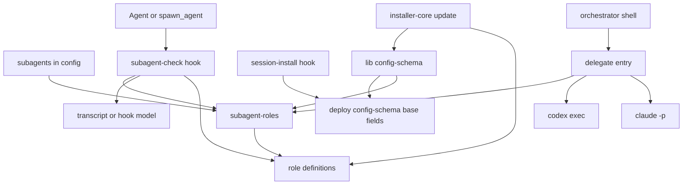
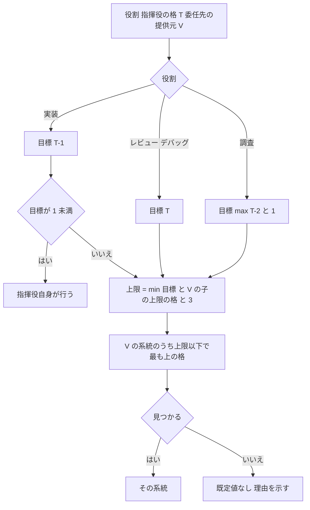
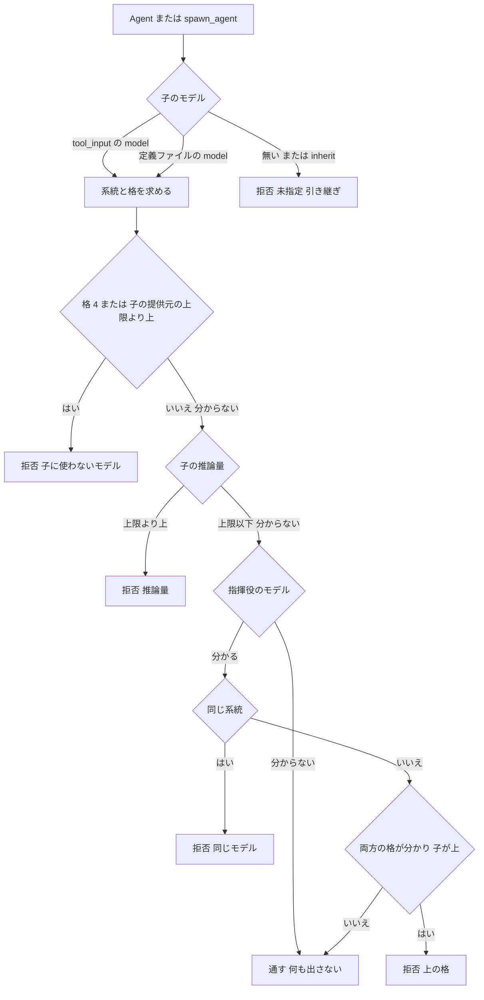
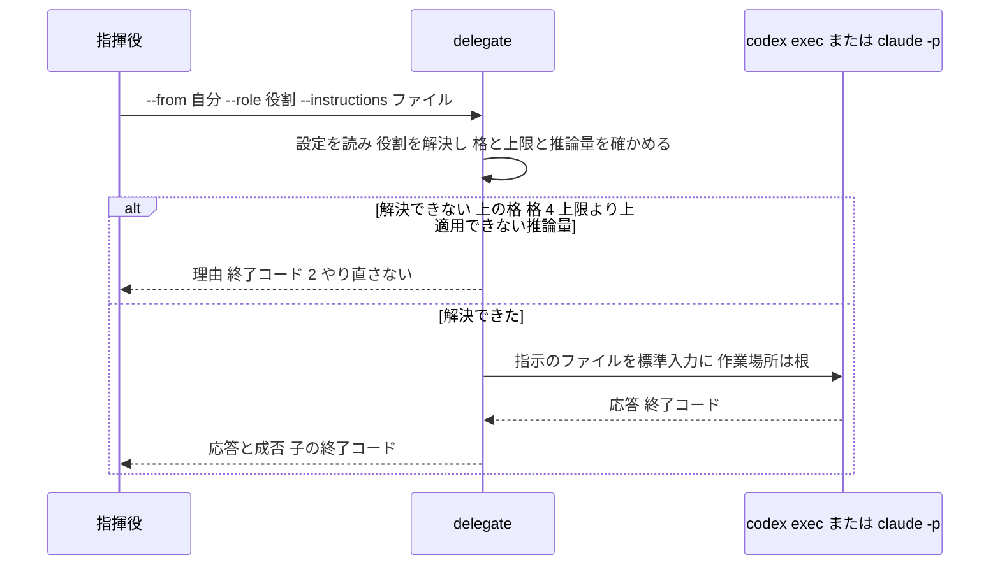

# 設計文書: subagent-delegation

## Overview

**Purpose**: サブエージェント（子のエージェント）に任せる役割（実装・修正、レビュー、調査、デバッグ）のモデル・推論量・権限と受け持つ提供元を役割表で決め、その表から両ツールの役割定義を作る。プロジェクトは提供元ごとの子の上限（使ってよい最上位のモデル）と推論量の上限を設定できる。子の起動の前に、モデルの未指定・指揮役と同じモデル・指揮役より上の格・格 4・上限より上のモデルと推論量を拒否し、別の提供元の子を起動する入口と、レビューを 1 回に収める作業の流れの手順を示す。

**Users**: Claude Code または Codex を指揮役にして cc-sdd の作業を進める人と、子に使うモデル・推論量の範囲を決めるプロジェクトの管理者。

**Impact**: 手作業で CLAUDE.md に書いてきた「子のモデルの決まり」と「別の提供元の子の使い方」を、設定・フック・入口・運用の区画の文章に移す。

> 改訂（2026-11-24）: 要件の改訂（格の訂正、調査の既定を指揮役の 2 つ下に、子の上限、推論量の上限、設定の誤りで入力を止めない）と `poc/subagent-effort/` の結果に合わせて作り直した。既定のモデルは格 2 の表を持たず、1 つの決まりで計算する。役割表の項目定義と検証は `subagent-roles.mjs` に置き、配置物の `config-schema.mjs`（session-install が読む）からは切り離す。設計レビュー（2026-11-24）を受け、役割定義にはモデルを書かず、設定が壊れている間は子の起動を拒否する。

### Goals
- 作る役は指揮役と同じ提供元の下位のモデル、レビューは別の提供元が作業単位ごとに 1 回、が既定で行える。
- 指揮役と同じモデル・指揮役より上の格・格 4・子の上限より上・推論量の上限より上の子は起動前に止まる（フックが有効で、確かめられる範囲）。
- 別の提供元が使えない環境でも、同じ提供元だけで同じ決まりを守れる。
- 役割表の誤りで cc-sdd の導入と利用者の入力が止まらない。

### Non-Goals
- 作業の流れ（どの役割を何回呼んだか）や、作業ごとの格・推論量の選び方の追跡と強制。
- 入口の認証、MCP、ジョブの管理、委任先の自動切り替え、入口を通さない直接呼びの拒否。
- 依頼文の言葉（「ultrathink」など）による推論の深まりの制御、指揮役自身の推論量の制御。

## Boundary Commitments

### This Spec Owns
- 設定の項目 `subagents`（役割表・格・起動の名前・子の上限・推論量の上限）の形・既定値・検証。
- 既定のモデルの決まり（目標の格と上限による選択）。
- 役割表から作る役割定義の中身（Claude Code の `.claude/agents/cc-sdd-<役割>.md`、Codex の `.codex/agents/cc_sdd_<役割>.toml`）。
- 子の起動の確認のフック（`subagent-check.mjs`）、別の提供元の入口（`delegate.mjs`）、純粋な規則（`subagent-roles.mjs`）。
- 運用の区画の `subagent-delegation` の文章（分担・既定値の表・格と推論量の選び方の目安・作業の流れ・指示のファイル・結果の確認・通信の許可・未承認時と拒否時の手順）。
- 設定の項目定義から旧項目 `models`・`codex.enabled` を外すこと。

### Out of Boundary
- 役割定義のファイルを書き出す処理と、古い定義の片付け（installer-core のカタログの「設定から作るファイル」。実装済み）。
- 手順書を読むまでの拒否（kiro-gate）。cc-sdd の導入とその失敗時の停止（session-install）。session-install が読む配置物の項目定義には導入に使う項目だけを残し、`subagents` を置かない（下の「session-install との関係」）。
- cc-sdd のスキルの本文の改変（読み替えは文章で示す）。
- 旧項目を利用者の設定から消すこと（導入コマンドは消さない。利用者が手で外す）。

### Allowed Dependencies
- installer-core: カタログ（`generated`・`hooks` の `matcher`・`agentSections`・`files`）、設定の項目定義、フックのコマンドの形、`update` の設定の検証。
- `codex`・`claude` の CLI（入口から起動する）。`codex debug models`（起動の名前と、モデルが受け付ける推論量）。
- Node.js 22 の標準モジュール。配置物の読み込みの向き: `subagent-roles`（純粋、何も読み込まない）← `subagent-check`・`delegate`。配置物の `config-schema`（基本の項目だけ、何も読み込まない）← `install-rules`。`config-schema` と `subagent-roles` は互いに読み込まない（cc-sdd の導入が役割表の部品に依存しないため。1.12）。
- `lib/` は、`lib/config-schema.mjs` で配置物の基本の項目と `subagent-roles` の `subagentsField` をつないで項目の一覧を作り、カタログの `generated` のために `subagent-roles` の `renderDefinitions` を読み込む。installer-core の Allowed Dependencies の例外に `subagentsField` を足す。

### Revalidation Triggers
- `subagents` の形の変更 → installer-core の設定の検証と表示、運用の区画の文章、このリポジトリの設定。
- 役割定義のファイルの名前・置き場所の変更 → installer-core の片付けの範囲。
- Claude Code・Codex の子の起動のツールの名前や `tool_input` の形（`model`・`reasoning_effort`）の変更、定義と起動の指定の優先順位の変更 → `poc/subagent-defs/`・`poc/subagent-effort/` を再実行する。
- 別の提供元の CLI の指定（権限・推論量の書き方）や、推論量の値の種類の変更 → 入口・`EFFORT_ORDER` と PoC。
- 新しいモデルの系統の登場 → `DEFAULT_TIERS`（設定の `tiers` で利用者が足せる）。

## Architecture

### Architecture Pattern & Boundary Map



- 矢印は「左が右を使う」関係。役割の決まり（格・系統の判定・既定値の計算・上限・検証・定義の中身・CLI の引数）は `subagent-roles.mjs` だけが持つ。
- 設定を読む 4 者のうち、session-install は配置物の基本の項目（`format`・`ccSdd.version`・`ccSdd.lang`）だけを知り、`subagents` を検証も読み込みもしない（1.12）。`update` は全項目を検証して失敗する。フックは子の起動を拒否して直し方を示し（入力は止めない）、入口はその委任だけ終了 2。

### Technology Stack

| Layer | Choice / Version | Role in Feature | Notes |
|-------|------------------|-----------------|-------|
| 実行 | Node.js 22（`.mjs`） | フックと入口 | 標準モジュールだけ |
| 子（組み込み） | Claude Code の `Agent`、Codex の `spawn_agent` | 同じ提供元の子 | 定義ファイルで役割を選ぶ。Codex は起動ごとの `reasoning_effort` を持つ |
| 子（別の提供元） | `codex exec`（Codex CLI 0.167.0）、`claude -p`（Claude Code 2.1.329） | 別の提供元の子 | PoC で指定を確認 |

## File Structure Plan

### Directory Structure
```
.agent-hooks/cc-sdd-bootstrap/
├── subagent-roles.mjs      # 純粋: 格・系統・推論量の並び、既定値の計算、上限、`subagents` の項目定義と検証、定義の中身、CLI の引数、文言
├── subagent-check.mjs      # 入口: PreToolUse（Agent・spawn_agent）で子のモデルと推論量を確かめ、違反を拒否する
└── delegate.mjs            # 入口: 役割と指示のファイルを受け取り、別の提供元の CLI を起動して結果を返す
.claude/agents/cc-sdd-<役割>.md   # 生成物（コミットする）: Claude Code の役割定義（4 つ）
.codex/agents/cc_sdd_<役割>.toml  # 生成物（コミットする）: Codex の役割定義（書き込み可の役割だけ）
test/
├── subagent-roles.test.mjs   # 既定値の計算・上限・検証・系統と格・定義の中身・引数
├── subagent-check.test.mjs   # 標準入力の JSON と一時の会話の記録・定義ファイルでの判定
└── delegate.test.mjs         # 偽の codex・claude（PATH の差し替え）での起動・引数・失敗
poc/subagent-defs/run.mjs     # 実機の確認（定義ファイル・CLI の権限。実施済み、3.2 で更新）
poc/subagent-effort/run.mjs   # 実機の確認（推論量の指定と見え方。実施済み）
```

### Modified Files
- `.agent-hooks/cc-sdd-bootstrap/config-schema.mjs` — `models`・`codex.enabled` の項目を外す（基本の項目 `ccSdd.version`・`ccSdd.lang` だけが残る）。何も読み込まないまま。
- `lib/config-schema.mjs` — 配置物の基本の項目と `subagent-roles` の `subagentsField` をつないだ `configFields` を公開する（`formatProblem` などは今までどおり公開し直す）。
- `test/install-rules.test.mjs` — `subagents` の誤りがある設定でも `readInstallConfig` が成功する試験を足す（1.12）。`install-rules.mjs` 自体は変えない。
- `.kiro/specs/session-install/design.md`・`.kiro/specs/installer-core/design.md` — 境界の注記を 1 行ずつ足す（session-install: 配置物の項目定義には導入に使う項目だけを置く。installer-core: `lib/` が読み込んでよい配置物の関数に `subagentsField` を足す）。
- `lib/catalog.mjs` — subagent-delegation の項目（スクリプト 3 つ・フック・`generated`・運用の区画の文章）を足す。
- `package.json` — `files` に 3 つのスクリプトを足す。
- `.cc-sdd-bootstrap.json`（このリポジトリ） — 自己適用の確認で、旧項目を手で外す。

## System Flows

### 既定のモデルの決め方（`defaultModelFor`）



例（上限なし。上限なしは各提供元で格 3）:

| 指揮役 | 実装・修正 | レビュー・デバッグ | 調査 |
|---|---|---|---|
| Haiku（1） | 指揮役自身 | Luna | Luna |
| Sonnet（2） | Haiku | Terra | Luna |
| Opus（3） | Sonnet | Sol | Luna |
| Fable（4） | Opus | Sol | Terra |
| Luna（1） | 指揮役自身 | Haiku | Haiku |
| Terra（2） | Luna | Sonnet | Haiku |
| Sol（3） | Terra | Opus | Haiku |
| Astra（4） | Sol | Opus | Sonnet |

上限が Claude は Sonnet、Codex は Sol のときは、Fable の指揮役の実装が Sonnet、Sol・Astra の指揮役のレビュー・デバッグが Sonnet になる（1.10）。

### 子の起動の確認（PreToolUse）



- 子の推論量: Codex は定義の `model_reasoning_effort` → `tool_input.reasoning_effort`、Claude Code は `subagent_type` の定義の `effort`。どれも無ければ分からない（`poc/subagent-effort/`）。

### 別の提供元への委任（`delegate.mjs`）



## Requirements Traceability

| Requirement | Summary | Components | Interfaces | Flows |
|-------------|---------|------------|------------|-------|
| 1.1 | 役割ごとに提供元・モデル・推論量・権限を指揮役の提供元ごとに | Roles, ConfigSchema | `SubagentsConfig.roles[指揮役][役割]` | — |
| 1.2 | 格の指定と既定（格 4 は既定値に使わない） | Roles | `DEFAULT_TIERS` `familyOf` `CHILD_MAX_TIER` | — |
| 1.3 | 格 2 の指揮役の既定値 | Roles | `defaultModelFor`（格 2 の場合） | 既定のモデル |
| 1.4 | 格 2 以外の既定のモデル | Roles, Delegate | `defaultModelFor` | 既定のモデル |
| 1.5 | 最下位の指揮役は自分で実装 | Roles, 区画の文章 | `defaultModelFor` の `self` | 既定のモデル |
| 1.6 | 推論量の選び方と目安 | Delegate, 区画の文章 | `--effort`、`EFFORT_ORDER` | — |
| 1.7 | 明示した値を使う | Roles | `resolveRole` | — |
| 1.8 | 読めない・確定できない設定 | Roles, ConfigSchema, Delegate | `validateSubagents` | 委任 |
| 1.9 | 系統の名前で扱い起動の名前は実行時に求める | Roles, Delegate | `familyOf` `resolveModelName` | 委任 |
| 1.10 | 提供元ごとの子の上限と既定値の下げ方 | Roles | `maxModel` `childMaxTier` `defaultModelFor` | 既定のモデル |
| 1.11 | 上限より上・格 4・上限より上の推論量の明示は設定の誤り | Roles, ConfigSchema | `validateSubagents` | — |
| 1.12 | 設定の誤りで導入と入力を止めない | ConfigSchema の分け方, Check, Delegate | 配置物の `config-schema` に `subagents` を置かない、Check は起動だけ拒否 | 確認 |
| 1.13 | 推論量の上限（共通と系統ごと、既定 high） | Roles | `maxEffort` `effortCapFor` | — |
| 2.1 | 両ツールの役割定義 | Roles（中身）, installer-core（書き出し） | `renderDefinitions` | — |
| 2.2 | 定義でモデル・推論量・権限を確認できる | 生成物, Delegate | 定義ファイルの推論量・権限、`--resolve-model`（指揮役に応じた起動の名前と推論量） | — |
| 2.3 | 適用できない項目を示し置き換えない | Roles, Delegate | `renderDefinitions` の `notices`、`effortSupported` | 委任 |
| 3.1 | すべての組み込みの子を確認 | Check | フックの登録（matcher） | 確認 |
| 3.2 | 未指定・引き継ぎを拒否（定義にモデルを書かないので、明示の無い起動はすべて拒否） | Check, Roles | `decideSpawn`、`renderDefinitions` | 確認 |
| 3.3 | 同じモデルを拒否 | Check, Roles | `decideSpawn` | 確認 |
| 3.4 | 上の格を拒否 | Check, Roles | `decideSpawn` | 確認 |
| 3.5 | 変更後のモデルで比べる | Check | 会話の記録の最後の応答 | 確認 |
| 3.6 | 確認できなければそれだけで拒否しない | Check, Roles | `decideSpawn` | 確認 |
| 3.7 | 拒否理由と明示の必要を伝える | Roles | `messageSpawnDenied` | — |
| 3.8 | kiro-gate の拒否を解かない | Check | `allow` を出さない | — |
| 3.9 | 格 4・子の上限より上を拒否 | Check, Roles | `decideSpawn` | 確認 |
| 3.10 | 推論量の上限より上を拒否 | Check, Roles | `decideSpawn` の `childEffort` | 確認 |
| 4.1 | 別の提供元へ委任できる | Delegate | `delegate.mjs` の引数 | 委任 |
| 4.2 | 役割の設定を適用 | Delegate, Roles | `buildCliCommand` | 委任 |
| 4.3 | 指示の内容と作業場所を渡す | Delegate | 標準入力と `--cd`・`cwd` | 委任 |
| 4.4 | 書き込み可は編集とテスト | Roles | `buildCliCommand` | — |
| 4.5 | 読み取り専用は書かせない | Roles | `buildCliCommand` | — |
| 4.6 | 応答と成否を返す | Delegate | 標準出力と終了コード | 委任 |
| 4.7 | 失敗の理由を返しやり直さない | Delegate | 終了コード 2 | 委任 |
| 4.8 | 上の格・格 4・上限より上・上限より上の推論量は起動しない | Delegate, Roles | `checkChildModel` `effortCapFor` | 委任 |
| 5.1 | 分担 | 区画の文章 | `agentSections.subagent-delegation` | — |
| 5.2 | 実装・修正の流れ | 区画の文章 | 同上 | — |
| 5.3 | 調査・設計の流れ（判断を含む確認はレビュー役） | 区画の文章 | 同上 | — |
| 5.4 | デバッグの流れ | 区画の文章 | 同上 | — |
| 5.5 | レビューをやり直さず差分とテスト | 区画の文章 | 同上 | — |
| 5.6 | cc-sdd の委任の読み替え | 区画の文章 | 同上 | — |
| 5.7 | 別の提供元が使えないとき | 区画の文章 | 同上 | — |
| 5.8 | 指示のファイルの置き場所 | 区画の文章 | 同上 | — |
| 5.9 | 指示の書き方 | 区画の文章 | 同上 | — |
| 5.10 | 書き込みは 1 つずつ | 区画の文章 | 同上 | — |
| 5.11 | Codex から claude -p の通信の許可 | 区画の文章 | 同上 | — |
| 5.12 | フックが未承認のときの手順 | 区画の文章 | 同上 | — |
| 5.13 | 子の起動が許可の判定で拒否されたときの手順 | 区画の文章 | 同上 | — |
| 5.14 | 許可を前もって与えないこと・提供元の切り替えに許可を求めないこと | 区画の文章 | 同上 | — |

## Components and Interfaces

| Component | Domain/Layer | Intent | Req Coverage | Key Dependencies | Contracts |
|-----------|--------------|--------|--------------|------------------|-----------|
| Roles（`subagent-roles.mjs`） | 純粋 | 役割表の項目定義・解釈・既定値の計算・上限・検証・判定・生成・引数 | 1.1–1.11, 1.13, 2.1–2.3, 3.2–3.4, 3.6, 3.7, 3.9, 3.10, 4.2, 4.4, 4.5, 4.8 | なし | Service |
| ConfigSchema の分け方（配置物の `config-schema.mjs`・`lib/config-schema.mjs`） | データ | 配置物は基本の項目だけ、`lib/` で `subagentsField` をつなぐ | 1.1, 1.8, 1.11, 1.12 | Roles (P0) | State |
| Check（`subagent-check.mjs`） | 入口 | 子の起動の確認 | 1.12, 3.1–3.10 | Roles (P0) | Event |
| Delegate（`delegate.mjs`） | 入口 | 別の提供元の子の起動 | 1.4, 1.6, 1.8, 1.12, 2.3, 4.1–4.8 | Roles (P0), CLI (P0) | Batch |
| カタログの項目（`lib/catalog.mjs`） | データ | スクリプト・フック・生成物・区画の文章 | 2.1, 3.1, 5.1–5.14 | installer-core (P0), Roles (P0) | State |

### Roles

```typescript
type Vendor = "claude" | "codex";
type Role = "implement" | "review" | "investigate" | "debug";
type Effort = "low" | "medium" | "high" | "xhigh" | "max" | "ultra";
type Permission = "write" | "read-only";
type RoleSetting = { provider: "same" | "other"; model?: string; effort: Effort; permission: Permission };
type SubagentsConfig = {
  tiers?: Record<string, number>;                      // 系統の語 → 格。既定に足す・上書きする（1.2）
  modelIds?: Record<string, string>;                   // 系統の語 → 起動に使うモデルの名前（版を固定したいときだけ。1.9）
  maxModel?: Partial<Record<Vendor, string>>;          // 提供元 → 子の上限の系統（1.10）
  maxEffort?: { default?: Effort } & Record<string, Effort>;  // 共通の上限と系統ごとの上限（1.13）
  roles?: Partial<Record<Vendor, Partial<Record<Role, Partial<RoleSetting>>>>>;  // 指揮役の提供元 → 役割 → 設定（1.1）
};

const DEFAULT_TIERS = { haiku: 1, luna: 1, sonnet: 2, terra: 2, opus: 3, sol: 3, fable: 4, astra: 4 };
const FAMILY_VENDOR = { haiku: "claude", sonnet: "claude", opus: "claude", fable: "claude",
                        luna: "codex", terra: "codex", sol: "codex", astra: "codex" };
const CHILD_MAX_TIER = 3;                               // 格 4 以上は子に使わない（1.2・3.9）
const EFFORT_ORDER = ["low", "medium", "high", "xhigh", "max", "ultra"];  // 弱い順
const DEFAULT_MAX_EFFORT: Effort = "high";              // 1.13
const VENDOR_EFFORTS = { claude: ["low", "medium", "high", "xhigh", "max"], codex: EFFORT_ORDER };
const DEFAULT_ROLES = {   // 提供元・推論量・権限だけ。モデルは defaultModelFor で計算する
  claude: { implement:   { provider: "same",  effort: "medium", permission: "write" },
            review:      { provider: "other", effort: "medium", permission: "read-only" },
            investigate: { provider: "other", effort: "medium", permission: "read-only" },
            debug:       { provider: "other", effort: "medium", permission: "read-only" } },
  codex:  { /* claude と同じ形 */ },
};
// 委任先の提供元 = provider が same なら指揮役の提供元、other なら反対の提供元

function familyOf(model: string, tiers: Record<string, number>): string | null;
// 小文字の ID が含む系統の語（長い語を先に照合）。例 claude-sonnet-5-5・sonnet → sonnet、gpt-6.1-terra → terra
function vendorOfFamily(family: string): Vendor | null;  // FAMILY_VENDOR。設定で足した語は null
function childMaxTier(vendor: Vendor, cfg: SubagentsConfig): number;
// maxModel[vendor] の系統の格。未設定なら CHILD_MAX_TIER。どちらも CHILD_MAX_TIER を超えない（1.10）
function defaultModelFor(role: Role, target: Vendor, orchestratorTier: number, cfg: SubagentsConfig):
  { kind: "family"; family: string } | { kind: "self" } | { kind: "none"; reason: string };
// 目標の格: 実装 = T-1（1 未満なら self、1.5）、レビュー・デバッグ = T、調査 = max(T-2, 1)（1.4）。
// 上限 = min(目標の格, childMaxTier(target), CHILD_MAX_TIER)。target の系統（vendorOfFamily が target のもの）のうち、
// 上限以下で格が最も上のもの（同じ格が複数なら名前の順で最初）。見つからなければ none（1.8）。1.3 の表は T=2 の場合。
function resolveRole(cfg: SubagentsConfig, from: Vendor, role: Role, orchestratorModel: string | null):
  { ok: true; target: Vendor; setting: RoleSetting & { model?: string }; selfImplement: boolean } | { ok: false; reason: string };
// setting = roles[from][role] の明示値 → 無い項目は DEFAULT_ROLES（1.7）。明示の model が無ければ defaultModelFor（指揮役のモデルが分からないときは T=2 として計算）。
// 明示の無い effort（既定の medium）が effortCapFor より上なら上限の値に下げる（明示の effort が上限より上なのは 1.11 の誤り）
function effortCapFor(family: string | null, cfg: SubagentsConfig): Effort;
// maxEffort[family] → maxEffort.default → DEFAULT_MAX_EFFORT（1.13）
function effortAbove(effort: Effort, cap: Effort): boolean;   // EFFORT_ORDER の位置で比べる
function effortSupported(vendor: Vendor, effort: Effort, catalogLevels: string[] | null): boolean;
// claude は VENDOR_EFFORTS、codex は codex debug models の supported_reasoning_levels（無ければ VENDOR_EFFORTS）（2.3）
function checkChildModel(child: string, cfg: SubagentsConfig):
  { ok: true } | { ok: false; kind: "tier4" | "above-cap"; family: string };   // 格 4 以上、または子の提供元の上限より上（3.9・4.8・1.11）。系統・提供元が分からなければ ok
function compareTier(child: string, orchestrator: string | null, tiers: Record<string, number>): "higher" | "same-model" | "ok" | "unknown";

const subagentsField: ConfigField;  // { path: "subagents", kind: "map", defaultValue: {}, validate }。validate は validateSubagents の problems を「、」でつないで返す
function validateSubagents(value: unknown): { ok: true; config: SubagentsConfig } | { ok: false; problems: string[] };
// 問題の項目の道筋つき（1.8・1.11）。役割・提供元の名前、same・other、Effort、Permission、格の正の整数、空でないモデルの名前。
// maxModel[V] は V の系統で格が CHILD_MAX_TIER 以下。maxEffort のキーは default か系統の語、値は Effort。
// roles の明示の model が格 4 以上・委任先の上限より上、明示の effort がその系統の推論量の上限より上なら誤り（1.11）

type SpawnInput = { vendor: Vendor; childModel: string | null; childEffort: Effort | null; orchestratorModel: string | null };
function decideSpawn(input: SpawnInput, cfg: SubagentsConfig): { deny: false } | { deny: true; reason: string };
// 順に: childModel が無い・"inherit" → deny（3.2）。checkChildModel が NG → deny（3.9）。
// childEffort があり effortCapFor(子の系統) より上 → deny（3.10）。compareTier が same-model・higher → deny（3.3・3.4）。
// それ以外（unknown を含む）→ 通す（3.6・3.10）
function messageSpawnDenied(kind: "missing" | "inherit" | "same-model" | "higher" | "tier4" | "above-cap" | "effort", detail: { child: string | null; orchestrator: string | null; effort?: Effort; cap?: string }): string;
// 理由と、指揮役と異なり指揮役の格以下かつ子の上限以下のモデルを、推論量の上限以下で明示する必要（3.7）。
// missing では、名前を求めるコマンド（delegate.mjs --resolve-model --from <ツール> --role <役割> --orchestrator-model <自分のモデル>）を示す
function messageConfigBroken(problems: string[]): string;  // 設定が壊れている間は子を起動しないことと、直し方（問題の項目、update での確認）（1.8・1.12）

type Definition = { path: string; content: string };
function renderDefinitions(cfg: SubagentsConfig): { files: Definition[]; notices: string[] };
// 提供元 V の定義は roles[V]（V が指揮役のときの設定）だけから作る。ファイルは提供元 × 役割で 1 つずつ。
//   どの役割も model を書かない。既定のモデルは指揮役の格で変わる（1.4）ので、起動時に --resolve-model の名前を明示させ、
//   明示の無い起動は Check が未指定として拒否する（設計レビュー 2026-11-24）。役割設定に model を明示していても書かない（--resolve-model がその値を出す。1.7）。
//   provider=other の役割は、別の提供元が使えないとき（5.7）の予備。
// Claude Code: frontmatter に name・description・effort、読み取り専用は tools: Read, Grep, Glob。effort が VENDOR_EFFORTS.claude に無い（ultra）ときは作らず notices（2.3）
// Codex: permission が write の役割だけ（name・description・developer_instructions）。model は書かない（1.9）。model_reasoning_effort も書かない
//        （定義の推論量は起動の reasoning_effort より優先され、作業ごとに選べなくなるため。poc/subagent-effort/。推論量は --resolve-model が出す値を起動で指定する）。
//        read-only の役割は作らず「Codex の組み込みの子では読み取り専用を適用できない（<役割>）」を notices に入れる（2.3）
function buildCliCommand(target: Vendor, setting: RoleSetting, modelName: string, root: string): { command: string; args: string[] };
// codex: ["-a","never","exec","--sandbox", read-only|workspace-write, "--model", M, "--config", `model_reasoning_effort="${E}"`, "--cd", root, "-"]
// claude: ["-p","--model",M,"--effort",E, ...(read-only ? ["--tools","Read,Grep,Glob"] : ["--permission-mode","acceptEdits","--allowedTools","Bash"])]（4.2・4.4・4.5）
type ModelCatalog = { slug: string; visibility: string; priority: number; levels: string[] }[];   // codex debug models（入口が読み込んで渡す）
function resolveModelName(model: string, vendor: Vendor, cfg: SubagentsConfig, catalog: ModelCatalog | null): { ok: true; name: string } | { ok: false; reason: string };
// modelIds に系統があればそれ。claude は系統の語そのもの。codex は visibility が list で "-<系統>" で終わる slug のうち priority が最小のもの。
// 系統でない名前（利用者が完全な名前を書いた）はそのまま使う（1.7・1.9）
```

設定の例（このリポジトリのような使い方）:

```json
{
  "subagents": {
    "maxModel": { "claude": "sonnet", "codex": "sol" },
    "maxEffort": { "default": "high", "sonnet": "medium" }
  }
}
```

### ConfigSchema の分け方
- 配置物の `config-schema.mjs`: 基本の項目（`ccSdd.version`・`ccSdd.lang`）と `formatProblem` だけを持ち、何も読み込まない。旧項目 `models`・`codex.enabled` は外す（既存の設定にあっても検証も補完もされず、そのまま残る）。
- `subagent-roles.mjs`: `subagentsField`（`{ path: "subagents", kind: "map", defaultValue: {}, validate }`）を持つ。
- `lib/config-schema.mjs`: `export const configFields = [...base.configFields, subagentsField]` とし、ほかは配置物の公開し直し。installer-core の `init`・`update` はこの一覧で検証して失敗する（1.8・1.11）。

### session-install との関係
- session-install（`install-rules.mjs`）は配置物の `config-schema.mjs` だけを読み込むので、`subagents` を検証せず、`subagent-roles.mjs` が壊れていても読み込みで失敗しない（1.12）。`install-rules.mjs` は変えず、試験で確かめる。
- session-install の design.md に「配置物の項目定義には導入に使う項目だけを置く（subagent-delegation 1.12）」を足す。

### Check（`subagent-check.mjs pre-tool-use --tool <claude|codex>`）

##### Event Contract
- 登録: Claude Code は PreToolUse の matcher `Agent`、Codex は matcher なしで登録し、スクリプトの中で `tool_name` が `spawn_agent` を含むものだけを見る（3.1）。
- 子のモデル: `tool_input.model` → 無ければ `subagent_type`（Claude Code）・`agent_type`（Codex）の定義ファイル（`.claude/agents/<名前>.md` の frontmatter の `model`、`.codex/agents/<名前>.toml` の `model`。利用者が手で書いた定義のため）→ 無ければ未指定。生成する役割定義にはモデルが無いので、明示の無い起動は未指定として拒否され、理由に名前を求めるコマンドが示される。
- 子の推論量: Codex は定義の `model_reasoning_effort` → `tool_input.reasoning_effort`（定義が優先される。`poc/subagent-effort/`）。Claude Code は定義の `effort`。どれも無い、または `EFFORT_ORDER` に無い値なら分からない（3.10）。
- 指揮役のモデル: Codex は入力の `model`。Claude Code は `transcript_path` の会話の記録を後ろから読み、最後の応答の `message.model`（3.5）。読めなければ不明。
- 出力: 拒否なら `hookSpecificOutput: { hookEventName: "PreToolUse", permissionDecision: "deny", permissionDecisionReason }`。通すときは何も出さない（`allow` を出さない。3.8）。
- 設定が壊れているとき: 設定ファイルが読めない、または `validateSubagents` が誤りを返すときは、その起動を拒否し、`messageConfigBroken` で問題の項目と直し方を示す（1.8。上限が外れたまま子が動くことを防ぐ）。入力そのものは止めない（1.12）。設定ファイルが無い・`subagents` が無いときは既定の設定で判定する。
- 誤り: それ以外の予期しない誤りは標準エラーに日本語で出し、通す。

### Delegate（`delegate.mjs`）

##### Batch / Job Contract
- 起動: `node .agent-hooks/cc-sdd-bootstrap/delegate.mjs --from <claude|codex> --role <implement|review|investigate|debug> --instructions <ファイル> [--to same] [--effort <low|medium|high|xhigh|max|ultra>] [--model <ID>] [--orchestrator-model <ID>]`。
- 名前だけ求める: `delegate.mjs --resolve-model --from <claude|codex> --role <役割> [--to same] [--orchestrator-model <ID>]` は、子を起動せず、その役割に使う起動の名前と推論量を 1 行で出す。指揮役が組み込みの子（Codex の `spawn_agent`、Claude Code の `Agent` の `model`）に明示する名前を得るために使う（1.4・1.9）。求められなければ理由と終了 2。根はスクリプトの位置から求める。
- 処理: 設定を読み（読めない・誤りがあれば理由を返して終了 2、1.8・1.12）、`resolveRole` で解決する。委任先は役割の `provider` で決まる提供元。`provider` が `same` の役割（実装・修正）は組み込みの子を使う役割なので、その旨を返して起動しない。`--to same` のときは同じ提供元の CLI で起動する（5.7）。`--effort`・`--model` はその実行だけ役割の設定を上書きする（1.6）。
- 確かめること（どれかに当たれば理由と終了 2、4.8・2.3）: `checkChildModel`（格 4・子の上限より上）、`--orchestrator-model` があれば `compareTier`（同じ系統・上の格）、推論量が `effortCapFor` より上、`effortSupported` が偽（例 Claude Code に `ultra`、Luna に `ultra`）。
- モデルの名前: 委任先が Codex なら `codex debug models` を実行して一覧（受け付ける推論量を含む）を得て（失敗なら一覧なし）、`resolveModelName` で起動の名前を求める（1.9）。
- 起動: `buildCliCommand` の引数で、指示のファイルを標準入力に渡し、`cwd` を根にする（4.3）。子の標準出力・標準エラーはそのまま流す。
- 結果: 子の終了コードをそのまま返し、最後に 1 行「委任先の終了: 成功／失敗（終了コード）」を標準エラーに出す（4.6）。別の提供元・モデル・推論量・権限でやり直さない（4.7）。

### カタログの項目（`lib/catalog.mjs` に足す）
- `files`: `subagent-roles.mjs`・`subagent-check.mjs`・`delegate.mjs`。
- `hooks`: `{ tools: ["claude"], event: "PreToolUse", matcher: "Agent", script: "subagent-check.mjs", args: ["pre-tool-use", "--tool", "claude"], timeout: 10 }`、`{ tools: ["codex"], event: "PreToolUse", script: "subagent-check.mjs", args: ["pre-tool-use", "--tool", "codex"], timeout: 10 }`。
- `generated`: `{ id: "subagent-definitions", owns: [".claude/agents/cc-sdd-*.md", ".codex/agents/cc_sdd_*.toml"], render: (config) => renderDefinitions(config.subagents ?? {}) }`。生成した役割定義は利用先でコミットする（`.gitignore` に入れない。クラウドのセッションで `update` を実行せずに使うため。2026-11-24、利用者の確認）。旧項目（`models`・`codex.enabled`）は導入コマンドが設定から消さない（使わない項目として残し、利用者が手で外す）。
- `agentSections` の `subagent-delegation`（両ツールで同じ趣旨。呼び方の `--from` と道筋だけ違う）:
  - 分担と既定値（5.1・1.3・1.4・1.5・1.10）: 実装・修正は同じ提供元の子（指揮役の 1 つ下の格。指揮役が最下位の格なら自分）、レビューとデバッグの原因調査は別の提供元（指揮役の格以下の最上位）、調査は別の提供元（指揮役の 2 つ下の格、最低は格 1）。格 4 は子に使わない。どれも子の上限まで下げる。上の「既定のモデルの決め方」の例の表を載せる。
  - 格と推論量の選び方の目安（1.6・1.13）: 推論量は対象のモデルが受け付ける値のうち推論量の上限以下から作業ごとに選ぶ。格 1 は `high` を選んでよい。格 2 以上は `medium` を基本とし重要な作業だけ `high`。軽い作業は `low` でよく、特に格 3 では `low` も選択肢。複雑な調査（例：複数のアプリケーションにまたがる関係箇所の洗い出し）は、指揮役の判断で調査役を 1 つ上の格（指揮役の格より下、かつ子の上限以下）にしてよい。上位の格ほど推論量を上げたときの費用が大きいので、格と推論量は作業の重大度と費用の釣り合いで選ぶ。これらは仕組みで強制しない。Claude Code の組み込みの子は起動ごとに推論量を変えられず、役割定義の `effort` で動く（`poc/subagent-effort/`）。別の推論量にしたいときは `delegate.mjs --to same --effort <値>`（`claude -p`）で起動する。
  - 作業の流れ（5.2・5.3・5.4）: 実装 → 別の提供元のレビュー 1 回 → 同じ実装役が修正 → 同じレビュー役が指摘箇所だけ再確認。調査（事実を集めて要約を返す）→ 指揮役が設計 → 別の提供元が設計をレビュー。判断を含む確認（技術の実現性の確認・PoC の検証）は調査役ではなくレビュー役に任せる。原因調査（別）→ 修正（同じ）→ テスト。
  - 結果の扱い（5.5）: 指揮役は同じ観点のレビューをやり直さず、結果を未確認として差分と必要なテストで確かめてから完了とする。
  - 読み替え（5.6）: cc-sdd の手順が「Agent ツールで子に任せる」と書く箇所は、実装・修正は同じ提供元の役割定義（Claude Code は `cc-sdd-implement`、Codex は `cc_sdd_implement`）で `model` に `delegate.mjs --resolve-model --from <自分> --role implement --orchestrator-model <自分のモデル>` が出す名前を明示して起動する（定義にモデルは無く、明示しなければフックが拒否する）（Codex は `fork_turns` を `none` にし、`reasoning_effort` に同じ出力の推論量か作業に合わせて選んだ上限以下の値を明示する。履歴を引き継ぐと親と同じモデルになるため）。レビュー・デバッグは別の提供元の入口（`delegate.mjs --role review` など）で、同じ依頼内容と成果物の形式のまま渡す。
  - 別の提供元が使えないとき（5.7）: すべての役割を同じ提供元の、指揮役と異なり指揮役の格以下かつ子の上限以下のモデルで行い、レビューは 1 回。Claude Code は役割定義（読み取り専用は道具を制限済み）で、`--resolve-model --to same` の名前を `model` に明示して起動する。Codex の組み込みの子は読み取り専用にできないので、読み取り専用の役割は `delegate.mjs --to same --role review --model <指揮役と異なるモデル>`（`codex exec --sandbox read-only`）で行う。
  - 指示のファイル（5.8・5.9）: `~/.cache/cc-sdd-bootstrap-scratch/` に置く（リポジトリ内と `/tmp` には置かない）。範囲・必要な決まり・禁止する操作・成果物の形式を書き、子が CLAUDE.md・AGENTS.md を読むことに頼らない。
  - 書き込みは 1 つずつ（5.10）: 書き込み可の子の実行中は、読み取り専用の子も重ねない。
  - 子の起動が拒否されたとき（5.13・5.14）: 利用環境の許可の判定（Claude Code の auto モードなど）で組み込みの子の起動が拒否されたら、依頼の範囲・決まり・成果物の形式を依頼文に直接書いて 1 度だけ起動し直す。それでも拒否されたら、子の作業を指揮役が代わりに進めず、状況と選べる進め方（利用者が許可する・別の提供元が使えるまで待つ・指揮役が直接進めることを利用者が認める）を示して止まる。導入時に許可の決まりは置かない。別の提供元の子が使えないときに指揮役の提供元の子へ切り替えることには、利用者の許可を求めない。
  - Claude Code の文章だけ: 環境変数 `CLAUDE_CODE_EFFORT_LEVEL` が設定されていると、指揮役と子の推論量がすべてその値になり、役割定義の推論量は効かない（`poc/subagent-effort/`）。
  - Codex の文章だけ（5.11・5.12）: Codex から `claude -p` の子を使うには、シェルに通信の許可（`sandbox_workspace_write.network_access=true` など）が要り、無いと子は応答を返せない。フックの信頼が承認されていないと起動前の確認は働かないので、役割表に従い `model` と推論量を明示し、指揮役と同じモデル・上の格・格 4・上限より上を避ける。`spawn_agent` の推論量は、定義に推論量があると定義が優先される（生成する定義には書かない）。

## Error Handling

| 状況 | 扱い | 要件 |
|---|---|---|
| 設定の `subagents` が読めない・誤り（上限より上の明示などを含む） | `update` は失敗（問題の項目を表示）。入口は理由を出して終了 2。フックは子の起動を拒否して直し方を示す。session-install は `subagents` を知らず、導入と入力を止めない | 1.8, 1.11, 1.12 |
| 既定のモデルが見つからない（上限が低すぎて委任先の提供元に候補が無いなど） | 入口（`--resolve-model` を含む）は理由と終了 2 | 1.8 |
| Codex の役割を読み取り専用にした、Claude Code の役割に `ultra` | 定義を作らず、適用できない旨を表示 | 2.3 |
| 入口で、モデルが受け付けない推論量 | 理由、終了 2、置き換えない | 2.3, 4.7 |
| 子のモデルが未指定・引き継ぎ・格 4・上限より上、推論量が上限より上 | 拒否（理由と明示の必要） | 3.2, 3.7, 3.9, 3.10 |
| 指揮役のモデル・子の推論量が分からない | 分かる範囲だけ判定し、分からないことだけでは拒否しない | 3.6, 3.10 |
| 入口で CLI を起動できない・指示のファイルが読めない | 理由、終了 2、やり直さない | 4.7 |
| 予期しない誤り（フック） | 標準エラーに理由、通す | — |

## Testing Strategy
- **単体（Roles）**:
  - `defaultModelFor`: 上の例の表の 8 人の指揮役 × 3 種の役割が表のとおりになる（1.3・1.4・1.5）。格 2 の指揮役で 1.3 の表（Claude Code: Haiku・Terra・Luna・Terra、Codex: Luna・Sonnet・Haiku・Sonnet）になる。
  - 子の上限: `maxModel` が Claude Sonnet・Codex Sol で、Fable の実装が Sonnet、Sol・Astra のレビューが Sonnet。上限を書かないと格 3 まで（Astra の指揮役でもレビューに Astra を選ばない）（1.2・1.10）。
  - `effortCapFor`: 系統ごとの上限が共通より優先、無ければ共通、どちらも無ければ `high`（1.13）。
  - `validateSubagents`: 知らない役割・不正な権限・推論量・格、`maxModel` に格 4 や別の提供元の系統、明示の model が格 4・上限より上、明示の effort が上限より上で、問題の道筋つきの誤り（1.8・1.11）。
  - `familyOf`: `claude-sonnet-5-5`・`sonnet` → sonnet、`gpt-6.1-terra` → terra、`gpt-6.2-sol` → sol、知らない ID → null（1.2・1.9）。
  - `resolveModelName`: 一覧の優先度で最新の `-terra` を選ぶ。版を含む名前の明示はそのまま。一覧が無く明示も無い Codex の系統は理由（1.9）。
  - `decideSpawn`: 未指定・`inherit` は拒否。Sonnet の指揮役で `sonnet` の子は拒否、`opus` の子は拒否、`haiku` は通す。`fable`・`astra` の子は拒否。上限 Sonnet で `opus` の子は拒否。上限 `medium` の系統で推論量 `high` は拒否、推論量が分からなければ通す。指揮役が不明で子が明示なら通す（3.2–3.4・3.6・3.9・3.10）。理由の文言に明示の必要が入る（3.7）。
  - `renderDefinitions`: Claude Code は 4 つで、どれも `model` を含まず `effort` を含む。読み取り専用に `tools: Read, Grep, Glob`、`ultra` の役割は作らず notices。役割設定に model を明示しても定義には出ない。Codex は書き込み可の `implement` だけで、`model`・`model_reasoning_effort` を含まず、読み取り専用は notices（2.1–2.3）。`maxEffort.default` が `low` のとき、明示の無い役割の推論量は low に下がる（1.13）。
  - `buildCliCommand`: 両ツール・両権限の引数（4.2・4.4・4.5）。
- **項目定義の分け方**: `readInstallConfig` が `subagents` の誤り（例 `{"subagents": {"maxModel": {"claude": "fable"}}}`）でも成功し、`ccSdd.version` の誤りでは今までどおり失敗する。配置物の `config-schema.mjs` が何も読み込まない。`lib/config-schema.mjs` の `configFields` に `subagents` が入り、`update` が同じ誤りで失敗する（1.8・1.11・1.12）。既存の試験が通る。
- **入口（Check）**: 標準入力の JSON・一時の会話の記録・一時の定義ファイルで、生成した定義（model 無し）を明示なしで起動すると拒否され理由に `--resolve-model` のコマンドが入る、`tool_input.model` を明示すれば通る、手で書いた定義に `model: haiku` があれば Sonnet の指揮役で通る、`inherit` は拒否、会話の記録が無ければ子が明示なら通す、Codex の `model` で比べる。Codex の定義の推論量 low と起動の `xhigh` では定義の low で判定する。Claude Code の定義の `effort: xhigh` は上限 `high` で拒否。設定が壊れているとモデルを明示した起動も拒否され、理由に問題の項目が入る。何も出さないときに `allow` を出さない（3.1–3.10・1.8・1.12）。
- **入口（Delegate）**: `--resolve-model` は、偽の `codex debug models` の一覧から、Opus の指揮役のレビューで sol の最新の名前（一覧の例で `gpt-6.2-sol`）、Sonnet の指揮役の調査で luna の最新の名前、Terra の指揮役の実装で luna の最新の名前を出し、子を起動しない（1.4・1.9）。上限 Codex Sol のとき Astra の指揮役の Codex の実装で sol を出す（1.10）。偽の `codex`・`claude` を `PATH` に置き、渡された引数・標準入力・作業場所を記録させる。両方向・両権限の引数、子の終了コードの受け渡し、指示のファイルが無い・役割が未定義・上の格・格 4・上限より上・上限より上の推論量・受け付けない推論量（Claude Code の `ultra`）で終了 2 と CLI を呼ばないこと（2.3・4.1–4.8）。
- **カタログの試験**: 区画の文章に 5.1〜5.14 の要素（既定値の表、格と推論量の目安、判断を含む確認はレビュー役、指示のファイルの置き場所、書き込みは 1 つずつ、`CLAUDE_CODE_EFFORT_LEVEL` の注意、Codex の通信の許可など）が入る。
- **実機**: `poc/subagent-defs/run.mjs` を配置したフックと生成した定義で更新し、Claude Code・Codex の拒否と通過（モデル・推論量）を確かめる。自己適用の後、このリポジトリでも確かめる（Codex は普通の checkout の写しと、develop への取り込み後の worktree）。

## Migration Strategy
- 旧項目 `models`・`codex.enabled` は項目定義から外れ、既存の設定にあっても使わない項目として残る。このリポジトリでは自己適用の確認のときに手で外す。
- 本体の checkout（develop）に取り込まれるまで、このリポジトリの worktree の Codex では子の起動の確認のフックが動かない（`poc/codex-worktree-hooks/`）。取り込みまでは、指揮役が役割表を手で守る（tasks.md の暫定の運用）。
- このリポジトリの CLAUDE.md の「子は Codex」の決まりは、自己適用で運用の区画に置き換わる。
