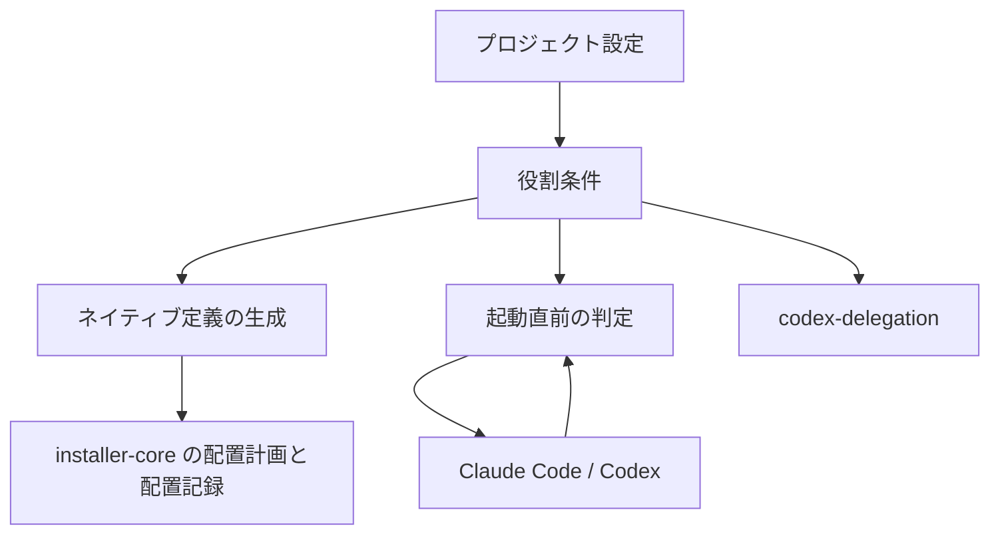
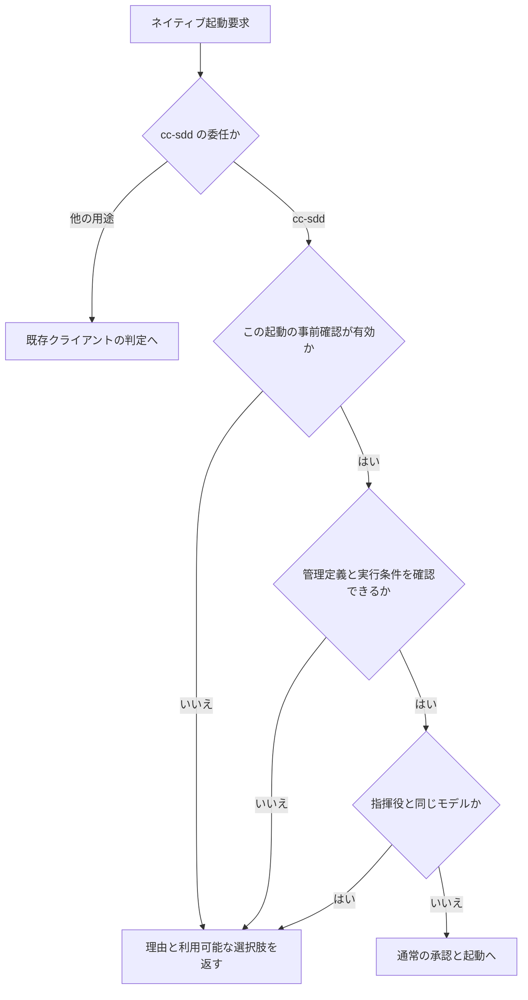
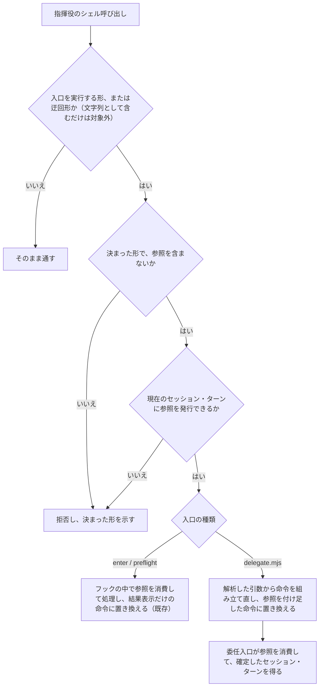

# Design Document: subagent-model-policy

## Overview

cc-sdd の役割ごとにモデル・推論量・権限を決め、外部委任とネイティブ起動で同じ条件を参照する。Claude Code と Codex の管理対象のエージェント定義を導入時に生成し、ネイティブ起動直前に有効な設定と指揮役のモデルを確認する。

> 改訂（2026-11-22、再承認待ち。拒否の検出範囲を「入口を実行する形」に絞った改訂を含む。実機確認は `poc/codex-delegation-live/result.md` の「管理入口への参照の付け足しの実機確認」）: 要件 1〜4 の設計と実装は完了している。下流の codex-delegation の実機検証で見つかった問題のうち、上流の部品に原因がある 2 つ（G1: 管理入口の参照がモデルに届かない、G3: ネイティブ単独の事前確認が常に拒否される）を解くため、要件 5・6 の設計を追加した。追加箇所は「ManagedEntryRewrite」「KiroDelegationContext」の単独発行の段落、要件の対応表、エラー処理、試験、末尾の「変更の影響（2026-11-22 の改訂）」。下流の都合で上流のコードを黙って書き換えないよう、所有者を本仕様と明記し、承認をやり直してから実装する。

### Goals

- 既存の役割別モデル指定を保持し、クライアントごとの既定値と推論量を適用する。
- 外部委任が利用する役割条件を、一つの共通契約から得られるようにする。
- 指揮役との一致、暗黙の継承、役割条件に反する起動を防ぎ、理由を返す。

### Non-Goals

- MCP の探査、候補の設定と優先順位、MCP ジョブの起動・監視は codex-delegation が扱う。
- cc-sdd が配布するスキルやひな形の改変は扱わない。

## Boundary Commitments

### This Spec Owns

- 役割 ID、クライアント別モデル・推論量の既定値、権限条件、設定値の検証と解決。
- 管理対象のネイティブ定義の名前と内容、cc-sdd の作業範囲の識別、起動時の適格判定と利用者向けの理由。
- 外部委任に提供する役割条件と、ネイティブ候補の一回限りの事前確認の契約。MCP の選択・起動・実行状態・外部 MCP の直接起動拒否は codex-delegation が扱う。
- 管理入口への呼び出し参照の発行・付け足し・消費の規則（要件 5）。対象は本仕様の `enter` / `preflight` と、codex-delegation が配置する `delegate.mjs start|status|stop`。委任入口の中の処理（候補選択・起動・状態確認）は codex-delegation が持ち、本仕様はその呼び出しの決まった形と、参照の受け渡しの契約だけを持つ。
- ネイティブ単独の事前確認での「有効な外部候補がある」の判定規則（要件 6）。判定に使う保存形式（`delegation[host].cloud` と `codex.enabled`）は codex-delegation と installer-core が定め、本仕様は読むだけとする。

### Out of Boundary

- レジストリの列挙、候補の優先順、クライアント間のフォールバック、バックエンドへの問い合わせ。
- ネイティブ定義以外の利用者のエージェントの管理と、個別サーバーの認証や信頼の変更。
- Pi・Muse のネイティブ定義の生成。codex-delegation は対応できる実行先を選び、現在のクライアントで利用できるネイティブ手段を使う。

### Allowed Dependencies

- installer-core の設定スキーマ・配置計画・配置記録。配置物は Node.js 22 以上の標準機能と同梱された設定規則だけを読み込む。
- Claude Code と Codex のプロジェクト定義およびフック。観測されたイベントと承認済みの定義から実行条件を検証する。
- 既存の設定読み取り（`readProjectSettings` → `readInstallConfig`。委任設定の形式検査 `validateDelegation` を含む）。要件 6 の判定はこの結果だけを使う。
- codex-delegation の委任入口の呼び出しの形（道筋 `.agent-hooks/cc-sdd-bootstrap/delegate.mjs`、操作名、引数名）。文字列の契約として扱い、上流から下流の配置物（`delegate.mjs` など）を読み込まない。

### Revalidation Triggers

- 役割 ID・推論量・権限の契約を変えるときは codex-delegation のモデル適格判定とフォールバックを再検証する。
- 定義やフックの登録先、生成物の管理規則を変えるときは installer-core の update・uninstall と信頼の再承認を再検証する。
- クライアントの版、Agent の引数、モデル解決の優先順またはフック順を変えるときは、起動・拒否・モデル切り替えの PoC と kiro-gate のフック併用を再検証する。
- codex-delegation が委任入口の道筋・操作名・引数を変えるときは、要件 5 の決まった形と書き換え・拒否を再検証する。委任設定（`delegation`）の保存形式や `codex.enabled` からの引き継ぎ規則を変えるときは、要件 6 の判定を再検証する。
- 参照の発行・消費の契約（参照の種類、結び付ける呼び出しの指紋、失効の条件）を変えるときは、codex-delegation の委任入口の参照検査を再検証する。
- ホストが PreToolUse の入力の書き換え（`updatedInput`）の扱い、またはモデルに見せるツール入力の範囲を変えるときは、要件 5.2・5.7 の実機確認をやり直す。

## Architecture

### Existing Architecture Analysis

installer-core の形式 1 は役割別の文字列マップ `models` を保存する。現行カタログは配布する固定ファイルを管理ディレクトリに置く。ネイティブ定義は設定で内容が変わり、各クライアントが読む専用ディレクトリが必要になるため、定型生成物として既存の配置計画と配置記録に加える。

### Architecture Pattern & Boundary Map



依存は設定規則 → 純粋な役割解決と定義生成 → 配置計画またはフックの入出力の順にする。役割解決はディスク・ネットワーク・MCP から情報を取得せず、外部で得た情報を引数で受け取る。クライアント別のイベント解釈は起動判定の端で扱う。

### Technology Stack

| 領域 | 採用する形式 |
|---|---|
| 設定・配置計画 | Node.js 22、ESM、JSDoc の型、既存の形式 1 |
| ネイティブ定義 | Claude Code の Markdown frontmatter、Codex の custom agent TOML |
| 起動判定 | 既存のコマンドフック登録、JSON 入力と deny 応答 |

## File Structure Plan

| 道筋 | 責任 |
|---|---|
| `.agent-hooks/cc-sdd-bootstrap/config-schema.mjs` | 役割設定に使うマップの検査と引数の定義 |
| `.agent-hooks/cc-sdd-bootstrap/role-policy.mjs` | 役割と既定値の定義、明示設定の解決、実行条件の純粋な判定 |
| `.agent-hooks/cc-sdd-bootstrap/native-agent-definitions.mjs` | 予約されたネイティブ名・相対パス・定義内容の生成と照合 |
| `.agent-hooks/cc-sdd-bootstrap/kiro-delegation-context.mjs` | cc-sdd 作業の開始・終了の記録と、ネイティブ起動の一回限りの事前確認記録。管理入口の種類ごとの参照の発行・消費と、単独発行での有効な外部候補の判定（要件 5・6） |
| `.agent-hooks/cc-sdd-bootstrap/subagent-model-policy-hook.mjs` | ホストのフック入力の正規化と振り分け。管理入口の決まった形の解析、参照の付け足しによる書き換え、形から外れた呼び出しの拒否（要件 5） |
| `.agent-hooks/cc-sdd-bootstrap/native-agent-gate.mjs` | クライアントのイベントの解釈、セッション状態の読み書き、判定結果の返却 |
| `lib/catalog.mjs`、`package.json` | 配布物とクライアント別フック、管理区画の案内 |
| `lib/plan.mjs`、`lib/target.mjs`、`lib/ledger.mjs` | 予約ファイルの読み取り、変更計画、配置記録の既存処理への統合 |
| `.claude/agents/cc-sdd-*.md`、`.codex/agents/cc_sdd_*.toml` | 役割ごとに生成する予約ファイル |
| `test/kiro-delegation-context.test.mjs` | 作業範囲の識別、記録の失効と一回限りの消費、参照の種類と指紋の照合、外部候補の判定 |
| `test/subagent-model-policy-hook.test.mjs` | 管理入口の書き換え・拒否、両クライアントの応答の形 |
| `test/role-policy.test.mjs`、`test/native-agent-definitions.test.mjs`、`test/native-agent-gate.test.mjs` | 役割解決・生成・フック判定 |
| `test/plan.test.mjs`、`test/cli.e2e.test.mjs` | 導入・更新・削除、旧設定の引き継ぎ、利用者データの保持 |

## System Flows



起動フックは Claude Code と Codex のネイティブ起動ツール全体を監視し、**確認済みの cc-sdd 作業中だけ**起動前の確認を強制する。組み込みエージェント名、役割名なし、履歴継承も作業中には対象とする。通常作業で使うネイティブ起動は既存のクライアント判定に委ねる。Codex では既存のプロジェクト信頼とフック個別承認を使い、起動判定はホスト側の承認を省略しない。

管理入口のシェル呼び出し（要件 5）は次の流れで扱う。



## Requirements Traceability

| ID | 設計要素 |
|---|---|
| 1.1 | RolePolicy の共通 RoleId と RolePolicy |
| 1.2 | 製造権限とネイティブの実行条件 |
| 1.3 | レビュー・調査・デバッグの権限 |
| 1.4 | 設計依頼の権限指定 |
| 1.5 | ローカルモデル条件と公開モデルの照合契約 |
| 2.1 | クライアント別のモデルと推論量マップ |
| 2.2 | 製造の既定値 |
| 2.3 | レビューの既定値 |
| 2.4 | 設計の既定値 |
| 2.5 | 対応が確認できた明示推論量 |
| 2.6 | 形式 1 の移行と明示値の優先順位 |
| 3.1 | クライアント別の定義生成と配置 |
| 3.2 | 対応する役割名と管理区画の案内 |
| 3.3 | 対応が証明できないモデル・推論量・権限の起動拒否 |
| 4.1 | 起動直前の実効モデル照合 |
| 4.2 | モデルの継承・一致・未解決での拒否 |
| 4.3 | Claude Code のモデル変更イベントと Codex の呼び出し側モデル |
| 4.4 | 判定結果の理由と適格な別設定の案内 |
| 5.1 | ManagedEntryRewrite の参照の発行と付け足し（`delegate.mjs`）、既存の `enter` / `preflight` の内部処理 |
| 5.2 | 書き換え後の命令をモデルに返さない応答の形、入口の出力に参照を含めない契約 |
| 5.3 | 自分で書いた `--reference` を含む呼び出しの拒否 |
| 5.4 | 決まった形の解析と、管理入口を指すが形から外れた呼び出しの拒否 |
| 5.5 | KiroDelegationContext の種類別の消費（参照なし・使用済み・別ターン・指紋不一致を拒否） |
| 5.6 | Claude Code（`updatedInput`）と Codex（`permissionDecision: allow` と `updatedInput`）の応答 |
| 5.7 | 実機確認の前提と、確認前のホストで管理経路として公開しない扱い |
| 6.1 | 単独発行の検査から導入台帳の目印（`delegate.mjs`）の判定を外し、設定による判定に置き換える |
| 6.2 | `effectiveExternalCandidates` の規則（`cloud`、未設定時の `codex.enabled` からの引き継ぎ、同系統の除外） |
| 6.3 | 外部候補ありのときの単独発行の拒否と管理入口の案内 |
| 6.4 | 外部候補なしのときの単独発行（ほかの検査は従来どおり） |
| 6.5 | 設定の読み取り失敗・形式不正で発行しない |
| 6.6 | 設定の中身だけによる判定（下流の配置物の読み込みとホストの命令の実行をしない） |

## Components and Interfaces

### RolePolicy

共有の読み取り契約は次の形とする。JavaScript 実装では同じ型を JSDoc で記述し、設定やフックの入力は `unknown` として検査する。

```typescript
type RoleId = "manufacture" | "review" | "design" | "research" | "debug";
type NativeClient = "claude" | "codex";
type Access = "read-only" | "workspace-write";
type Effort = "medium" | "high";
type RolePolicy = Readonly<{
  role: RoleId;
  access: Access;
  effort: Effort;
  localModelIds: readonly string[];
}>;
type NativePolicy = RolePolicy & Readonly<{
  client: NativeClient;
  modelId: string;
  agentName: string;
}>;
type RoleError = Readonly<{
  code: "UNKNOWN_ROLE" | "INVALID_SETTING" | "UNSUPPORTED_ACCESS";
  reason: string;
}>;
type Result<T> = { ok: true; value: T } | { ok: false; error: RoleError };

resolveRole(settings: unknown, role: RoleId, options: { readOnly?: boolean }): Result<RolePolicy>;
resolveNative(settings: unknown, client: NativeClient, role: RoleId,
  options: { readOnly?: boolean }): Result<NativePolicy>;
```

| 役割 | 権限 | Claude Code | Codex | 推論量 |
|---|---|---|---|---|
| 製造 | 作業先への書き込み | Haiku | Luna | medium |
| レビュー | 読み取り専用 | Sonnet | Sol | medium |
| 設計 | 成果物の作成では書き込み、読み取りの依頼では読み取り専用 | Sonnet | Sol | high |
| 調査・原因調査 | 読み取り専用 | レビューの既定値 | レビューの既定値 | medium |

設計レビュー・実装レビューは `review`、デバッグでの修正は `manufacture` を使う。作業先への書き込みが必要な製造役に読み取り専用を指定した場合は拒否する。ネイティブ既定値は Claude Code の `haiku`・`sonnet` と Codex の `gpt-6-luna`・`gpt-6.1-sol` に対応させる。モデル条件は確認済みの役割への割り当てを使い、MCP の公開モデル ID と完全一致で照合する。候補を確認できない役割はローカル割り当てを空にする。公開モデルの推論量と権限の一致は codex-delegation が判定する。

### NativeAgentDefinitions

- Claude Code は `cc-sdd-<役割>`、Codex は `cc_sdd_<役割>` を使う。設計の読み取り用にはそれぞれの接尾辞規則で専用の定義を作る。
- Claude Code は `model`・`effort` を設定する。読み取り専用の定義は `Read`・`Glob`・`Grep` の許可リストを使う。製造はクライアントが認める作業先への編集とテストに限定する。
- Codex は `model` と `model_reasoning_effort` を指定する。子の権限は現在の実行環境から引き継ぐため、定義中のサンドボックス指定を権限の根拠にしない。読み取り専用の役割は、引き継ぐ実行環境が読み取り専用と確認できた場合だけ成立する。
- 生成と通常の検証は同じ関数を使い、生成後に設定が変更された状態や管理ファイルの書き換えを検出する。クライアント側で同名の優先設定やコマンド引数が実効定義を変えている場合、管理対象として確認できるまで起動しない。正規 ID に解決できた指定だけを比較する。公式の別名を使う場合は、プロバイダーとクライアントの版に対応した確認済みの解決情報を使う。環境指定による別名・推論量の上書きが同じ値と確認できない場合は候補を無効とする。

### KiroDelegationContext

- 監視対象はプロジェクトで導入済みの `kiro-*` 手順。ユーザープロンプトの開始イベントで、実在する cc-sdd 手順への `/kiro-*`・`$kiro-*` 呼び出しを検出し、ターンを管理対象にする。
- 自然文から開始した場合は、ホストのスキル呼び出しイベントまたは、導入済みの正規 `SKILL.md` の読み取り成功を確実に識別できるイベントで同じ状態に入る。シェル文字列の部分一致は使わない。自動読み込みなど、ホストが観測可能なイベントを提供しない経路では、管理手順の入口 `kiro-delegation-context enter <skill>` でアクティブ化してから作業する。アクティブ化を確認できる経路について実機 PoC で照合し、確認できない経路は管理された cc-sdd の委任経路として公開しない。
- 状態は正規化した作業ツリー、クライアント、セッション、ターンにひも付ける。ホストがターン ID を公開しないときは、開始と終了のフックからセッション内の世代を割り当てる。終了を表すイベントまたは次のプロンプトで以前のターンを失効させる。継続した cc-sdd 手順は手順の再開時に状態を作る。自然文から入ったターンは、そのターンが終わるまで通常作業へ切り替えない。
- 管理入口のシェル呼び出しは、クライアントが渡すツール起動イベントにひも付ける。推測で任意のシェルコードを識別せず、管理入口の固定コマンド形式と呼び出し識別子を確認したときだけ、フックが確定した作業コンテキストへの一回限りの参照を記録する。入口は参照を消費して現在のセッション・ターンを取得する。呼び出し側が申告したセッションやターンは使わない。自然文からの明示的な `enter` も同じ経路で管理対象に入れる。codex-delegation の委任入口（`delegate.mjs`）にも同じ経路で参照を付け足す（下の「ManagedEntryRewrite」）。
- ネイティブの事前確認記録は、作業ツリー、セッション、ターン、依頼 ID、役割、ネイティブ定義名、実行に影響する引数の正規化済み指紋を含み、現在のターンで一度だけ使える。入力側から任意の経路や起動可否を指定できない。起動フックは一致した記録を原子的に消費し、現在のモデル・推論量・権限を改めて検査する。不一致、使用済み、期限切れは拒否し、管理された委任入口を示す。
- ネイティブ単独で利用する段階では、この仕様の入口が役割と起動条件を検証して記録を発行する。有効な外部候補がある構成では、codex-delegation の選択処理が外部候補を検査してネイティブを選んだときだけ、共通関数から発行し、単独用の発行経路は拒否する。設定や配置記録が壊れて判定不能な場合も発行しない。上流は下流の実装を読み込まない。
- 単独発行の可否（要件 6、2026-11-22 改訂）: 以前は導入台帳に `delegate.mjs` が載っているか、その実体があるかで「外部委任の配置あり」と判定していた。現行の導入は `delegate.mjs` を常に配置するため、外部の委任先を使わない構成でも単独発行が使えなかった（下流の実機検証 6.1）。この目印の判定をやめ、次の純粋な関数で判定する。導入台帳・設定・ネイティブ定義の照合など、ほかの検査は変えない。
  - `effectiveExternalCandidates(settings, client)`: 既存の `readProjectSettings` が返した設定だけを受け取る。`settings.delegation?.[client]` に `cloud` の配列があればそれを使い、項目が無ければ（未設定）`settings.codex.enabled === true` のときに限り管理対象の Codex MCP（系統 `codex`）を 1 件の候補とみなす。空の配列は「候補なし」と明示した状態として扱い、引き継ぎをしない。得た候補から、系統（`family`）が現在のホストの系統（`claude` → `claude`、`codex` → `codex`）と同じものを除く。
  - 結果が 1 件以上なら単独発行を拒否し、理由に「外部の委任先が設定されているため、管理入口（`delegate.mjs start`）を使ってください」と示す。0 件なら、委任機能の部品が配置されていても単独発行の他の検査へ進む。
  - 判定は保存された設定の内容だけで行い、ホストの登録の承認状態や MCP の稼働は確かめない（フックの中でホストの命令を実行しない）。承認待ちの候補があるだけでも「外部候補あり」とみなし、管理入口へ案内する。管理入口は候補が全部使えなければネイティブを選び、共通関数で事前確認を発行するため、行き止まりにならない。
  - 廃止済みの `delegation[host].local` は判定に使わない（候補とみなさない）。設定の形式検査が設定全体を拒否する場合は要件 6.5 に従って発行しない。

### ManagedEntryRewrite（管理入口の呼び出しの書き換え、要件 5）

`subagent-model-policy-hook.mjs` の PreToolUse の振り分けに含める。下流の実機検証（G1）で、`enter` の参照はフックの中で消費されるため、`delegate.mjs start` に渡す参照をモデルが得る手段がないと分かった。参照をモデルに見せる案（`enter` の出力に載せる）は一回限りの秘密が文脈と記録に残るため採らず、`enter` と同じくフックが付け足す方式にする。

- **決まった形** — 委任入口は `node .agent-hooks/cc-sdd-bootstrap/delegate.mjs <操作> <引数>…` の 1 命令だけとする。操作ごとに受け付ける引数を固定する（`start`: `--skill`・`--task-id`・`--request-id`・`--role`・`--work-dir`・`--instruction-file`・任意の `--read-only`。`status` / `stop`: `--skill`・`--task-id`・`--request-id`・`--work-dir`）。各引数は 1 回まで、必須の引数がすべてあること。値は安全な文字だけの語か、中に引用符を含まない一重引用符の文字列に限る。命令の連結（`;`・`&&`・`|`）、リダイレクト、変数・命令の展開、別名や別の起動方法（`bash -c` など）は形から外れるものとする。`enter` / `preflight` は既存の形のまま。
- **参照の付け足し** — 形に合えば、フックが現在のセッション・ターンに結び付けた参照を発行し、解析した引数から命令を組み立て直して `--reference <参照>` を末尾に足した命令に置き換える。命令の道筋は、フックが自分の配置場所から求めた `delegate.mjs` の実際の道筋を引用して使い、呼び出し時の作業ディレクトリに依存させない。元の文字列に参照を連結するだけの書き換えはしない。
- **参照の記録** — 参照の記録に、入口の種類（`enter`・`preflight`・`delegate-start`・`delegate-control`）と、参照を除いた正規化済みの引数の指紋を持たせる。消費する側は種類と指紋の一致を確かめるため、ある呼び出しのために発行された参照を別の操作・別の依頼に使えない。参照は 1 回だけ消費でき、ターンの終了または次のプロンプトで失効する（既存の規則）。
- **作業範囲との関係** — `delegate-start` は `enter` と同じ条件（終了していないターン、手順名の一致）で発行し、そのターンを管理対象に入れる。`delegate-control`（`status` / `stop`）は現在のセッション・ターンに結び付けるだけで、作業範囲を開始しない。開始したターンが終わった後の状態確認・停止は、新しいターンの参照で行い、依頼の所有の確認（作業ツリー・依頼記録の照合）は委任入口が行う。
- **拒否** — 管理入口を**実行する形**のシェル呼び出しで、形から外れるもの、またはモデルが書いた `--reference` を含むものは、書き換えずに拒否し、決まった形を示す。「実行する形」とは、命令の先頭の語が `node`（先頭の環境変数代入・`cd … &&` の前置きは形から外れたものとして拒否側に倒す）で、その次の語が管理入口の道筋（`delegate.mjs` または `kiro-delegation-context.mjs`。相対・絶対のどちらも）であるものをいう。これに加え、命令の連結・パイプ・`bash -c`・`eval`・変数展開の中に入口の道筋と操作名（`enter`・`preflight`・`start`・`status`・`stop`）が並んで現れるものも、入口を迂回して実行し得るため拒否する。入口の道筋や操作名が引数・引用符の中の文字列として現れるだけの呼び出し（`grep "delegate.mjs start" …`、`cat` や `sed` での読み取りなど。命令の先頭が `node` でなく、連結・展開も含まないもの）は対象にせず通す。この検出は拒否にだけ使う安全側の判定で、作業範囲の開始の識別には使わない（シェル文字列の部分一致で管理対象に入れない、という既存の方針は変えない）。
- **応答の形** — Claude Code には `hookSpecificOutput.updatedInput`、Codex には `permissionDecision: "allow"` と `updatedInput` を返す（既存の `writeHostResponse` の書き換え応答）。Codex の Bash の PreToolUse で `updatedInput` の書き換えが実際に実行されることは実機で確認済み（`poc/codex-delegation-live/result.md` の「Codex フックの実機確認（2026-11-22）」）。フック登録の対象（Claude Code の `Bash|Agent`、Codex の `Bash|shell|…`）は既にシェルを含むため、登録の変更は要らない。フックの入口で早く抜ける条件に、管理入口の検出を加える。
- **入口側の安全側** — 委任入口と `enter` は今と同じく参照を必須とする。フックが働かなかった、または書き換えが反映されなかった場合は、参照なしで実行されて拒否される。委任入口は受け取った参照を出力・記録に書かない（codex-delegation の責務。本仕様の契約として示す）。
- **実機確認の前提（要件 5.7）** — 次をホストごとに確かめるまで、そのホストでは委任入口への付け足しを管理経路として公開しない（下流は管理委任を有効にしない）。(1) 実際の `delegate.mjs` の命令で書き換えが実行されること、(2) 書き換え後の命令と参照が、モデルが次に受け取る入力（ツールの結果・表示）に現れないこと。Codex の PoC では目印が命令の出力に出たが、それは試験用の命令が目印を表示したためで、参照の非表示は未確認である。

### NativeAgentGate

| 入力 | 判定の使い方 |
|---|---|
| 呼び出し元、セッション ID、作業先 | 対応するクライアントと該当セッションの状態を選ぶ |
| 役割名と起動時の指定 | 管理対象の定義に一致することを確認する。継承される履歴方式と定義に矛盾する明示指定は拒否する |
| 指揮役モデルの確定した ID | 子モデルと同じクライアントの正規 ID で比較する。ブランド名の部分一致だけで判定しない |
| 実効モデル・推論量・権限を確認できる情報 | 起動予定の定義と照合する。確認できない設定は適用不能として理由を返す |

- Claude Code の `PreToolUse(Agent)` は `subagent_type` と存在する場合の `model`・`effort` を読む。起動イベントには指揮役モデルが含まれない場合がある。`SessionStart.model`、確認できる会話記録のモデル、`PreModelSwitch` / `PostModelSwitch` を組み合わせる。切り替え開始時は古い判定状態を無効にし、完了イベントの正規化済み `to_model` を保存する。確認できない間は起動を拒否する。同じセッションの起動・切り替えイベントが確認できたモデルを使い、ターン単位の代替モデルを使う構成では当該呼び出しのモデルも確認する。以前の応答のモデルを、新しい応答を処理したモデルとして扱わない。
- Codex は起動ツールのフックに含まれる呼び出し側の `model` を使う。起動引数の `agent_type` を管理対象名と比較する。名前空間つきの `collaborationspawn_agent` と `spawn_agent` を認識する。Codex の管理対象起動では履歴の引き継ぎを無効にする。Multi-Agent V2 は `fork_turns: "none"` を必須とし、対応する旧形式では `fork_context: false` を使う。履歴を引き継ぐ場合は役割名が渡っていても実効モデルが親と同じになり得る。生入力の `model`・推論量は子の実効設定として扱わない。
- Codex の権限は `transcript_path` にある `turn_context` のうち、フックの `turn_id` とモデルに合う記録から確認する。`permission_profile` のファイルシステム権限を検査し、`sandbox_policy` の種類との矛盾がある場合や記録が欠ける場合は不明とする。読み取り専用では権限昇格が無効な承認ポリシーも確認する。互換フィールドの `permission_mode` だけでは読み取り専用を証明しない。
- cc-sdd 作業中に組み込み名や役割名なしの起動が来た場合は、予約名と有効な事前確認記録を持たないため拒否する。同じターンに二度呼ばれた場合は、消費済みなら拒否する。通常作業ではこの記録を要求しない。
- 読み取り専用の確認に失敗した場合、書き込み可の定義へ切り替えない。異なるクライアントや役割の選択は呼び出し側の判断に任せ、適格な代替が分かる場合にだけ案内する。

## Data Models

- 既存の `models` はそのまま保存する。形式 1 のまま `subagents.claudeModels`、`subagents.codexModels`、`subagents.efforts`、`subagents.localModels` を、役割 ID から文字列へのマップとして追加する。
- モデル指定は、クライアント別の明示値、旧 `models` の明示値、クライアント既定値の順に評価する。旧モデルがそのクライアントで使えない場合は理由を表示する。未認識の役割キーは保存し、管理定義の生成には使わない。
- `localModels` は MCP を選ぶ設定と独立させる。明示した値、またはリリース時点で役割適合を確認済みのモデル ID を照合対象とする。接続先が変わっても名称やモデルサイズだけで適格と推測しない。
- 生成物は予約した相対パスと配置記録で管理する。利用者の同名ファイル、管理外の定義、設定済みの値を保護し、既存の競合・書き換え時の扱いを使う。生成に失敗した状態で部分的に適用しない。
- 作業範囲と事前確認記録は依頼本文を保存せず、他の作業ツリーと共有しない。ネイティブ起動フックと選択入口が同じ利用者用の実行時領域を使用し、外部エージェントへこの領域を書き込み可能として渡さない。
- モデル観測の記録はプロジェクト設定に含めない。`.cache/cc-sdd-model-policy/` でプロジェクトとセッション ID ごとに分け、モデル識別子・状態・更新順だけを保持する。途中書き込みを読まないよう一時ファイルから置換する。別のセッションからの状態を流用しない。

## Error Handling

| 条件 | 挙動 |
|---|---|
| 不正な値、対象クライアントのモデル未対応、管理定義との不一致 | 問題の役割と項目を表示し、その設定で起動しない |
| 同じモデル、継承、比較材料が欠ける | 起動を拒否し、一致か判定不能かを理由で示す |
| フック・定義が未承認、または該当イベントが確認できない | 保護されたネイティブ経路として扱わず、承認・構成の確認方法を示す |
| 予約された生成先の競合 | 配置計画を適用せず競合する道筋を提示する |
| 管理入口を指すシェル呼び出しが決まった形から外れる、または自分で書いた参照を含む | 書き換えずに拒否し、決まった形を示す（要件 5.3・5.4） |
| 管理入口の参照を現在のターンに発行できない（ターン終了、手順名の不一致、ホスト情報の欠落） | 書き換えずに拒否する。入口は参照なしでは処理しない（要件 5.5） |
| 単独発行で有効な外部候補がある | 発行せず、管理入口を使うよう示す（要件 6.3） |
| 単独発行で設定を読めない・委任の設定が形式に合わない | 発行しない（要件 6.5） |

通常の診断に会話本文や認証情報を出さない。フックの拒否理由には、対象役割と確認できなかった項目を含める。

## Testing Strategy

- **単体** — 全役割の既定値、明示・旧形式・省略の優先順、別名での一致、読み取り専用の不一致、依頼ごとの設計権限を検証する（1.1–2.6、4.1–4.4）。
- **統合** — 明示コマンドと自然文からの手順開始、通常作業への復帰、組み込み・役割なしの直接起動、事前確認の一回消費、切り替えイベント、Codex の起動名の別パターン、継承起動、権限の未確定、kiro-gate との併用を模擬入力と実機で確認する（3.1–4.4）。
- **導入の通し** — 片方・両方のクライアントへの init、旧設定からの update、再更新の差分なし、同名ファイルの衝突、クライアントの切り替えと uninstall で他者の定義を保持する（2.6、3.1–3.3）。
- **実機** — クライアントの版ごとに、許可された役割の実効モデル・推論量、拒否時に子が起動しないこと、指揮役変更、読み取り専用の継承を確認する。実機および模擬 API を使った検証の観測結果は research.md を参照する。
- **管理入口の書き換え（要件 5）** — 単体で、決まった形の受け付け、連結・リダイレクト・展開・別名・未知の引数・重複引数・自分で書いた参照の拒否、入口の道筋と操作名を文字列として含むだけの呼び出し（`grep`・`cat`・`sed`）の通過と、迂回形（`bash -c`・`eval`・連結・前置き）の拒否、引数からの命令の組み立て直し（引用を含む値）を確認する。統合で、参照の種類・指紋の不一致、使用済み、別ターンの参照で入口が処理しないこと、ターンをまたぐ `status` / `stop` を確認する。実機で、Claude Code と Codex のそれぞれについて、実際の `delegate.mjs` の命令が書き換え後に実行されること、参照がモデルの次の入力に現れないことを確認する（要件 5.7）。
- **外部候補の判定（要件 6）** — 単体で、`cloud` の候補あり・空の配列・未設定かつ `codex.enabled` 有効・無効、同系統だけの候補（Codex のホストで Codex MCP だけ）、廃止済みの `local` だけの設定、形式不正を確認する。統合で、`delegate.mjs` が配置されていても外部候補がなければ単独発行が通り、外部候補があれば拒否されることを確認する。

## 変更の影響（2026-11-22 の改訂）

要件 1〜4 の番号と内容は変えていない。要件 5・6 を追加した。

### 実装済みのコード・テストへの影響

| 対象 | 必要な変更 | 種類 |
|---|---|---|
| `kiro-delegation-context.mjs`（`trustedPreToolUse`・`consumeReference`・`bindEntryReference`） | 参照の記録に入口の種類と引数の指紋を加え、`enter` 以外（`delegate-start`・`delegate-control`）の発行と消費を受け付ける。消費時に種類と指紋を照合する。`delegate-control` は作業範囲を開始しない | 拡張（要件 5） |
| `kiro-delegation-context.mjs`（`verifyStandaloneInstall`） | 導入台帳の `delegate.mjs` と実体の有無による拒否を削除し、`effectiveExternalCandidates` による判定に置き換える。ほかの照合は変えない | 変更（要件 6） |
| `subagent-model-policy-hook.mjs` | 委任入口の決まった形の解析、命令の組み立て直しと参照の付け足し、形から外れた呼び出しと自分で書いた参照の拒否、入口で早く抜ける条件への追加 | 拡張（要件 5） |
| `native-agent-gate.mjs`・`claude-native-agent-adapter.mjs`・`codex-native-agent-adapter.mjs` | 変更なし（ネイティブ起動の判定と証拠の集め方は変えない。Codex の参照発行で既存のフック証拠の要求をそのまま使う） | なし |
| `lib/catalog.mjs`（フック登録） | 変更なし（シェルは既に対象）。管理区画の文章は codex-delegation 側で変える | なし |
| `test/kiro-delegation-context.test.mjs` | `delegate.mjs` を置くと単独発行が拒否される試験を、外部候補の有無で分ける試験に置き換える。参照の種類・指紋の試験を追加 | 変更 |
| `test/subagent-model-policy-hook.test.mjs` | 委任入口の書き換え・拒否の試験を追加。既存の `enter` / `preflight` の試験は維持 | 追加 |

### 既存タスクの再オープン

tasks.md は変更していない。次の段階（tasks の再生成）で次を反映する。

| タスク | 影響 |
|---|---|
| 2.3 | 再オープン。参照の種類と指紋、委任入口の発行・消費、`delegate-control` が作業範囲を開始しないこと（要件 5.1・5.5） |
| 2.4 | 再オープン。単独発行の可否を有効な外部候補で判定する（要件 6）。「委任機能の配置後は単独発行を無効にする」の確認項目を置き換える |
| 3.2 | 再オープン。フックの振り分けに委任入口の書き換え・拒否を接続する（要件 5.3・5.4・5.6） |
| 4.2・4.3 | 追加の実機確認。実際の `delegate.mjs` の命令の書き換えと参照の非表示を両クライアントで確かめる（要件 5.7）。既存の確認結果は有効 |
| その他（1.x・2.1・2.2・2.5・2.6・3.1・4.1） | 影響なし |

### codex-delegation への影響

| 項目 | 影響 |
|---|---|
| 委任入口（`delegate.mjs`） | 参照を必須のまま、新しい種類（`delegate-start`・`delegate-control`）と引数の指紋で消費する。参照を出力・記録に書かない |
| 管理区画と拒否の文章 | `--reference` を案内せず、参照なしの決まった形を案内する |
| タスクの順序 | 本仕様の改訂が承認・実装されるまで、codex-delegation の管理入口の参照（G1）と単独の事前確認（G3）に依存する作業（同仕様のタスク 5.2・5.3 の該当部分と 6.1 の再検証）は進められない |
| 委任設定の保存形式 | codex-delegation が `delegation` の形や `codex.enabled` からの引き継ぎ規則を変えるときは、本仕様の要件 6 を再検証する |

## Supporting References

- [下流の実機の通し検証の結果（G1・G3、Codex フックの実機確認）](../../../poc/codex-delegation-live/result.md)
- [Claude Code のサブエージェント](https://code.claude.com/docs/en/sub-agents)
- [Claude Code のフック](https://code.claude.com/docs/en/hooks)
- [Codex のサブエージェント設定](https://learn.chatgpt.com/docs/agent-configuration/subagents)
- [Codex のフック](https://learn.chatgpt.com/docs/hooks)
