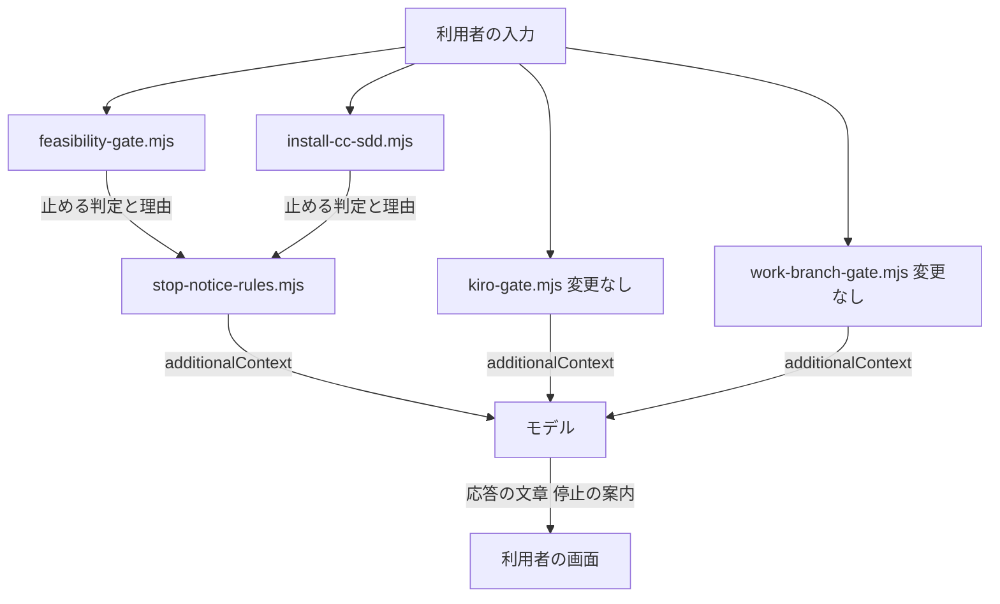
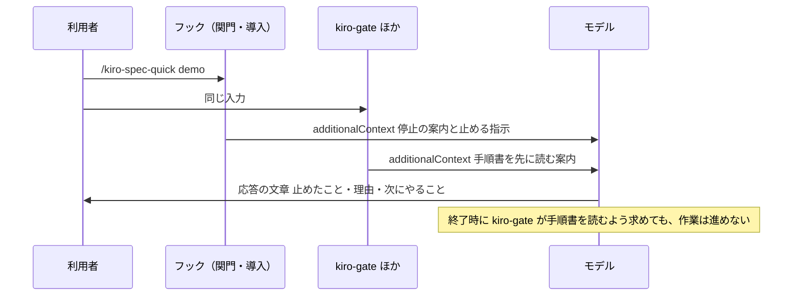

# 設計文書: visible-stop

## Overview

**Purpose**: フックが利用者の入力を止める場面で、利用者が必ず「止めたこと・理由・次にやること」を応答の文章として画面で読めるようにする。入力を止める出力を、`decision: "block"`（モデルを動かさずに止める）から、追加の文脈（`additionalContext`）で停止の案内と止める指示を渡してモデルに話させる形へ変える。

**Users**: cc-sdd-bootstrap を導入したリポジトリの開発者。特に、リモートセッションのように、フックの停止の理由が画面に出ない環境の利用者。

**Impact**: 実現性の関門（`feasibility-gate.mjs`）と導入のフック（`install-cc-sdd.mjs`）の出力の形を変える。止める条件（どの入力を止めるか）は変えない。配布物に純粋な部品を 1 つ足す。

### Goals
- 入力を止める全ての経路で、応答の文章（停止の案内）が必ず作られる。
- 止めた入力のために、手順書に従った作業（ファイルの作成と編集・状態を変えるコマンド・子のエージェント・ブランチの切り替え）が進まない。
- Claude Code（リモートセッション・コマンドライン）と Codex で同じ出力を使う。

### Non-Goals
- 複数の spec 名を渡された入力で、先頭以外の spec を判定の対象にすること（止める条件の変更になるため、この spec では扱わない。既知の制約として下に記す）。
- どの入力を止めるかの条件の変更。
- kiro-gate・work-branch-gate の変更（止めた入力で手順書が読まれることは許容する）。
- フック以外の原因による無応答の検出。
- ツールの拒否による補強（実機で作業が進んだ観測が無いため入れない。見直しの条件を下に記す）。

## Boundary Commitments

### This Spec Owns
- 停止の案内を載せる追加の文脈の文面と出力の形（`stop-notice-rules.mjs`）。
- 実現性の関門と導入のフックが、入力を止めるときに使う出力（`decision: "block"` を出さない）。
- 停止の案内が応答の文章で届くことを確かめる実機の確認の記録。

### Out of Boundary
- 実現性の関門の止める判定（`decideInput` が返す停止の判定と理由の文面。内部の種別名 `kind: "block"` は「止める判定」を表すものとして変えない）。
- 導入のフックの止める条件（`decideInstall` の判定）。
- kiro-gate・work-branch-gate の出力と状態。
- Claude Code・Codex のフックの仕様。

### Allowed Dependencies
- `feasibility-gate-rules.mjs` の `messageBlock`（理由の文面）と `install-rules.mjs` の `messageBlocked`（導入の停止の理由の文面）。これらの文面は変えない。
- フックの出力の形 `hookSpecificOutput.additionalContext`（両ツールで先例あり: 既存の関門の文脈）。

### Revalidation Triggers
- 停止の出力の形（`additionalContext` の使い方）の変更 → 実現性の関門・導入のフック・テストの再確認。
- Claude Code・Codex のフックの入出力の仕様の変更（追加の文脈の扱い）→ 実機の確認をやり直す。
- 止めた入力で作業が進んだ観測が出たとき → ツールの拒否による補強（`PreToolUse` で止めた入力のターンの作業ツールを拒否）を設計に足す。

## Architecture

### Existing Architecture Analysis
- `feasibility-gate.mjs` は `decideInput` の結果が `block` のとき `{decision:"block", reason}` を出力する（1 か所）。`install-cc-sdd.mjs` の `runUserPromptSubmit` は `{decision:"block", reason}` を出力する経路を 9 か所（導入の失敗・導入中・区画の書き直しの失敗・判定不能。書き直し後の再判定を含む）で持つ。
- Claude Code・Codex ともに、`UserPromptSubmit` のフックの `additionalContext` を追加の文脈として受け取る（既存の関門が使用）。`decision: "block"` は、モデルを動かさず、理由を画面（またはシステムの通知）に出すだけの停止で、リモートセッションの画面には出ない（実機の確認。`poc/design_01.md`）。
- 同じ入力に複数のフックが文脈を出す（kiro-gate・work-branch-gate・関門）。kiro-gate は一覧に載らないスキルで、手順書を読むまで他のツールを拒否し、終了を 1 回止める。

### Architecture Pattern & Boundary Map



**Architecture Integration**:
- Selected pattern: 停止の出力の形を 1 か所の純粋な部品に集め、2 つのフックが同じ部品を使う。
- Domain/feature boundaries: 判定（既存の rules）、出力の組み立て（新しい部品）、入出力（各フック）を分ける。
- Existing patterns preserved: 判定は `*-rules.mjs` に置く純粋な処理、入出力は `*.mjs` のフックという分け方。フックの内部の失敗は入力を止めずに通す。
- New components rationale: 2 つのフックで同じ文面を使うため、重複を避けて 1 つにまとめる（1 部品）。
- Steering compliance: コードを増やさない（新しい部品は 1 つ、純粋な文字列の処理）。

### Technology Stack

| Layer | Choice / Version | Role in Feature | Notes |
|-------|------------------|-----------------|-------|
| フック | Node.js 22（ESM） | 止める出力の組み立て | 既存の rules + フックの構成 |
| 出力の形 | `hookSpecificOutput.additionalContext`（`UserPromptSubmit`） | 停止の案内を渡す | 両ツールで既存の先例あり |
| テスト | `node --test` | 文面・出力の形・経路 | 既存のテストを直す |

## File Structure Plan

### Directory Structure
```
.agent-hooks/cc-sdd-bootstrap/
└── stop-notice-rules.mjs    # 新規: 停止の案内と止める指示の文面と、UserPromptSubmit の出力の形を作る（純粋な処理）
```

### Modified Files
- `.agent-hooks/cc-sdd-bootstrap/feasibility-gate.mjs` — 止める判定のとき、`{decision:"block", reason}` の代わりに `stopOutput` の結果を出す（3.1〜3.5・6）。
- `.agent-hooks/cc-sdd-bootstrap/install-cc-sdd.mjs` — `{decision:"block", reason}` を出す 9 か所を、1 つの補助（`writeStop(prompt, reason)`）に置き換える。入力の `prompt` を関数の外の変数に保持する（4.1〜4.6）。
- `lib/catalog.mjs` — 配布する `stop-notice-rules.mjs` を配置の一覧に足す（8.5）。運用の区画の文章の「入力が止まります」の説明に、止めた理由は応答の文章で示されることを足す（8.1）。
- `package.json` — `files` に `stop-notice-rules.mjs` を足す。
- `.agent-hooks/cc-sdd-bootstrap/agent-section-claude.md`・`agent-section-codex.md` — `update` コマンドで再生成する（8.4）。
- `test/stop-notice-rules.test.mjs`（新規）、`test/feasibility-gate.test.mjs`、`test/install-cc-sdd.test.mjs`、`test/catalog.test.mjs`、`test/package.test.mjs` — 出力の形・文面・配布物の一覧を直す（8.3）。
- `.kiro/specs/feasibility-review/{requirements,design,feasibility}.md`、`.kiro/specs/session-install/requirements.md` — 「停止の理由は利用者に示される」とする記述（要件 5.5・5.11・8.2、記録の根拠の行、session-install 要件 5）を、停止の案内が応答の文章で届くことに合わせて直す（8.2）。

## System Flows



- 止める指示は、並んだ案内より優先する旨を文面に含める。実機では、作業の成果物は作られなかった（`poc/design_02.md`）。kiro-gate の終了の停止により手順書が読まれることは許容する（利用者の判断）。
- 止める判定でない入力には、停止の出力を出さない（従来どおり、何も出さない・または段階ごとの文脈を出す）。

## Requirements Traceability

| Requirement | Summary | Components | Interfaces | Flows |
|-------------|---------|------------|------------|-------|
| 1.1, 1.2, 1.3, 1.4, 1.6 | 応答の文章で停止の案内（止めたこと・理由・次にやること・止めた入力）を必ず作る | `stop-notice-rules.mjs`、両フック | `messageStopNotice`・`stopOutput` | 停止の流れ |
| 1.5 | 日本語で読める | `stop-notice-rules.mjs` | `messageStopNotice` | — |
| 2.1, 2.2, 2.3 | 止めた入力のために作業を進めない・並んだ案内より優先 | `stop-notice-rules.mjs`（止める指示） | `messageStopNotice` | 停止の流れ |
| 2.4 | 作業が進んだときの扱い | 見直しの条件（補強は入れない） | — | — |
| 2.5 | 理由を解消して再送すれば通る | 両フック（判定は変えない） | — | — |
| 3.1, 3.2, 3.3, 3.4 | 実現性の関門の各停止に案内を載せる（既存の理由の文面を使う） | `feasibility-gate.mjs` | `stopOutput` | 停止の流れ |
| 3.6 | 複数の spec 名・`-y` つきの入力でも停止の案内（引数の形によらず、止める判定の出力は同じ形） | `feasibility-gate.mjs`（`classifyPrompt` は変更なし） | `stopOutput` | 停止の流れ |
| 3.7 | 記録が無い導入前の spec への案内（既存の `messageBlock` の文面が、記録を作る手順と不要判定の手順を含む） | `feasibility-gate-rules.mjs`（文面は変更なし） | `messageBlock` | 停止の流れ |
| 3.5, 4.6, 5.2, 5.3 | 止める条件・通す条件を変えない | `decideInput`・`decideInstall`（変更なし） | — | — |
| 4.1, 4.2, 4.3, 4.4, 4.5 | 導入の各停止（失敗・導入中・古い印・区画の書き直しの失敗・判定不能）に案内を載せる | `install-cc-sdd.mjs`（`writeStop`） | `stopOutput` | 停止の流れ |
| 5.1, 5.4 | 止めない入力には停止の出力を出さない・導入の案内を変えない | 両フック | — | — |
| 6.1, 6.2, 6.3, 6.4 | 3 つの画面で読める・確かめた記録 | 実機の確認（`poc/`） | — | 停止の流れ |
| 7.1, 7.2 | 並んだ案内より停止を優先 | `stop-notice-rules.mjs` | `messageStopNotice` | 停止の流れ |
| 7.3 | 案内と他の文脈を区別できる形 | `stop-notice-rules.mjs`（区切りと見出し） | `messageStopNotice` | — |
| 8.1 | 運用の区画の文章の見直し | `lib/catalog.mjs`、`agent-section-*.md` | — | — |
| 8.2 | 既存の仕様の記述の見直し | 既存 spec の文書 | — | — |
| 8.3 | 文面と出力を自動の確認で確かめる | テスト | — | — |
| 8.4, 8.5 | 更新の反映・配置の一覧に新ファイルを足す | `update` の実行、`lib/catalog.mjs`、`package.json` | — | — |
| 9.1〜9.5 | 設計前の実機の確認と記録 | `poc/design_01.md`・`design_02.md`、`feasibility.md` | — | — |

## Components and Interfaces

| Component | Domain/Layer | Intent | Req Coverage | Key Dependencies (P0/P1) | Contracts |
|-----------|--------------|--------|--------------|--------------------------|-----------|
| `stop-notice-rules.mjs` | 純粋な処理 | 停止の案内と止める指示の追加の文脈を作る | 1, 2, 7 | なし | 関数 |
| `feasibility-gate.mjs` | フック | 実現性の止める判定を出力の形にする | 3 | `stop-notice-rules.mjs` (P0)、`decideInput` (P0) | フックの出力 |
| `install-cc-sdd.mjs` | フック | 導入の止める判定を出力の形にする | 4 | `stop-notice-rules.mjs` (P0)、`messageBlocked` (P0) | フックの出力 |

#### `stop-notice-rules.mjs`

| Field | Detail |
|-------|--------|
| Intent | 止める出力の形を 1 か所に集める |
| Requirements | 1.1〜1.6, 2.1〜2.3, 7.1〜7.3 |

**Contracts**: Service [x]

```typescript
interface StopNotice {
  /** 止めた入力（先頭 200 文字まで。制御文字は取り除く）。取得できなければ null */
  prompt: string | null;
  /** 止めた理由と次にやること（既存の messageBlock・messageBlocked の文面） */
  reason: string;
}

/** UserPromptSubmit の追加の文脈に入れる文章を返す */
function messageStopNotice(notice: StopNotice): string;

/** フックが標準出力に書く JSON を返す（decision を含まない） */
function stopOutput(notice: StopNotice): {
  hookSpecificOutput: { hookEventName: "UserPromptSubmit"; additionalContext: string };
};
```
- 文面の構成（見出しで他の文脈と区別する）:
  1. `【入力の停止】この入力は止められています。ほかの作業はしないでください。`
  2. 箇条書き: 次の「停止の案内」をそのまま利用者に伝えて終える／ファイルの作成と編集・状態を変えるコマンドの実行・子のエージェントの起動・ブランチの切り替えをしない／同じ入力に並んで届く他の案内（手順書を先に読む案内、終了を止めて手順書を読むよう求める案内、作業ブランチへの切り替えの案内）より、この停止を優先する。
  3. `--- 停止の案内 ---` に続けて、`止めた入力: <prompt>`（prompt が null のときは「取得できませんでした」）、`止めたこと: この入力を止めました。`、`<reason>`（理由と次にやること）。
- Preconditions: `reason` は空でない文字列。
- Postconditions: 返す文字列は、`reason` の内容をそのまま含み、`decision` を含む出力は作らない。
- Invariants: 入出力・時刻・環境変数を使わない（純粋）。

#### `feasibility-gate.mjs`・`install-cc-sdd.mjs`
- 止める判定のとき、`stopOutput({ prompt, reason })` を標準出力に 1 行の JSON で書き、終了コード 0 で終える（従来の `block` と同じ終了の扱い）。
- `install-cc-sdd.mjs` は、入力の読み取りに失敗した場合（`prompt` が分からない）も、`prompt: null` で停止の案内を出す。判定できない誤りの停止（要件 4.4）は従来どおり止める側とする。
- 実現性の関門のフック自体の失敗は、従来どおり標準エラーに書いて入力を通す（要件 5.3）。

## Data Models

新しいデータは持たない。追加の文脈は 1 回の出力に限り、状態ファイル・一時ファイルは作らない。

## 既知の制約

- 実現性の関門は、入力の先頭の spec 名だけを判定する（`classifyPrompt` は最初の `-` で始まらない語を spec 名にする）。`/kiro-spec-tasks A B -y` では、A の記録だけが見られ、B は判定されない。A が通過なら B の記録の有無にかかわらず入力は通る。これは止める条件の話で、この spec の対象外（止める条件を変えない）。扱うかは別の判断とする。
- 事象の 2 件目（`/kiro-spec-tasks brw-enforcement brw-pr-handoff -y`）は、先頭の spec `brw-enforcement`（この仕組みの導入前に作られ、実現性の記録を持たない想定）の記録が無いために止められ、同じ無応答になったと考えられる。実際の記録は確認できていない（セッションを特定できなかった）。停止の出力を変えれば、この経路でも応答の文章が作られる。

## Error Handling

### Error Strategy
- 止める判定が出たとき: 停止の案内を追加の文脈で出す。出力の組み立て自体は失敗しない（純粋な文字列の処理）。標準出力への書き込みの失敗は、従来と同じく例外として扱う（関門は通す側、導入は止める側）。
- モデルが止める指示に従わず、作業を進めた場合: 現時点の補強は無い（実機で 0 回）。観測した場合は、`PreToolUse` で止めた入力のターンの作業ツールを拒否する補強を設計に足す（見直しの条件）。

### Error Categories and Responses
- **止める条件に合う入力**: 停止の案内（応答の文章）。
- **止める条件に合わない入力**: 従来どおり（何も出さない・段階ごとの文脈）。
- **フックの内部の失敗**: 関門は入力を通す、導入は従来どおり理由つきで止める（停止の案内の形で）。

## Testing Strategy

### Unit Tests
- `stop-notice-rules`: 文面に見出し・止める指示・「止めた入力」・理由が含まれる（1.2〜1.4）。`prompt` が null のとき「取得できませんでした」を含む（4.4）。長い入力を 200 文字までに切り、制御文字を除く。`decision` を含まない（1.6）。
- `stop-notice-rules`: 同じ入力に並ぶ他の案内より優先する旨を含む（7.1・7.2）。

### Integration Tests
- `feasibility-gate`（フックの標準入出力）: 複数の spec 名と `-y` を含む入力（`/kiro-spec-tasks a b -y`）で、先頭の spec の記録が無いとき、停止の案内の出力になる（3.6）。記録が無い・未通過・`/kiro-spec-quick` の停止で、出力が `hookSpecificOutput.additionalContext` を持ち、`decision` を持たず、既存の理由の文面を含む（3.1〜3.4）。止めない入力では何も出さない（5.1）。
- `install-cc-sdd`（フックの標準入出力）: 導入の失敗・導入中（新しい印・古い印）・区画の書き直しの失敗・判定不能の各経路で、同じ形の出力になる（4.1〜4.5）。導入済みの入力の出力は変わらない（5.4）。
- 配布物の一覧: `stop-notice-rules.mjs` が `package.json` の `files` と配置の一覧に入っている（8.5）。運用の区画の文章に、停止の理由が応答の文章で示されることが含まれる（8.1）。

### E2E（実機）
- 設計の段階の確認: `poc/design_01.md`・`design_02.md`（試作のフックで、Claude Code・Codex）。
- 実装後: 実際の配置物で、`/kiro-spec-quick <記録が無い spec>` を、(1) コマンドライン（Claude Code）、(2) Codex、(3) リモートセッションの画面、のそれぞれに送り、停止の案内が応答の文章として表示されることを確かめる。結果は `poc/impl_01.md` に残す（要件 6.4）。

## Migration Strategy

- 配布物（導入先のフック）の出力の形が変わる。導入先は `update` で新しい配置物に揃う。古い配置物のまま動く導入先は、従来どおりの停止（`decision: "block"`）が動き続ける（無応答の問題は残る）。
- 既存の spec の記述の見直し（8.2）は、実装の最後に行い、実装と同じ変更に含める。
