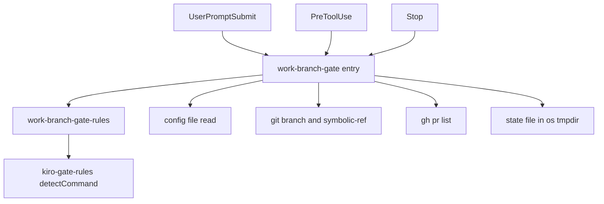
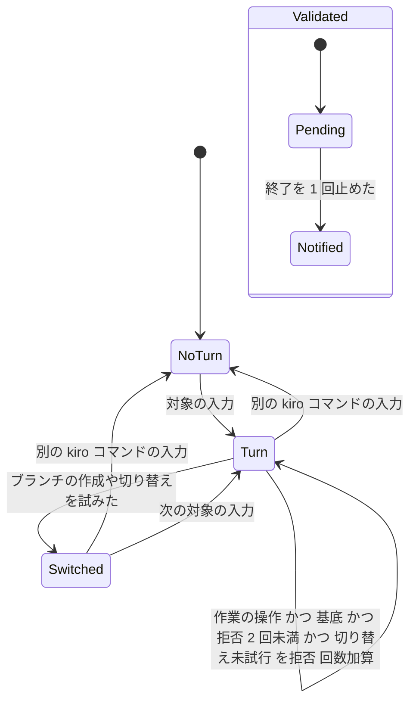

# 設計文書: work-branch-flow

## Overview

**Purpose**: cc-sdd の作業を作業用ブランチの上で進め、検証の後に PR まで届ける運用フローを、設定ファイルのオプション（既定は有効）で足す。作業前のブランチ確保（基底ブランチの上での最初の作業を拒否して案内する）と、検証後の PR 作成（案内し、作らないまま終えようとしたら 1 回止める）の 2 つ。

**Users**: cc-sdd-bootstrap を導入したリポジトリで、Claude Code または Codex を指揮役にして開発する人。

**Impact**: 新しいフックのスクリプトを 1 組足し、設定の項目を 3 つ、運用の区画を 1 つ、フックの登録を両ツール分足す。brw（ブランチと PR の作成を別の手順に集約する別の仕組み）は一切知らず、通常のブランチ作成・PR 作成の操作を案内するだけにする。brw が導入されていれば、brw のフックの拒否でエージェントが brw の手順へ移る。

### Goals
- 基底ブランチの上で対象の作業を始めたエージェントを、作業用ブランチへ導く（最大 2 回の拒否と、入力時の案内）。
- `kiro-validate-impl` の後に PR が作られないまま終わることを、1 回の停止で防ぐ。
- 判定できないときと内部の失敗では、作業を止めずに通す。
- brw などの別の仕組みの拒否と競合せず、行き詰まらない。

### Non-Goals
- brw の検出・呼び出し・宣言ファイルの読み取り。ブランチ名の決め方。リモートのブランチの探索。PR のタイトル・本文の生成。GO・NO-GO の機械的な判定。
- 基底ブランチでの commit・push の拒否。編集ツールごとの対象パスの解析。

## Boundary Commitments

### This Spec Owns
- `work-branch-gate.mjs`（3 つのフックの入口、設定・git・gh・状態の入出力）と `work-branch-gate-rules.mjs`（対象の判定、基底ブランチの判定、操作の分類、拒否・停止の判断、文言）。
- 設定の項目 `workflow.branchGate`・`workflow.prAfterValidate`・`workflow.baseBranches` の意味と既定値（定義の置き場所は `config-schema.mjs`）。
- 作業前のブランチ確保と検証後の PR 作成の状態（OS の一時ディレクトリの下。リポジトリの外）。
- カタログの work-branch-flow の項目（スクリプト 2 つ、両ツール分の 3 つのフック、運用の区画 `work-branch-flow` の文章）。

### Out of Boundary
- `/kiro-*` の検出の規則そのもの（kiro-gate。`detectCommand` を読み込んで使うだけ）。
- 手順書を読むまでの拒否（kiro-gate）、子のモデルの確認（subagent-delegation）。
- フックの登録の仕組み・運用の区画の組み立て・設定の補い（installer-core。項目と文章を足すだけ）。
- ブランチと PR の作成の実体（git・gh、または別の仕組み）。

### Allowed Dependencies
- Node.js 22 の標準モジュール（`node:child_process` で `git`・`gh` を引数の配列で起動する。シェルを経由しない）。
- 依存の向き: `work-branch-gate-rules`（純粋）→ `work-branch-gate`（入出力と入口）。判定は `kiro-gate-rules.mjs` の `detectCommand` だけを読み込む（一方向。kiro-gate 側は work-branch-flow を知らない）。
- `lib/` と他の配置物（`detectCommand` 以外）は読み込まない。
- 前提: `git` が使えること。PR の確認は `gh` が使えるときだけ（無ければ通す）。

### Revalidation Triggers
- `kiro-gate-rules.mjs` の `detectCommand` の形の変更（この spec の対象の検出が変わる）。
- フックの入力の形（`cwd`・`session_id`・`stop_hook_active`・`tool_name`・`tool_input`）の変更、拒否と停止の出力の形の変更（Claude Code・Codex の版）。`poc/work-branch-flow/` を再実行する。
- 設定の項目の追加・名前の変更（installer-core の項目定義と導入先の設定ファイル）。
- 同じイベントに動く別のフックの追加（拒否の理由が 1 つしか届かないため、重なる場面を見直す）。

## Architecture

### Existing Architecture Analysis
- 配置物は「入出力の入口（`<名前>.mjs`）＋判定だけの純粋な処理（`<名前>-rules.mjs`）」の組。導入対象は `lib/catalog.mjs`（`hooks`・`agentSections`・`files`）と `package.json` の `files` に登録する（structure.md）。
- kiro-gate と同じく、状態は `os.tmpdir()` の下に「根の絶対の道筋＋`session_id`」のハッシュ名で置き、失敗は標準エラーに書いて終了コード 0（通す）。
- 設定の項目は `config-schema.mjs` の `configFields`（`codex.trustHooks` が boolean の先例）。`init`・`update` が欠けた項目を既定値で補う。

### Architecture Pattern & Boundary Map



- **Selected pattern**: 新しい入口＋純粋な判定（既存の型）。kiro-gate を拡張しない（その spec の境界は「先読みの強制だけ」）。
- **Domain boundaries**: 「いまどのブランチか」の判定（git）と「何を拒否するか」の判断（rules）を分け、判断は入力（ブランチ・状態・設定）から結果だけを計算する。
- **現在のブランチの取得**: スクリプトの位置ではなく、入力の `cwd`（無ければプロセスの作業場所）で `git branch --show-current` を実行する。Claude Code のフックの `cwd` は Bash の `cd` に追随しないため、worktree へ移った後は本体の checkout のブランチを見ることがある。拒否を最大 2 回に限り、ブランチの作成・切り替えを試みた後は拒否しないことで、この誤検出を再試行 1〜2 回に収める（`poc/work-branch-flow/result.md` の E3）。
- **brw との併存**: 拒否の対象から「ブランチの作成・切り替え」（`git switch`・`git checkout`・`git branch`・`git worktree`）を除き、それを試みた時点で拒否をやめる。brw がその操作を拒否して `brw create` を案内しても、work-branch-flow は以後拒否しないので行き詰まらない（E2 の失敗を避ける）。
- **拒否の理由の届き方**: 同じ操作への複数の拒否は理由が 1 つしか届かない（Claude Code は後に登録したもの、Codex は先に登録したもの）。そのため、対象の入力を受けた時点で追加の文脈として案内を先に届け（3.12）、拒否は最大 2 回にする（3.5）。

### Technology Stack

| Layer | Choice / Version | Role in Feature | Notes |
|-------|------------------|-----------------|-------|
| 実行 | Node.js 22（`.mjs`） | フック | 標準モジュールだけ |
| フック | Claude Code・Codex の UserPromptSubmit・PreToolUse・Stop | 入力の検出と案内・拒否・終了の停止 | 登録は installer-core のカタログ |
| 外部コマンド | `git`（必須）、`gh`（任意） | ブランチの取得、PR の有無 | 引数の配列で起動、timeout あり |

## File Structure Plan

### Directory Structure
```
.agent-hooks/cc-sdd-bootstrap/
├── work-branch-gate.mjs          # 入口: 標準入力の JSON・設定・git・gh・状態を扱い、判断を出力する
└── work-branch-gate-rules.mjs    # 純粋: 対象の判定、基底ブランチの判定、操作の分類、拒否・停止の判断、文言
test/
├── work-branch-gate-rules.test.mjs   # 規則の単体試験
└── work-branch-gate.test.mjs         # 一時の git リポジトリと標準入力での入口の試験
poc/work-branch-flow/
└── run.mjs                       # 配置した入口を使う確認の場面（F）を足す
```

### Modified Files
- `.agent-hooks/cc-sdd-bootstrap/config-schema.mjs` — `workflow.branchGate`（boolean、既定 true）・`workflow.prAfterValidate`（boolean、既定 true）・`workflow.baseBranches`（string、既定 `main,master,develop`）を足す。
- `lib/catalog.mjs` — `hooks` に両ツール分の 3 つ（UserPromptSubmit・PreToolUse・Stop）、`agentSections` に `work-branch-flow`、`files` に 2 つのスクリプトを足す。
- `package.json` — `files` に 2 つのスクリプトを足す。
- `test/catalog.test.mjs`・`test/config-schema.test.mjs`・`test/package.test.mjs` — 新しい項目の確認を足す。

## System Flows



- `Turn` は「対象の入力を受けてから、別の kiro コマンドの入力か基底ブランチでなくなるまで」の状態（スキル名・拒否の回数・切り替えを試みたか）。コマンドを含まない通常の入力では解除せず、拒否の回数だけ 0 に戻す（対話を挟む `kiro-discovery` でも、書き込みの前に拒否が効く。対話中に誤って作業と分類された操作が回数を使い切ることも避ける）。切り替えを試みたかは戻さない。`Validated` はセッションの間続く別の状態（`kiro-validate-impl` の入力を受けたか・終了を止めたか）。2 つは独立に持つ。
- 作業の拒否は PreToolUse で判断する: ① 設定が有効 ② `turn` がある ③ 切り替え未試行 ④ 拒否が 2 回未満 ⑤ 操作が「作業」と分類される ⑥ 現在のブランチが基底ブランチ（ブランチなしを含む）または git で判定できて基底。⑥ で判定できなければ通す。
- 終了の停止は Stop で判断する: ① 設定が有効 ② `validated` があり未停止 ③ `stop_hook_active` が偽 ④ 現在のブランチが基底ブランチではない ⑤ `gh` で「PR が無い」と判定できた。1 つでも満たさなければ通す。止めたら `validated` の未停止を既停止にする。

## Requirements Traceability

| Requirement | Summary | Components | Interfaces | Flows |
|-------------|---------|------------|------------|-------|
| 1.1 | 2 つのフローを個別に有効・無効に | Config fields | `workflow.branchGate`・`workflow.prAfterValidate` | — |
| 1.2 | 書かれていなければ有効 | Config fields, Gate | 既定値、`readSettings` の欠けの扱い | — |
| 1.3 | 基底ブランチの一覧を設定で変更 | Config fields, Rules | `workflow.baseBranches`、`parseBaseBranches` | — |
| 1.4 | 作業前のブランチ確保が無効なら拒否しない | Gate | 設定の判定 | — |
| 1.5 | PR 作成が無効なら案内・停止しない | Gate | 設定の判定 | — |
| 1.6 | 設定が読めない・不正なら通す | Gate | `readSettings` の失敗時の既定 | — |
| 1.7 | 導入が項目を有効の値で書く | Config fields | 既存の補いの仕組み | — |
| 2.1 | 5 つのコマンドを対象に | Rules | `targetSkill` | NoTurn→Turn |
| 2.2 | コマンド名の直後が空白か末尾 | Rules | `detectCommand`（kiro-gate-rules） | — |
| 2.3 | 先頭以外の言及は対象外 | Rules | `detectCommand` | — |
| 2.4 | 別の kiro コマンドか基底でなくなるまで保つ | Gate | `turn` の保持・上書き・消去 | Turn→NoTurn |
| 2.5 | 次の対象の入力で記録を引き継がない | Gate | `turn` の上書き | →Turn |
| 2.6 | その他のコマンドは対象外 | Rules | `TARGET_SKILLS` | — |
| 3.1 | 基底での最初の作業を拒否 | Rules, Gate | `decidePreToolUse` | Turn（拒否） |
| 3.2 | ブランチなしを基底と同じに | Rules | `isBaseBranch` | — |
| 3.3 | 拒否の理由の内容 | Rules | `messageDeny` | — |
| 3.4 | `kiro-impl` の追加の案内 | Rules | `messageDeny`・`messageGuidance` | — |
| 3.5 | 入力ごとに最大 2 回まで拒否 | Rules, Gate | `decidePreToolUse`・`turn.denials`（入力ごとに 0 へ） | Turn |
| 3.6 | 読み取りと切り替えは拒否しない | Rules | `classifyToolCall` | — |
| 3.7 | 別の仕組みの拒否の後は拒否しない | Rules, Gate | `turn.switchTried` | Turn→Switched |
| 3.8 | 作れないときは利用者に伝えて止まる | Rules | `messageDeny` の文言 | — |
| 3.9 | 判定できなければ通す | Gate | `currentBranch` が null | — |
| 3.10 | 基底以外では拒否しない | Rules | `isBaseBranch` | — |
| 3.11 | 回数の記録をリポジトリに残さない | Gate | `statePath`（os.tmpdir） | — |
| 3.12 | 入力時に案内を先に届ける | Rules, Gate | `messageGuidance`（追加の文脈） | NoTurn→Turn |
| 4.1 | `kiro-validate-impl` の入力で PR の案内 | Rules, Gate | `messagePrContext` | Validated |
| 4.2 | 既定の運用で事前の指示と明記 | Rules | `messagePrContext` | — |
| 4.3 | 通常の操作で試み、別の仕組みの案内に従う | Rules | `messagePrContext` | — |
| 4.4 | 基底の上では PR を求めない | Rules | 案内の文章の条件（案内自体は常に出す） | — |
| 4.5 | タイトル・本文は固定しない | Rules | `messagePrContext`（文言に含めない） | — |
| 5.1 | PR が無ければ終了を 1 回止める | Rules, Gate | `decideStop` | Validated |
| 5.2 | 2 回目は通す | Rules | `decideStop`（`stop_hook_active`・停止済み） | — |
| 5.3 | PR の有無が判定できなければ通す | Gate | `prExists` が null | — |
| 5.4 | PR があれば止めない | Rules | `decideStop` | — |
| 5.5 | 同じセッションの入力が無ければ止めない | Rules | `decideStop`（`validated` が無い） | — |
| 5.6 | 停止の記録をリポジトリに残さない | Gate | `statePath` | — |
| 6.1 | 運用の区画の文章（ブランチ・PR） | Catalog | `agentSections.work-branch-flow` | — |
| 6.2 | 無効にできること・既定が有効 | Catalog | 同上 | — |
| 6.3 | 別の仕組みの案内に従う | Catalog | 同上 | — |
| 6.4 | 両ツールに同じ内容 | Catalog | 同上 | — |
| 6.5 | 特定の仕組みの名前を含めない | Catalog, テスト | 文章の試験 | — |
| 7.1 | 両ツールに同じ規則 | Gate | `--tool` の違いは出力の形だけ | — |
| 7.2 | 拒否が重なっても案内が届く | Rules, Gate | 入力時の案内（3.12）＋再度の拒否（3.5） | — |
| 7.3 | 別の仕組みの拒否を取り消さない | Gate | 出力は拒否と文脈だけ | — |
| 7.4 | 信頼未承認のときは文章で促す | Catalog | 運用の区画の文章 | — |
| 7.5 | 解釈・内部の失敗で通す | Gate | `run().catch` で終了コード 0 | — |

## Components and Interfaces

| Component | Domain/Layer | Intent | Req Coverage | Key Dependencies | Contracts |
|-----------|--------------|--------|--------------|------------------|-----------|
| Rules | 純粋な判定 | 対象・基底・分類・拒否・停止の判断と文言 | 2, 3, 4, 5 | `detectCommand`（P0） | Service |
| Gate | 入口（入出力） | 入力・設定・git・gh・状態を扱い、出力を作る | 1, 3, 4, 5, 7 | Rules（P0）、git（P0）、gh（P1） | Event, State |
| Config fields | データ | 3 つの設定項目の定義 | 1 | installer-core の項目定義（P0） | State |
| Catalog entry | データ | フック・区画・ファイルの登録 | 6, 7 | installer-core（P0） | — |

### 純粋な判定

#### Rules（`work-branch-gate-rules.mjs`）

| Field | Detail |
|-------|--------|
| Intent | 入力から結果だけを計算する。ファイル・git・gh・環境変数を読まない |
| Requirements | 2.1〜2.6, 3.1〜3.10, 3.12, 4.1〜4.5, 5.1〜5.5 |

**Responsibilities & Constraints**
- 対象の入力を決め、基底ブランチか・「作業」の操作かを判定し、拒否と停止の判断（理由つき）を返す。
- 文言は日本語。特定の仕組みの名前を含めない（6.5）。

**Dependencies**
- Inbound: Gate — 判断の呼び出し（P0）
- External: `kiro-gate-rules.mjs` の `detectCommand` — 先頭の `/kiro-*`・`$kiro-*` の取り出し（P0）

**Contracts**: Service [x]

##### Service Interface
```typescript
type Turn = { skill: string; denials: number; switchTried: boolean };
type Validated = { stopped: boolean };
type Settings = { branchGate: boolean; prAfterValidate: boolean; baseBranches: string[] };

/** 先頭の kiro コマンドを対象として分類する。対象外・コマンドなしは null。 */
function classifyPrompt(prompt: string): { kind: "target"; skill: string } | { kind: "validate-impl" } | null;

/** ブランチ名（空はブランチなし）が基底か。originDefault は無ければ null。 */
function isBaseBranch(branch: string, bases: string[], originDefault: string | null): boolean;

/** 設定値（カンマ区切り）を一覧にする。空要素を除き、前後の空白を除く。 */
function parseBaseBranches(value: string): string[];

/** 道具の呼び出しが「作業の開始」か、「読み取り・ブランチの作成や切り替え」か。 */
function classifyToolCall(toolName: string, toolInput: unknown): "read" | "branch" | "work";

type PreDecision =
  | { allow: true; turn: Turn }
  | { allow: false; reason: string; turn: Turn };
function decidePreToolUse(turn: Turn | null, call: { toolName: string; toolInput: unknown },
  facts: { branch: string | null; bases: string[]; originDefault: string | null }): PreDecision;

type StopDecision = { block: false } | { block: true; reason: string };
function decideStop(validated: Validated | null, facts: { stopHookActive: boolean; branch: string | null;
  bases: string[]; originDefault: string | null; prExists: boolean | null }): StopDecision;

function messageGuidance(skill: string, branch: string): string;
function messageDeny(skill: string, branch: string): string;
function messagePrContext(): string;
function messageStop(branch: string): string;
```
- Preconditions: `turn` は null か上の形。`facts.branch` が null のときは git で判定できなかったことを表す。
- Postconditions: `decidePreToolUse` は、`classifyToolCall` が `branch` のとき `switchTried` を真にして許可する。`work` かつ基底かつ `denials < 2` かつ `switchTried` が偽のときだけ拒否し、`denials` を 1 増やす。それ以外は許可。`decideStop` は `validated` が無い・`stopped` が真・`stopHookActive` が真・`branch` が null か基底・`prExists` が真か null のいずれかなら通し、`prExists` が偽のときだけ止める。
- Invariants: 乱数・時刻・外部の状態に依存しない。

**Implementation Notes**
- `classifyToolCall` は粗い分類: 読み取り専用の道具名（`Read`・`Glob`・`Grep`・`LS`・`ToolSearch`・`WebFetch`・`WebSearch`・`TodoWrite` など）は `read`。シェル（`Bash`）は、リダイレクト・連結・サブシェルを含まない単純なコマンドで、先頭の語が `git switch|checkout|branch|worktree` なら `branch`、`ls`・`cat`・`head`・`tail`・`nl`・`pwd`・`grep`・`rg`・`find`・`git status|log|diff|show|fetch|rev-parse|remote|ls-remote` なら `read`。それ以外はすべて `work`。誤って `work` と分類しても、最大 2 回の拒否で済む。
- `messageDeny`・`messageGuidance` は、現在のブランチ名、作業用ブランチへ切り替えてから続けること、既存の作業用ブランチがあればそこへ・無ければ新規作成、どれか分からなければ利用者に尋ねること、作れないときは理由を利用者に伝えて止まること、を含める。`kiro-impl` では「その spec を格納した作業用ブランチがリモートにある場合はそこへ切り替える。ローカルに spec が無い可能性がある」を足す。
- `messagePrContext` は、`kiro-validate-impl` が GO で、エージェントが基底ブランチの上にいなければ（基底の上なら PR を求めない）、作業ブランチの push と PR の作成を通常の操作で試みること（設定の既定の運用であり利用者の事前の指示として扱うこと）、NO-GO なら PR を作らず報告すること、別の仕組みが拒否して別の手順を案内したら従うこと、タイトル・本文は作業の内容から作ることを含める。

### 入出力

#### Gate（`work-branch-gate.mjs`）

| Field | Detail |
|-------|--------|
| Intent | フックの入力を読み、設定・git・gh・状態を使って Rules に判断させ、出力する |
| Requirements | 1.1〜1.7, 3.9, 3.11, 4.4, 5.3, 5.6, 7.1, 7.3, 7.5 |

**Responsibilities & Constraints**
- 引数: `<event> --tool <claude|codex>`（`event` は `user-prompt-submit`・`pre-tool-use`・`stop`）。
- 設定: スクリプトの位置から求めた根の `.cc-sdd-bootstrap.json` を読み、`workflow.*` を取り出す。読めない・不正なら通す（出力なし）。項目が欠けていれば既定値（有効・一覧は `main,master,develop`）。
- 現在のブランチ: 入力の `cwd` で `git branch --show-current`（timeout 3 秒）。git の失敗は null。origin の既定ブランチは `git symbolic-ref --short refs/remotes/origin/HEAD` の `origin/` を除いた名前。無ければ null。
- PR の有無: `gh pr list --head=<ブランチ> --state all --json number --limit 1`（timeout 8 秒、`cwd` は入力の `cwd`）。標準出力が `[]` なら偽、要素があれば真、失敗・timeout・未導入・JSON 不正は null。
- 状態: `<os.tmpdir()>/cc-sdd-bootstrap-work-branch/<sha256(根 + "\0" + session_id)>.json`（モード 0600、一時ファイルを書いて rename）。中身は `{ turn: Turn | null, validated: Validated | null }`。
- 出力の形（Claude Code・Codex 共通）: 追加の文脈は `{"hookSpecificOutput":{"hookEventName":"UserPromptSubmit","additionalContext":…}}`、拒否は `{"hookSpecificOutput":{"hookEventName":"PreToolUse","permissionDecision":"deny","permissionDecisionReason":…}}`、停止は `{"decision":"block","reason":…}`。入力は止めない。
- すべての失敗は標準エラーに日本語で 1 行を書き、終了コード 0 で終える（通す）。

**Dependencies**
- Inbound: Claude Code・Codex のフック（P0）
- Outbound: Rules（P0）、git（P0）、gh（P1）、状態ファイル（P1）
- External: なし（標準モジュールのみ）

**Contracts**: Event [x] / State [x]

##### Event Contract
- UserPromptSubmit: 対象の入力なら `turn` を作り（既存を上書き）、設定が有効で現在のブランチが基底なら `messageGuidance` を追加の文脈として出す。`kiro-validate-impl` の入力なら、設定が有効なら現在のブランチによらず `validated` を作り `messagePrContext` を出す（4.1・4.4。案内の文章が「基底ブランチの上なら PR を求めない」と条件を示す）。対象でも `kiro-validate-impl` でもない別の kiro コマンドの入力は `turn` を消す。コマンドを含まない通常の入力は `turn` を残し、`denials` だけ 0 に戻し、設定が有効で `turn` があり現在のブランチが基底で切り替え未試行なら `messageGuidance` を改めて出す（`validated` は残す）。
- PreToolUse: `turn` があるときだけ判断し、拒否なら理由を出力し `turn` を保存する。
- Stop: `validated` があるときだけ判断し、止めたら `validated.stopped` を真にして保存する。

##### State Management
- State model: 上の `{ turn, validated }`。別のリポジトリ・セッションには適用されない（キーに根と `session_id` を含む）。
- Persistence & consistency: セッションの間だけ有効。OS の一時ディレクトリの下に置き、リポジトリの管理対象に残さない。保存に失敗したときは通す。
- Concurrency strategy: 同じセッションの同じイベントは直列。別のイベントが並んでも、最後に書いた状態が残るだけで判断に致命的な影響はない（最大 2 回の拒否で上限がある）。

**Implementation Notes**
- Integration: `kiro-gate.mjs` と同じ時点で動く。拒否は並んで出うるが、理由は 1 つしか届かない（上の「拒否の理由の届き方」）。
- Validation: 入力の JSON が不正、`session_id` が無い、`stop_hook_active` が真偽値でない（Stop）は、通す側で失敗とする。
- Risks:
  - 作業の判定が `turn` の保持に依存するため、基底ブランチのまま別の作業を頼むと、入力ごとに最大 2 回拒否される（ブランチを作ると止まる）。
  - PR の流れは、フックが見るブランチが基底（`brw create` と同じセッションで worktree へ移った場合など）だと、Stop が判定できず通す。案内（4.1）だけに頼る。作業ブランチの上で始めたセッション（`brw resume` など）では Stop の停止が効く。
  - Claude Code の `cwd` は Bash の `cd` に追随しない。brw の worktree で作業中でも、本体が基底のままなら誤って拒否される場合がある（再試行で収まる）。

### データ

#### Config fields（`config-schema.mjs` への追加）

| Path | kind | 既定 | 検証 |
|------|------|------|------|
| `workflow.branchGate` | boolean | true | 真偽値 |
| `workflow.prAfterValidate` | boolean | true | 真偽値 |
| `workflow.baseBranches` | string | `main,master,develop` | カンマ区切りで 1 件以上。各要素は空でなく、空白・制御文字・先頭の `-` を含まない |

- 導入コマンドの `init`・`update` が欠けた項目を既定値で補う（既存の仕組み。1.7）。`flag`・`question`・`notice` は持たない。

#### Catalog entry（`lib/catalog.mjs`）
- `hooks`: ツールごとに `UserPromptSubmit`（timeout 10）・`PreToolUse`（timeout 10）・`Stop`（timeout 15。PR の確認の分）を `work-branch-gate.mjs` へ。Claude Code の `PreToolUse` は `matcher` を付けない。
- `agentSections`: `work-branch-flow`。Claude Code 用・Codex 用に同じ趣旨の文章（新機能追加系の作業の前に作業用ブランチへ移ること、`/kiro-validate-impl` の GO の後に作業ブランチの PR を作ること、2 つのフローは設定で無効にできること・既定は有効であること、ブランチや PR の作成を別の仕組みが拒否して別の手順を案内したらそれに従うこと）。特定の仕組みの名前を含めない。
- `files`: 2 つのスクリプト。`package.json` の `files` にも同じ 2 つ。

## Error Handling

### Error Strategy
通す側に倒す。内部の失敗・判定できない状況では、出力せずに終了コード 0 で終える。

### Error Categories and Responses
- **入力・設定の不正**（JSON・設定ファイル・`session_id`）: 標準エラーに理由を書き、通す（1.6・7.5）。
- **git で判定できない**（リポジトリの外・git が無い・timeout）: ブランチは null。拒否も停止もしない（3.9）。
- **gh で判定できない**（未導入・未認証・GitHub 以外・timeout・JSON 不正）: PR の有無は null。停止しない（5.3）。
- **状態の保存の失敗**: 標準エラーに書き、その判断は出力しない（通す）。

## Testing Strategy

### Unit Tests（`test/work-branch-gate-rules.test.mjs`）
- `classifyPrompt`: `/kiro-discovery`・`$kiro-spec-init`・`/kiro-impl foo`・`/kiro-validate-impl`（2.1）、`kiro-spec-requirements` など対象外（2.6）、直後が空白でない・先頭以外の言及（2.2・2.3）。
- `isBaseBranch`・`parseBaseBranches`: 既定の一覧・設定の一覧・origin の既定・ブランチなし（1.3・3.2・3.10）。
- `classifyToolCall`: `Read`・`cat x`・`git status` は `read`、`git switch -c a` は `branch`、`Write`・`touch a`・`echo a > b`・`git switch -c a && echo` は `work`（3.6）。
- `decidePreToolUse`: 基底で `work` を拒否し回数が増える（3.1）、3 回目は通す（3.5）、`branch` の後は通す（3.7）、`read` は通す、`branch` が null は通す（3.9）、基底以外は通す（3.10）。
- `decideStop`: PR が無いときだけ止める（5.1）、`stop_hook_active`・停止済み・`validated` なし・PR あり・判定不能は通す（5.2〜5.5）。
- 文言: 特定の仕組みの名前を含まない（6.5）、`kiro-impl` の追加の案内（3.4）、既定の運用であることの明記（4.2）。

### Integration Tests（`test/work-branch-gate.test.mjs`、一時の git リポジトリ）
- 基底ブランチで対象の入力 → 追加の文脈（3.12）→ `Write` を拒否 → `git switch -c` を許可 → 以後の `Write` を許可（3.1・3.5・3.7）。
- 対話を挟む場面: 対象の入力 → 通常の入力 → `Write` を拒否（2.4）。入力ごとに拒否の回数が 0 に戻る（3.5）。別の kiro コマンドで解除される（2.4）。
- 作業ブランチでは入力・操作ともに何も出さない（3.10）。設定を無効にすると何も出さない（1.4・1.5）。設定ファイルが壊れていると通す（1.6）。
- `kiro-validate-impl` の入力 → 基底ブランチでも PR の案内が出る（4.1・4.4）→ Stop で（偽の `gh` を PATH に置いて）PR 無しなら 1 回止まり、2 回目は通る（4.1・5.1・5.2）。`gh` が無い・失敗は通る（5.3）。
- 状態ファイルが os.tmpdir の下にだけ作られ、リポジトリの中に何も作られない（3.11・5.6）。
- カタログ・設定項目・`package.json` の `files` の一致、運用の区画に特定の仕組みの名前が無いこと（6.5）。

### E2E（実機。`poc/work-branch-flow/run.mjs` の場面 F）
- 実際の配置物を入れた一時リポジトリで、Claude Code と Codex それぞれが、基底ブランチで対象の入力を受けて作業ブランチへ移ってから作業すること（拒否→案内→切り替え）。
- brw を重ねた構成（Claude Code）で、`git switch -c` が brw に拒否され、`brw create` へ進めること（行き詰まらない）。
- kiro-gate と重なる入力（手順書の未読と基底ブランチが同時）で、最終的に両方の案内が届くこと。

## Migration Strategy
- 導入済みのリポジトリは `cc-sdd-bootstrap update` で、新しいスクリプト・フックの登録・設定の項目（有効）・運用の区画が入る。設定ファイルに項目が無い間は有効として動く。無効にする場合は項目を `false` にする。
- 自己適用（このリポジトリ）の後は、本体の checkout が `develop` のままなら、対象の入力で拒否が働く。worktree の中の Codex は、本体の checkout にも同じ登録が入るまでフックが動かない（roadmap の取り込み後の確認の対象）。

## Supporting References
- 実機の前提と結果: `poc/work-branch-flow/result.md`（A・B・C・D・E・同じイベントへの複数のフック）。
- 調査と判断の記録: 同じディレクトリの `research.md`。
